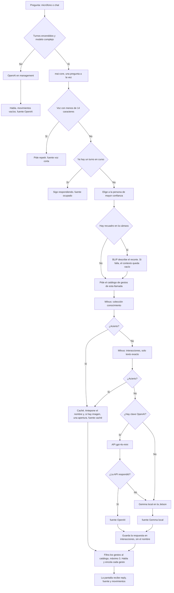

## ⚙️ Configuración Inicial

### 1. Configurar Submódulos

**Primera vez - Inicializar submódulos:**

```bash
git submodule update --init --recursive
```

**Actualizar referencias a los submódulos:**

```bash
git submodule update --remote
```

### 2. Turno de interacción (mai-core, contexto y acción)

El chat web y la voz pasan por mai-core. BLIP describe la escena; Milvus y Gemma (o OpenAI, si hay clave) responden; robótica habla y ejecuta el gesto.

```bash
cp .env.template .env
mkdir -p data/milvus
sudo docker compose build pmai-core
sudo docker compose up
```

`PMAI_CORE_PYTHONPATH` en `.env` debe quedar así (ya viene en la plantilla):

```bash
PMAI_CORE_PYTHONPATH=/opt/model-context:/opt/action-model:/app/src
```

Antes del primer arranque:

- Si falta `pmai-model-vision-language/models/gguf/gemma-4-E2B-it-Q4_K_M.gguf`, mai-core lo descarga de Hugging Face al arrancar. Hace falta red esa primera vez.
- Clave OpenAI del turno: `PMAI_OPENAI_API_KEY` en el `.env` del lanzador (si va vacía, se reusa `MS_MANAGEMENT_OPENAI_API_KEY`). Compose la inyecta en `pmai-core` como `OPENAI_API_KEY`. Si sigue vacía, `pmai-model-vision-language/.env` es el respaldo. Con clave se usa `gpt-4o-mini`; si no hay clave o la API falla, Gemma.
- El catálogo del turno son las secuencias ingestadas (`id`, nombre, descripción) creadas en el estudio de movimiento. `ACTION_DESCRIPTIONS_PATH` sigue existiendo, pero el turno no usa esas frases.
- El estudio web corre en el puerto `MOTION_STUDIO_PORT` (4210). `/sequences` lo carga en un iframe. `./scripts/lan-up.sh` abre ese puerto en UFW junto con 3000 y 4200.
- Milvus Lite crea `conocimiento` e `interacciones` al arrancar mai-core. El archivo queda en `pmai-model-vision-language/utils/milvus/androide_milvus.db`.
- La única fuente de las preguntas de `conocimiento` es `pmai-model-vision-language/utils/webscraping/primera fase/preguntas_respuestas.json`. `./scripts/lan-up.sh` la carga en Milvus, igual que siembra los usuarios de Postgres. Es idempotente: no repite una pregunta que ya está. Para repetirla a mano: `./scripts/seed-conocimiento.sh`. La primera vez descarga el modelo de embeddings dentro de `pmai-core`.
- El primer inicio descarga BLIP y el modelo de embeddings, y carga Gemma. Tarda.


### 2. Variables de entorno

Si aún no existe `.env` en la raíz del repositorio, copie la plantilla:

```bash
cp .env.template .env
```


### 3. Inicio en red local (Ubuntu)

Comando principal para levantar el stack en LAN:

```bash
./scripts/lan-up.sh
```

En la Jetson (tras `source ~/.bashrc`) los mismos pasos son `rone-up`, `rone-down` y `rone-restart`.


| Comando        | Script                           | Qué hace                                                                                                                   |
| -------------- | -------------------------------- | -------------------------------------------------------------------------------------------------------------------------- |
| `rone-up`      | `./scripts/lan-up.sh`            | Detecta la IPv4 LAN, abre UFW si hay, levanta Compose, aplica migraciones, seed de Postgres y seed de Milvus, imprime URLs |
| `rone-down`    | `./scripts/lan-down.sh`          | Detiene el stack (`docker compose stop`). Los contenedores siguen creados                                                  |
| `rone-restart` | `./scripts/lan-restart.sh`       | `compose stop` y luego `compose start` (no recrea contenedores)                                                            |
| `rone-status`  | `./scripts/wifi-up.sh status`    | Muestra interfaces, ruta por defecto y las URLs para teléfonos                                                             |
| `rone-wifi`    | `./scripts/wifi-up.sh`           | `scan` / `join "SSID" "clave"` / `hotspot` y después arranca en esa red                                                    |
| `rone-bt`      | `./scripts/bt-up.sh`             | `scan` / `connect` / `disconnect` / `status` — parlante Bluetooth (Thinkplus-K3-pro)                                       |
| `rone-seed`    | `./scripts/seed-auth.sh`         | Reaplica migraciones y usuarios admin (idempotente)                                                                        |
| —              | `./scripts/seed-conocimiento.sh` | Carga `preguntas_respuestas.json` en Milvus `conocimiento` (idempotente). `lan-up` ya lo ejecuta                           |


Opcional: forzar la interfaz de red (por ejemplo Wi‑Fi):

```bash
LAN_IFACE=wlp2s0 ./scripts/lan-up.sh
```

Parlante Bluetooth (sin GUI; el audio de robótica sale por Pulse del host):

```bash
rone-bt scan
rone-bt connect                    # Thinkplus-K3-pro por defecto
rone-bt status
```

El script detecta la IPv4 de la LAN, abre reglas UFW TCP para el gateway (3000), la web (4200) y el Motion Studio (4210) cuando es posible, siembra Postgres y la colección `conocimiento`, ejecuta `docker compose up -d`, espera a que 4200 y 4210 respondan, imprime las URLs LAN (`http://<LAN_IP>:4200` y `http://<LAN_IP>:4210`) y abre el navegador en el frontend.

Tras actualizar el frontend (por ejemplo la dependencia `qrcode`), reconstruya el servicio web una vez para refrescar `node_modules` del contenedor:

```bash
docker compose up -d --build pmas-web-main
```

**Teléfonos y otros dispositivos:** use la URL impresa en consola o escanee **Código QR de red** después de iniciar sesión (en la primera visita al admin el modal aparece automáticamente; el menú de perfil puede reabrirlo).

### 4. Turno de interacción (mai-core, contexto y acción)

El chat web y el micrófono entran por `chatService.chat`. Si los turnos están apagados o el modelo es básico, management llama a OpenAI, habla y no mueve. Si los turnos están encendidos y el modelo es complejo, mai-core arma el turno. Ahí la memoria se consulta antes que cualquier modelo: primero `conocimiento` (lo sembrado desde `preguntas_respuestas.json`) y, si no hay acierto, `interacciones` (respuestas ya generadas, y solo si el texto coincide). Eso es el caché. Sin acierto, y si hay clave, responde la API de OpenAI. Si no hay clave o la API falla, responde Gemma en la Jetson. `declarePoema` no usa este camino: sigue en OpenAI y sí habla.


