# R-ONE: documentación integral

Semillero de investigación Prometeo · Facultad de Ingeniería · Universidad Libre, seccional Bogotá

Este documento explica R-ONE de principio a fin: qué es, cómo está construido, cómo viaja una pregunta desde que alguien la dice hasta que el robot responde y gesticula, cómo se despliega y qué historia de investigación hay detrás. Está pensado como el único material que necesita una persona que llega al proyecto, ya sea para operarlo, para evaluarlo o para seguir desarrollándolo.

Reemplaza a la memoria académica *Documentación del Proyecto: Inteligencia Artificial Multimodal y Robótica Autónoma*, que ahora vive como referencia histórica en `docs/project-docs/archivo/`. Todo su contenido está aquí: lo que sigue vigente se integra en el cuerpo del texto y lo que ya cambió se cuenta en la [Parte VI](#parte-vi-evolución-e-investigación). Cuando la memoria y el código no coinciden, este documento sigue al código, y la tabla [Versión documentada](#versión-documentada) dice exactamente qué versión de cada repositorio se leyó para escribirlo.

## Cómo leer este documento

No hace falta leerlo de corrido. Está organizado por capas: cada parte supone un poco más de contexto técnico que la anterior, de modo que cada lector puede detenerse donde ya tenga lo que necesita.

| Si eres… | Lee | Puedes saltarte |
|---|---|---|
| Visitante, directivo o evaluador | Parte I y Parte V | Partes II, III y anexos |
| Operador del robot en un evento | Parte I y Parte IV | Parte III |
| Desarrollador que se suma al equipo | Partes I, II y III, y los anexos | Parte V, si no tocas la interfaz |
| Investigador que retoma un modelo | Parte I y Parte VI, y la ficha del repositorio en la Parte III | Parte IV |

Algunas convenciones se repiten en todo el texto:

- Las rutas de archivo se escriben siempre desde la raíz del lanzador, por ejemplo `pmai-mai-core/settings.toml`. Así se pueden abrir directamente desde la carpeta `pba-launcher`.
- Los nombres que vienen del código (funciones, mensajes, variables) aparecen en `letra de código` y tal como están escritos en el programa, aunque mezclen inglés y español.
- Cuando algo no se pudo comprobar en el código, el texto lo dice con la fórmula "pendiente de confirmar" seguida del motivo. Ningún dato de este documento es una suposición presentada como hecho.
- Los diagramas están dibujados en Mermaid dentro del propio archivo, por lo que GitHub, GitLab o el editor los muestran sin herramientas adicionales. Las figuras con imagen vienen de la memoria académica y están en `docs/project-docs/assets/`.

## Versión documentada

| Repositorio | Rama | Commit | Fecha |
|---|---|---|---|
| `pba-launcher` | main | `28900f3` | 2026-11-05 |
| `pmas-web-main` | dev | `8e3c3fb` | 2026-10-27 |
| `pba-ms-gateway` | dev | `3f38ec9` | 2026-10-19 |
| `pba-ms-auth` | dev | `4c4802a` | 2026-10-14 |
| `pba-ms-management` | dev | `d70503c` | 2026-10-27 |
| `pba-ms-robotics` | dev | `05a6e16` | 2026-10-27 |
| `pmai-mai-core` | dev | `e0452ed` | 2026-10-27 |
| `pmai-model-context` | dev | `400ec0d` | 2026-10-09 |
| `pmai-model-vision-language` | dev | `b9042c9` | 2026-10-31 |
| `pmai-model-vision` | dev | `5bbccd6` | 2026-08-27 |
| `pmas-web-motion-studio` | dev | `259451a` | 2026-10-17 |
| `pba-arduino-codes` | dev | `2e9454f` | 2026-04-14 |

## Tabla de contenido

<!-- toc:inicio -->
- [Cómo leer este documento](#cómo-leer-este-documento)
- [Versión documentada](#versión-documentada)
- [Parte I. Entender R-ONE](#parte-i-entender-r-one)
  - [1. Qué es R-ONE y por qué existe](#1-qué-es-r-one-y-por-qué-existe)
  - [2. El sistema en una página](#2-el-sistema-en-una-página)
  - [3. Recorrido de una pregunta](#3-recorrido-de-una-pregunta)
  - [4. Conceptos clave](#4-conceptos-clave)
- [Parte II. Arquitectura y flujos](#parte-ii-arquitectura-y-flujos)
  - [5. Mapa de servicios](#5-mapa-de-servicios)
  - [6. Flujos](#6-flujos)
  - [7. Datos y persistencia](#7-datos-y-persistencia)
- [Parte III. Repositorios](#parte-iii-repositorios)
  - [8. Cómo leer una ficha](#8-cómo-leer-una-ficha)
  - [9. pba-launcher](#9-pba-launcher)
  - [10. pmas-web-main](#10-pmas-web-main)
  - [11. pba-ms-gateway](#11-pba-ms-gateway)
  - [12. pba-ms-auth](#12-pba-ms-auth)
  - [13. pba-ms-management](#13-pba-ms-management)
  - [14. pba-ms-robotics](#14-pba-ms-robotics)
  - [15. pmai-mai-core](#15-pmai-mai-core)
  - [16. pmai-model-context](#16-pmai-model-context)
  - [17. pmai-model-vision-language](#17-pmai-model-vision-language)
  - [18. pmai-model-vision](#18-pmai-model-vision)
  - [19. pmas-web-motion-studio](#19-pmas-web-motion-studio)
  - [20. pba-arduino-codes](#20-pba-arduino-codes)
- [Parte IV. Despliegue y operación](#parte-iv-despliegue-y-operación)
  - [21. Requisitos y configuración](#21-requisitos-y-configuración)
  - [22. Arranque local y en red local](#22-arranque-local-y-en-red-local)
  - [23. La Jetson Orin Nano](#23-la-jetson-orin-nano)
  - [24. Solución de problemas](#24-solución-de-problemas)
- [Parte V. Producto e identidad visual](#parte-v-producto-e-identidad-visual)
  - [25. Para quién es la interfaz](#25-para-quién-es-la-interfaz)
  - [26. Principios y voz](#26-principios-y-voz)
  - [27. Paleta, tipografía y accesibilidad](#27-paleta-tipografía-y-accesibilidad)
- [Parte VI. Evolución e investigación](#parte-vi-evolución-e-investigación)
  - [28. Stakeholders e hitos](#28-stakeholders-e-hitos)
  - [29. El detector de objetos](#29-el-detector-de-objetos)
  - [30. El modelo contextual](#30-el-modelo-contextual)
  - [31. El modelo de acción](#31-el-modelo-de-acción)
  - [32. La primera interfaz y las decisiones descartadas](#32-la-primera-interfaz-y-las-decisiones-descartadas)
- [Anexos](#anexos)
  - [Anexo A. Glosario](#anexo-a-glosario)
  - [Anexo B. Variables de entorno](#anexo-b-variables-de-entorno)
  - [Anexo C. Patrones NATS](#anexo-c-patrones-nats)
  - [Anexo D. Endpoints HTTP del gateway](#anexo-d-endpoints-http-del-gateway)
  - [Anexo E. Índice de figuras y diagramas](#anexo-e-índice-de-figuras-y-diagramas)
<!-- toc:fin -->

## Parte I. Entender R-ONE

> Esta parte es para cualquier lector. No supone conocimientos de programación: explica qué es R-ONE, qué hace hoy y cómo recorre una pregunta, y cierra con los conceptos técnicos que el resto del documento usa, cada uno con un ejemplo cotidiano.

### 1. Qué es R-ONE y por qué existe

#### 1.1 El semillero Prometeo

R-ONE es un androide de tamaño humano construido por el semillero de investigación Prometeo, de la Facultad de Ingeniería de Sistemas de la Universidad Libre, sede El Bosque, en Bogotá. Su cuerpo parte del diseño abierto InMoov (de ahí el nombre del firmware, `Inmoov_control2.ino`): una cabeza con ojos, párpados y cejas móviles, un cuello, un torso y brazos con manos, todos movidos por servomotores. A ese cuerpo el semillero le añadió cámaras, un micrófono, un parlante y un miniPC que corre todo el software.

El proyecto nació con una idea sencilla: acercar a toda la comunidad de la universidad a los robots humanoides y, de paso, automatizar tareas repetitivas como orientar a un visitante o contestar preguntas generales sobre la institución. Con el tiempo se convirtió también en un ecosistema de software propio del semillero, con una aplicación web para administrarlo y un estudio para diseñar sus movimientos.

La memoria académica que este documento reemplaza la firmaron Johel Arias, Andrea López, Anyi Becerra, Daniela Fierro y Evelin Sánchez. Además de ellos, el semillero tiene más integrantes; de hecho, las 25 personas que el detector de rostros sabe reconocer son miembros del semillero (ver [29.3](#293-análisis-del-dataset)).

#### 1.2 Objetivos del proyecto

El objetivo general, tal como lo formuló la memoria, era diseñar e implementar un sistema de inteligencia artificial multimodal capaz de interactuar en tiempo real con personas reconocibles, construir la arquitectura de servidores que ejecuta los movimientos del androide e integrar las aplicaciones del semillero en un mismo ecosistema.

Ese objetivo se desglosó en objetivos específicos. La tabla los resume y, a la derecha, dice en qué punto están según el código de noviembre de 2026.

| Objetivo específico | Estado actual |
|---|---|
| Reidentificación multicámara: dar un identificador global único a cada persona aunque pase de una cámara a otra | Implementado en `pmai-mai-core` con OSNet; ver [4.4](#44-detección-seguimiento-y-reidentificación) |
| Usar un modelo preentrenado que convierta lo que se ve en lenguaje natural | Implementado con BLIP base en `pmai-model-context` |
| Integrar un modelo visión-lenguaje compacto que interprete ese contexto | Cumplido de otra manera: en lugar de un modelo visión-lenguaje, un modelo de lenguaje (OpenAI o Gemma local) recibe la descripción de BLIP |
| Motor de decisión que traduzca la interpretación en acciones | Implementado: el modelo elige hasta tres gestos del catálogo vivo de robótica |
| Interacción verbal por síntesis de voz | Implementado en `pba-ms-robotics` (OpenAI TTS, Piper o eSpeak) |
| Arquitectura de servidores para mover el hardware por Arduino | Implementado en `pba-ms-robotics` y el firmware `pba-arduino-codes` |
| Integrar el sistema inteligente con esa arquitectura | Implementado mediante NATS; ver [6.3](#63-chat-por-la-ruta-complejo-el-turno) |
| Sistema web de gestión y administración del semillero y del robot | Implementado en `pmas-web-main`, con el estudio `pmas-web-motion-studio` incrustado |
| Entrenamiento automático del detector a partir de la aplicación móvil | Pendiente: no existe aplicación móvil en el lanzador y el detector se entrena a mano en `pmai-model-vision` |

#### 1.3 Qué puede hacer R-ONE hoy

Dicho en una frase, R-ONE ve, reconoce, escucha, responde con voz y puede gesticular. A continuación se detalla cada capacidad con la precisión que el resto del documento sostiene.

R-ONE **ve** con una o varias cámaras USB conectadas al miniPC. En cada cuadro busca rostros con un detector entrenado por el semillero y, cuando reconoce a alguien, lo sigue dentro de esa cámara y le asigna una identidad global que se mantiene aunque la persona aparezca en otra cámara. Desde la interfaz web cualquier operador ve en vivo lo que ven las cámaras, con un recuadro y el nombre de cada persona.

R-ONE **escucha** de forma continua por un micrófono. No reacciona a cualquier ruido: espera a oír su nombre de activación, "Fede" (también acepta "hey fede" y "federico"), y entonces graba la frase completa hasta que la persona deja de hablar. Mientras piensa la respuesta dice una frase corta del tipo "Déjame pensarla un momentico", para que el silencio no parezca un fallo.

R-ONE **responde** combinando tres fuentes. Primero busca en su memoria (una base de datos de preguntas y respuestas sobre la universidad); si no encuentra nada parecido, le pregunta a un modelo de lenguaje en la nube (OpenAI) y, si no hay internet o clave, a un modelo que corre en el propio miniPC (Gemma). La respuesta se personaliza: si sabe quién pregunta, lo llama por su nombre, y si la cámara ve algo útil (por ejemplo, un grupo de personas), lo menciona.

R-ONE **habla** por un parlante, que puede ser Bluetooth, con una voz sintética. También puede **gesticular**: tiene un catálogo de secuencias de movimiento (un saludo, un guiño, un gesto de sorpresa) creadas por el equipo en un estudio web, y el modelo puede elegir hasta tres para acompañar la respuesta.

Por último, la **aplicación web** permite iniciar sesión, administrar usuarios, ver las cámaras, conversar con el robot por chat, lanzar gestos a mano, crear secuencias y decidir si el chat usa la ruta sencilla o la ruta completa con visión y gestos (ver [6.2](#62-chat-por-la-ruta-básico) y [6.3](#63-chat-por-la-ruta-complejo-el-turno)).

Hay, sin embargo, una salvedad importante sobre el estado de noviembre de 2026. Las 31 secuencias que hay hoy en robótica no tienen descripción, y robótica solo ofrece al modelo las secuencias con una descripción de al menos diez caracteres (`pba-ms-robotics/src/sequence/ingest.py:54`). En consecuencia, el catálogo que recibe el modelo está vacío y, aunque la arquitectura completa funciona, el robot responde sin mover el cuerpo en el turno. Los gestos sí se pueden lanzar a mano desde la interfaz. La [sección 24](#24-solución-de-problemas) explica cómo corregirlo guardando de nuevo cada secuencia con su descripción desde el estudio.

### 2. El sistema en una página

El diagrama siguiente resume R-ONE en cuatro bloques. A la izquierda está la **percepción**: las cámaras y el micrófono. En el centro, el **núcleo** (`pmai-core`), que es el proceso que interpreta lo que llega y arma cada respuesta. Arriba a la derecha, los **servicios** de apoyo: la puerta de entrada de la web, la autenticación, la gestión del chat, la robótica y las dos piezas de infraestructura que los conectan, una base de datos Postgres y un servidor de mensajes NATS. Abajo a la derecha, lo que la gente ve y oye: el **cuerpo** (Arduino y servos), el **parlante** y las **interfaces web**.

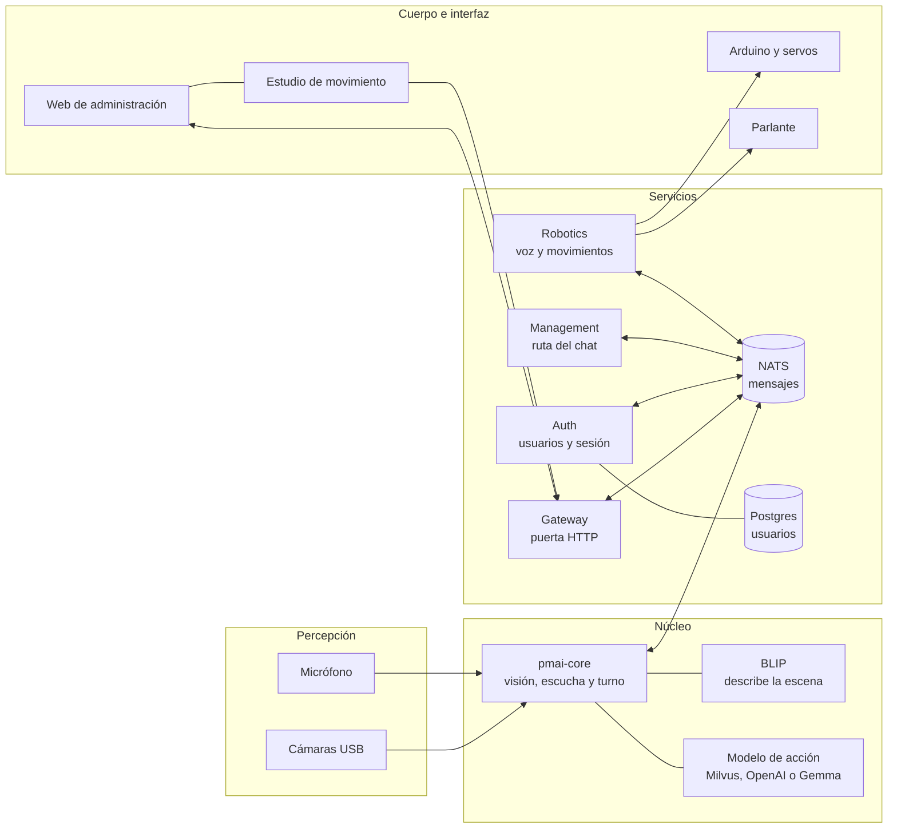

Leído de izquierda a derecha, el recorrido es el siguiente. Las cámaras alimentan continuamente al núcleo, que reconoce a las personas y guarda la última imagen de cada cámara. El micrófono también entrega audio al núcleo, que detecta el nombre de activación y transcribe la pregunta. A partir de ahí, la pregunta no va directa al modelo: pasa primero por el servicio de gestión (management), que decide si se responde por la ruta sencilla o por la ruta completa. En la ruta completa, el núcleo junta todo lo que sabe de la escena, le pide a BLIP una descripción de la persona, consulta el catálogo de gestos en robótica y le pasa todo al modelo de acción. La respuesta vuelve a robótica, que la dice por el parlante y ejecuta los gestos en el Arduino.

Ningún servicio llama directamente a otro. Todos se hablan a través de NATS, que funciona como una central de mensajes (ver [4.2](#42-nats-y-los-patrones-de-mensaje)). La única excepción es la web, que habla por HTTP con el gateway, y este traduce cada petición a un mensaje NATS. Por eso el gateway es la única puerta que el navegador conoce.

La memoria académica incluía un diagrama equivalente, que sigue siendo correcto en lo esencial:

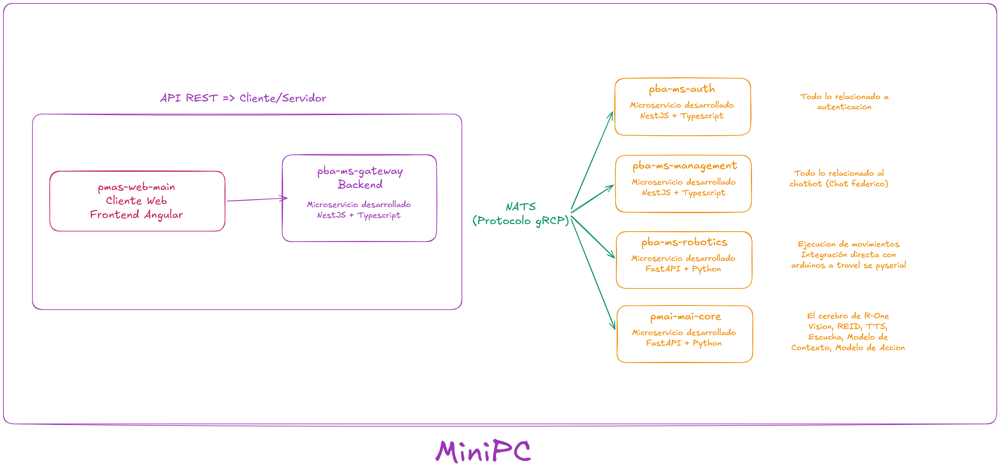

*Figura 1. Arquitectura de alto nivel de R-ONE: la web habla con el gateway y este con cuatro microservicios por NATS, todo dentro del miniPC. Fuente: memoria académica 2026.*

Dos detalles de esa figura ya no se ajustan al código. NATS no usa gRPC, como dice su rótulo: es un protocolo propio en el que los servicios intercambian mensajes JSON. Además, `pmai-mai-core` no es una aplicación FastAPI: no abre ningún puerto HTTP y solo se comunica por NATS (ver la [ficha 15](#15-pmai-mai-core)). La figura tampoco muestra Postgres, el estudio de movimiento ni el Arduino, que sí aparecen en el diagrama de arriba.

### 3. Recorrido de una pregunta

La mejor manera de entender R-ONE es seguir una pregunta de principio a fin. El ejemplo que sigue usa nombres y valores reales del código. Lo único inventado es la situación.

Andrea López, integrante del semillero, se acerca al robot durante una feria y dice: "Fede, ¿qué es la Universidad Libre?".

**La cámara ya la había visto.** Mucho antes de que hablara, la cámara del robot la estaba enviando al núcleo a unos quince cuadros por segundo. Cada tres cuartos de segundo, el núcleo toma el cuadro más reciente de cada cámara y se lo pasa al detector de rostros, un modelo YOLO entrenado por el semillero con fotos de sus integrantes. El detector encierra la cara de Andrea en un recuadro y la etiqueta como `Andrea Lopez` con una confianza de 0,91. Un seguidor sencillo comprueba que ese recuadro se solapa con el del cuadro anterior y concluye que es la misma persona. Cada cinco cuadros, además, un segundo modelo (OSNet) calcula una "huella" numérica de su aspecto y la compara con las que ya conoce; como no la había visto antes, le asigna una identidad global nueva, del estilo `gid_3f9a1c2e`. Si Andrea se moviera frente a otra cámara, esa misma huella permitiría reconocerla como la misma persona.

**El micrófono la oye.** El micrófono también está siempre encendido, pero el núcleo no transcribe todo lo que oye. Primero filtra por volumen, para no gastar cálculo en el silencio, y luego pasa el audio a un reconocedor de voz (Vosk) que solo sabe distinguir las palabras de activación. Cuando oye "Fede", abre un segundo reconocedor, este sí de vocabulario libre, y empieza a grabar. Un detector de actividad de voz decide que Andrea terminó cuando lleva 1,6 segundos en silencio. El resultado es el texto "fede qué es la universidad libre".

**El robot avisa que está pensando.** Como la frase tiene más de catorce caracteres, el núcleo le pide a robótica que diga una frase de espera, por ejemplo "Déjame pensarla un momentico.", y envía la pregunta al servicio de gestión mediante el mensaje `MANAGEMENT_MS.chatService.chat`.

**Gestión elige la ruta.** El servicio de gestión lee un pequeño archivo de configuración (`pba-ms-management/data/chat-route.json`) donde el operador dejó guardada la elección del chat. Ese día están activados los turnos y el modelo elegido es "complejo", así que gestión no responde por su cuenta: reenvía la pregunta al núcleo con el mensaje `MAI_CORE_MS.interactionService.ask`.

**El núcleo arma el turno.** Lo primero que hace el núcleo es asegurarse de que no hay otro turno en curso: atiende una pregunta a la vez. Después elige a la persona de la escena con mayor confianza, que es Andrea. Toma el último cuadro de la cámara que la ve, recorta su recuadro, lo guarda como imagen JPEG y se lo pasa a BLIP, un modelo que describe imágenes. BLIP responde en inglés algo como "a woman with glasses standing in front of a robot". A continuación, el núcleo le pide a robótica el catálogo de gestos disponibles (`ROBOTICS_MS.actionService.getActions`).

**El modelo de acción busca primero en su memoria.** Con todo eso, el núcleo llama a la función `responder()` de `pmai-model-vision-language/utils/main.py`. Esta convierte la pregunta en un vector de 384 números que representa su significado y lo busca en Milvus, una base de datos de vectores. En la colección `conocimiento` hay 244 preguntas sobre la universidad cargadas por el semillero y una de ellas se parece mucho: la distancia entre ambas es menor que el umbral de 0,35, así que cuenta como acierto. Como la respuesta viene de la memoria, no se llama a ningún modelo de lenguaje y la respuesta tarda milisegundos.

**La respuesta se personaliza.** Antes de devolverla, `responder()` antepone el nombre de Andrea y, si la descripción de BLIP se parece a alguna situación conocida (por ejemplo, alguien que parece buscar orientación), añade una frase de apertura. El resultado se parece a "Andrea, la Universidad Libre es una institución de educación superior colombiana fundada en 1923…". Si la respuesta guardada trae gestos, solo se conservan los que estén en el catálogo que robótica entregó en esta misma llamada, con un máximo de tres.

**El robot habla y gesticula.** El núcleo le pide a robótica que diga la respuesta (`ROBOTICS_MS.voiceService.speak`) y, mientras habla, le pide ejecutar cada gesto (`ROBOTICS_MS.actionService.executeAction`). Robótica sintetiza la voz y la envía al parlante. Por cada gesto, encola cuatro pasos: el movimiento, un segundo de espera, el regreso a la postura de descanso (el "neutro") y otro segundo de espera. El núcleo no espera a que los gestos terminen.

**La pantalla registra la respuesta.** Si en lugar de hablar Andrea hubiera escrito la pregunta en el chat de la web, el navegador habría recibido `{ reply, fuente, movimientos }`. En este caso, `fuente` valdría `caché`, porque la respuesta salió de la memoria, y `movimientos` listaría los gestos ejecutados.

El recorrido completo cabe en este diagrama, que la [sección 6.3](#63-chat-por-la-ruta-complejo-el-turno) vuelve a dibujar con todos sus detalles técnicos.

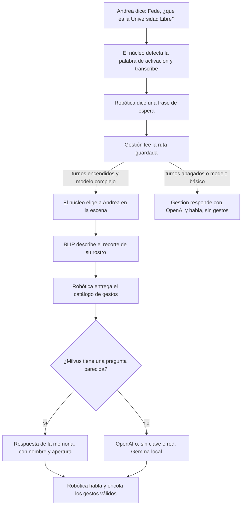

Dos variaciones ayudan a fijar la idea. Si Andrea hubiera preguntado algo que nadie había preguntado antes, como "¿qué opinas del clima de hoy?", Milvus no habría encontrado nada parecido. En ese caso, `responder()` construye un prompt con su nombre, la descripción de BLIP, la pregunta y la tabla de gestos, y se lo envía a OpenAI (`gpt-4o-mini`); si no hay clave o la llamada falla, lo resuelve Gemma en el miniPC. La respuesta nueva se guarda en la colección `interacciones`, sin el nombre de Andrea, para que la próxima vez que alguien pregunte exactamente lo mismo salga de la memoria. Si, en cambio, el operador hubiera dejado el chat en la ruta "básico", gestión le habría preguntado directamente a OpenAI, habría pedido a robótica que dijera la respuesta y el robot no habría usado ni la cámara ni los gestos.

### 4. Conceptos clave

#### 4.1 Microservicios y gateway

Un **microservicio** es un programa pequeño que se encarga de una sola responsabilidad y se comunica con los demás a través de la red, en lugar de vivir todo dentro de una sola aplicación. Se parece a un restaurante con estaciones: la cocina, la barra y la caja son equipos distintos que se pasan comandas; si la barra se satura, la cocina sigue funcionando, y se puede cambiar al cajero sin cerrar el restaurante.

R-ONE tiene siete servicios propios, además de la base de datos y el servidor de mensajes. Cada uno vive en su propio repositorio y en su propio contenedor Docker: `pba-ms-auth` se ocupa de usuarios y sesiones; `pba-ms-management`, del chat; `pba-ms-robotics`, de la voz y el cuerpo; `pmai-mai-core`, de la percepción y el turno; `pmas-web-main`, de la interfaz; `pmas-web-motion-studio`, del estudio de movimientos; y `pba-ms-gateway`, de la puerta de entrada que se describe a continuación. La ventaja práctica es que cada equipo del semillero puede trabajar en su pieza sin romper las demás, y que un fallo en el reconocimiento de voz no tumba el inicio de sesión.

El **gateway** (`pba-ms-gateway`) es la recepción del edificio. El navegador no conoce las direcciones internas de los servicios y tampoco debería: toda petición HTTP entra por el gateway, que comprueba la sesión y los permisos, la traduce a un mensaje y la envía al servicio que corresponde. De ese modo, la seguridad se revisa en un solo lugar.

En R-ONE: el gateway escucha en el puerto 3000 y su punto de entrada es `pba-ms-gateway/src/main.ts`. La lista completa de rutas está en el [Anexo D](#anexo-d-endpoints-http-del-gateway). Para profundizar en el patrón, la documentación de NestJS sobre [microservicios](https://docs.nestjs.com/microservices/basics) explica exactamente el modelo que usan el gateway, auth y management.

#### 4.2 NATS y los patrones de mensaje

**NATS** es un servidor de mensajería: un programa por el que pasan todos los mensajes entre servicios. Funciona como un conmutador telefónico de oficina. Cada servicio se registra con unas "extensiones", que en NATS se llaman *sujetos*, y quien quiere algo marca la extensión sin saber en qué computador vive el otro servicio. Si nadie contesta, el que llama recibe un error al agotarse el tiempo de espera.

Los sujetos de R-ONE siguen la convención de NestJS, `SERVICIO.servicioInterno.método`. Por ejemplo, `ROBOTICS_MS.voiceService.speak` es "la función `speak` del servicio de voz de robótica". Casi todas las llamadas son de tipo **petición-respuesta**: quien llama envía `{ pattern, data, id }` y espera una respuesta `{ response, isDisposed }`, o `{ err }` si algo salió mal. El núcleo también publica **eventos** sin esperar respuesta (`pmai.detection` y `pmai.reid`), aunque hoy ningún servicio se suscribe a ellos.

La ventaja frente a que cada servicio llame a los demás por HTTP es que NATS desacopla a quien llama de quien responde. Por eso un servicio en Python (robótica o el núcleo) puede atender a uno en TypeScript (el gateway) sin que ninguno sepa en qué lenguaje está escrito el otro. Basta con que ambos respeten la forma del mensaje.

En R-ONE: el servidor es el contenedor `nats-server` (imagen `nats:2.12.5-alpine3.22`), escucha en el puerto 4222 dentro de la red de Docker y publica su monitor en el 8222. Los servicios Python imitan el formato de NestJS en `pba-ms-robotics/src/core/nats/nest_request.py` y `pmai-mai-core/src/pmai_core/core/nats/nats_client.py`. El catálogo completo de sujetos está en el [Anexo C](#anexo-c-patrones-nats). Referencia externa: [documentación de NATS](https://docs.nats.io/nats-concepts/core-nats/reqreply).

#### 4.3 Sesión y JWT

Para usar la web hay que iniciar sesión. Cuando el usuario y la contraseña son correctos, el servidor entrega un **JWT** (JSON Web Token): un texto firmado que dice quién es el usuario y qué roles tiene. Es como la manilla de un evento: en la entrada verifican la identidad una vez y, a partir de ahí, basta con mostrar la manilla en cada puerta, sin volver a enseñar la cédula. La firma impide falsificarla, porque solo el servidor conoce la clave con la que se firmó.

En R-ONE el token tiene dos particularidades que conviene conocer. La primera es que cada usuario tiene una sola sesión activa: iniciar sesión en un teléfono cierra la que estuviera abierta en el portátil, que entonces muestra "Tu sesión venció. Entra de nuevo.". La segunda es que, además del token, cada petición lleva la cabecera `X-Active-Role` con el identificador del rol con el que se está trabajando (ADMIN o USER), porque un usuario puede tener varios.

En R-ONE: el token lo emite `pba-ms-auth` y lo valida el gateway con su estrategia JWT en `pba-ms-gateway/src/auth/strategies`; la web lo guarda y lo adjunta en su interceptor de `pmas-web-main/src/app/core/interceptors`. El flujo completo está en [6.1](#61-inicio-de-sesión). Referencia externa: [introducción a JWT](https://jwt.io/introduction).

#### 4.4 Detección, seguimiento y reidentificación

Reconocer a alguien en video implica tres problemas distintos, que R-ONE resuelve con tres piezas.

La **detección** responde a la pregunta "¿qué hay en esta imagen y dónde?". Un detector mira un cuadro y devuelve recuadros con una etiqueta y una confianza. El de R-ONE es un modelo YOLO entrenado por el semillero cuyas 25 etiquetas son los nombres de sus integrantes, así que no detecta "una persona" en general, sino "Andrea López" o "Johel Arias". Si nadie supera una confianza de 0,5, no hay detección.

El **seguimiento** responde a "¿esta persona es la misma que estaba aquí hace un instante?". El seguidor compara cada recuadro nuevo con los del cuadro anterior en la misma cámara y, si se solapan lo suficiente, los une en una misma pista. Es lo que hacemos al seguir con la vista a alguien que camina: no necesitamos reconocerle la cara en cada paso.

La **reidentificación** (ReID) responde a "¿esta persona que aparece en la cámara 2 es la misma que vi en la cámara 1?". Para eso, un segundo modelo convierte la imagen de la persona en una huella numérica (512 valores, según la documentación del modelo) que resume su aspecto (ropa, colores, silueta). Dos huellas parecidas indican que se trata de la misma persona, aunque haya cambiado de cámara o de ángulo. Es lo que hace un portero que reconoce por la chaqueta a alguien que entró por otra puerta. Cada persona recibe así un `id_global`, como `gid_3f9a1c2e`, que se conserva mientras el núcleo esté encendido.

En R-ONE: el detector es `pmai-mai-core/src/pmai_core/models/my_model.pt` (YOLO11s), el seguidor está en `pmai-mai-core/src/pmai_core/resources/vision/tracker.py` y la reidentificación usa `pmai-mai-core/src/pmai_core/models/osnet_x0_25_msmt17.onnx`, con una similitud mínima de 0,6. Todo lo orquesta `pmai-mai-core/src/pmai_core/resources/identification/service.py`. Referencias externas: [Ultralytics YOLO](https://docs.ultralytics.com/) y [OSNet en torchreid](https://kaiyangzhou.github.io/deep-person-reid/).

#### 4.5 Descripción de escena

Saber que la persona es Andrea no dice nada de lo que está haciendo. Para eso R-ONE usa un modelo de **descripción de imágenes** (image captioning): recibe una foto y devuelve una frase que la describe. Funciona como un narrador para personas ciegas que, al ver la imagen, dice "una mujer con gafas de pie frente a un robot".

El modelo es BLIP en su versión base, publicado por Salesforce. Escribe en inglés, y eso no es un problema: la frase no se le muestra a nadie, sino que se entrega como contexto al modelo de lenguaje, que la interpreta y responde en español. Como BLIP a veces inventa detalles (por ejemplo, menciona un lugar o una fecha que no aparecen en la imagen), el semillero añadió filtros que eliminan esas alucinaciones típicas; su historia se cuenta en [30.4](#304-alucinaciones-y-palabras-protegidas).

En R-ONE: el núcleo recorta el recuadro de la persona elegida como JPEG de calidad 85 y llama a `generate_context_from_base64` de `pmai-model-context/model_context/context.py`. Si BLIP falla, el turno sigue sin contexto visual. Referencia externa: [BLIP en Hugging Face](https://huggingface.co/Salesforce/blip-image-captioning-base).

#### 4.6 Embeddings y búsqueda vectorial

Un **embedding** es una lista de números que representa el significado de un texto. El truco está en que textos con significados parecidos producen listas parecidas, aunque no compartan palabras. Se puede imaginar como unas coordenadas en un mapa de significados: "¿dónde queda la universidad?" y "¿en qué parte está la U?" caen muy cerca, mientras que "¿qué es un gato?" cae lejos.

R-ONE usa el modelo `paraphrase-multilingual-MiniLM-L12-v2`, que entiende español y convierte cada pregunta en 384 números. Comparar dos preguntas se reduce entonces a medir el ángulo entre sus vectores (distancia coseno): cuanto más pequeño, más se parecen. Una **base de datos vectorial** es una base de datos optimizada para responder rápido "¿cuál es el vector guardado más cercano a este?", incluso con millones de registros. R-ONE usa Milvus Lite, la versión de Milvus que corre dentro del propio proceso y guarda todo en un archivo, sin servidor aparte.

En R-ONE: el codificador está en `pmai-model-vision-language/utils/encoder/encoder.py`, la búsqueda en `pmai-model-vision-language/utils/milvus/busqueda.py` y la base en `pmai-model-vision-language/utils/milvus/androide_milvus.db`. Las colecciones y sus umbrales se detallan en [7.2](#72-milvus-lite). Referencias externas: [Sentence Transformers](https://www.sbert.net/) y [Milvus Lite](https://milvus.io/docs/milvus_lite.md).

#### 4.7 Caché semántico

Un caché guarda respuestas ya calculadas para no repetir el trabajo. Uno normal solo acierta si la pregunta es idéntica; uno **semántico** acierta si la pregunta *significa* lo mismo. Milvus funciona como un archivo que no busca por palabras exactas, sino por parecido de significado: si alguien ya preguntó "¿dónde queda la universidad?", la pregunta "¿en qué parte está la U?" encuentra esa respuesta sin llamar a ningún modelo.

R-ONE tiene dos memorias con reglas distintas, y la diferencia es deliberada. La colección `conocimiento` contiene preguntas y respuestas verificadas por el semillero, así que basta con que la pregunta nueva se parezca lo suficiente (distancia menor que 0,35, o 0,28 si la pregunta pide un dato concreto). La colección `interacciones`, en cambio, guarda respuestas que generó un modelo de lenguaje y que nadie revisó. Por eso solo se reutilizan si la pregunta coincide de forma estricta: igual al texto guardado, o contenida en él con al menos tres palabras. Así se evita que una respuesta improvisada se reparta a preguntas que solo se parecen.

El caché tiene dos beneficios visibles. Las respuestas de la memoria salen casi al instante, mientras que Gemma en el miniPC puede tardar varios segundos. Además, no gastan créditos de la API de OpenAI.

En R-ONE: `responder()` consulta primero `conocimiento` y luego `interacciones` (`pmai-model-vision-language/utils/main.py`); cuando acierta, la pantalla muestra `fuente: caché`. El paso a paso está en la [ficha 17](#17-pmai-model-vision-language).

#### 4.8 Modelo local frente a modelo en la nube

Cuando la memoria no tiene la respuesta, R-ONE necesita un **modelo de lenguaje** (LLM) que la redacte. Puede usar dos, y la elección es un equilibrio entre calidad y autonomía. Es como elegir entre llamar a un experto por teléfono o resolverlo con la calculadora de bolsillo: el experto sabe más, pero hace falta línea y cuesta; la calculadora siempre está ahí, aunque haga menos.

El modelo en la nube es `gpt-4o-mini` de OpenAI: responde bien y rápido, pero necesita una clave de API, conexión a internet y presupuesto. El modelo local es Gemma 4 E2B, de Google, en un archivo GGUF de unos 3 GB que corre en el procesador del miniPC con `llama-cpp-python`. No depende de nada externo, pero es más lento y menos preciso. R-ONE intenta primero OpenAI si tiene clave y, si la llamada falla por cualquier motivo (sin red, clave inválida o cuota agotada), cae a Gemma sin que el usuario lo note, más allá de la `fuente` que muestra la pantalla: `OpenAI` o `Gemma (local)`.

En R-ONE: el enrutador está en `pmai-model-vision-language/utils/gpt/gptapi.py` y Gemma en `pmai-model-vision-language/utils/gguf/ggufapi.py`. El archivo del modelo vive en `pmai-model-vision-language/models/gguf/` y se descarga solo, desde `unsloth/gemma-4-E2B-it-GGUF`, la primera vez que hace falta. Referencias externas: [llama.cpp](https://github.com/ggml-org/llama.cpp) y [Gemma](https://ai.google.dev/gemma).

#### 4.9 Secuencias, bloques y el par normal y neutro

Un gesto de R-ONE es una **secuencia**: una partitura de movimientos para varios servos a lo largo del tiempo. Cada nota de esa partitura es un **bloque**, que dice "en el segundo 0,4, lleva el servo 3 de la placa 2 a tal posición, a tal velocidad". Las secuencias se diseñan en el estudio de movimiento grabando posiciones del robot real y quedan guardadas como archivos JSON en robótica, con un número de identificación (`id`), un nombre, una categoría y una descripción.

Cada secuencia viene en **par**: la versión normal (los `blocks`) y su versión neutra (los `blocks_neutro`), que devuelve cada servo a la postura de descanso. Es como hacer un saludo y luego bajar el brazo: si el robot encadenara gestos sin volver al neutro, cada uno empezaría desde la posición en que dejó el anterior y el resultado sería impredecible. Por eso robótica ejecuta siempre normal, espera un segundo, ejecuta el neutro y espera otro segundo.

Para que el modelo de lenguaje pueda elegir un gesto, este tiene que estar en el **catálogo** que robótica entrega en cada turno. Solo entran los pares completos (categoría, normal y neutro) que además tienen una descripción de al menos diez caracteres, porque la descripción es lo que el modelo lee para decidir si el gesto encaja con la respuesta. Un id que no esté en el catálogo de esa llamada se descarta, aunque el modelo lo pida.

En R-ONE: las secuencias viven en `pba-ms-robotics/data/sequences`, la cola de ejecución en `pba-ms-robotics/src/sequence/playback_queue.py` y el filtro del catálogo en `pba-ms-robotics/src/sequence/ingest.py`. El ciclo completo de un gesto está en [6.5](#65-ciclo-de-un-gesto).

## Parte II. Arquitectura y flujos

> Esta parte es para desarrolladores y para operadores que quieran entender qué pasa por dentro. Supone que se leyeron los conceptos de la [sección 4](#4-conceptos-clave). Primero muestra el mapa de servicios, luego recorre cada flujo con un diagrama de secuencia que usa los nombres reales de los mensajes y, por último, describe dónde se guarda cada dato. Las fichas de la [Parte III](#parte-iii-repositorios) bajan al detalle de cada repositorio.

### 5. Mapa de servicios

#### 5.1 Servicios y puertos

Todo R-ONE se levanta con un único archivo de Docker Compose, `docker-compose.yml`, en la raíz del lanzador. Define nueve servicios: siete son repositorios del semillero y dos son piezas de infraestructura tomadas tal cual (Postgres y NATS). Los puertos salen de `.env.template`, y conviene no cambiarlos porque la web tiene fijos el 3000 y el 4210 (ver la [ficha 10](#10-pmas-web-main)).

| Servicio de Compose | Repositorio | Tecnología | Puerto publicado | Depuración | Depende de |
|---|---|---|---|---|---|
| `db` | imagen `postgres:17.1-alpine` | PostgreSQL 17 | 5432 | — | — |
| `nats-server` | imagen `nats:2.12.5-alpine3.22` | NATS | 8222 (monitor) | — | — |
| `pba-ms-gateway` | `pba-ms-gateway` | NestJS | 3000 (`MS_GATEWAY_PORT`) | 9230 | `db` sano, `nats-server` |
| `pba-ms-auth` | `pba-ms-auth` | NestJS | 3001 (`MS_AUTH_PORT`), sin servidor HTTP | 9231 | `db` sano, `nats-server` |
| `pba-ms-management` | `pba-ms-management` | NestJS | 3002 (`MS_MANAGEMENT_PORT`), sin servidor HTTP | 9232 | — |
| `pba-ms-robotics` | `pba-ms-robotics` | Python, FastAPI y Uvicorn | 3003 (`MS_ROBOTICS_PORT`), sin rutas de negocio | 9233 | — |
| `pmas-web-main` | `pmas-web-main` | Angular | 4200 (`WEB_MAIN_PORT`) | — | — |
| `pmas-web-motion-studio` | `pmas-web-motion-studio` | Python, FastAPI | 4210 (`MOTION_STUDIO_PORT`) | — | — |
| `pmai-core` | `pmai-mai-core` (con `pmai-model-context` y `pmai-model-vision-language` montados) | Python 3.12 | 3004 (`PMAI_CORE_PORT`), sin servidor | — | `nats-server` |

La tabla tiene varias rarezas que conviene explicar, porque desconciertan a quien llega. Tres servicios publican un puerto en el que nadie escucha: auth y management son microservicios NestJS que solo atienden NATS, y el núcleo no abre ningún servidor. Esos puertos quedaron de una versión anterior y no hacen daño, pero tampoco sirven para nada. Robótica, en cambio, sí arranca un servidor web con Uvicorn, aunque no monta ninguna ruta de negocio; todo su trabajo entra por NATS. En la práctica, los únicos puertos que un navegador usa son el 4200 (la web), el 3000 (el gateway) y el 4210 (el estudio).

El puerto de clientes de NATS, el 4222, no se publica en el anfitrión: solo existe dentro de la red privada de Docker, donde cada servicio lo encuentra como `nats://nats-server:4222`. Esto tiene una consecuencia de seguridad positiva, porque desde la red local nadie puede enviar mensajes directamente a robótica o al núcleo saltándose el gateway.

Por último, solo el gateway y auth declaran dependencias en Compose. El orden en que arranca el resto lo impone el script `scripts/lan-up.sh`, que se describe en la [sección 22](#22-arranque-local-y-en-red-local).

#### 5.2 Canales de comunicación

El diagrama muestra cada canal real entre servicios, con el protocolo en la flecha.

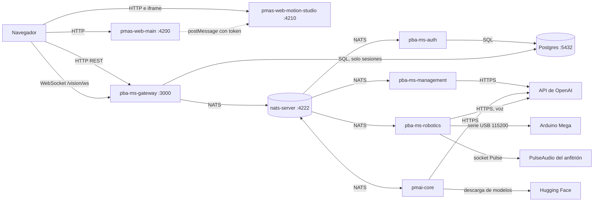

El navegador habla con tres servidores. Carga la aplicación Angular desde el 4200, carga el estudio desde el 4210 dentro de un `iframe` y hace todas las peticiones de datos al gateway en el 3000, por HTTP para lo normal y por WebSocket para el video. El estudio no inicia sesión por su cuenta: la web le pasa el token con `postMessage` (mensajes `prometeo-auth` y `prometeo-auth-request`) y, desde ahí, el estudio llama al mismo gateway.

Detrás del gateway todo es NATS. Gateway, auth y management son NestJS y usan el transporte NATS de NestJS tal cual. Robótica y el núcleo son Python y no tienen NestJS, así que reproducen a mano el formato de sobre que NestJS espera. Cuando el gateway envía `ROBOTICS_MS.voiceService.speak`, publica en ese sujeto un JSON `{ "pattern": "ROBOTICS_MS.voiceService.speak", "data": { "message": "Hola" }, "id": "…" }`. Robótica lo recibe en su suscriptor, llama al controlador con `data` y responde `{ "response": …, "isDisposed": true }`. La función que arma esas peticiones en Python es `nest_request` en `pba-ms-robotics/src/core/nats/nest_request.py`, y el núcleo tiene su equivalente en `pmai-mai-core/src/pmai_core/core/nats/nats_client.py`.

Hay tres salidas a internet. Management y el núcleo llaman a OpenAI para generar texto, robótica la llama para sintetizar voz y el núcleo descarga de Hugging Face los modelos que no encuentra en disco. Las tres son opcionales: sin internet, el sistema responde con Gemma, habla con Piper o eSpeak y usa los modelos ya descargados.

Hacia el mundo físico, robótica escribe en el puerto serie del Arduino (115200 baudios) y reproduce el audio a través del servidor PulseAudio del anfitrión, cuyo socket Compose monta dentro del contenedor. Por eso el parlante Bluetooth se empareja en el sistema operativo y no en Docker.

### 6. Flujos

#### 6.1 Inicio de sesión

Iniciar sesión involucra a la web, al gateway, a auth y a Postgres. El gateway nunca guarda contraseñas: delega la validación en auth y, desde ese momento, en cada petición comprueba que la sesión siga viva.

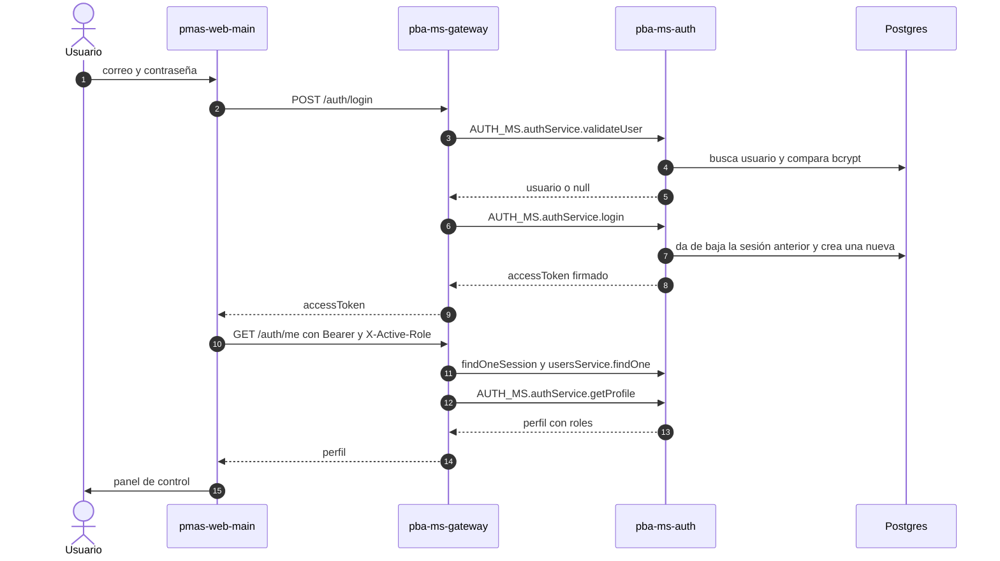

El orden importa por dos razones. Primero, el gateway usa dos estrategias de Passport: `LocalStrategy` comprueba usuario y contraseña con `AUTH_MS.authService.validateUser`, y solo si pasa se pide el token a `AUTH_MS.authService.login`. Segundo, auth firma el JWT con una duración tomada del ajuste `SESSION_EXPIRATION` (8 horas en la siembra) y, al crear la sesión, da de baja la anterior del mismo usuario. Esa es la razón de que haya una sola sesión por cuenta: si dos personas comparten usuario, la que entró primero queda fuera.

Después del login, cada petición protegida pasa por `JwtAuthGuard`, que valida la firma y además pregunta a auth si la sesión existe y sigue activa. Luego `RolesGuard` comprueba que el rol de la cabecera `X-Active-Role` esté asignado al usuario. Si un usuario tiene varios roles, la web le muestra un selector después del login.

Los errores se ven así en la pantalla. Una contraseña errada da 401 y "Credenciales incorrectas."; demasiados intentos bloquean la cuenta durante `LOCK_LOGIN_UNTIL` horas (0,25 en la siembra, es decir, quince minutos) después de `LOCK_LOGIN_ATTEMPTS` fallos (5). Una sesión vencida o dada de baja da 401 y la web vuelve al login con "Tu sesión venció. Entra de nuevo.". Hay un matiz: la web cierra la sesión ante cualquier 401 o 403, incluido un 403 por falta de permisos, de modo que un USER que intenta una acción de ADMIN también termina en el login.

#### 6.2 Chat por la ruta Básico

La ruta Básico es la más sencilla y no usa ni cámaras, ni memoria, ni gestos. Se activa cuando el operador apaga los turnos automáticos o elige el modelo "básico" en el selector del chat.

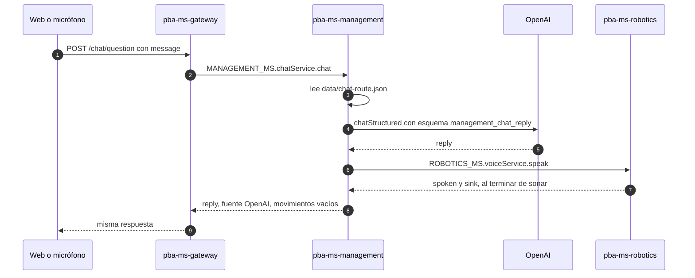

La decisión de ruta es una sola línea de `pba-ms-management/src/chat/chat.service.ts`: `const useTurn = route.automationEnabled && route.selectedModel === 'complejo';`. Si es falsa, management llama a OpenAI pidiendo una respuesta estructurada (`chatStructured`), le pide a robótica que la diga y devuelve `{ reply, fuente: "OpenAI", movimientos: [] }`.

Hay tres detalles que no se ven desde fuera. El primero es que management espera a que robótica termine de reproducir el audio antes de contestar, y esa espera tiene un límite de 20 segundos; una respuesta muy larga puede vencerlo aunque el robot siga hablando. El segundo es que esta ruta no tiene respaldo: si OpenAI falla, el chat muestra un error. El tercero es que el prompt de sistema que se envía es una constante del código; la variable `OPENAI_SYSTEM_PROMPT` es obligatoria al arrancar, pero nadie la lee (ver la [ficha 13](#13-pba-ms-management)).

#### 6.3 Chat por la ruta Complejo: el turno

La ruta Complejo es el corazón del sistema y se llama **turno**. Se activa cuando los turnos automáticos están encendidos y el modelo elegido es "complejo", que es el valor por defecto.

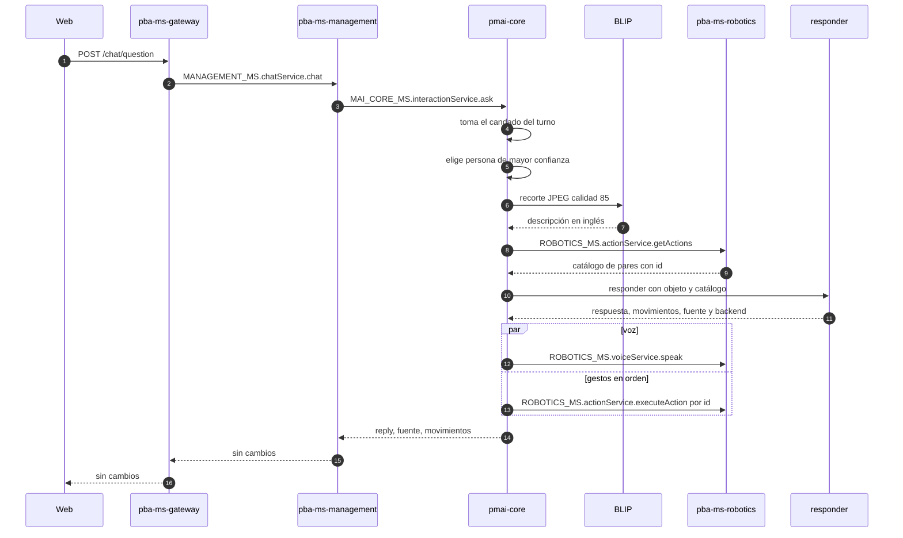

El turno lo implementa `InteractionTurn.ask` en `pmai-mai-core/src/pmai_core/pipeline/interaction_turn.py`, y conviene leerlo paso a paso.

1. **Un turno a la vez.** Un candado no bloqueante impide que dos preguntas se mezclen. Si llega una segunda mientras la primera sigue en curso, la respuesta inmediata es "Sigo respondiendo, un momento." con `fuente: ocupado`.
2. **Elegir a la persona.** De los objetos globales de la escena, gana el de mayor confianza; si hay empate, el de `id_global` menor en orden alfabético. Si no hay nadie, se usa la etiqueta `Persona no identificada`, sin recuadro ni imagen.
3. **Describir la escena.** Si hay recuadro, se toma el último cuadro de la cámara que mejor ve a la persona, se recorta como JPEG de calidad 85 y se envía a BLIP. Si BLIP falla, el contexto queda vacío y el turno sigue.
4. **Pedir el catálogo.** `ROBOTICS_MS.actionService.getActions` devuelve los pares completos y con descripción, cada uno con su `id`. Si la lista está vacía, el turno no falla: el robot hablará y no moverá nada.
5. **Responder.** `responder()` busca en la memoria y, si no acierta, genera con OpenAI o Gemma (ver [4.7](#47-caché-semántico) y [4.8](#48-modelo-local-frente-a-modelo-en-la-nube)). Devuelve como máximo tres ids, y solo de ese catálogo.
6. **Hablar y gesticular.** La voz se lanza en un hilo aparte y, mientras suena, el núcleo envía `executeAction` por cada id en el orden que eligió el modelo, sin esperas ni neutro: el neutro lo inserta robótica. Al final, el turno espera a que termine la voz y devuelve `{ reply, fuente, movimientos }`.

La `fuente` le dice al operador de dónde salió la respuesta. El núcleo la traduce a partir de lo que devuelve `responder()`:

| `fuente` | Cuándo aparece |
|---|---|
| `caché` | Milvus encontró la respuesta en `conocimiento` o `interacciones` |
| `OpenAI` | No hubo acierto y respondió `gpt-4o-mini` |
| `Gemma (local)` | No hubo acierto y respondió Gemma, porque no había clave o la llamada a OpenAI falló |
| `ocupado` | Había otro turno en curso |
| `voz corta` | La pregunta vino por voz y tenía menos de 14 caracteres |
| `disculpa` | `responder()` lanzó una excepción o devolvió vacío; la respuesta es "Lo siento, no puedo responder en este momento." |

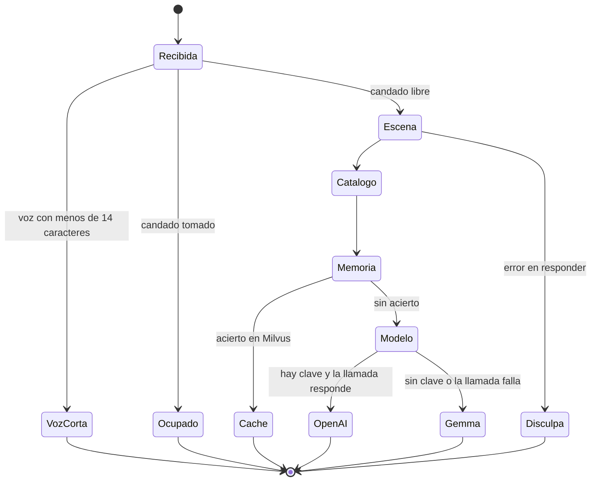

El código y la documentación anterior se separan en cuatro puntos que un desarrollador tiene que conocer:

- **"Voz corta" y el "ocupado" hablado no ocurren hoy.** Esas dos ramas solo se activan cuando el origen del turno es `voice`, pero el controlador de NATS siempre llama `turn.ask(message, "chat")`, también cuando la pregunta vino del micrófono a través de management.
- **Una disculpa de Gemma se ve como `Gemma (local)`.** Si Gemma no puede cargar, devuelve la frase de disculpa marcada como `gguf`. Además, esa frase no está en la lista de respuestas que no se guardan, así que puede quedar indexada en `interacciones` y repetirse desde la caché.
- **El tiempo límite del gateway es de 20 segundos.** El gateway espera ese tiempo como máximo cualquier respuesta NATS. Como el turno espera a que termine la voz, una respuesta larga generada por Gemma puede superarlo: el robot habla, pero la web muestra "Error al conectar con el robot.".
- **La persona puede desaparecer de la escena.** La identidad global solo se calcula en el primer cuadro y luego cada cinco, y el resto de cuadros no la trae. Por eso una pregunta puede caer en `Persona no identificada` aunque haya alguien delante (pendiente de confirmar: falta medir con cámaras reales con qué frecuencia ocurre).

#### 6.4 El micrófono

El micrófono no tiene un camino propio hasta el modelo: transcribe y entra por la misma puerta que el chat. Por eso la voz obedece siempre la ruta que el operador eligió en la pantalla.

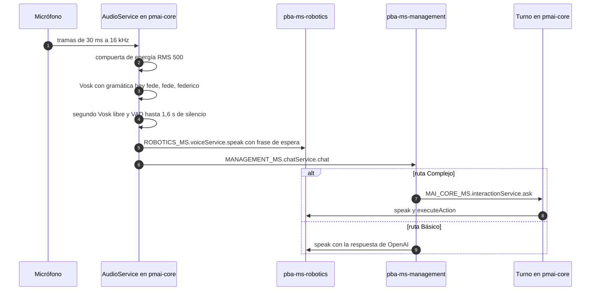

La escucha corre en un hilo propio del núcleo (`pmai-mai-core/src/pmai_core/resources/audio/service.py`). En reposo, una compuerta de volumen descarta el silencio y el resto del audio pasa a un reconocedor Vosk restringido a las palabras de activación. Usar una gramática tan pequeña lo hace rápido y evita falsas activaciones. Cuando oye la palabra, el núcleo abre un reconocedor de vocabulario libre, le reinyecta los 0,4 segundos anteriores para no perder el arranque de la frase y empieza a grabar. La grabación termina cuando el detector de voz de WebRTC cuenta 1,6 segundos de silencio, siempre después de un margen de gracia de 2,2 segundos tras la activación y con un mínimo de un segundo grabado; en ningún caso supera los 20 segundos.

Si la transcripción tiene al menos 14 caracteres, el núcleo dice una de cinco frases de espera ("Uy, buena esa. Dame un segundo.", "Déjame pensarla un momentico.", etc.) y envía el texto a `MANAGEMENT_MS.chatService.chat` con un límite de 30 segundos. La frase de espera se dice también cuando la ruta será Básico. En la ruta Complejo, la pregunta hace así un viaje de ida y vuelta: del núcleo a management y de management de nuevo al núcleo.

La web no captura audio para el robot. La página del chat consulta cada medio segundo `GET /audio/listening-status` y muestra el estado del micrófono ("Conectado, en silencio", "Oyendo", "Frase reconocida"…), el nivel de entrada de 0 a 100 y la última frase reconocida.

#### 6.5 Ciclo de un gesto

Un gesto puede venir de tres orígenes: el turno ("Voz o chat"), el panel de control de la web y el estudio. Los tres terminan en la misma clase, `SequenceService` de `pba-ms-robotics/src/sequence/sequence_service.py`, que encola pasos en una `PlaybackQueue` y los ejecuta en un hilo llamado `sequence-queue`.

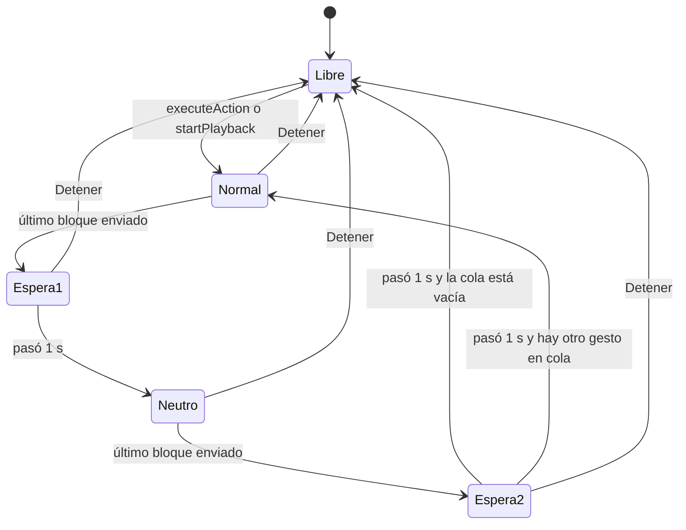

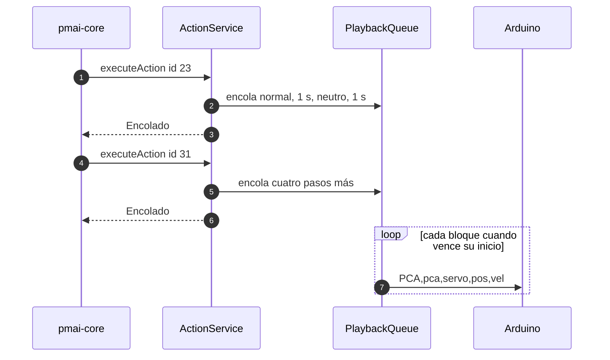

Por cada id, robótica encola cuatro pasos: la versión normal, una espera de un segundo, la versión neutra y otra espera de un segundo. La llamada `executeAction` responde "Encolado" en cuanto encola, así que el núcleo no se queda esperando a que el robot termine de moverse. Dentro de cada paso, el hilo envía cada bloque al Arduino cuando llega su tiempo de `inicio`, con el comando `PCA,<pca>,<servo>,<pos>,<vel>`. El paso termina cuando se envía el último bloque. El campo `dur` de cada bloque nunca llega al Arduino: la duración real depende de la velocidad `vel` y de la distancia que recorre el servo.

Desde el panel o el estudio, `startPlayback` rechaza una nueva reproducción si la cola está ocupada. Por eso la interfaz deshabilita los botones de gesto mientras el hardware trabaja y solo deja activo Detener. Detener vacía la cola, pero no envía nada al Arduino: los servos terminan de llegar a la última posición que recibieron.

Aquí hay una trampa importante del código actual. `ActionController` (que atiende al turno) y `SequenceController` (que atiende al panel y al estudio) crean cada uno su propio `SequenceService`, y cada servicio tiene su propia cola. En consecuencia, el cajón de runtime de la web y el botón Detener solo ven los gestos lanzados desde el panel o el estudio, no los del turno. Las pruebas no lo detectan porque usan una sola instancia (pendiente de confirmar: en el hardware, aunque se deduce directamente del código).

Si no hay ningún Arduino conectado, robótica descarta los pasos de movimiento y solo consume las esperas. En ese caso, el gesto "ocurre" en la cola, pero no mueve nada.

#### 6.6 Visión en tiempo real

El video que se ve en la página de visión no viaja como un flujo de video, sino como una sucesión de fotos JPEG pedidas dos veces por segundo.

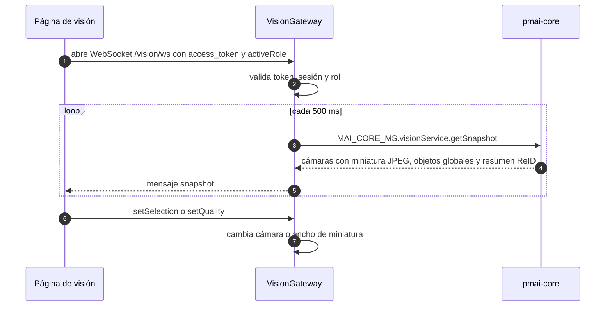

El núcleo mantiene en memoria el último cuadro anotado de cada cámara, con el recuadro, el nombre, el porcentaje de confianza, un identificador corto y la marca `SEEN` si varias cámaras ven a la misma persona. Cuando el gateway pide `getSnapshot`, el núcleo devuelve cada cámara como una miniatura JPEG de calidad 82, con un ancho de 480 píxeles por defecto y de 960 como máximo, junto con la lista de objetos globales y un resumen de la reidentificación.

El gateway valida el token en la cadena de consulta, porque un WebSocket del navegador no puede enviar cabeceras. Si el token no vale, cierra con el código 4001 y la web vuelve al login. La espera máxima de cada petición NATS es de 20 segundos; si el núcleo está ocupado cargando modelos al arrancar, la página puede tardar en mostrar la primera imagen.

La memoria académica describía este mismo flujo con un componente `ngOnInit → connect() → snapshot` validado por `parseVisionSnapshot`; esa estructura sigue presente en `pmas-web-main/src/app/pages/robotics-vision/vision-websocket.service.ts`.

#### 6.7 Creación e ingesta de una secuencia

Las secuencias nuevas nacen en el estudio de movimiento, que la web muestra incrustado en la página `/sequences`.

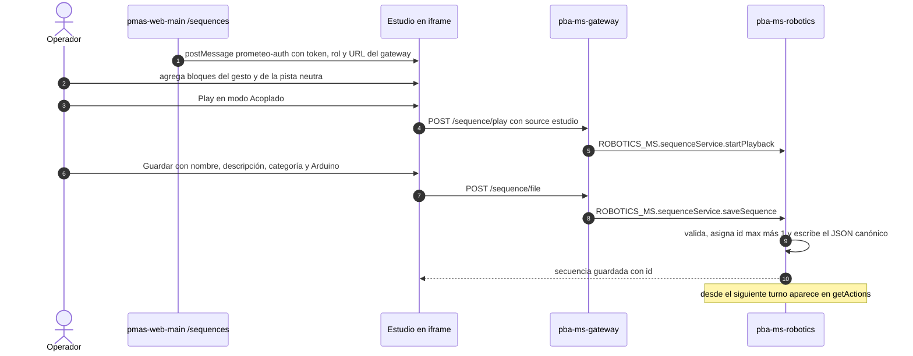

El estudio exige lo mismo que el catálogo: un nombre, una descripción de al menos diez caracteres, una de las seis categorías, el Arduino de destino y las dos pistas, la del gesto y la neutra. Puede generar la pista neutra "rebobinando" el gesto, aunque la propia interfaz advierte que ese neutro automático no es fiable, porque lleva cada servo a la posición 0 en su primer movimiento.

Robótica valida otra vez, convierte el archivo al formato canónico y le asigna un `id` nuevo (el mayor existente más uno) o conserva el que tenía si se sobrescribe. Desde ese momento la secuencia está en `pba-ms-robotics/data/sequences` y aparece en el catálogo del siguiente turno.

La web también puede importar archivos JSON del formato anterior: empareja cada gesto con su neutro por el nombre del archivo y los guarda con `overwrite: true`. Esa importación no exige descripción, lo que probablemente explica que las 31 secuencias actuales no la tengan (pendiente de confirmar: el historial no registra con qué herramienta se crearon).

#### 6.8 Declarar un poema

`MANAGEMENT_MS.chatService.declarePoema` es un camino aparte y más antiguo que el turno. Lo expone el gateway en `POST /chat/poema` y hace siempre lo mismo: le pide a OpenAI un poema con una instrucción fija escrita en el código, le pide a robótica que lo diga y devuelve el texto.

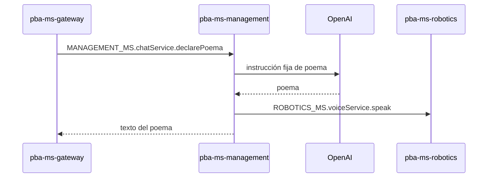

No pasa por el turno porque no necesita ni visión, ni memoria, ni gestos: es una demostración de voz. Tampoco tiene respaldo local si OpenAI falla. Hoy ningún botón de la web llama a esta ruta; queda disponible para usarla con una herramienta HTTP o desde otra interfaz.

### 7. Datos y persistencia

#### 7.1 Postgres y Prisma

La única base de datos relacional de R-ONE es un Postgres compartido. El dueño de sus tablas es `pba-ms-auth`, que las define con Prisma en el esquema `auth`; el gateway se conecta a la misma base, pero solo para leer la tabla `session` al responder `GET /auth/me`. Management tiene un archivo de Prisma heredado sin modelos y no usa la base.

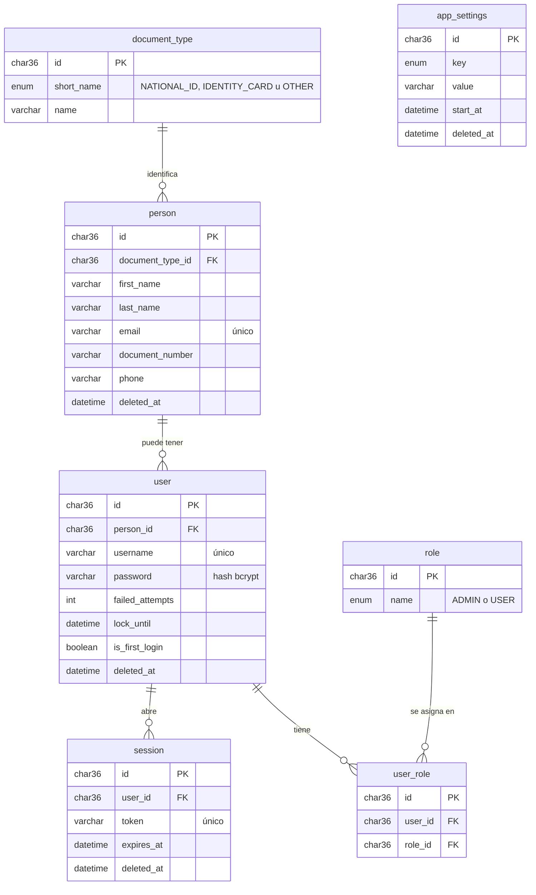

El modelo separa a la **persona** del **usuario** a propósito. Una persona es alguien del semillero, con su documento y su correo; un usuario es una cuenta para entrar, con su contraseña y sus roles. Así se puede registrar a alguien sin darle acceso, o darle de baja la cuenta sin borrar sus datos. Casi todas las tablas tienen `deleted_at`: las bajas son lógicas y los listados solo muestran lo que no se ha dado de baja.

La tabla `app_settings` guarda ajustes con historia. Cambiar un ajuste no sobrescribe la fila, sino que marca la vigente como dada de baja y crea una nueva con su fecha de inicio. Los cuatro ajustes que existen son `SESSION_EXPIRATION`, `LOCK_LOGIN_ATTEMPTS`, `LOCK_LOGIN_UNTIL` y `FRONT_END_URL`.

La siembra crea los tres tipos de documento colombianos (cédula de ciudadanía, tarjeta de identidad y otro), los roles ADMIN y USER, tres administradores (`admin-prometeo@unilibre.edu.co`, `admin-prometeo2@unilibre.edu.co` y `admin-prometeo3@unilibre.edu.co`) y los ajustes por defecto. La contraseña de esos administradores está en `pba-ms-auth/prisma/seed.ts` y este documento no la reproduce.

#### 7.2 Milvus Lite

La memoria del modelo de acción vive en Milvus Lite, dentro del proceso del núcleo, en la carpeta `pmai-model-vision-language/utils/milvus/androide_milvus.db`. Tiene dos colecciones con el mismo tipo de índice (HNSW con distancia coseno, `M=16`, `efConstruction=200`, búsqueda con `ef=64`) y vectores de 384 dimensiones.

| Colección | Qué guarda | Campos | Cuándo acierta |
|---|---|---|---|
| `conocimiento` | Preguntas y respuestas verificadas, sembradas desde `preguntas_respuestas.json` (244 pares) | `id`, `pregunta`, `respuesta`, `movimientos` (lista JSON en texto), `vector` | Distancia ≤ 0,35 (≤ 0,28 si la pregunta pide un dato específico) o coincidencia textual |
| `interacciones` | Respuestas generadas por OpenAI o Gemma, sin el nombre de la persona | `id`, `texto_clave`, `pregunta`, `scene_summary`, `respuesta`, `movimientos`, `vector` | Solo coincidencia estricta: texto igual o contenido, con tres palabras o más |

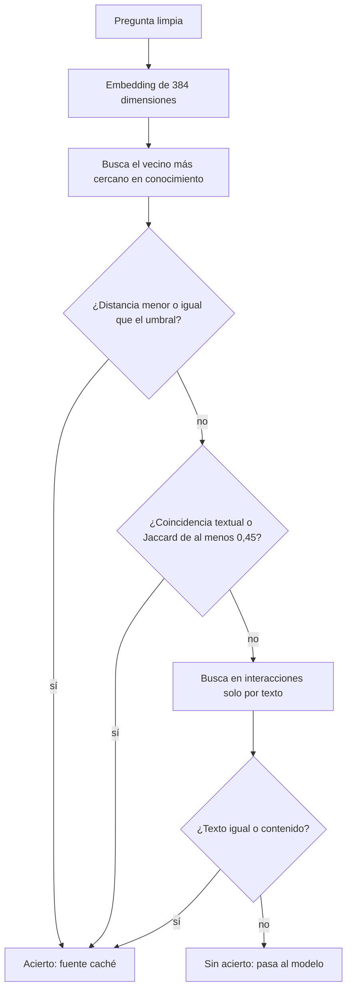

Además de la búsqueda vectorial, cada búsqueda tiene un respaldo textual: carga hasta mil registros y acepta la igualdad exacta (tras normalizar mayúsculas y tildes), una frase contenida o, solo en `conocimiento`, una similitud de Jaccard de al menos 0,45. Ese respaldo existe para cuando el embedding falla, pero con colecciones grandes se vuelve lento y deja registros fuera.

Dos detalles de rutas confunden a menudo. Primero, Compose define `MILVUS_DB_PATH=/data/milvus/androide_milvus.db`, pero ningún archivo lee esa variable: la ruta está fija en `pmai-model-vision-language/utils/config.py`, y por eso `data/milvus` del lanzador está vacío. Segundo, en la raíz de `pmai-model-vision-language` hay otra carpeta `androide_milvus.db` más antigua, creada por el cuaderno de ingesta, que tampoco se usa.

Hay también un efecto de la siembra que conviene saber. A 171 de los 244 pares sin gesto propio se les asigna `movimientos = [1]`, así que, si alguna vez existe en robótica una secuencia con `id` 1, el robot la ejecutará en todas esas respuestas.

#### 7.3 Secuencias en JSON

Cada secuencia es un archivo JSON dentro de `pba-ms-robotics/data/sequences`. El nombre lógico es la ruta relativa sin la extensión, y al guardar se sustituyen los caracteres raros por guiones; así, la secuencia `Secuencias/NEGAR 9.0` vive en `pba-ms-robotics/data/sequences/Secuencias/NEGAR-9-0.json`. Este es un extracto real de ese archivo, recortado a dos bloques del gesto y uno del neutro:

```json
{
  "version": 1,
  "id": 23,
  "name": "Secuencias/NEGAR 9.0",
  "description": "",
  "category": "cuello",
  "blocks": [
    { "arduino_id": 0, "pca": 0, "servo": 1, "inicio": 0.0, "dur": 0.5, "pos": 420, "vel": 6, "nombre": "rot_cuello" },
    { "arduino_id": 0, "pca": 3, "servo": 8, "inicio": 0.0, "dur": 1.0, "pos": 650, "vel": 5, "nombre": "ceja_izq" }
  ],
  "blocks_neutro": [
    { "arduino_id": 0, "pca": 0, "servo": 1, "inicio": 0.0, "dur": 1.0, "pos": 560, "vel": 5, "nombre": "rot_cuello" }
  ]
}
```

Cada campo tiene un sentido preciso. `version` es la versión del formato. `id` es el número que usa el catálogo y que el modelo elige; se asigna al guardar y no cambia al sobrescribir. `name` es el nombre visible y `description` es la frase que lee el modelo para decidir si el gesto encaja, por lo que debe tener al menos diez caracteres para entrar al catálogo; en este ejemplo está vacía y por eso la secuencia no se ofrece al turno. `category` es una de seis zonas del cuerpo (en los datos actuales aparecen `cara`, `cuello`, `torso` y `brazo_derecho`).

Cada bloque dice qué Arduino (`arduino_id`), qué placa controladora PCA9685 (`pca`, de 0 a 3) y qué canal (`servo`, de 0 a 15) mover; a qué segundo empezar (`inicio`); hasta qué posición, en ticks de PWM (`pos`); y con qué velocidad (`vel`). `nombre` es una etiqueta legible del servo y `dur` una duración orientativa que el firmware no recibe. El formato antiguo, una lista de siete valores `[pca, servo, inicio, dur, pos, vel, nombre]`, se sigue aceptando al leer.

#### 7.4 Ruta del chat

La elección entre Básico y Complejo no está en la base de datos, sino en un archivo pequeño: `pba-ms-management/data/chat-route.json`. Hoy contiene `{ "automationEnabled": true, "selectedModel": "complejo" }`.

Management lo vuelve a leer en cada mensaje, de modo que un cambio desde la web aplica a la siguiente pregunta, sin reiniciar nada. Compose monta la carpeta `data` de management, así que el archivo sobrevive a recrear el contenedor; git, en cambio, lo ignora. Si el archivo falta o está corrupto, management asume turnos encendidos y modelo complejo.

Las reglas de cambio las aplica `pba-ms-management/src/chat/chat.service.ts`. Apagar los turnos fuerza el modelo `basico`, y pedir `complejo` con los turnos apagados devuelve un error 409. Desde la web, cualquier usuario puede cambiar el modelo con `PATCH /chat/route/model`, pero solo un ADMIN puede encender o apagar los turnos con `PATCH /chat/route/automation`. La plantilla `.env.template` declara `MS_MANAGEMENT_CHAT_ROUTE_PATH` para mover el archivo, pero Compose no pasa esa variable al contenedor.

#### 7.5 Modelos de IA en disco

R-ONE usa siete modelos de inteligencia artificial. Algunos vienen dentro del repositorio y otros se descargan la primera vez que se necesitan, lo que explica que el primer arranque sea lento.

| Modelo | Para qué | Archivo o identificador | Tamaño aproximado | Origen |
|---|---|---|---|---|
| YOLO11s del semillero | Detectar los 25 rostros | `pmai-mai-core/src/pmai_core/models/my_model.pt` | 19 MB | En el repositorio |
| OSNet x0.25 | Huella para reidentificar | `pmai-mai-core/src/pmai_core/models/osnet_x0_25_msmt17.onnx` | 0,9 MB | En el repositorio |
| Vosk small es 0.42 | Voz a texto en español | `pmai-mai-core/src/pmai_core/models/vosk-model-small-es-0.42` | 58 MB | En el repositorio |
| BLIP base | Describir la escena | `Salesforce/blip-image-captioning-base` | ~1 GB (pendiente de confirmar: medido en Hugging Face, no en el contenedor) | Hugging Face, al arrancar |
| MiniLM multilingüe | Embeddings de preguntas | `paraphrase-multilingual-MiniLM-L12-v2` | ~470 MB (pendiente de confirmar: medido en Hugging Face, no en el contenedor) | Hugging Face, al arrancar |
| Gemma 4 E2B Q4_K_M | Respuestas sin internet | `pmai-model-vision-language/models/gguf/gemma-4-E2B-it-Q4_K_M.gguf` | 2,9 GB | Hugging Face, `unsloth/gemma-4-E2B-it-GGUF`, si falta |
| Piper es_ES davefx | Voz local | `pba-ms-robotics/src/core/models/voice/es_ES-davefx-medium.onnx` | 61 MB | En el repositorio |

El núcleo precarga Milvus, BLIP, el modelo de embeddings y Gemma al arrancar, en `pmai-mai-core/src/pmai_core/pipeline/runtime.py`, para que el primer turno no pague esa espera. El precio es que el contenedor tarda varios minutos en estar listo la primera vez. Compose no monta un volumen para la caché de Hugging Face, así que BLIP y los embeddings probablemente se vuelven a descargar cada vez que se recrea el contenedor (pendiente de confirmar: dónde queda esa caché dentro de la imagen). El GGUF, en cambio, se guarda en la carpeta montada del repositorio y sobrevive.

## Parte III. Repositorios

> Esta parte es para quien vaya a tocar el código. Cada ficha describe un repositorio: para qué existe, con qué se construye, cómo está organizado, qué contratos expone y consume, cómo se configura, cómo se prueba y dónde suele tropezar quien llega. Los flujos (login, chat, micrófono, gesto, visión, estudio, poema) ya están en la [Parte II](#parte-ii-arquitectura-y-flujos); aquí no se vuelven a contar, se enlazan. Quien trabaje en una sola pieza puede saltar a su ficha: [9](#9-pba-launcher), [10](#10-pmas-web-main), [11](#11-pba-ms-gateway), [12](#12-pba-ms-auth), [13](#13-pba-ms-management), [14](#14-pba-ms-robotics), [15](#15-pmai-mai-core), [16](#16-pmai-model-context), [17](#17-pmai-model-vision-language), [18](#18-pmai-model-vision), [19](#19-pmas-web-motion-studio) o [20](#20-pba-arduino-codes).

### 8. Cómo leer una ficha

Todas las fichas de esta parte siguen la misma plantilla de nueve apartados, numerados con el número de la ficha. Así, en robótica el propósito es `14.1` y las trampas son `14.9`; en el lanzador, `9.1` y `9.9`. El orden no cambia:

1. **Propósito.** Qué hace el repositorio en R-ONE y, igual de importante, qué no hace. Una o dos analogías del propio sistema, no un resumen de marketing.
2. **Versión.** Rama, commit corto y fecha, tomados de la tabla [Versión documentada](#versión-documentada). Si el puntero del submódulo no coincidiera con el `HEAD` de la carpeta, la ficha lo diría.
3. **Tecnología.** Lenguaje, marco, imagen Docker y las bibliotecas que importan de verdad. Las dependencias heredadas de una plantilla y que nadie llama se mencionan como resto, no como stack vigente.
4. **Árbol.** Un bloque de texto hasta el nivel de módulo, con un comentario corto por carpeta, y uno o dos párrafos que explican por qué está organizado así.
5. **Archivos clave.** Ruta relativa a la raíz del lanzador y, a la derecha, para qué sirve. El primero es siempre el punto de entrada.
6. **Contratos.** Dos tablas: lo que el repositorio **expone** (sujeto NATS, función importable o endpoint HTTP) y lo que **consume**. Columnas: contrato, entrada, salida, archivo. Las listas globales viven en el [Anexo C](#anexo-c-patrones-nats) y el [Anexo D](#anexo-d-endpoints-http-del-gateway); la ficha no las copia.
7. **Configuración.** Tabla de clave o variable, valor que se usa y efecto. El catálogo completo está en el [Anexo B](#anexo-b-variables-de-entorno).
8. **Pruebas.** El comando exacto, qué cubren y el resultado registrado al investigar. Si no hay pruebas, la ficha lo dice.
9. **Trampas.** Invariantes que el código sostiene y problemas conocidos. No es una lista de deseos: es lo que ya rompió a alguien o lo que el código hace distinto de lo que parece.

Las rutas van siempre desde la raíz del lanzador, entre comillas invertidas, por ejemplo `pba-ms-robotics/src/sequence/sequence_service.py`. Nunca se escriben relativas al repositorio (`src/app.py` suelta es un error). Los nombres de funciones, sujetos NATS y variables aparecen tal como están en el programa, aunque mezclen inglés y español.

Esta sección no es una ficha: no tiene `8.1` ni contratos. Su trabajo es ahorrar al lector la sorpresa de que el turno no se reexplica aquí. El mapa de servicios está en [5](#5-mapa-de-servicios), el turno en [6.3](#63-chat-por-la-ruta-complejo-el-turno) y dónde se guarda cada dato en [7](#7-datos-y-persistencia). Cuando una ficha necesita ese contexto, enlaza; no lo vuelve a narrar.

### 9. pba-launcher

#### 9.1 Propósito

El lanzador es la carpeta que se clona para tener R-ONE entero. Agrupa los repositorios del semillero como submódulos y aporta lo que ninguno de ellos tiene por sí solo: el `docker-compose.yml` de los nueve servicios, la plantilla `.env.template`, la configuración de NATS y los scripts de arranque en red local, Wi-Fi de campo y Bluetooth. No contiene código de negocio. Un cambio de interfaz va en `pmas-web-main`; un cambio del turno, en `pmai-mai-core`; un cambio del prompt, en `pmai-model-vision-language`.

Dicho de otro modo, el lanzador es el maletín: dentro van las herramientas, el plano de cómo se enchufan y las instrucciones de apertura. También guarda la identidad de producto (`PRODUCT.md`, `DESIGN.md`) y la documentación larga en `docs/project-docs/`. El mapa corto para quien trabaja con agentes está en `AGENTS.md`.

#### 9.2 Versión

Según la tabla [Versión documentada](#versión-documentada), el lanzador se leyó en la rama `main`, commit `28900f3`, el 2026-11-05. Los punteros de submódulo del índice coinciden con el `HEAD` de cada carpeta. `pba-arduino-codes` está declarado en `.gitmodules` con rama `dev`, pero no tiene gitlink en el índice ni carpeta en el lanzador; el clon de trabajo usado para esta documentación vive fuera de git, pendiente de confirmar: no hay historia en el lanzador que explique por qué el firmware se declaró y no se clonó.

#### 9.3 Tecnología

El orquestador es Docker Compose, sin clave `version` en el archivo. Las imágenes tomadas tal cual son `postgres:17.1-alpine` y `nats:2.12.5-alpine3.22`. Las demás se construyen: `node:22-slim` para gateway, auth y la web; `python:3.12-slim` para `pmai-core`; `python:3.13-slim` para el estudio y robótica. Los scripts son Bash con `set -euo pipefail`; `scripts/bt-up.sh` incrusta un programa Python 3 que habla con `bluetoothctl` por la entrada estándar.

En el anfitrión los scripts esperan `ip`, `docker`, y, según el caso, `ufw`, `nc`, `xdg-open`, `nmcli`, `bluetoothctl` y `pactl`. En la Jetson quedó Docker Engine 29.9.2 y Compose v5.6.1. El archivo `LICENSE` de la raíz tiene el mismo tamaño que el de la web, el gateway y auth; el tipo exacto queda pendiente de confirmar: no se abrió el texto.

#### 9.4 Árbol

```text
pba-launcher/
  docker-compose.yml              # nueve servicios, puertos y montajes
  .env.template                   # plantilla de variables; se copia a .env
  nats.conf                       # una línea: monitor HTTP de NATS en 8222
  .dockerignore                   # contexto de construcción de pmai-core
  .gitmodules                     # submódulos y sus ramas
  scripts/                        # arranque, red, Bluetooth y siembra
  pba-ms-auth/                    # usuarios, roles, JWT y Postgres
  pba-ms-gateway/                 # única puerta HTTP y WebSocket
  pba-ms-management/              # ruta Básico o Complejo del chat
  pba-ms-robotics/                # voz, secuencias y Arduino
  pmai-mai-core/                  # cámaras, micrófono y turno
  pmai-model-context/             # BLIP; paquete model_context
  pmai-model-vision-language/     # Milvus, prompt, OpenAI o Gemma
  pmai-model-vision/              # entrenamiento del detector
  pmas-web-main/                  # interfaz Angular
  pmas-web-motion-studio/         # estudio de secuencias
  data/                           # videos de prueba y milvus vacío
  docs/                           # documentación larga y planes
  AGENTS.md                       # mapa corto para agentes
  README.md                       # comandos de arranque
  PRODUCT.md  DESIGN.md           # producto e identidad visual
```

La organización sigue una regla: cada carpeta de primer nivel, salvo `docs/` y `scripts/`, es un repositorio propio. El lanzador no mezcla el código de uno dentro de otro. `data/` se monta en `pmai-core` y guarda los videos con los que se simulan cámaras; `docs/` concentra la memoria, la ficha de la Jetson y este documento. Los archivos sueltos de la raíz son el contrato de arranque: Compose, variables, NATS y el mapa para humanos y agentes.

Además de eso hay reglas para agentes en `.cursor/rules/`, tres configuraciones de depuración por attach en `.vscode/launch.json` (gateway 9230, auth 9231, management 9232) y, en la Jetson, alias `rone-*` definidos en `~/.bashrc` del usuario `jetson` que apuntan a estos mismos scripts.

#### 9.5 Archivos clave

| Ruta | Propósito |
|---|---|
| `docker-compose.yml` | Punto de entrada del sistema: servicios, puertos, montajes y variables |
| `.env.template` | Plantilla que el `README.md` pide copiar a `.env` |
| `nats.conf` | Habilita el monitor HTTP de NATS en 8222 |
| `.dockerignore` | Excluye `.git`, `data`, `.env` y `node_modules` del contexto de `pmai-core` |
| `scripts/lan-up.sh` | Arranque completo en LAN: IP, UFW, Postgres, migraciones, siembra y Compose |
| `scripts/lan-down.sh` | `compose stop`; los contenedores siguen creados |
| `scripts/lan-restart.sh` | Para y vuelve a arrancar los mismos contenedores, sin recrearlos |
| `scripts/wifi-up.sh` | Unirse a un Wi-Fi o encender el hotspot y luego `lan-up.sh` |
| `scripts/bt-up.sh` | Emparejar el parlante Bluetooth en el PulseAudio del anfitrión |
| `scripts/seed-auth.sh` | Migraciones Prisma y usuarios administradores |
| `scripts/seed-conocimiento.sh` | Carga de `preguntas_respuestas.json` en la colección `conocimiento` |
| `AGENTS.md` | Repositorios, el turno y el arranque que no hay que romper |
| `README.md` | Comandos de arranque |
| `docs/project-docs/jetson-orin-nano-r-one.md` | Ficha y bitácora de la Jetson Orin Nano |

#### 9.6 Contratos

El lanzador no implementa sujetos NATS ni endpoints. Lo que publica en el anfitrión son los puertos de Compose; el detalle de cada servicio está en [5.1](#51-servicios-y-puertos). El puerto de clientes de NATS, el 4222, no se publica: solo existe dentro de la red de Docker como `nats://nats-server:4222`. `scripts/lan-up.sh` abre en UFW únicamente 3000, 4200 y 4210.

| Expuesto | Entrada | Salida | Archivo |
|---|---|---|---|
| `db` en 5432 | variables `DB_USER`, `DB_PASSWORD`, `DB_NAME` | Postgres con `pg_isready` | `docker-compose.yml` |
| `nats-server` en 8222 | `nats.conf` | monitor HTTP; clientes en 4222 interno | `docker-compose.yml` |
| `pba-ms-gateway` en 3000 y 9230 | `.env` | HTTP y depuración Node | `docker-compose.yml` |
| `pmas-web-main` en 4200 | `WEB_MAIN_PORT` | `ng serve` | `docker-compose.yml` |
| `pmas-web-motion-studio` en 4210 | `MOTION_STUDIO_PORT` | Uvicorn del estudio | `docker-compose.yml` |
| `pmai-core` contexto `.` | tres repositorios | imagen con núcleo, BLIP y modelo de acción | `pmai-mai-core/Dockerfile.dev` |

La imagen de `pmai-core` se construye desde la raíz del lanzador, no desde `pmai-mai-core/`. El Dockerfile copia `pmai-mai-core`, `pmai-model-context` y `pmai-model-vision-language` y los instala con pip; Compose por eso pone `context: .` y `dockerfile: pmai-mai-core/Dockerfile.dev`. De ahí que `.dockerignore` viva en la raíz y excluya `data` y `.env`. En ejecución, Compose monta el núcleo en `/app`, el contexto en `/opt/model-context` y el modelo de acción en `/opt/action-model`, y deja `PYTHONPATH` en `/opt/model-context:/opt/action-model:/app/src`. Recortar esa ruta a `/app/src` deja al núcleo sin BLIP ni `responder()`.

| Consumido | Entrada | Salida | Archivo |
|---|---|---|---|
| `compose up -d db nats-server` y espera de Postgres | hasta 90 s | base lista | `scripts/lan-up.sh` |
| `npx prisma migrate deploy` y `npx prisma db seed` en auth | contenedor `pba-ms-auth` | esquema `auth` y administradores | `scripts/lan-up.sh`, `scripts/seed-auth.sh` |
| `python -m utils.context_builder.cargar_preguntas` | JSON de preguntas | colección `conocimiento` | `scripts/seed-conocimiento.sh` |
| `nmcli` (join o hotspot) y luego `lan-up.sh` | SSID o conexión `Hotspot` | red de campo y stack arriba | `scripts/wifi-up.sh` |
| `bluetoothctl` y `pactl` | nombre `Thinkplus-K3-pro` o `RONE_BT_DEVICE` | sink `bluez` por defecto | `scripts/bt-up.sh` |

Los siete scripts cubren el ciclo de operación. `scripts/lan-up.sh` detecta la IPv4 de LAN (respeta `LAN_IFACE`, omite `docker*`, `br-*` y direcciones `169.254.*`, y prefiere la ruta de salida), abre UFW si existe, espera Postgres y auth, aplica migraciones, siembra Milvus y levanta el resto; los argumentos se pasan a `compose up -d`. `scripts/lan-down.sh` y `scripts/lan-restart.sh` usan `stop` y `start`, no `down`: los contenedores no se recrean y un cambio de `.env` no aplica. `scripts/wifi-up.sh` entiende `scan`, `status`, `join` y `hotspot` (SSID esperado `Jetson_Orin_Hot`) y recuerda que no hace falta editar `environment.ts` porque la web llama a `http://<hostname>:3000`. `scripts/bt-up.sh` entiende `scan`, `status`, `connect` y `disconnect`, guarda el último MAC y recuerda reiniciar robótica si la voz ya estaba arriba. `scripts/seed-auth.sh` exige Postgres con usuario fijo `postgres`. `scripts/seed-conocimiento.sh` es idempotente: si `pmai-core` corre usa `compose exec`; si no, `compose run --rm`.

En la Jetson, `rone-up`, `rone-down`, `rone-restart`, `rone-wifi`, `rone-bt`, `rone-status` y `rone-seed` apuntan a estos scripts. No hay alias para `seed-conocimiento.sh`. El arranque paso a paso está en la [sección 22](#22-arranque-local-y-en-red-local).

#### 9.7 Configuración

La lista completa de variables está en el [Anexo B](#anexo-b-variables-de-entorno). Aquí solo las que el lanzador impone o que suelen romperse al copiar la plantilla.

| Clave o variable | Valor | Efecto |
|---|---|---|
| `PMAI_CORE_PYTHONPATH` | `/opt/model-context:/opt/action-model:/app/src` | El núcleo importa `model_context` y `utils`; no recortar |
| `PMAI_OPENAI_API_KEY` | vacía reusa `MS_MANAGEMENT_OPENAI_API_KEY` | Clave de `responder()` en `pmai-core` |
| `NATS_SERVER` en Compose | `nats://nats-server:4222` (literal) | La plantilla no se usa; Compose fija el valor |
| `MS_GATEWAY_SECRET` y `MS_AUTH_SECRET` | la misma cadena | Auth firma y el gateway verifica; si diferencian, el login “funciona” y el resto da 401 |
| `MS_MANAGEMENT_CHAT_ROUTE_PATH` | en la plantilla, no en Compose | Management cae a `pba-ms-management/data/chat-route.json` |
| `MILVUS_DB_PATH` | `/data/milvus/androide_milvus.db` | Compose la pasa; el código no la lee (ver [7.2](#72-milvus-lite)) |
| `LAN_IFACE` | opcional | Fuerza la interfaz que anuncia `lan-up.sh` |
| `RONE_BT_DEVICE` | `Thinkplus-K3-pro` | Nombre del parlante que busca `bt-up.sh` |
| `MS_ROBOTICS_PULSE_SERVER` | `unix:/run/user/1000/pulse/native` | Socket de Pulse del UID 1000; otro usuario no oye |

La plantilla no alcanza para arrancar gateway y auth: ambos exigen `SECRET`, `RESTORE_PASSWORD_SECRET` y `PROJECT_ID`, y `.env.template` no trae `MS_GATEWAY_SECRET`, `MS_GATEWAY_RESTORE_PASSWORD_SECRET`, `MS_GATEWAY_PROJECT_ID` ni `MS_AUTH_PROJECT_ID`. El comentario de Compose dice que la TTS de robótica reusa la clave de management si `MS_ROBOTICS_OPENAI_API_KEY` va vacía, pero Compose pasa esa variable tal cual, sin respaldo `:-`.

#### 9.8 Pruebas

El lanzador no tiene pruebas automatizadas propias. Las comprobaciones operativas que documenta la Jetson son `docker compose config -q`, `git submodule status`, `rone-status` y `rone-bt status`. El plan de arranque en LAN dejó sin ejecutar la lista de extremo a extremo en Ubuntu nativo. En esta investigación no se ejecutó ningún script.

#### 9.9 Trampas

`PMAI_CORE_PYTHONPATH` tiene que quedar con los tres directorios; los dos primeros son los montajes de contexto y del modelo de acción. La imagen de `pmai-core` se construye desde la raíz porque el Dockerfile copia esos tres repositorios: construirla con contexto `pmai-mai-core/` deja a pip sin BLIP ni Gemma.

`lan-down.sh` no destruye contenedores. Quien cambie `.env` o Compose y luego haga `lan-restart.sh` sigue con la configuración vieja: hace falta `compose up -d --build` del servicio afectado. Management, robótica, la web y el estudio no declaran `depends_on`; el orden lo impone `lan-up.sh`, no Compose. Ese script siembra Milvus antes de levantar el resto, de modo que en un arranque en frío la siembra va por un contenedor de un solo uso y descarga ahí el modelo de embeddings.

El socket de PulseAudio está fijo para el UID 1000. Sin la cookie montada, Pulse responde `Access denied` porque robótica corre como root. `seed-auth.sh` comprueba Postgres con `-U postgres` fijo, mientras `lan-up.sh` usa `${DB_USER:-postgres}`. El bloque `volumes:` de primer nivel declara cuatro volúmenes con nombre que ningún servicio usa; los `node_modules` son volúmenes anónimos.

Tres puertos publicados no escuchan nada: auth 3001, management 3002 y `PMAI_CORE_PORT` 3004. Qué escucha `pmai-core` en 3004 queda pendiente de confirmar: una búsqueda de servidor HTTP en `pmai-mai-core/src` no encontró ninguno; el video llega por NATS y el WebSocket del gateway. Si robótica abre un depurador en 9233 también queda pendiente de confirmar: Compose publica el puerto y `debugpy` está en las dependencias, pero el comando es Uvicorn sin `debugpy`.

No se edita `pmas-web-main/src/environments/environment.ts` al cambiar de red: la web arma el gateway con el hostname de la página. En la Jetson, Docker 28 o posterior necesita la variable de entorno que desactiva iptables raw, porque el kernel de JetPack 6.2 no trae ese módulo, y la ruta por defecto no debe ser la IP estática heredada del kit Yahboom (`192.168.1.1`). El detalle operativo está en `docs/project-docs/jetson-orin-nano-r-one.md`.

### 10. pmas-web-main

#### 10.1 Propósito

`pmas-web-main` es la mesa de control de R-ONE en el navegador: login, panel de movimientos, visión, chat (con la elección Básico o Complejo y la pestaña «Decir oración»), estudio de secuencias incrustado, administración de usuarios y las páginas públicas del semillero. Toda llamada de datos va al gateway por HTTP o WebSocket; el único otro origen es el estudio, cargado en un `iframe`. La web no ejecuta el turno, no habla con NATS y no captura el audio del robot.

Se parece a un tablero de avión: muestra instrumentos y envía mandos, pero el vuelo lo hacen los servicios de atrás. Por eso un fallo de OpenAI se ve aquí como «Error al conectar con el robot.», aunque el origen esté en management o en el núcleo.

#### 10.2 Versión

Rama `dev`, commit `8e3c3fb`, 2026-10-27, según la tabla [Versión documentada](#versión-documentada). El puntero del lanzador coincide con el `HEAD` de la carpeta.

#### 10.3 Tecnología

Angular 21.2 con componentes independientes y señales, constructor `@angular/build:application` y entrada `pmas-web-main/src/main.ts`. RxJS ~7.8, TypeScript ~5.9.2, Tailwind CSS 4.1 y `qrcode` 1.5.4 para el código QR de red. Las pruebas se declaran con Vitest 4 y jsdom 28 a través de `@angular/build:unit-test`. La imagen es `node:22-slim`. Las fuentes Space Grotesk, Inter y Material Symbols Outlined se cargan desde Google Fonts; el documento está en español.

Compose sirve el servidor de desarrollo (`npm run start -- --host 0.0.0.0 --port ${WEB_MAIN_PORT} --poll 2000`) con `NODE_OPTIONS=--max-old-space-size=4096`. Tras cambiar dependencias hay que reconstruir el servicio, porque `node_modules` vive en un volumen anónimo.

#### 10.4 Árbol

```text
pmas-web-main/src/
  main.ts                         # bootstrapApplication
  app/app.ts                      # raíz; plantilla en línea con router-outlet
  app/app.routes.ts               # todas las rutas y guards
  app/core/constants/             # GATEWAY_URL y MOTION_STUDIO_URL
  app/core/guards/                # authGuard, guestGuard, roleGuard
  app/core/interceptors/          # token, X-Active-Role, cierre por 401 o 403
  app/core/services/              # sesión, salud, hardware, QR, JWT
  app/layouts/admin-shell/        # cascarón autenticado y cajón de runtime
  app/components/                 # barra, menú, cajón, QR, salud
  app/pages/login/                # correo y contraseña
  app/pages/control-panel/        # gestos a mano y registro
  app/pages/robotics-chat/        # chat, ruta, frases, estado del micrófono
  app/pages/robotics-vision/      # WebSocket de cámaras
  app/pages/sequences/            # iframe del estudio e importación legado
  app/pages/admin/users/          # CRUD de usuarios, solo ADMIN
  app/pages/home|team|projects/   # páginas públicas
  app/pages/r-one/                # resto heredado; rutas que el gateway no tiene
  environments/environment.ts     # compactMode y gatewayUrl de respaldo
  styles.css                      # tokens de color y tipografía
```

La aplicación es plana a propósito: no hay estado global aparte de la sesión y de unos pocos almacenes en `localStorage`. Cada página habla con el gateway por su cuenta. El cascarón autenticado (`AdminShell`) envuelve el panel, el chat, la visión, las secuencias y los usuarios, y es quien enciende el sondeo del hardware y el QR de la primera visita. Las páginas públicas (`info`, `team`, `projects`) viven fuera de ese cascarón, detrás de `guestGuard`.

#### 10.5 Archivos clave

| Ruta | Propósito |
|---|---|
| `pmas-web-main/src/main.ts` | Punto de entrada; arranca `App` con `appConfig` |
| `pmas-web-main/src/app/app.config.ts` | Router y `provideHttpClient` con `authInterceptor` |
| `pmas-web-main/src/app/app.routes.ts` | Rutas, guards y metadatos del menú |
| `pmas-web-main/src/app/core/constants/gateway.ts` | `GATEWAY_URL` en el puerto 3000 del hostname de la página |
| `pmas-web-main/src/app/core/constants/motion-studio.ts` | `MOTION_STUDIO_URL` en el puerto 4210 |
| `pmas-web-main/src/app/core/services/auth.service.ts` | Login, perfil, rol activo y cierre de sesión |
| `pmas-web-main/src/app/core/interceptors/auth.interceptor.ts` | Cabeceras `Authorization` y `X-Active-Role` |
| `pmas-web-main/src/app/core/services/hardware-runtime.service.ts` | Sondeo de `GET /sequence/runtime` y apertura del cajón |
| `pmas-web-main/src/app/pages/robotics-chat/robotics-chat.ts` | Chat, selector de modelo, turnos y «Decir oración» |
| `pmas-web-main/src/app/pages/robotics-vision/vision-websocket.service.ts` | Cliente del WebSocket de visión |
| `pmas-web-main/src/app/pages/control-panel/control-panel.ts` | Panel Gesto o Neutro |
| `pmas-web-main/src/app/pages/sequences/sequences.ts` | `iframe` del estudio y `postMessage` del token |
| `pmas-web-main/src/app/pages/admin/users/users.ts` | Alta, edición y baja de usuarios |
| `pmas-web-main/src/styles.css` | Tokens navy, cian y esmeralda |

#### 10.6 Contratos

La web no expone API. Expone rutas de Angular y consume el gateway. El listado HTTP completo está en el [Anexo D](#anexo-d-endpoints-http-del-gateway).

| Ruta | Guard | Componente |
|---|---|---|
| `''` exacta | — | redirige a `info` |
| `login`, `register` | `guestGuard` | `Login`, `Register` |
| `info`, `team`, `projects` | `guestGuard` | páginas públicas |
| `''` padre | `authGuard` | `AdminShell` con hijos |
| `control-panel` | hereda | panel de movimientos |
| `robotics/chat` | hereda | chat |
| `robotics/vision` | hereda | visión |
| `sequences` | hereda | estudio incrustado |
| `admin/users` | `authGuard` y `roleGuard` | usuarios; solo `ADMIN` |
| `profile`, `iframe` | hereda | perfil y visor genérico |
| `r-one` | ninguno | resto heredado |
| `**` | — | redirige a `info` |

`authGuard` deja pasar si hay token con `exp` futuro, decodificado en el navegador sin verificar la firma; si el token venció, llama a `logout('expired')` y manda a `/login`. `guestGuard`, con sesión y `compactMode` verdadero (el valor actual), redirige a `/control-panel`. `roleGuard` exige que el nombre del rol activo sea `ADMIN`. El menú lateral muestra Usuarios solo con ese rol; en modo compacto el cascarón usa una barra inferior con Movimientos, Visión, Chat y Secuencias.

Hacia el estudio, la página `/sequences` escucha `prometeo-auth-request` y responde `prometeo-auth` con token, `GATEWAY_URL` y rol activo, solo si el hostname del origen coincide con el de la página. El `iframe` carga `http://<hostname>:4210/?embed=1`. El flujo de creación está en [6.7](#67-creación-e-ingesta-de-una-secuencia).

| Consumido | Entrada | Salida | Archivo |
|---|---|---|---|
| `POST /auth/login` | `{ username, password }` | `{ accessToken }` | `pmas-web-main/src/app/core/services/auth.service.ts` |
| `GET /auth/me` | Bearer y `X-Active-Role` | perfil con roles | `pmas-web-main/src/app/core/services/auth.service.ts` |
| `POST /chat/question` | `{ message }` | `{ reply, fuente, movimientos }` | `pmas-web-main/src/app/pages/robotics-chat/robotics-chat.ts` |
| `GET` y `PATCH /chat/route…` | modelo o `enabled` | `{ automationEnabled, selectedModel }` | `pmas-web-main/src/app/pages/robotics-chat/robotics-chat.ts` |
| `GET /sequence/runtime` | — | `{ busy, source, current, queue }` | `pmas-web-main/src/app/core/services/hardware-runtime.service.ts` |
| `POST /sequence/play` y `POST /sequence/stop` | `{ name, mode, source: 'panel' }` o `{}` | estado | panel y cajón |
| `ws://<host>:3000/vision/ws` | `access_token` y `activeRole` en la consulta | `snapshot` cada 500 ms | `pmas-web-main/src/app/pages/robotics-vision/vision-websocket.service.ts` |
| `GET /audio/listening-status` | cada 500 ms | fase, nivel y última frase | chat |
| `GET\|POST\|PATCH /voice/phrases` y `POST /voice/speak` | frases de «Decir oración» | catálogo y `spoken` | chat |
| `GET\|POST\|PUT\|PATCH /users…` | CRUD; `role_ids` y persona | listado o alta | `pmas-web-main/src/app/pages/admin/users/users.ts` |

El login está en [6.1](#61-inicio-de-sesión); el chat, en [6.2](#62-chat-por-la-ruta-básico) y [6.3](#63-chat-por-la-ruta-complejo-el-turno); el micrófono del robot, en [6.4](#64-el-micrófono); los gestos a mano, en [6.5](#65-ciclo-de-un-gesto); la visión, en [6.6](#66-visión-en-tiempo-real). Ningún botón llama a `POST /chat/poema`.

Hay una sesión por usuario, pero no la impone la web: la impone auth al dar de baja la sesión anterior (ver [12.9](#129-trampas)). La web guarda un solo `prometeo_token` y, ante cualquier 401 o 403 de una ruta no pública, cierra con «Tu sesión venció. Entra de nuevo.». Por eso un USER que intenta una acción de ADMIN también termina en el login, y por eso entrar en el teléfono saca al portátil.

#### 10.7 Configuración

| Clave o variable | Valor | Efecto |
|---|---|---|
| `GATEWAY_PORT` | 3000, fijo en código | La web no lee `MS_GATEWAY_PORT` |
| `MOTION_STUDIO_PORT` | 4210, fijo en código | La web no lee `MOTION_STUDIO_PORT` |
| `environment.compactMode` | `true` | Barra inferior de robótica; con sesión no hay landing |
| `environment.gatewayUrl` | `http://localhost:3000` | Solo respaldo fuera del navegador |
| `WEB_MAIN_PORT` | 4200 | Puerto de `ng serve` |
| `prometeo_token` | `localStorage` | JWT de acceso |
| `prometeo_active_role` | `localStorage` | UUID del rol activo |
| `prometeo_login_flash` | `sessionStorage` | Aviso de sesión vencida |
| `pmas.lanQrShown` | `localStorage` | El QR de red ya se mostró |

El catálogo de variables del contenedor está en el [Anexo B](#anexo-b-variables-de-entorno). Cambiar 3000 o 4210 en `.env` y no en estos dos archivos deja la interfaz hablando con nadie. El QR comparte `window.location.origin` y se abre en la primera visita al cascarón.

#### 10.8 Pruebas

El comando del paquete es `npm test`, que ejecuta `ng test` con Vitest. Hay 27 archivos `*.spec.ts`: la mayoría leen el código fuente con `node:fs` y comprueban textos; otras prueban funciones puras (`hardware-runtime`, `jwt-exp`, `sequence-groups`, `origin-sequence`, `microphone-status`).

Resultado registrado el 2026-11-05 en el anfitrión: `npx ng test --watch=false` no corre ninguna prueba. La compilación falla con 57 errores TypeScript (no encuentra `node:fs` ni `import.meta.dirname`; un objeto de prueba de hardware no trae `remaining_ms` ni `blocks`). Si esas pruebas compilan dentro del contenedor queda pendiente de confirmar: no se ejecutaron en Docker.

#### 10.9 Trampas

Los puertos 3000 y 4210 están hardcodeados. `GATEWAY_URL` se arma con el hostname de la página y el 3000; `MOTION_STUDIO_URL`, con el 4210. En LAN eso es una ventaja (el teléfono abre `http://jetson-w4.local:4200` y llama a `:3000` en el mismo host), pero un cambio de puerto en Compose no arrastra a la web.

El cajón «En hardware» es un botón flotante siempre visible en el cascarón. Sondea `GET /sequence/runtime` cada 500 ms si el robot está ocupado o el cajón abierto, y cada 3 s si no. Se abre solo cuando empieza una racha `busy` con `source: 'turno'`; si el usuario lo cierra, no vuelve a abrirse en esa misma racha. Muestra el paso actual (Gesto, Neutro o «Pausa de 1 s»), el tiempo restante y la cola. Detener llama a `POST /sequence/stop`. Por las dos instancias de `SequenceService` en robótica (ver [14.9](#149-trampas)), ese cajón y ese Detener no ven los gestos del turno.

El selector Básico o Complejo vive bajo la caja del chat y escribe en el gateway: la elección es del sistema, no del navegador. Complejo solo aparece si los turnos están encendidos; la casilla de turnos solo la ve un ADMIN. La web siempre llama a `POST /chat/question`; quien decide la ruta es management. El micrófono del chat es `webkitSpeechRecognition` del navegador, solo para llenar la caja; el micrófono del robot lo muestra el estado de `GET /audio/listening-status`.

Cualquier 401 o 403 no público cierra la sesión. Las fuentes de Google Fonts no cargan en el hotspot sin internet. La página `register` simula el envío y no crea cuentas. La ruta `r-one` llama a `/robotics/execute` y `/robotics/health`, que el gateway no tiene. `pmas-web-main/src/app/app.html` no se usa: el componente raíz tiene la plantilla en línea.

### 11. pba-ms-gateway

#### 11.1 Propósito

El gateway es la única puerta HTTP y WebSocket de la interfaz. Valida el JWT, la sesión activa y el rol, valida el cuerpo con `class-validator` y traduce cada petición a un mensaje NATS hacia `AUTH_MS`, `MANAGEMENT_MS`, `ROBOTICS_MS` o `MAI_CORE_MS`. No tiene lógica de negocio propia salvo el empuje periódico de la instantánea de visión por WebSocket. Usa Prisma solo para leer la tabla `session` en `GET /auth/me` y `GET /auth/verify`.

Es la recepción del edificio que describe [4.1](#41-microservicios-y-gateway): el navegador no conoce las direcciones internas y no debería. Toda seguridad de la interfaz se revisa aquí. El puerto de clientes de NATS (4222) no se publica en el anfitrión, de modo que desde la red local nadie envía mensajes a robótica o al núcleo saltándose esta puerta.

#### 11.2 Versión

Rama `dev`, commit `3f38ec9`, 2026-10-19, según la tabla [Versión documentada](#versión-documentada). El puntero del lanzador coincide.

#### 11.3 Tecnología

NestJS 11 sobre Fastify, adaptador WebSocket `ws`, transporte NATS, Passport (`passport-jwt` y `passport-local`), Prisma 7 con adaptador Postgres y validación de entorno con Joi. Hay un limitador `ThrottlerModule` (10 peticiones por 60 s) que no se aplica: el módulo se registra y no hay ningún guard que lo haga efectivo. `@fastify/multipart` admite un archivo de hasta 200 MB; `@fastify/http-proxy` se importa y no se usa. TypeScript ^5.7.2, imagen `node:22-slim`. El `name` del paquete es `ensename`, herencia de otra plantilla.

#### 11.4 Árbol

```text
pba-ms-gateway/src/
  main.ts                         # Fastify, CORS, pipes, WebSocket, puerto 3000
  app.module.ts                   # raíz; ThrottlerModule, NATS, Prisma, módulos MS
  app.controller.ts               # GET /health
  transports/                     # cliente NATS_SERVICE
  auth/strategies/                # jwt, local, password-reset, refresh-token
  auth/guards/                    # acceso global, JWT con sesión, roles, /auth/me
  core/                           # nombres MS, Prisma, filtros RPC, ajustes
  auth-ms/                        # reenvío a AUTH_MS (auth, users, person, roles…)
  management-ms/                  # chat, poema, ruta
  robotics-ms/                    # action, voice, sequence
  mai-core-ms/                    # audio, camera, monitoring, vision HTTP y WS
pba-ms-gateway/prisma/            # copia del esquema auth; sin migraciones
pba-ms-gateway/test/              # cuatro pruebas node:test que leen el código
```

El árbol copia la forma de los microservicios a los que habla: un módulo por destino NATS, y dentro de cada uno un controlador por recurso HTTP. El módulo `auth/` no es `auth-ms/`: el primero es la seguridad del propio gateway (Passport y guards); el segundo reenvía a `pba-ms-auth`. Prisma aquí no es dueño del esquema: en cada arranque `prisma db pull` regenera `schema.prisma` contra la base de auth. Los tipos generados se usan para el modelo `session` en los guards y para el enum `Roles` en `@HasRoles`. El gateway no corre migraciones: si arranca antes de que auth las aplique, el `db pull` vería una base vacía. En el arranque normal eso no ocurre porque `scripts/lan-up.sh` migra auth primero.

#### 11.5 Archivos clave

| Ruta | Propósito |
|---|---|
| `pba-ms-gateway/src/main.ts` | Punto de entrada; escucha en `0.0.0.0` y `PORT` o 3000 |
| `pba-ms-gateway/src/app.module.ts` | Ensambla config, NATS, Prisma y los cuatro módulos MS |
| `pba-ms-gateway/src/auth/auth.module.ts` | `UserAccessGuard` global y `UserAccessInterceptor` |
| `pba-ms-gateway/src/auth/guards/user-access.guard.ts` | Primer candado: Bearer, firma y usuario no dado de baja |
| `pba-ms-gateway/src/auth/guards/jwt.guard.ts` | `JwtAuthGuard`: JWT, sesión idéntica al token y rol activo |
| `pba-ms-gateway/src/auth/guards/roles.guard.ts` | Compara `X-Active-Role` con `@HasRoles` |
| `pba-ms-gateway/src/auth/guards/jwt-me.guard.ts` | Sesión leída con Prisma para `/auth/me` |
| `pba-ms-gateway/src/transports/nats.module.ts` | Cliente NATS, tiempo límite 20 s |
| `pba-ms-gateway/src/core/filters/rpc-exception.filter.ts` | Errores RPC a HTTP |
| `pba-ms-gateway/src/mai-core-ms/vision/vision.gateway.ts` | WebSocket `/vision/ws` |
| `pba-ms-gateway/src/robotics-ms/sequence/dto/sequence.dto.ts` | Validación de secuencias y reproducción |

#### 11.6 Contratos

El gateway no pone prefijo global: la ruta es `http://<host>:3000/<controlador>/<ruta>`. La lista completa de endpoints, guards y sujetos NATS está en el [Anexo D](#anexo-d-endpoints-http-del-gateway); los sujetos, además, en el [Anexo C](#anexo-c-patrones-nats). Aquí basta el resumen por familia y los contratos que el resto de esta parte necesita.

| Familia HTTP | Guard típico | Destino NATS | Para qué |
|---|---|---|---|
| `GET /health` y `GET /*-ms/health` | pública | el servicio o ninguno | semáforo de la web |
| `POST /auth/login` y restauración | pública o `LocalAuthGuard` | `AUTH_MS.authService.*` | [6.1](#61-inicio-de-sesión) |
| `GET /auth/me`, `GET /auth/verify` | `JwtMeAuthGuard` | `getProfile` | perfil antes de elegir rol |
| `/users`, `/roles` | ADMIN | `AUTH_MS.usersService.*`, `rolesService.*` | mesa de usuarios |
| `/chat/question`, `/chat/poema`, `/chat/route` | JWT; automation es ADMIN | `MANAGEMENT_MS.chatService.*` | [6.2](#62-chat-por-la-ruta-básico), [6.3](#63-chat-por-la-ruta-complejo-el-turno), [6.8](#68-declarar-un-poema) |
| `/action`, `/voice`, `/sequence` | JWT | `ROBOTICS_MS.*` | [6.5](#65-ciclo-de-un-gesto) y estudio |
| `/audio`, `/camera`, `/monitoring`, `/vision` | JWT | `MAI_CORE_MS.*` | [6.4](#64-el-micrófono) y [6.6](#66-visión-en-tiempo-real) |
| `ws://<host>:3000/vision/ws` | token en la consulta | `visionService.getSnapshot` cada 500 ms | visión en vivo |

| Consumido | Entrada | Salida | Archivo |
|---|---|---|---|
| `ClientProxy.send` a `NATS_SERVICE` | `{ pattern, data }` | `{ response }` o `{ err }` | `pba-ms-gateway/src/transports/nats.module.ts` |
| `AUTH_MS.authService.findOneSession` | `{ user_id }` | sesión activa o `null` | `JwtAuthGuard` y el WebSocket |
| `AUTH_MS.usersService.findOne` | `{ id }` | usuario con roles | guards e interceptor |
| `prisma.session.findFirst` | `user_id` y `deleted_at: null` | sesión | solo `JwtMeAuthGuard` |

El cliente NATS reconecta sin límite, espera la primera conexión y tiene `timeout: 20000`. Ese tope es el que hace que un turno largo (Gemma hablando) llegue a la web como «Error al conectar con el robot.» aunque el robot sí hable; si esos 20 s alcanzan en la Jetson queda pendiente de confirmar: no se midió la duración de un turno.

El login, visto desde esta puerta, es dos viajes a auth. `POST /auth/login` pasa por `LocalStrategy`, que llama a `AUTH_MS.authService.validateUser`; si vuelve `null` responde 401 «Email y/o contraseña incorrectos». Solo entonces el controlador pide `AUTH_MS.authService.login` y devuelve `{ accessToken }`. A continuación la web llama a `GET /auth/me`, que usa `JwtMeAuthGuard` (sesión leída con Prisma, sin exigir rol) y `AUTH_MS.authService.getProfile`. En cada petición siguiente el guard global y `JwtAuthGuard` vuelven a preguntar `findOneSession` y `usersService.findOne`. Los textos de error de sesión («Sesión no encontrada», «Esta sesión no se encuentra activa», «Sesión expirada», «No se ha especificado un rol activo») salen de `pba-ms-gateway/src/auth/guards/jwt.guard.ts`. El flujo completo está en [6.1](#61-inicio-de-sesión).

El WebSocket `/vision/ws` no puede llevar cabeceras, así que el token y el rol van en la consulta. El gateway acepta la conexión, verifica firma, sesión y rol, y si falla envía `{ type: 'error' }` y cierra con código 4001. El estado inicial de cada cliente es sin cámara seleccionada, miniatura 480 y vista 640; cada 500 ms pide `MAI_CORE_MS.visionService.getSnapshot` y reenvía `{ type: 'snapshot', data }`. El cliente puede mandar `setSelection` y `setQuality`. El flujo está en [6.6](#66-visión-en-tiempo-real).

`POST /person` es pública. `GET /action/execute` es un GET con efectos: mueve el robot. `PATCH /chat/route/automation` es el único cambio de ruta que pide ADMIN; el modelo lo puede cambiar cualquiera con sesión.

#### 11.7 Configuración

| Clave o variable | Valor | Efecto |
|---|---|---|
| `PORT` | `MS_GATEWAY_PORT` (3000) | Escucha HTTP; `main.ts` cae a 3000 si falta |
| `DATABASE_URL` | misma base que auth, `?schema=auth` | Prisma lee `session` |
| `SECRET` | obligatoria | Verifica el JWT que firmó auth |
| `RESTORE_PASSWORD_SECRET` | obligatoria | Estrategia de restauración |
| `NATS_SERVER` | `nats://nats-server:4222` | Cliente NATS |
| `PROJECT_ID` | obligatoria | Joi la exige; ningún código del gateway la usa |
| `NODE_ENV` | `development` | `configEnvs.environment` |

CORS admite origen `*`, métodos GET, POST, PUT, PATCH, DELETE y OPTIONS, y las cabeceras `Content-Type`, `Authorization`, `X-Active-Role` y `Cache-Control`, con `credentials: true`. El `ValidationPipe` global transforma, limpia (`whitelist`) y rechaza campos de más (`forbidNonWhitelisted`) con 422 empaquetado como `RpcException`. Si un microservicio responde `statusCode >= 400`, `ErrorResponseInterceptor` copia ese código al HTTP. `RpcCustomExceptionFilter` convierte «Empty response» en 500 y el resto de `{ statusCode, message }` conserva su código. El arranque de depuración ejecuta `prisma db pull && prisma generate` antes de `nest start --debug 0.0.0.0:9230`. El `JwtModule` del gateway firma con `expiresIn: '8d'` por defecto, pero este servicio no firma tokens de acceso: solo los verifica. El resto de variables está en el [Anexo B](#anexo-b-variables-de-entorno).

#### 11.8 Pruebas

El `package.json` declara `npm test` → `jest`, sin configuración Jest. Las pruebas que sí corren son cuatro archivos `node:test` en `pba-ms-gateway/test` que leen el código como texto: el `RolesGuard` usa `x-active-role`, usuarios y roles llevan `HasRoles(Roles.ADMIN)`, el enum `Roles` no tiene `STUDENT` ni `TEACHER`, y la miniatura de visión por defecto es 480 con tope 960.

Resultado el 2026-11-05: `node --test test/*.test.cjs` dentro de `pba-ms-gateway`, Node 24.13.0, 6 pruebas, 6 aprobadas. `pba-ms-gateway/src/robotics-ms/sequence/dto/sequence.dto.spec.ts` es una prueba Jest de los DTO de secuencia; no se ejecutó.

#### 11.9 Trampas

La cadena de guards corre en este orden. Primero `UserAccessGuard` (Bearer, firma, usuario no dado de baja), salvo `@Public()` o `@SkipAccessGuard()`. Después `JwtAuthGuard` exige que la sesión de la base sea la misma (`session.token === token`), que no haya vencido y que `X-Active-Role` sea un id de rol asignado. Por último `RolesGuard` compara el nombre de ese rol con `@HasRoles`. `GET /document-types` solo pasa el guard global, así que acepta un JWT válido aunque su sesión ya no sea la activa. `GET /auth/me` usa `JwtMeAuthGuard` y no pide rol, para que la web cargue el perfil antes de elegir.

`PATCH /chat/route/model` no pide ADMIN: cualquier usuario cambia Básico o Complejo para todos. `PATCH /app-settings/:id` tampoco pide ADMIN. `DELETE /person/:id` envía `AUTH_MS.personService.remove`, patrón que auth no atiende: la petición espera hasta el tiempo límite de NATS. `UserAccessInterceptor` busca `request.user.sub`, pero el JWT lleva `user.id`: el interceptor no hace su comprobación. `POST /auth/refresh-token` exige un token con `type: 'refresh'` que auth no emite.

El JWT del WebSocket viaja en la URL. Cada cliente genera una petición NATS cada 500 ms aunque la anterior no haya terminado. `SaveSequenceDto` exige `blocks` y `blocks_neutro` con al menos un elemento, de modo que no se puede guardar un gesto sin neutro por HTTP. `StartPlaybackDto.source` solo acepta `panel` o `estudio`: el origen `turno` no entra por esta puerta. El secreto JWT del gateway tiene que ser el de auth, y llegan por variables distintas del `.env`.

`prisma db pull` al arrancar sobreescribe `pba-ms-gateway/prisma/schema.prisma` dentro del contenedor con lo que haya en la base. Compose solo espera a que Postgres esté sano, no a que auth haya migrado; es `scripts/lan-up.sh` quien levanta y migra auth antes del resto. La estrategia local prevé un «primer ingreso» que devolvería `{ message, resetToken }`, pero `validateUser` nunca envía `requiresPasswordChange`, así que esa rama no se ejecuta. `POST /auth/refresh-token` queda, en la práctica, inalcanzable. La página heredada `r-one` llama a `/robotics/execute` y `/robotics/health`; no hay controlador `robotics` en este repositorio.

### 12. pba-ms-auth

#### 12.1 Propósito

Auth es el microservicio dueño de usuarios, personas, roles, tipos de documento, ajustes y sesiones. Valida credenciales con bcrypt, firma el JWT de acceso, registra una sesión por usuario en Postgres y genera tokens de restauración de contraseña. No expone HTTP: se crea con `NestFactory.createMicroservice` sobre NATS, y todo acceso desde la interfaz pasa por el gateway. No envía correos, no sabe de robótica y no llama a otros microservicios.

La analogía útil es la oficina de carnets de la universidad: guarda quién es quién, entrega la manilla firmada y anota que esa manilla es la única válida. El portero (el gateway) no guarda contraseñas; pregunta aquí. El modelo de datos está en [7.1](#71-postgres-y-prisma): una **persona** es alguien del semillero (documento, correo, nombre) y un **usuario** es la cuenta para entrar (contraseña, roles, sesiones). Así se puede registrar a alguien sin darle acceso, o darle de baja la cuenta sin borrar sus datos. Casi todas las tablas tienen `deleted_at`: las bajas son lógicas.

#### 12.2 Versión

Rama `dev`, commit `4c4802a`, 2026-10-14, según la tabla [Versión documentada](#versión-documentada). El puntero del lanzador coincide. Commits previos relevantes recortaron los roles a `ADMIN` y `USER` y dejaron los tipos de documento colombianos.

#### 12.3 Tecnología

NestJS 11 con transporte NATS (`nats` ^2.29.3), Prisma 7 con adaptador `@prisma/adapter-pg` sobre Postgres 17.1, `bcrypt` ^6.0.0, `@nestjs/jwt` y `dayjs` con zona `America/Bogota`. Validación de entorno con Joi. TypeScript ^5.7.2, imagen `node:22-slim`. El `name` del paquete es otra vez `ensename`. Hay dependencias sin uso en el flujo actual (`jwks-rsa`, `helmet`, `winston`, `axios`, `country-state-city`) y una estrategia de Google Identity Platform que ningún controlador activa.

#### 12.4 Árbol

```text
pba-ms-auth/src/
  main.ts                         # microservicio NATS; sin listen HTTP
  app.module.ts                   # Auth, Users, Person, DocumentTypes, Roles
  auth/                           # login, perfil, sesiones, restauración
  auth/repositories/              # una sesión activa por usuario
  users/                          # CRUD, baja, reactivación, persona embebida
  person/                         # personas
  roles/                          # ADMIN y USER
  document-types/                 # cédula, tarjeta de identidad, otro
  app-settings/                   # ajustes con vigencia e historial
  core/                           # Prisma, DTO, enums, filtros, Joi
  transports/                     # cliente NATS que nadie inyecta
pba-ms-auth/prisma/
  schema.prisma                   # modelos del esquema auth
  migrations/                     # cuatro migraciones
  seed.ts                         # tipos, roles, tres administradores, ajustes
pba-ms-auth/test/                 # seis pruebas node:test
```

Cada recurso tiene controlador NATS, servicio y repositorio. `AppSettingsModule` no se importa en el módulo raíz: entra a través de `AuthModule` y `UsersModule`, porque el login y el alta leen ajustes. El cliente NATS existe y no se usa: auth no llama a nadie. Prisma es el dueño del esquema; el gateway solo copia.

El JWT, además de identificar al usuario, lista los ids de rol, no los nombres. Eso obliga a la web a mandar `X-Active-Role` con un UUID en cada petición, y al gateway a resolver el nombre contra `usersService.findOne`. Un usuario puede tener varios roles; la web le muestra un selector después del login y, con uno solo, lo elige sola. El concepto está en [4.3](#43-sesión-y-jwt).

#### 12.5 Archivos clave

| Ruta | Propósito |
|---|---|
| `pba-ms-auth/src/main.ts` | Punto de entrada; `ValidationPipe` y filtros RPC |
| `pba-ms-auth/src/auth/auth.service.ts` | `validateUser`, `login`, JWT, bloqueo, restauración |
| `pba-ms-auth/src/auth/repositories/session.repository.ts` | Una sesión activa por usuario |
| `pba-ms-auth/src/auth/services/password-generator.service.ts` | Reglas de contraseña y token de restauración |
| `pba-ms-auth/src/users/users.service.ts` | Alta con persona, edición, baja y último ADMIN |
| `pba-ms-auth/src/app-settings/app-settings.service.ts` | Ajustes versionados |
| `pba-ms-auth/prisma/schema.prisma` | Modelos `person`, `user`, `session`, `role`, `user_role` |
| `pba-ms-auth/prisma/seed.ts` | Siembra |
| `pba-ms-auth/prisma.config.ts` | Esquema, migraciones, comando de siembra y `DATABASE_URL` |

#### 12.6 Contratos

Hay 31 `@MessagePattern` con prefijo `AUTH_MS`. La lista global está en el [Anexo C](#anexo-c-patrones-nats). Lo que el login y la sesión usan:

| Expuesto | Entrada | Salida | Archivo |
|---|---|---|---|
| `AUTH_MS.healthService.health` | `{}` | `{ status: 'UP', msName: 'AUTH_MS' }` | `pba-ms-auth/src/app.controller.ts` |
| `AUTH_MS.authService.validateUser` | `{ username, password }` | usuario con hash, o `null`; 401 si baja o bloqueo | `pba-ms-auth/src/auth/auth.service.ts` |
| `AUTH_MS.authService.login` | `{ username }` | `{ accessToken }`; ignora `push_token` | `pba-ms-auth/src/auth/auth.service.ts` |
| `AUTH_MS.authService.getProfile` | `{ id }` | usuario sin contraseña, con persona y roles | `pba-ms-auth/src/auth/auth.service.ts` |
| `AUTH_MS.authService.findOneSession` | `{ user_id }` | sesión con `deleted_at: null`, o `null` | `pba-ms-auth/src/auth/repositories/session.repository.ts` |
| `AUTH_MS.authService.requestNewPassword` | `{ email }` | `resetToken` en la respuesta; no envía correo | `pba-ms-auth/src/auth/auth.service.ts` |
| `AUTH_MS.usersService.create` | persona, `username` correo, `role_ids` | 201 o reactivación si estaba dado de baja | `pba-ms-auth/src/users/users.service.ts` |
| `AUTH_MS.usersService.inactive` | `{ user_id, reason }` | baja lógica; no a sí mismo ni al último ADMIN | `pba-ms-auth/src/users/users.service.ts` |

Los demás patrones cubren listar y actualizar usuarios, personas, roles, tipos de documento y ajustes. `AUTH_MS.usersService.findAll` pagina con `skip` y `take` (máximo 100) y busca en `username`, nombre, apellido, correo y documento; solo lista quienes no están dados de baja. `findOne` acepta UUID o `username`, y un correo con forma de UUID se trataría como id. `updateAuthUser` rechaza dejar el sistema sin un ADMIN y, si la contraseña nueva coincide con la actual, no la cambia. Cambiar el `username` también cambia el correo de la persona.

`AUTH_MS.personService.remove` no existe como patrón, aunque el servicio tenga el método: de ahí el `DELETE /person/:id` mudo del gateway. `AUTH_MS.countryService.findActive`, que un cliente de management sabe llamar, no existe. `AUTH_MS.rolesService.setRoles` borra los roles que ya no vienen y crea los nuevos en una transacción. `AUTH_MS.appSettingsService.update` no sobrescribe: marca la fila vigente con `deleted_at` y crea otra con su `start_at`. Los cuatro ajustes son `SESSION_EXPIRATION`, `LOCK_LOGIN_ATTEMPTS`, `LOCK_LOGIN_UNTIL` y `FRONT_END_URL`.

| Consumido | Entrada | Salida | Archivo |
|---|---|---|---|
| Postgres vía Prisma | `DATABASE_URL` con `?schema=auth` | tablas del esquema `auth` | `pba-ms-auth/src/core/database/database.service.ts` |
| NATS como servidor | `NATS_SERVER` | peticiones `@MessagePattern` | `pba-ms-auth/src/main.ts` |

Quién llama: el gateway, en cada petición protegida y en el login. Management tiene un cliente hacia auth que no se importa en ningún módulo, así que en tiempo de ejecución no se usa.

#### 12.7 Configuración

| Clave o variable | Valor | Efecto |
|---|---|---|
| `SECRET` | obligatoria; igual que la del gateway | Firma el JWT de acceso |
| `RESTORE_PASSWORD_SECRET` | obligatoria | Firma el token de restauración, 24 h, `type: 'password-reset'` |
| `DATABASE_URL` | host `db`, esquema `auth` | Prisma |
| `NATS_SERVER` | `nats://nats-server:4222` | Servidor del microservicio |
| `PORT` | 3001 | Joi la exige; auth no escucha HTTP |
| `PROJECT_ID` | obligatoria | Audiencia de la estrategia Google, sin uso real |
| `SESSION_EXPIRATION` | `'8'` en la siembra | Horas de vida del JWT |
| `LOCK_LOGIN_ATTEMPTS` | `'5'` | Fallos antes del bloqueo |
| `LOCK_LOGIN_UNTIL` | `'0.25'` | Bloqueo de quince minutos |
| `FRONT_END_URL` | `''` | El login la exige aunque esté vacía |

El JWT lleva `{ user: { id, roles: [ids] } }`, firmado con `SECRET` y `expiresIn = <SESSION_EXPIRATION>h`. El `expiresIn: '8d'` del `JwtModule` es solo el valor por defecto: lo reemplaza `generateJwt`. Tras firmar, `login` crea `session { user_id, token, expires_at }` y marca `deleted_at` en las sesiones activas anteriores: una sola sesión por cuenta. El algoritmo exacto queda pendiente de confirmar: no se fija en el código; se asume el de `@nestjs/jwt` con secreto compartido. El resto de variables está en el [Anexo B](#anexo-b-variables-de-entorno).

La siembra crea los tipos «Cédula de ciudadanía», «Tarjeta de identidad» y «Otro»; los roles `ADMIN` y `USER`; tres administradores (`admin-prometeo@unilibre.edu.co` y los números 2 y 3), cada uno con persona, cédula distinta, rol `ADMIN` e `is_first_login: false`; y los cuatro ajustes. Este documento no reproduce la contraseña. La ejecutan `scripts/lan-up.sh` y `scripts/seed-auth.sh`. Hay dos configuraciones de siembra (`package.json` apunta a un archivo que no existe; `prisma.config.ts` apunta a `pba-ms-auth/prisma/seed.ts`); cuál usa `npx prisma db seed` con Prisma 7 queda pendiente de confirmar: la Jetson sembró, lo que sugiere `prisma.config.ts`.

#### 12.8 Pruebas

`npm test` lanza Jest con `rootDir: "test"` y `testRegex: ".*\\.spec\\.ts$"`: en esa carpeta no hay `.spec.ts`, así que Jest no encuentra nada. Las pruebas reales son seis archivos `node:test` que leen el código: la contraseña se valida en texto plano antes del hash, la siembra tiene los tres tipos colombianos, el primer login no devuelve un `resetToken` en lugar del JWT, el DTO de alta lleva persona y `role_ids`, solo hay `ADMIN` y `USER`, y reusar la contraseña actual en la edición no hace nada.

Resultado el 2026-11-05: `node --test test/*.test.cjs` dentro de `pba-ms-auth`, Node 24.13.0, 18 pruebas, 18 aprobadas.

#### 12.9 Trampas

Una sola sesión activa por usuario. Si el teléfono entra con el QR, el portátil recibe 401 «Esta sesión no se encuentra activa» y la web muestra «Tu sesión venció.». `validateUser` devuelve el usuario con el hash y ese objeto viaja por NATS hasta el gateway. En el primer acceso correcto pone `is_first_login: false` y nunca devuelve `requiresPasswordChange`: la rama de «primer ingreso» del gateway no se ejecuta, y es el comportamiento que fija `pba-ms-auth/test/first-login.test.cjs`.

Sin la siembra no hay login: faltan `LOCK_LOGIN_ATTEMPTS`, `LOCK_LOGIN_UNTIL` y `FRONT_END_URL`. `requestNewPassword` no envía correo; devuelve el `resetToken` en la respuesta y el gateway deja esa ruta pública. El token de refresco nunca se emite. `PORT` y `PROJECT_ID` son obligatorias aunque no se usen; el `.env.template` del lanzador no trae `PROJECT_ID`.

No se puede dejar el sistema sin un ADMIN ni darse de baja a sí mismo. Crear un usuario cuyo `username` estaba dado de baja lo reactiva. El `username` es el correo: el DTO exige `@IsEmail` y la persona se crea con `email = username`. Al crear, la contraseña pide al menos ocho caracteres, mayúscula, minúscula, número o carácter especial, sin punto, sin salto de línea y sin espacios; el hash es `bcrypt.hashSync(password, 10)`. Las migraciones crean tablas sin calificar el esquema y funcionan porque la URL lleva `?schema=auth`. El rol activo viaja como UUID en `X-Active-Role`; los nombres `ADMIN` y `USER` los resuelve el gateway al consultar el usuario.

Hay restos de plantilla que no hay que reactivar: enums de nivel educativo y horario preferido, la estrategia Google, e interfaces que importan tipos inexistentes (`policy`, `role_policy`). El enum `Roles` de la primera migración incluía `STUDENT` y `TEACHER`; una migración posterior los pasó a `USER` y los borró. Lo mismo ocurrió con tipos de documento extranjeros: hoy solo quedan `NATIONAL_ID`, `IDENTITY_CARD` y `OTHER`.

### 13. pba-ms-management

#### 13.1 Propósito

Management es la puerta única del chat. Tanto `POST /chat/question` del gateway como el micrófono de `pmai-mai-core` terminan en `MANAGEMENT_MS.chatService.chat`. Aquí se decide si la pregunta va por la ruta Básico (OpenAI estructurado y hablar) o por la ruta Complejo (reenviar al turno del núcleo). La elección se guarda en un JSON en disco. Además ofrece `MANAGEMENT_MS.chatService.declarePoema`, un camino viejo que no usa el turno.

No percibe, no elige gestos, no sintetiza voz ni toca el Arduino. Tampoco gestiona las frases de «Decir oración»: esas viven en robótica. Se parece al portero de un auditorio que, según el cartel del día, manda al visitante a la sala pequeña o a la grande; el cartel es `pba-ms-management/data/chat-route.json`. El picker del chat y el micrófono usan esta misma puerta: no hay un camino de voz distinto. En Complejo, la pregunta hace un viaje de ida y vuelta (núcleo → management → núcleo); en Básico, management responde y habla, y el núcleo no participa.

#### 13.2 Versión

Rama `dev`, commit `d70503c`, 2026-10-27, según la tabla [Versión documentada](#versión-documentada). El árbol de trabajo estaba limpio al investigar.

#### 13.3 Tecnología

Node 22, NestJS 11 con transporte NATS, SDK `openai` ^4.104.0, `class-validator` y Joi para el entorno. Prisma 7 está en las dependencias y no se monta: el esquema declara `mysql` sin modelos y el servicio usa el adaptador Postgres, resto de plantilla. Jest 30 con `ts-jest`. El `name` del paquete es `ensename`. Compose arranca `npm run start:debug` (prisma generate y `nest start --debug 0.0.0.0:9232 --watch`) y publica 9232.

#### 13.4 Árbol

```text
pba-ms-management/src/
  main.ts                         # microservicio NATS; timeout 20 s; sin HTTP
  app.module.ts                   # config, OpenAI, chat, robótica
  app.controller.ts               # salud
  chat/                           # enrutamiento Básico o Complejo y poema
  chat/chat-route.store.ts        # lectura y escritura del JSON de ruta
  openai-integration/             # chatStructured, esquema y prompt constante
  ms-mai-core-integration/        # MAI_CORE_MS.interactionService.ask
  ms-robotics-integration/        # ROBOTICS_MS.voiceService.speak
  ms-auth-integration/            # cliente a auth; no se importa
  transports/                     # NATS_SERVICE (20 s) y MAI_CORE_NATS (120 s)
  core/                           # nombres, Joi, Prisma sin usar
pba-ms-management/data/           # chat-route.json, ignorado por git
pba-ms-management/test/           # chat-route.spec.ts, la que sí corre
```

El módulo de chat es el corazón; OpenAI y los dos clientes NATS son colaboradores. Auth está escrito y desconectado a propósito: no se importa en `AppModule` ni en `ChatModule`. La carpeta `data/` sobrevive a recrear el contenedor porque Compose la monta; git la ignora.

#### 13.5 Archivos clave

| Ruta | Propósito |
|---|---|
| `pba-ms-management/src/main.ts` | Punto de entrada NATS; `PORT` se valida y no se usa para escuchar |
| `pba-ms-management/src/chat/chat.controller.ts` | Cinco `@MessagePattern` del chat |
| `pba-ms-management/src/chat/chat.service.ts` | Decisión `useTurn`, poema y reglas de cambio de ruta |
| `pba-ms-management/src/chat/chat-route.store.ts` | JSON síncrono de la ruta |
| `pba-ms-management/src/openai-integration/openai-integration.service.ts` | `chatStructured` con JSON estricto |
| `pba-ms-management/src/openai-integration/constants/system-prompt.constant.ts` | Prompt que de verdad se envía |
| `pba-ms-management/src/openai-integration/schema/openai-response.schema.ts` | Esquema `management_chat_reply` |
| `pba-ms-management/src/transports/nats.module.ts` | Dos clientes, dos tiempos de espera |
| `pba-ms-management/src/core/settings/app.setting.ts` | Variables Joi |
| `pba-ms-management/test/chat-route.spec.ts` | Especificación ejecutable de la ruta |

#### 13.6 Contratos

| Expuesto | Entrada | Salida | Archivo |
|---|---|---|---|
| `MANAGEMENT_MS.healthService.health` | `{}` | `{ status: 'UP', msName: 'MANAGEMENT_MS' }` | `pba-ms-management/src/app.controller.ts` |
| `MANAGEMENT_MS.chatService.chat` | `{ message }` no vacío | `{ reply, fuente?, movimientos? }` | `pba-ms-management/src/chat/chat.service.ts` |
| `MANAGEMENT_MS.chatService.declarePoema` | ignorada | `{ reply }` | `pba-ms-management/src/chat/chat.service.ts` |
| `MANAGEMENT_MS.chatService.getRoute` | ignorada | `{ automationEnabled, selectedModel }` | `pba-ms-management/src/chat/chat-route.store.ts` |
| `MANAGEMENT_MS.chatService.setAutomation` | `{ enabled }` | estado; apagar fuerza `basico` | `pba-ms-management/src/chat/chat.service.ts` |
| `MANAGEMENT_MS.chatService.setModel` | `{ model: 'basico' \| 'complejo' }` | estado o error 409 | `pba-ms-management/src/chat/chat.service.ts` |

La decisión es una sola línea: `const useTurn = route.automationEnabled && route.selectedModel === 'complejo';`. Si es verdadera, management llama a `MAI_CORE_MS.interactionService.ask` y devuelve la respuesta del núcleo tal cual, sin OpenAI y sin hablar: el habla y los gestos los dispara el turno ([6.3](#63-chat-por-la-ruta-complejo-el-turno)). Si es falsa, llama a `chatStructured`, espera `ROBOTICS_MS.voiceService.speak` y responde `{ reply, fuente: 'OpenAI', movimientos: [] }` ([6.2](#62-chat-por-la-ruta-básico)). Pedir `complejo` con los turnos apagados lanza 409 «Los turnos automáticos están apagados». El valor por defecto, si el archivo falta o está corrupto, es turnos encendidos y modelo `complejo`.

`declarePoema` envía a OpenAI el mensaje fijo «Declara un poema para Diana Serrano, con un tono romantico y amoroso», llama a `speak` y devuelve solo `reply`. No consulta la ruta ni el turno ([6.8](#68-declarar-un-poema)). La constante de prompt presenta a R-One «también llamado Federico», tutea, pide una o dos frases, prohíbe saludos de cortesía, emojis y datos institucionales inventados.

`chatStructured` crea un cliente OpenAI en cada llamada, usa `OPENAI_MODEL` y el esquema estricto `management_chat_reply` (un único campo `reply`, `strict: true`, sin propiedades adicionales). No hay historial: cada pregunta va sola con el prompt de sistema. Los errores de contenido vacío, JSON inválido o DTO que no valida salen como 502; un `OpenAI.APIError` conserva su `status` o cae a 502; cualquier otro es 500. Si OpenAI falla no hay respaldo local: el chat Básico muestra un error y no se habla nada.

La variable de entorno `OPENAI_SYSTEM_PROMPT` es obligatoria para Joi y se carga en `configEnvs.openaiSystemPrompt`, pero el servicio no la lee: importa la constante homónima de `pba-ms-management/src/openai-integration/constants/system-prompt.constant.ts`. Cambiar el prompt exige editar ese archivo, no el `.env`. El DTO de respuesta que usa el servicio declara `reply`, `fuente` opcional y `movimientos`; en `pba-ms-management/src/chat/dto/` hay un duplicado más viejo, sin esos dos campos, que nadie importa. `setModel` en management pasa `body.model` sin validar; la validación `@IsIn(['basico', 'complejo'])` la hace el gateway.

| Consumido | Entrada | Salida | Archivo |
|---|---|---|---|
| `MAI_CORE_MS.interactionService.ask` | `{ message }` | `{ reply, fuente, movimientos }` | `pba-ms-management/src/ms-mai-core-integration/ms-mai-core.service.ts` (espera 120 s) |
| `ROBOTICS_MS.voiceService.speak` | `{ message }` | `{ spoken, sink }` al terminar el audio | `pba-ms-management/src/ms-robotics-integration/ms-robotics.service.ts` (espera 20 s) |
| API Chat Completions | sistema constante más usuario | JSON `{ reply }` | `pba-ms-management/src/openai-integration/openai-integration.service.ts` |

El micrófono entra por el mismo `chat` ([6.4](#64-el-micrófono)): la voz obedece el cartel. En Complejo eso es un viaje de ida y vuelta, núcleo → management → núcleo.

#### 13.7 Configuración

| Clave o variable | Valor | Efecto |
|---|---|---|
| `NATS_SERVER` | `nats://nats-server:4222` | Servidor y ambos clientes |
| `OPENAI_API_KEY` | `MS_MANAGEMENT_OPENAI_API_KEY` | `chatStructured`; sin ella Básico no arranca |
| `OPENAI_MODEL` | obligatoria; en el `.env` local `gpt-4o-mini` | Modelo de la ruta Básico y del poema |
| `OPENAI_SYSTEM_PROMPT` | obligatoria y no leída | Joi exige que exista; el texto útil es la constante |
| `DATABASE_URL` | obligatoria | Prisma no se monta; sin ella el servicio no arranca |
| `PORT` | 3002 | No hay HTTP |
| `MS_MANAGEMENT_CHAT_ROUTE_PATH` | no se pasa al contenedor | Cae a `/usr/src/app/data/chat-route.json` |
| `automationEnabled` / `selectedModel` | `true` / `complejo` por defecto | Archivo montado; git lo ignora |

El archivo de ruta es `{ "automationEnabled": true, "selectedModel": "complejo" }` cuando existe. Cada llamada a `chat`, `getRoute`, `setAutomation` y `setModel` lo relee de forma síncrona y normaliza: cualquier `selectedModel` distinto de `basico` se lee como `complejo`, y solo `automationEnabled === false` apaga los turnos. La escritura no es atómica: crea la carpeta y escribe JSON con sangría de 2. El detalle está en [7.4](#74-ruta-del-chat). El catálogo de variables está en el [Anexo B](#anexo-b-variables-de-entorno). Qué modelo queda en cada máquina de campo depende de que `.env` rellene `MS_MANAGEMENT_OPENAI_MODEL`: la plantilla del lanzador la deja vacía y Joi no admite vacío, de modo que con la plantilla sola management no arranca.

Los dos clientes NATS comparten servidor y opciones salvo el tiempo de espera: `NATS_SERVICE` 20 000 ms (voz) y `MAI_CORE_NATS` 120 000 ms (turno). El módulo de auth hacia `AUTH_MS.appSettingsService.findOne`, `AUTH_MS.usersService.findOne` y `AUTH_MS.countryService.findActive` existe en `pba-ms-management/src/ms-auth-integration/` y no se importa: esos tres patrones no se usan en caliente. Prisma declara `provider = "mysql"` sin modelos, mientras `PrismaService` usa el adaptador Postgres; como `PrismaModule` no entra en `AppModule`, management no abre conexión.

#### 13.8 Pruebas

`npm test` ejecuta Jest con `rootDir: "test"`, así que solo corre `pba-ms-management/test/chat-route.spec.ts`. Esa suite cubre el almacén (valores por defecto, archivo corrupto, persistencia) y la ruta: OpenAI más `speak` con turnos apagados, OpenAI con turnos encendidos y modelo básico, mai-core sin hablar con modelo complejo, apagar los turnos fuerza básico, y pedir complejo con turnos apagados da 409. `pba-ms-management/src/chat/chat.service.spec.ts` está obsoleta (construye el servicio sin el almacén) y no se ejecuta.

Resultado de la investigación: `npx jest --ci` → 1 suite, 8 pruebas, 8 aprobadas.

#### 13.9 Trampas

La ruta se relee del disco en cada mensaje: editar `pba-ms-management/data/chat-route.json` a mano cambia el comportamiento sin reiniciar. Un archivo corrupto vuelve al turno. `setModel` en management no valida el valor; un modelo desconocido publicado directo por NATS se escribe y luego se lee como `complejo`. En Complejo management no habla; añadir un `speak` aquí haría hablar a R-ONE dos veces.

Los tiempos de espera se encadenan: el micrófono espera 30 s a management, management espera 120 s al núcleo y el gateway espera 20 s. Un turno lento puede vencer al micrófono o a la web aunque management siga esperando. En Básico, `speak` se espera con el cliente de 20 s: un audio largo (el poema, por ejemplo) puede vencer esa espera aunque robótica siga reproduciendo. Sin OpenAI, Básico y el poema fallan y no se habla nada.

Hoy ningún botón de la web llama a `POST /chat/poema`; la ruta queda para una herramienta HTTP o para otra interfaz. La regla de agentes `.cursor/rules/chat-surface.mdc` pide no llamar a `speak` ni a OpenAI en `chat()`. El código de la ruta Básico hace las dos cosas. La regla quedó atrás del cambio de ruta; manda `AGENTS.md` y esta ficha.

### 14. pba-ms-robotics

#### 14.1 Propósito

Robótica es el cuerpo de R-ONE: sintetiza y reproduce la voz, guarda el catálogo canónico de secuencias, las reproduce por puerto serie hacia uno o más Arduino con placas PCA9685 y administra las frases de «Decir oración». Expone todo por NATS con el sobre de NestJS. FastAPI solo existe para el ciclo de vida (conectar NATS al arrancar) y no publica rutas de negocio. Uvicorn escucha en 3003 porque Compose se lo pide, no porque haya API HTTP propia.

No decide qué decir ni qué gesto hacer: eso lo deciden management (ruta Básico) y el núcleo (turno). Robótica es el escenario y el técnico de sonido: le llegan el texto y los ids, y se ocupa de que se oigan y se vean. El ciclo de un gesto está en [6.5](#65-ciclo-de-un-gesto); el formato JSON, en [7.3](#73-secuencias-en-json).

#### 14.2 Versión

Rama `dev`, commit `05a6e16`, 2026-10-27, según la tabla [Versión documentada](#versión-documentada). El árbol de trabajo estaba limpio al investigar.

#### 14.3 Tecnología

Python ≥ 3.13, imagen `python:3.13-slim`. Dependencias: `openai`, `nats-py`, `pydantic`, FastAPI, Uvicorn, `pyserial`, `python-dotenv`. En la imagen hay `pulseaudio-utils`, `alsa-utils`, `espeak-ng` y el binario Piper `2023.11.14-2` para `linux_x86_64`. El modelo Piper `es_ES-davefx-medium.onnx` va versionado en el repositorio. Pyright en modo `strict`; pytest con `asyncio_mode = auto`. Compose monta el repositorio entero, el socket de PulseAudio y la cookie, y corre con `privileged: true` para ver `/dev/ttyACM*` y `/dev/ttyUSB*`.

#### 14.4 Árbol

```text
pba-ms-robotics/src/
  app.py                          # FastAPI; lifespan conecta NATS y suscribe
  app_controller.py               # salud
  core/nats/                      # cliente, sobre Nest, lista de sujetos
  core/settings/env.py            # ROBOTICS_MS y rutas de datos
  core/models/voice/              # Piper onnx
  action/                         # getActions y executeAction
  action/utils/arduino_utils.py   # puertos serie compartidos
  sequence/                       # almacén JSON, ingesta, cola, runtime
  sequence/playback_queue.py      # normal → 1 s → neutro → 1 s
  sequence/ingest.py              # par completo y descripción ≥ 10
  voice/                          # TTS, Pulse, reproducción
  voice/phrases/                  # Decir oración
pba-ms-robotics/data/sequences/   # 31 JSON canónicos
pba-ms-robotics/tests/            # cinco archivos pytest
```

La separación es por oficio, no por protocolo. `action/` es lo que el turno ve (catálogo e ids). `sequence/` es lo que el estudio y el panel ven (archivos, reproducción, cadenas, snapshot). `voice/` es el parlante. Las tres se encuentran en `pba-ms-robotics/src/core/nats/nats_subscribers.py`, que es la tabla de sujetos. El problema de esa separación, como se verá en [14.9](#149-trampas), es que `action/` y `sequence/` no comparten la misma instancia de `SequenceService`.

#### 14.5 Archivos clave

| Ruta | Propósito |
|---|---|
| `pba-ms-robotics/src/app.py` | Punto de entrada; `nats_handler.connect()` y CORS abierto |
| `pba-ms-robotics/src/core/nats/nats_subscribers.py` | Sujeto → controlador; crea las dos instancias |
| `pba-ms-robotics/src/core/nats/nats_client.py` | Sobre Nest `{ response, isDisposed }` y errores |
| `pba-ms-robotics/src/action/action_service.py` | `get_actions` y `execute_action` |
| `pba-ms-robotics/src/sequence/sequence_service.py` | Almacén, ingesta, `enqueue_turn_pair`, serie |
| `pba-ms-robotics/src/sequence/playback_queue.py` | Cola y snapshot de runtime |
| `pba-ms-robotics/src/sequence/ingest.py` | `is_complete_pair` y normalización del estudio |
| `pba-ms-robotics/src/action/utils/arduino_utils.py` | Descubrimiento de `/dev/ttyACM*` y `/dev/ttyUSB*` |
| `pba-ms-robotics/src/voice/voice_service.py` | `speak_only`: OpenAI o Piper o eSpeak, y `paplay` |
| `pba-ms-robotics/src/core/nats/nest_request.py` | Helper para llamar a Nest; hoy nadie lo usa en caliente |

#### 14.6 Contratos

Veinte sujetos `ROBOTICS_MS.*`. La lista global está en el [Anexo C](#anexo-c-patrones-nats); las rutas HTTP equivalentes, en el [Anexo D](#anexo-d-endpoints-http-del-gateway). Nest envía `{ id, pattern, data }`; robótica responde `{ response, isDisposed: true }`. Un `ValueError` (Arduino ausente, secuencia inexistente) sale como texto y el gateway lo convierte en 400.

| Expuesto | Entrada | Salida | Archivo |
|---|---|---|---|
| `ROBOTICS_MS.actionService.getActions` | ignorada | `{ total, data: [{ id, name, arduino_id, description }] }` | `pba-ms-robotics/src/action/action_service.py` |
| `ROBOTICS_MS.actionService.executeAction` | `{ action_id, arduino_id }` | `{ status, response: ['Encolado'] }` o `['omitido']` | `pba-ms-robotics/src/action/action_service.py` |
| `ROBOTICS_MS.voiceService.speak` | `{ message }` ≥ 1 carácter | `{ message, spoken: true, sink }` al terminar el audio | `pba-ms-robotics/src/voice/voice_service.py` |
| `ROBOTICS_MS.sequenceService.startPlayback` | `{ mode, source: 'panel'\|'estudio', name? }` | iniciada o «Ya existe una secuencia en ejecución» | `pba-ms-robotics/src/sequence/sequence_service.py` |
| `ROBOTICS_MS.sequenceService.stopPlayback` | `{}` | detenida o no había | `pba-ms-robotics/src/sequence/sequence_service.py` |
| `ROBOTICS_MS.sequenceService.getRuntime` | ignorada | `{ busy, source, current, queue }` | `pba-ms-robotics/src/sequence/playback_queue.py` |
| `ROBOTICS_MS.sequenceService.saveSequence` | `{ sequence, overwrite? }` | guardada con `id` | `pba-ms-robotics/src/sequence/ingest.py` |
| `ROBOTICS_MS.phraseService.list` / `create` / `update` / `setActive` | frase | catálogo en `phrases.json` | `pba-ms-robotics/src/voice/phrases/` |

`getActions` no mira el Arduino. Recorre el almacén y se queda solo con los pares completos: categoría de las seis (`cara`, `cuello`, `brazo_derecho`, `brazo_izquierdo`, `torso`, `cadera`), `blocks` y `blocks_neutro` no vacíos, `id` presente y descripción de al menos diez caracteres tras `strip()`. Hoy las 31 secuencias de `pba-ms-robotics/data/sequences/Secuencias` tienen `id`, categoría y neutro, pero `"description": ""`. Ejecutar `as_commands()` sobre ese almacén da catálogo 0: el turno habla y no mueve. Un almacén vacío o solo JSON legado tampoco es un fallo del turno.

`executeAction` busca por `id`. Si el par es incompleto, responde `omitido`. Si es completo, llama a `enqueue_turn_pair` y responde en cuanto encola. Si el id no existe, escribe `"<action_id>\n"` en el puerto del `arduino_id` pedido (ruta heredada). El `arduino_id` que manda el núcleo se ignora cuando el id está en el almacén: cada bloque lleva el suyo.

La cola de reproducción del turno es siempre la misma, y no la inserta el núcleo:

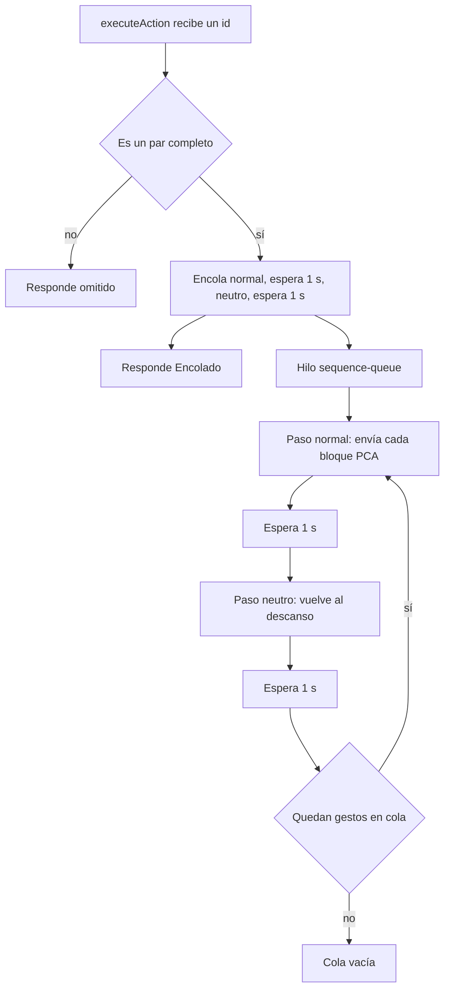

`WAIT_SECONDS` vale 1,0. El hilo es `daemon`. Un segundo gesto del turno se agrega detrás (`reject_if_busy=False`). El panel y el estudio, en cambio, llaman a `startPlayback` con `reject_if_busy=True`: si la cola está ocupada se rechazan. Cada bloque sale como `PCA,<pca>,<servo>,<pos>,<vel>\n` a 115200 baudios cuando el reloj alcanza su `inicio`. `dur` no viaja al Arduino. Sin Arduino, la cola descarta el paso de movimiento y consume las esperas. Detener vacía la cola y no envía nada al firmware: los servos se quedan en la última posición.

La voz recorta Markdown (código, encabezados, viñetas), intenta OpenAI TTS si `VOICE_TTS_MODE` no es `local` y hay `OPENAI_API_KEY` (`gpt-4o-mini-tts`, voz `ash`, WAV, texto recortado a 4096 caracteres, espera 60 s), y si falla cae a Piper (`piper --model … --output_file`) y luego a eSpeak (`-v ${ESPEAK_VOICE:-es}`). Reproduce con `paplay` hacia el primer sink `bluez`, USB o el primero de la lista; si `paplay` falla prueba `pw-play` y `aplay`. `VOICE_SKIP_PLAYBACK` genera el WAV y no lo oye. `speak` responde cuando terminó de sonar: el núcleo espera 30 s y management 20 s. El WAV temporal se borra siempre.

Hacia el Arduino, `sync_connections` abre los `/dev/ttyACM*` y `/dev/ttyUSB*` a 115200 baudios, espera 1,8 s (el micro se reinicia al abrir el puerto) y asigna `arduino_id` en orden alfabético, el primero es 0. Cada bloque se escribe bajo un `lock` como `PCA,<pca>,<servo>,<pos>,<vel>\n` y se hace `flush`; no se espera respuesta. El primer bloque de `NEGAR 9.0` sale `PCA,0,1,420,6`. El escaneo escribe `SCAN\n` y espera una línea `PCAS:<csv>`. Robótica valida `pca` 0–10, `servo` 0–15, `pos` 0–1000 y `vel` 1–10; el firmware vigente solo acepta `pca` 0–3. No hay variable de entorno para fijar el puerto.

Robótica no consume sujetos NATS en caliente. Quien la llama: el núcleo (`speak`, `getActions`, `executeAction`), management (`speak`) y el gateway (el resto, incluido el estudio).

#### 14.7 Configuración

| Clave o variable | Valor | Efecto |
|---|---|---|
| `NATS_SERVER` | obligatoria para validar | El destino real está escrito: `nats://nats-server:4222` |
| `SEQUENCES_DATA_DIR` | `/usr/src/app/data/sequences` | Almacén canónico |
| `PHRASES_PATH` | `/usr/src/app/data/phrases.json` | Frases de «Decir oración» |
| `ACTION_DESCRIPTIONS_PATH` | JSON heredado | Nadie en `src` lo lee; las frases salen del campo `description` |
| `VOICE_TTS_MODE` | `auto` | `local` nunca usa la nube; el resto intenta OpenAI si hay clave |
| `OPENAI_API_KEY` | `MS_ROBOTICS_OPENAI_API_KEY` | Compose no reusa la de management |
| `PIPER_MODEL_PATH` | onnx del repo | TTS local |
| `ESPEAK_VOICE` | `es` | Respaldo de Piper |
| `VOICE_SKIP_PLAYBACK` | `0` | `1` / `true` / `yes` no reproduce |
| `PULSE_SERVER` | socket del UID 1000 | `paplay` / `pactl` |
| `PORT` | 3003 | Uvicorn; sin rutas de negocio |

El catálogo está en el [Anexo B](#anexo-b-variables-de-entorno). Si `MS_ROBOTICS_OPENAI_API_KEY` va vacía, el TTS es local aunque management tenga clave.

#### 14.8 Pruebas

Comando: `pytest`, con `testpaths = ["tests"]`. En la investigación: `NATS_SERVER=nats://x:4222 .venv/bin/python -m pytest -q -p no:cacheprovider` → 43 aprobadas en 0,99 s.

`test_playback_queue.py` cubre la espera de 1 s, que `executeAction` encola los cuatro pasos y regresa antes de terminar, que un segundo gesto se agrega, que el panel no interrumpe una cola ocupada, que Detener vacía, que el hardware ausente descarta el paso y que el snapshot trae `remaining_ms` y `fired`. `test_sequence_ingest.py` cubre origen → canónico, descripción de 10 aceptada y más corta rechazada en el catálogo, neutro obligatorio, `overwrite` que conserva el `id` y JSON legado que se lista pero no entra a `getActions`. `test_action_catalog.py` fija que el catálogo sale de las secuencias y no del firmware. `test_phrase_store.py` cubre la siembra de frases. Las pruebas de la cola usan un único `SequenceService` compartido; en producción no es así.

#### 14.9 Trampas

Hay dos instancias de `SequenceService` y por tanto dos colas. `create_subscribers` construye un `ActionController()` (que crea su `ActionService`, que crea su `SequenceService`) y un `SequenceController()` (que crea otro). Los gestos del turno (`executeAction`) van a la primera cola; `getRuntime`, `stopPlayback` y `startPlayback` operan sobre la segunda. De ahí que el cajón de runtime de la web y el botón Detener no vean los gestos del turno, y de que el panel pueda reproducir a la vez que un gesto del turno. Las pruebas no lo detectan porque inyectan una sola instancia. Que eso se note en el hardware queda pendiente de confirmar: se deduce del código (`pba-ms-robotics/src/core/nats/nats_subscribers.py`) y no hay prueba de integración que lo cubra.

El catálogo está vacío si la descripción tiene menos de diez caracteres, aunque el par sea perfecto y el Arduino esté enchufado. La ingesta acepta descripción vacía, de modo que se puede guardar una secuencia que nunca aparecerá en el turno. De dónde salieron las 31 secuencias actuales sin descripción queda pendiente de confirmar: el estudio exige diez caracteres al guardar, así que probablemente se migraron por otra vía. Mientras no se describan, el turno no mueve el cuerpo; lanzarlos a mano desde el panel sí funciona, porque el panel no filtra por descripción.

El binario Piper de la imagen es `linux_x86_64`. En la Jetson (`aarch64`) `shutil.which("piper")` lo encuentra, y un error de ejecución no cae a eSpeak. Si esa imagen se construyó así en campo, y cómo se comporta, queda pendiente de confirmar: no se midió en aarch64. Abrir un puerto serie reinicia el Arduino y bloquea 1,8 s; el estudio consulta `/sequence/arduinos` cada 5 s. Los `arduino_id` dependen del orden alfabético de los dispositivos: reconectar un USB puede cambiar qué placa es la 0. Un JSON inválido en la carpeta rompe a la vez `listSequences`, `getActions` y `executeAction`. `executeAction` y `as_commands` releen todos los JSON en cada llamada. No se cambia `WAIT_SECONDS` ni el orden de los cuatro pasos: las pruebas y `AGENTS.md` los fijan.

Las frases de «Decir oración» viven en `PHRASES_PATH`. Si el archivo falta o `items` está vacío, se siembran 25 frases (saludos al Colegio Militar Patria, carreras, presentaciones). Si está corrupto, lanza error 500 y no lo sobrescribe. Pronunciar una frase no tiene sujeto propio: la interfaz usa `POST /voice/speak`. `ACTION_DESCRIPTIONS_PATH` y `pba-ms-robotics/src/action/descriptions.py` existen y nadie en `src` los importa: las descripciones del turno salen del campo `description` del JSON canónico.

### 15. pmai-mai-core

#### 15.1 Propósito

`pmai-mai-core` es el núcleo de percepción e interacción de R-ONE. Descubre y lee las cámaras, detecta con YOLO los rostros de los integrantes del semillero, los sigue dentro de cada cámara, les asigna una identidad global con ReID, escucha el micrófono con Vosk y arma el turno: persona, recorte, descripción de escena, catálogo de gestos, respuesta, voz y movimientos. Dicho de otro modo, es el proceso que ve, oye y decide qué decir; no es quien habla ni quien mueve los servos.

Lo que no le toca queda en otros repositorios a propósito. No abre HTTP ni WebSocket propios: la pantalla recibe el video a través del gateway. No sintetiza voz ni encola gestos: eso lo hace `pba-ms-robotics`. No elige la ruta Básico o Complejo: eso lo hace `pba-ms-management`. Tampoco contiene la lógica de describir una imagen ni la de redactar la respuesta: las importa, en el mismo proceso, de `pmai-model-context` (paquete `model_context`) y de `pmai-model-vision-language` (paquete `utils`). El recorrido de una pregunta está en [6.3](#63-chat-por-la-ruta-complejo-el-turno) y [6.4](#64-el-micrófono); esta ficha baja al código que lo ejecuta.

#### 15.2 Versión

La versión leída es la de la tabla [Versión documentada](#versión-documentada): rama `dev`, commit `e0452ed`, fecha 2026-10-27. El paquete declara versión `0.1.0` en `pmai-mai-core/pyproject.toml`. El script de consola es `pmai-core = "pmai_core.__main__:main"`.

#### 15.3 Tecnología

El servicio corre en Python 3.12 o superior, empaquetado con Hatchling. La imagen de desarrollo parte de `python:3.12-slim` (`pmai-mai-core/Dockerfile.dev`). Las dependencias propias cubren visión (`opencv-python-headless`, `onnxruntime`, `ultralytics`, `numpy`), audio (`sounddevice`, `vosk`, `webrtcvad-wheels`), configuración (`pydantic`, `pydantic-settings`), mensajería (`nats-py`) y trazas (`structlog`). El extra `dev` añade `pytest`, `pytest-asyncio`, `ruff`, `mypy` y `watchfiles`.

En la misma imagen se instalan además los dos modelos hermanos, porque el núcleo los importa en el mismo proceso: `pmai-model-context` (torch y transformers) y `pmai-model-vision-language` (Milvus Lite, sentence-transformers, llama-cpp-python, openai). Por eso el Dockerfile instala ffmpeg, v4l-utils, portaudio, libasound2, libgl1, build-essential y cmake: los dos últimos hacen falta para compilar `llama-cpp-python`. Compose construye esa imagen con el contexto en la raíz del lanzador, no dentro de `pmai-mai-core`, para poder copiar a los tres repositorios a la vez.

#### 15.4 Árbol

```text
pmai-mai-core/
  src/pmai_core/                 # paquete instalable
    __main__.py                  # CLI: python -m pmai_core
    app.py                       # arranque y cableado
    settings.py                  # modelos Pydantic de settings.toml
    api/                         # controladores NATS y clientes salientes
      health/                    # healthService.health
      camera/                    # listado y vista JPEG
      monitoring/                # identidades, pistas y ReID
      vision/                    # snapshot para la pantalla
      audio/                     # micrófono
      interaction/               # interactionService.ask
      management_ms/             # cliente a chatService.chat
      robotics_ms/               # cliente a voz y gestos
    core/                        # NATS de petición-respuesta al estilo NestJS
    messaging/                   # segundo cliente: eventos pmai.detection y pmai.reid
    domain/                      # BBox, Detection, TrackedObject, eventos
    pipeline/                    # motor, objetos globales, recorte, turno
    resources/
      camera/                    # V4L2, captura por hilo, gestor
      vision/                    # YOLO, seguidor IoU, recuadros
      reid/                      # OSNet ONNX, comparador, galería
      identification/            # orquesta detección, seguimiento, ReID
      audio/                     # palabra de activación, VAD, Vosk
    models/                      # my_model.pt, OSNet, Vosk
  tests/                         # turno, cableado, audio y contrato de visión
  settings.toml                  # configuración efectiva en el contenedor
  Dockerfile.dev                 # imagen; contexto en la raíz del lanzador
```

La organización separa tres capas que no deben mezclarse. `resources/` habla con el hardware y con los pesos: cámaras, detector, ReID, micrófono. `pipeline/` convierte ese estado en algo usable: un bucle cada 0,75 s, una escena de objetos globales y el turno. `api/` es la fachada NATS, una carpeta por servicio, más dos clientes salientes hacia management y robótica. Hay dos conexiones NATS a propósito: `core/` imita el sobre de NestJS para petición-respuesta, y `messaging/` publica eventos sin esperar respuesta. Los pesos viven versionados en `pmai-mai-core/src/pmai_core/models/` para que el contenedor no dependa de una descarga al arrancar.

#### 15.5 Archivos clave

- `pmai-mai-core/src/pmai_core/__main__.py`: punto de entrada. Lee `settings.toml` o la ruta de `sys.argv[1]`, construye `Settings.from_toml` y lanza `run_app` con `asyncio.run`.
- `pmai-mai-core/src/pmai_core/app.py`: cablea el arranque en este orden: cámaras, cliente de eventos, identificación y audio, NATS de RPC, precarga de Milvus, BLIP, embeddings y Gemma, `InteractionTurn`, enlace del micrófono al chat de management, registro de suscriptores y las tareas `pipeline`, `audio_poll` y, si aplica, `cam_poll`.
- `pmai-mai-core/src/pmai_core/pipeline/interaction_turn.py`: el turno completo. El controlador NATS solo le pasa el mensaje y la fuente `chat`.
- `pmai-mai-core/src/pmai_core/pipeline/runtime.py`: precarga. Importa `model_context.model.import_Blip_model`, `utils.milvus.conexion.get_client`, `utils.encoder.encoder` y `utils.gguf.ggufapi.precargar`.
- `pmai-mai-core/src/pmai_core/core/nats/nats_subscribers.py`: los 14 sujetos RPC, todos con prefijo `MAI_CORE_MS`.
- `pmai-mai-core/src/pmai_core/core/nats/nats_client.py`: `NatsHandler`. Espera el sobre `{pattern, data, id}`, responde `{response, isDisposed}` y ofrece `sync_request` para las llamadas salientes desde hilos.
- `pmai-mai-core/src/pmai_core/resources/identification/service.py`: `run_phase`. Detecta, sigue, corre ReID y publica eventos. Inicializa ONNX antes que PyTorch.
- `pmai-mai-core/src/pmai_core/resources/audio/service.py`: hilo de escucha, palabra de activación, VAD y despacho de la transcripción a `MANAGEMENT_MS.chatService.chat`.
- `pmai-mai-core/settings.toml`: configuración efectiva. Compose la monta en `/app/settings.toml`.
- `pmai-mai-core/Dockerfile.dev`: copia `pmai-mai-core`, `pmai-model-context` y `pmai-model-vision-language` y los instala. Un contexto limitado a este repositorio no vería a sus hermanos.

#### 15.6 Contratos

mai-core no sirve HTTP. El gateway traduce las rutas de cámara, monitoreo, visión, audio y salud a los sujetos de abajo; el catálogo global está en el [Anexo C](#anexo-c-patrones-nats). El manejador espera el sobre de NestJS, pasa `data["data"]` al controlador y responde `{response, isDisposed: true}`. JSON inválido produce `{err: "Invalid JSON"}`; cualquier otra excepción, `{err: …}`, que el gateway convierte en 400.

Contratos expuestos (RPC, `ms_name = "MAI_CORE_MS"`):

| Sujeto | Entrada | Salida | Archivo |
|---|---|---|---|
| `MAI_CORE_MS.healthService.health` | ignorada | `{status: "UP", timestamp, msName}` | `pmai-mai-core/src/pmai_core/api/health/health_controller.py` |
| `MAI_CORE_MS.cameraService.getCameras` | ignorada | `{version, count, cameras}` | `pmai-mai-core/src/pmai_core/api/camera/camera_controller.py` |
| `MAI_CORE_MS.cameraService.getCameraView` | `{camera_id}` | JPEG calidad 90 con recuadros, o 404 | `pmai-mai-core/src/pmai_core/api/camera/camera_controller.py` |
| `MAI_CORE_MS.monitoringService.getObjects` | ignorada | `{identities, ids}` | `pmai-mai-core/src/pmai_core/api/monitoring/monitoring_controller.py` |
| `MAI_CORE_MS.monitoringService.getTrackers` | ignorada | `{active_cameras}` | `pmai-mai-core/src/pmai_core/api/monitoring/monitoring_controller.py` |
| `MAI_CORE_MS.monitoringService.getTrackedObjects` | ignorada | `{count, objects}` de tipo `GlobalObjectForContext` | `pmai-mai-core/src/pmai_core/api/monitoring/monitoring_controller.py` |
| `MAI_CORE_MS.monitoringService.getReidStatus` | ignorada | identidades, cámaras vistas y cruce | `pmai-mai-core/src/pmai_core/api/monitoring/monitoring_controller.py` |
| `MAI_CORE_MS.visionService.getSnapshot` | `{selectedCameraId, thumbMaxWidth, previewMaxWidth}` | camelCase con miniaturas JPEG 82; `previewJpegBase64` siempre `null` | `pmai-mai-core/src/pmai_core/api/vision/vision_controller.py` |
| `MAI_CORE_MS.microphoneService.listMicrophones` | ignorada | lista, seleccionado y huella | `pmai-mai-core/src/pmai_core/api/audio/audio_controller.py` |
| `MAI_CORE_MS.microphoneService.selectMicrophone` | `{microphone_id}` | `{status: "ok", selected_microphone_id}` | `pmai-mai-core/src/pmai_core/api/audio/audio_controller.py` |
| `MAI_CORE_MS.microphoneService.startListening` | ignorada | `{status: "ok", message}` | `pmai-mai-core/src/pmai_core/api/audio/audio_controller.py` |
| `MAI_CORE_MS.microphoneService.stopListening` | ignorada | `{status: "ok", message}` | `pmai-mai-core/src/pmai_core/api/audio/audio_controller.py` |
| `MAI_CORE_MS.microphoneService.getListeningStatus` | ignorada | `running`, `phase`, `input_level` 0–100, última transcripción | `pmai-mai-core/src/pmai_core/api/audio/audio_controller.py` |
| `MAI_CORE_MS.interactionService.ask` | `{message}` | `{reply, fuente, movimientos: [{id, name}]}` | `pmai-mai-core/src/pmai_core/api/interaction/interaction_controller.py` |

El controlador de `ask` llama siempre `turn.ask(message, "chat")`, también cuando la pregunta nació en el micrófono. Por eso las ramas `voice` del turno no se alcanzan en el despliegue (ver [15.9](#159-trampas)).

Eventos publicados, sin respuesta, con prefijo `subject_prefix = "pmai"`: `pmai.detection` (`ObjectDetectedEvent`) y `pmai.reid` (`ObjectReIdentifiedEvent`). Ningún otro repositorio del lanzador se suscribe a ellos.

Contratos consumidos. Todas las peticiones salientes usan `NatsHandler.sync_request`, que envía `{id: "audio-voice-dispatch", data}` —el mismo `id` para todo, también en el turno—, espera `timeout + 2` s y lanza `RuntimeError` si la respuesta trae `err`. Solo puede llamarse desde un hilo de trabajo, nunca desde el bucle principal; de ahí que `ask` corra en `asyncio.to_thread`.

| Destino | Entrada | Salida esperada | Archivo |
|---|---|---|---|
| `ROBOTICS_MS.voiceService.speak` | `{message}`, 30 s | respuesta de robótica | `pmai-mai-core/src/pmai_core/api/robotics_ms/robotics_ms_service.py` |
| `ROBOTICS_MS.actionService.getActions` | `{}`, 10 s | `response["data"]` como lista de `{id, name, arduino_id, description}` | `pmai-mai-core/src/pmai_core/api/robotics_ms/robotics_ms_service.py` |
| `ROBOTICS_MS.actionService.executeAction` | `{action_id, arduino_id}`, 10 s | acuse de encolado | `pmai-mai-core/src/pmai_core/api/robotics_ms/robotics_ms_service.py` |
| `MANAGEMENT_MS.chatService.chat` | `{message}`, 30 s | la respuesta del chat (el micrófono la ignora) | `pmai-mai-core/src/pmai_core/api/management_ms/management_ms_service.py` |
| `model_context.model.import_Blip_model` | sin argumentos | `(processor, model)` en la caché | `pmai-mai-core/src/pmai_core/pipeline/runtime.py` |
| `model_context.context.generate_context_from_base64` | JPEG en base64, processor, model | `(contexto, "")`; se descarta el segundo valor | `pmai-mai-core/src/pmai_core/app.py` |
| `utils.main.responder` | objeto de escena y catálogo | ver [17.6](#176-contratos) | `pmai-mai-core/src/pmai_core/app.py` |

Si el `import` de `utils.main` falla al arrancar, el turno responde siempre la disculpa con `movimientos: []` y sin clave `fuente`, de modo que la fuente visible queda vacía y no `disculpa`.

El pipeline de visión, por dentro del código, es este. El flujo que ve el operador está en [6.6](#66-visión-en-tiempo-real); aquí importa el orden de las funciones.

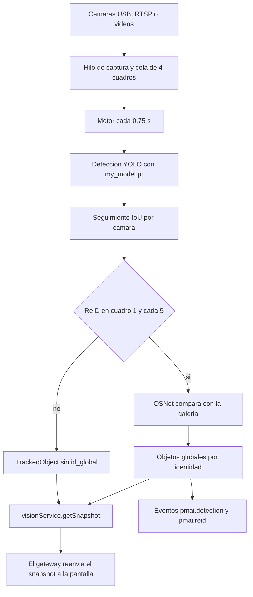

El turno, también por dentro del código. El recuento de pasos para cualquier lector está en [6.3](#63-chat-por-la-ruta-complejo-el-turno); este diagrama nombra los módulos.

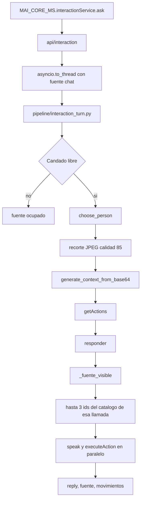

`_fuente_visible` traduce lo que devuelve `responder()`: `fuente == "cache"` pasa a `caché`; `backend == "openai"` a `OpenAI`; `fuente == "llm"` o `backend == "gguf"` a `Gemma (local)`; cualquier otro valor se deja tal cual. Los valores que mai-core puede producir son `caché`, `OpenAI`, `Gemma (local)`, `ocupado`, `voz corta`, `disculpa` y, si falló el import, la cadena vacía.

#### 15.7 Configuración

La configuración efectiva vive en `pmai-mai-core/settings.toml`. Entre paréntesis, el valor por defecto de `pmai-mai-core/src/pmai_core/settings.py` cuando difiere. La lista de variables de Compose está en el [Anexo B](#anexo-b-variables-de-entorno).

| Clave | Valor en el TOML | Efecto |
|---|---|---|
| `app.name` | `pmai-core` | Solo se registra en el log de arranque |
| `app.log_level` | `INFO` | Ningún módulo la lee; structlog usa su configuración por defecto |
| `camera.source_mode` | `v4l2` | `v4l2` descubre USB; `video_folder` trata cada video como `usb_0..N` |
| `camera.auto_discover` | `true` | Activa el descubrimiento V4L2 y el sondeo en caliente |
| `camera.poll_interval_seconds` | `10` | Periodo del sondeo de cámaras |
| `camera.default_resolution` | `[640, 480]` | Se pide a cada cámara V4L2 |
| `camera.default_fps` | `15` | Se pide a cada cámara V4L2 |
| `camera.video_folder_path` | `/data` | Carpeta de videos de desarrollo; Compose monta `./data:/data:ro` |
| `camera.video_extensions` | `.mp4`, `.avi`, `.mov`, `.mkv`, `.webm` | Extensiones aceptadas en modo carpeta |
| `camera.video_loop` | `true` | El video se repite |
| `camera.video_fps` | `15` | Lectura de archivo |
| `vision.model_path` | `/app/src/pmai_core/models/my_model.pt` | Detector; el defecto de Pydantic es `models/yolo11n.onnx` |
| `vision.confidence_threshold` | `0.5` | Descarta detecciones por debajo |
| `vision.device` | `cpu` | Dispositivo de YOLO |
| `reid.model_path` | `/app/src/pmai_core/models/osnet_x0_25_msmt17.onnx` | Extractor; el defecto de Pydantic es `models/osnet_ain_x0_25.onnx` |
| `reid.similarity_threshold` | `0.6` | Similitud coseno mínima (defecto 0.7) |
| `reid.embedding_update_interval` | `5` | ReID en el cuadro 1 y luego cada 5 cuadros por cámara |
| `reid.gallery_max_size` | `1000` | Tope del registro; al llenarse expulsa la identidad con menos actualizaciones |
| `pipeline.result_interval_seconds` | `0.75` | Espera entre iteraciones y entre eventos (defecto 1.0) |
| `audio.enabled` | `true` | Si es falso, el hilo de audio no arranca |
| `audio.auto_start_listening` | `true` | Estado inicial de `listening_enabled` |
| `audio.auto_select_microphone` | `true` | Elige el primero de la lista (USB primero) si no hay preferido |
| `audio.preferred_microphone_id` | `""` | Huella preferida; vacía = automático |
| `audio.sample_rate` | `16000` | Tasa deseada; si no, la primera compatible y remuestreo a 16 kHz |
| `audio.channels` | `1` | Mono |
| `audio.chunk_ms` | `30` | Trama de 480 muestras a 16 kHz |
| `audio.long_silence_ms` | `1600` | Silencio que cierra la frase |
| `audio.post_wake_grace_ms` | `2200` | Tras la palabra de activación el silencio no cuenta (defecto 1800) |
| `audio.max_recording_seconds` | `20.0` | Tope de captura (defecto 12.0) |
| `audio.min_recording_seconds` | `1.0` | Mínimo grabado (defecto 0.8) |
| `audio.preroll_seconds` | `0.4` | Audio previo reinyectado al reconocedor de la orden |
| `audio.min_useful_transcript_chars` | `14` | Por debajo no se dice la frase de "pensando" |
| `audio.fallback_speak_message` | frase de "no te escuché" | Ningún módulo la lee; el turno usa su propia constante |
| `audio.wake_phrases` | `hey fede`, `fede`, `federico` | Gramática de activación (defecto `hey fede`, `hola fede`) |
| `audio.thinking_phrases` | cinco frases | Rotación antes de despachar una transcripción larga |
| `audio.wake_partial_match` | `true` | Acepta la frase al final de lo oído |
| `audio.wake_energy_rms` | `500` | Compuerta de energía hacia el reconocedor de activación |
| `audio.wake_energy_hangover_ms` | `300` | Cola de esa compuerta |
| `audio.wake_confirm_chunks` | `2` | Parciales iguales seguidos para abrir |
| `audio.level_rms_full_scale` | `4000` | Escala del medidor `input_level` |
| `audio.level_hold_ms` | `500` | Retención del medidor |
| `audio.vosk_model_path` | `/app/src/pmai_core/models/vosk-model-small-es-0.42` | Modelo de español |
| `audio.poll_interval_seconds` | `5.0` | Resincroniza la selección con el hardware |
| `nats.url` | `nats://localhost:4222` | Lo pisa `NATS_SERVER` si existe |
| `nats.subject_prefix` | `pmai` | Prefijo de eventos |
| `nats.ms_name` | `MAI_CORE_MS` | Prefijo de los sujetos RPC |

`camera.sources` no está en el TOML: Pydantic la deja en `[]`. Sirve para fuentes manuales `stream` o `file` (RTSP, MJPEG o archivo) y es la vía que Compose recomienda en WSL2, donde los dispositivos V4L2 van comentados.

Variables del servicio `pmai-core` en Compose:

| Variable | Valor de plantilla | Efecto |
|---|---|---|
| `NATS_SERVER` | `nats://nats-server:4222` | Pisa `nats.url` |
| `PMAI_SETTINGS` | `/app/settings.toml` | Ningún módulo la lee; la ruta llega como argumento del comando |
| `PYTHONPATH` ← `PMAI_CORE_PYTHONPATH` | `/opt/model-context:/opt/action-model:/app/src` | Resolución de `model_context`, `utils` y `pmai_core` |
| `OPENAI_API_KEY` | clave de acción o, si va vacía, la de management | La lee `utils.gpt.gptapi` |
| `OMP_NUM_THREADS`, `MKL_NUM_THREADS`, `OPENBLAS_NUM_THREADS` | `1` | Acotan PyTorch y BLAS; Gemma usa `n_threads=os.cpu_count()` y no los respeta |
| `MILVUS_DB_PATH` | `/data/milvus/androide_milvus.db` | Ningún módulo la lee |
| `PMAI_CORE_PORT` | `3004` | Se publica; nada escucha en él |

`PMAI_CORE_PYTHONPATH` no se recorta a `/app/src`. La imagen instala con pip una copia de los dos modelos en site-packages, y Compose monta el código vivo en `/opt/model-context` y `/opt/action-model`. El orden del `PYTHONPATH` hace que esas rutas montadas ganen sobre la copia congelada de la imagen, y que `/app/src` resuelva `pmai_core`. Si se dejara solo `/app/src`, el núcleo importaría la versión instalada al construir la imagen y los cambios en BLIP, Milvus o el prompt no tendrían efecto hasta reconstruir. Por eso el lanzador fija las tres rutas y `AGENTS.md` prohíbe recortarlas.

El comando del contenedor es `watchfiles "python -m pmai_core /app/settings.toml" /app/src`. Reinicia el proceso al cambiar archivos bajo `/app/src`; no vigila `settings.toml` ni el código de los modelos en `/opt`.

#### 15.8 Pruebas

El comando es `pytest` desde `pmai-mai-core` (`testpaths = ["tests"]`, `asyncio_mode = "auto"`, `pythonpath = ["src"]`).

`pmai-mai-core/tests/test_interaction_turn.py` cubre el desempate por `id_global`, el recorte JPEG en base64, la voz corta sin modelo, el segundo turno ocupado sin hablar en chat, el turno sin persona sin BLIP y el fallo de BLIP que igual responde. `pmai-mai-core/tests/test_interaction_wiring.py` cubre `getActions` y `executeAction`, que el controlador `ask` usa la fuente `chat` y el despacho de voz. `pmai-mai-core/tests/test_audio_dispatch.py` comprueba que la transcripción va al chat enlazado y no al turno. `pmai-mai-core/tests/test_vision_pipeline_contract.py` exige un solo JPEG por miniatura, `previewJpegBase64` nulo, límites 480/960 y `result_interval_seconds = 1.0` en el TOML. `pmai-mai-core/tests/audio/` cubre descubrimiento de micrófonos, energía, nivel, reglas de escucha, remuestreo, selección y coincidencia de la palabra de activación.

Resultado registrado en las notas, ejecutado con `pmai-mai-core/.venv` y sin escribir cachés: las dos pruebas de turno y cableado no se recolectan porque ese entorno no tiene `nats-py`; del resto, 48 pasan y 1 falla, `test_pipeline_interval_is_one_second`, porque el TOML dice `0.75` y la prueba sigue exigiendo `1.0`. Pendiente de confirmar: si el valor 0,75 es intencional (lo cambió el commit `52eba23`) y la prueba quedó desactualizada.

#### 15.9 Trampas

El invariante del turno es uno solo a la vez: un `threading.Lock` no bloqueante. Si está tomado, la respuesta es "Sigo respondiendo, un momento." con fuente `ocupado`, y solo se pronuncia si la fuente es `voice`. Esa rama `voice` —voz corta y ocupado hablado— no se alcanza en el despliegue. El micrófono despacha a `MANAGEMENT_MS.chatService.chat` y management llama a `interactionService.ask`, cuyo controlador fija la fuente `chat`. `bind_turn` guarda el turno en el audio, pero nadie lo usa. De ahí que `voz corta` y el ocupado hablado solo aparecerían si alguien llamara a `ask(..., "voice")` directamente.

`id_global` solo existe en los cuadros donde corre ReID: el primero y luego cada cinco. El seguidor crea cada `TrackedObject` con `global_id=""`, y `compute_global_objects_for_context` descarta los objetos sin identidad. Como el último cuadro anotado se sobrescribe en cada iteración, en cuatro de cada cinco vueltas la escena puede no tener personas y el turno caer en `Persona no identificada` aunque alguien esté frente a la cámara. Pendiente de confirmar: con qué frecuencia ocurre eso con cámaras reales. Además, la etiqueta de la persona es el nombre de la clase YOLO (un integrante del semillero), no el identificador ReID.

El aviso de catálogo vacío escribe `reason="sin_arduino"` y habla de que no hay puerto serie `ttyACM`/`ttyUSB` (`pmai-mai-core/src/pmai_core/api/robotics_ms/robotics_ms_service.py`). Eso contradice el contrato de robótica y `AGENTS.md`: un almacén sin pares completos o un JSON legado produce lista vacía aunque el Arduino esté conectado, y esa lista vacía no es un fallo del turno. El texto del log engaña; manda lo que responde `getActions`.

Otras invariantes que no se deben romper. ONNX Runtime (ReID) se inicializa y calienta antes que PyTorch (YOLO) para evitar un bloqueo de OpenMP; no se reordena, y la inferencia corre en `asyncio.to_thread` por la misma razón. El detector recibe el cuadro BGR crudo: no aplica el balance de blancos ni el CLAHE del entrenamiento (ver [18.9](#189-trampas)). `watchfiles` solo vigila `/app/src`, así que cambiar `pmai-mai-core/settings.toml` o el código montado en `/opt` no reinicia el proceso. `PMAI_CORE_PORT` se publica y no hay servidor. `PMAI_SETTINGS` y `MILVUS_DB_PATH` se definen y nadie las lee. Compose siempre define `OPENAI_API_KEY`, aunque sea vacía, y `load_dotenv(..., override=False)` no pisa una variable que ya existe: el `.env` de `pmai-model-vision-language` no sirve de respaldo dentro del contenedor. Si BLIP no se precargó, cada turno falla al leer `cache["processor"]` nulo y sigue con contexto vacío, sin recarga perezosa. Una cámara V4L2 se abandona tras 50 lecturas fallidas seguidas. El registro de identidades vive solo en memoria: al reiniciar se pierden todos los `id_global`. Pendiente de confirmar: si `voiceService.speak` bloquea hasta terminar de reproducir, una respuesta larga superaría los 30 s de `sync_request` y el turno registraría `turn_speak_failed`. Pendiente de confirmar: dónde guardan BLIP y sentence-transformers su caché de Hugging Face dentro del contenedor; Compose no monta un volumen para ella.

### 16. pmai-model-context

#### 16.1 Propósito

`pmai-model-context` describe en una frase corta, en inglés, lo que se ve en el recorte de la persona elegida para el turno. Esa frase es el "contexto visual": no se muestra en la pantalla, sino que viaja dentro del objeto de escena hasta el modelo de acción, que la interpreta y responde en español. Para producirla carga BLIP desde Hugging Face, decodifica un JPEG en base64, genera el texto con búsqueda por haces y lo limpia de alucinaciones frecuentes.

No elige a la persona, no recorta la imagen y no responde la pregunta: eso lo hacen `pmai-mai-core` y `pmai-model-vision-language`. Tampoco entrena. Pese a que el cuaderno habla de entrenar modelos, el repositorio solo usa un modelo preentrenado. La historia de por qué se eligió BLIP-base está en [30](#30-el-modelo-contextual); esta ficha documenta lo que corre hoy. El paso del turno que lo llama está en [6.3](#63-chat-por-la-ruta-complejo-el-turno) y el concepto en [4.5](#45-descripción-de-escena).

#### 16.2 Versión

La versión leída es la de la tabla [Versión documentada](#versión-documentada): rama `dev`, commit `400ec0d`, fecha 2026-10-09. El paquete declara versión `0.1.0` en `pmai-model-context/pyproject.toml`. El commit `ac2703f` del mismo día renombró el paquete de `utils` a `model_context`.

#### 16.3 Tecnología

Python 3.12 o superior, empaquetado con setuptools y el paquete explícito `model_context`. En ejecución bastan torch, transformers menor que 5, Pillow y Pydantic. El resto de dependencias declaradas (`datasets`, Jupyter, `spiceypy`, `pycocoevalcap`, matplotlib) es del cuaderno de experimentación. La gestión local es con uv (`pmai-model-context/uv.lock`). No lee variables de entorno.

#### 16.4 Árbol

```text
pmai-model-context/
  model_context/          # paquete importable (antes se llamaba utils)
    model.py              # carga de BLIP y cuantización
    context.py            # generación y limpieza
    cache.py              # caché de módulo
    decoder.py            # base64 a imagen RGB
    local_object.py       # copia de GlobalObjectForContext; mai-core no la usa
  objetos/                # 41 imágenes de prueba en base64, ~27,7 MB
  tests/                  # una prueba de importación
  main.ipynb              # experimentación: carga, cuantización y recorrido de objetos
```

El repositorio es una biblioteca, no un servicio. Por eso no hay `api/`, ni NATS, ni Dockerfile propio: vive montado en `/opt/model-context` dentro del contenedor de mai-core. La carpeta `objetos/` y el cuaderno son material de laboratorio; el turno no los toca.

#### 16.5 Archivos clave

- `pmai-model-context/model_context/model.py`: `MODEL_ID` e `import_Blip_model` (carga única cacheada) y `get_quantized_blip_model` (cuantización dinámica, no usada en el turno).
- `pmai-model-context/model_context/context.py`: `PROTECTED_WORDS`, `SUSPICIOUS_WORDS`, `HALLUCINATION_PATTERNS`, `clean_caption`, `generate_context` y `generate_context_from_base64`.
- `pmai-model-context/model_context/cache.py`: diccionario de módulo `_MODEL_CACHE` con `processor`, `model`, `model_quantized` y metadatos; `get_cache`, `update_cache`, `clear_cache`.
- `pmai-model-context/model_context/decoder.py`: `base64_to_image` acepta prefijo `data:`, valida y convierte a RGB. Si la imagen no es válida lanza `ValueError("La imagen Base64 no es válida.")`.
- `pmai-model-context/model_context/local_object.py`: copia de `GlobalObjectForContext`. mai-core usa la suya en `pmai-mai-core/src/pmai_core/domain/`.
- `pmai-model-context/model_context/__init__.py`: vacío. El import es siempre `from model_context.…`.

#### 16.6 Contratos

No expone NATS ni HTTP. Es una biblioteca que mai-core importa desde `/opt/model-context`, primer elemento de `PMAI_CORE_PYTHONPATH` (ver [15.7](#157-configuración) y el [Anexo B](#anexo-b-variables-de-entorno)). El [Anexo C](#anexo-c-patrones-nats) no aplica.

API pública que usa mai-core:

| Función | Entrada | Salida | Archivo |
|---|---|---|---|
| `model_context.model.import_Blip_model` | ninguna | `(processor, model)` y los deja en la caché | `pmai-model-context/model_context/model.py` |
| `model_context.cache.get_cache` | ninguna | el diccionario de módulo | `pmai-model-context/model_context/cache.py` |
| `model_context.context.generate_context_from_base64` | JPEG en base64, processor, model | `(contexto, prompt)` con `prompt` siempre `""`; mai-core descarta el segundo valor | `pmai-model-context/model_context/context.py` |

mai-core no usa `get_quantized_blip_model`, `base64_to_image_resized`, `GlobalObjectForContext`, `context_info` ni `clear_cache`.

Contratos consumidos: Hugging Face Hub, `AutoProcessor.from_pretrained("Salesforce/blip-image-captioning-base", use_fast=True)` —con reintento sin `use_fast` si da `TypeError` o `ImportError`— y `BlipForConditionalGeneration.from_pretrained`. La primera vez necesita red. No habla con ningún microservicio.

#### 16.7 Configuración

Todo está en constantes. No hay `.env`. El [Anexo B](#anexo-b-variables-de-entorno) no lista claves de este repositorio.

| Clave | Valor | Efecto |
|---|---|---|
| `MODEL_ID` | `Salesforce/blip-image-captioning-base` | Variante base de BLIP, elegida por ser ligera en CPU |
| `DEVICE` | `cpu` | Las tensores se mueven a CPU |
| `prompt` de generación | `""` | Sin texto guía |
| `max_length` | `88` | Tope de tokens |
| `min_length` | `18` | Piso de tokens |
| `num_beams` | `10` | Búsqueda por haces |
| `repetition_penalty` | `1.4` | Penaliza repeticiones |
| `early_stopping` | `True` | Corta cuando los haces convergen |
| `length_penalty` | `1.05` | Ligera preferencia por frases un poco más largas |
| `no_repeat_ngram_size` | `3` | No repite trigramas |
| `use_cache` | `True` | Caché KV de transformers |
| cuantización | `torch.qint8` sobre `torch.nn.Linear`, motor `qnnpack` | Disponible y cacheada; el turno usa `cache["model"]`, el modelo sin cuantizar |

La generación corre bajo `torch.inference_mode()`. Después, `processor.batch_decode(..., skip_special_tokens=True)` y `clean_caption`. Pendiente de confirmar: por qué se dejó de usar la versión cuantizada en el turno; el código la conserva y el cuaderno la prueba, pero mai-core carga el modelo completo.

#### 16.8 Pruebas

El comando es `PYTHONPATH=. pytest` desde `pmai-model-context`. Hay una sola prueba, `pmai-model-context/tests/test_package_import.py`, que comprueba que `model_context.local_object.GlobalObjectForContext` acepta el campo `question`. Resultado registrado: 1 prueba pasa (`PYTHONPATH=. python3 -m pytest -q -p no:cacheprovider`). No hay pruebas de `clean_caption`, `generate_context` ni de la caché.

#### 16.9 Trampas

El paquete se llama `model_context` y no `utils` porque las dos bibliotecas se cargan en el mismo proceso de mai-core. `pmai-model-vision-language` también exporta `utils` y, con las dos rutas en `PYTHONPATH`, un segundo `utils` taparía al primero. El commit `ac2703f` (2026-10-09) renombró `utils/*` a `model_context/*`. Nunca se debe volver a importar como `utils`.

`clean_caption` trabaja en dos pasadas. Primero borra, palabra a palabra, las de `SUSPICIOUS_WORDS`, salvo que estén en `PROTECTED_WORDS`. Después aplica cada patrón de `HALLUCINATION_PATTERNS` solo si el texto coincidente no contiene una palabra protegida. Al final arregla puntuación y pone mayúscula inicial. Las palabras protegidas —nunca se borran— cubren personas y animales (`robot`, `man`, `woman`, `child`, `cat`, `dog`…), objetos (`chair`, `laptop`, `camera`…), colores, tamaños y acciones (`standing`, `sitting`, `holding`…). Las sospechosas cubren adverbios de duda (`likely`, `probably`, `seems`…), `nasa`, países, restos de alucinaciones vistas en pruebas (`sebre`, `seiree`, `crochel`, `keychain`, `triumph`…) y verbos de texto leído (`says`, `reads`). Los patrones recortan palabras repetidas de cuatro letras o más, "a man"/"a woman" duplicado, verbos copulativos dobles, fechas con mes y año, cualquier año 19xx o 20xx, textos citados y nombres de ciudades tras "in".

Hay tres agujeros conocidos en ese filtro. Las entradas de `SUSPICIOUS_WORDS` con espacios (por ejemplo `"le l'estrange"`) nunca coinciden, porque la comparación es palabra a palabra. Falta una coma entre `"how do i' m"` y `"crochel"`: Python concatena las dos cadenas y `crochel` no se filtra como palabra suelta. El patrón de años borra cualquier número 19xx/20xx aunque sea real.

Si la precarga del arranque falla —sin red la primera vez—, la caché queda en `None` y cada turno falla en BLIP sin reintentar la carga; mai-core sigue sin contexto. La salida está en inglés a propósito: el prompt de `pmai-model-vision-language` le pide al modelo interpretarla y responder en español, y las aperturas de caché se eligen comparando ese inglés con ejemplos (ver [17.6](#176-contratos)). El `README.md` del repositorio habla de Ollama y LangChain; ninguno se usa en el paquete. Pendiente de confirmar: la latencia real de BLIP-base con 10 haces en la Jetson o el N100, y dónde queda la caché de Hugging Face dentro del contenedor.

### 17. pmai-model-vision-language

#### 17.1 Propósito

`pmai-model-vision-language` es el modelo de acción. Recibe el objeto de la escena —quién pregunta, qué se ve y qué preguntó— más el catálogo de gestos de esa misma llamada, y devuelve la frase y hasta tres ids de gesto. Primero busca una respuesta ya guardada en Milvus Lite (`conocimiento` y, si no hay acierto, `interacciones` con coincidencia estricta). Si no encuentra nada parecido, construye el prompt de R-One y genera con OpenAI `gpt-4o-mini` cuando hay clave, o con Gemma 4 E2B en GGUF local cuando no la hay o la llamada falla.

No elige a la persona, no describe la imagen, no habla y no mueve servos. Eso queda en mai-core, en el paquete de contexto y en robótica. El concepto de caché semántico está en [4.7](#47-caché-semántico), el de modelo local frente a nube en [4.8](#48-modelo-local-frente-a-modelo-en-la-nube), las colecciones en [7.2](#72-milvus-lite) y el lugar del turno en [6.3](#63-chat-por-la-ruta-complejo-el-turno). Esta ficha recorre `responder()` y el prompt.

#### 17.2 Versión

La versión leída es la de la tabla [Versión documentada](#versión-documentada): rama `dev`, commit `b9042c9`, fecha 2026-10-31. El paquete declara versión `0.1.0` en `pmai-model-vision-language/pyproject.toml`.

#### 17.3 Tecnología

Python 3.12 o superior, setuptools con los paquetes `utils*`, `models*` y `prompt*`. Las dependencias de ejecución relevantes son `pymilvus[milvus-lite]`, `sentence-transformers`, `llama-cpp-python`, `openai`, `huggingface-hub`, `python-dotenv` y `spanlp`. El extra `dev` es `pytest>=8`. Quedan además dependencias heredadas de experimentación que el turno no usa: FastAPI, Uvicorn, LangChain, Ollama, Jupyter, pandas, wikipedia-api e ibm-watsonx-ai. El bloqueo de versiones es con uv.

#### 17.4 Árbol

```text
pmai-model-vision-language/
  utils/                         # paquete importable utils
    main.py                      # responder() y ayudas de nombre
    config.py                    # rutas, umbrales, modelos
    personalizacion.py           # aperturas según el contexto visual
    encoder/                     # embeddings 384 dimensiones
    milvus/                      # conexión, búsqueda, indexación, androide_milvus.db
    gpt/                         # enrutador OpenAI hacia Gemma
    gguf/                        # Gemma 4 E2B con llama-cpp-python
    context_builder/             # siembra de conocimiento
    webscraping/                 # primera fase hecha; segunda vacía
    ollama/                      # cliente histórico, roto
    stt-tts_to_test/             # pruebas sueltas históricas
  prompt/                        # PROMPT_PRINCIPAL y detector de groserías
  models/                        # esquema GlobalObjectForContext y carpeta gguf
  data/                          # aperturas.json (lo único versionado de data)
  tests/                         # pytest actual
  test/                          # comparativa histórica de GGUF
  docs/                          # texto académico de las secciones 2.10 a 2.12
  app.py                         # demo Gradio, histórica
  main.ipynb                     # cuaderno histórico
  androide_milvus.db             # base vieja en la raíz; ningún módulo la abre
```

La organización sigue el camino de una pregunta: `utils/main.py` orquesta, `utils/milvus/` es la memoria, `prompt/` es lo que se le dice al modelo cuando la memoria no alcanza y `utils/gpt/` elige entre nube y local. `models/gguf/` guarda el archivo de Gemma, que git ignora y se descarga solo. Lo histórico queda en el árbol —Ollama, Gradio, el cuaderno, STT/TTS, la base de la raíz— para no romper clones antiguos, pero el turno no lo importa.

#### 17.5 Archivos clave

- `pmai-model-vision-language/utils/main.py`: `responder(obj, secuencias)`, única entrada del turno.
- `pmai-model-vision-language/utils/config.py`: constantes y `load_dotenv(PROJECT_ROOT / ".env", override=False)`.
- `pmai-model-vision-language/utils/milvus/busqueda.py`: `search()` en dos etapas, vectorial y textual.
- `pmai-model-vision-language/utils/milvus/conexion.py`: cliente perezoso y creación de `conocimiento` e `interacciones`.
- `pmai-model-vision-language/utils/milvus/indexar.py`: inserción. El docstring aún habla de ids 1–34; el código acepta cualquier entero.
- `pmai-model-vision-language/utils/gpt/gptapi.py`: `generar_respuesta`. Si hay `OPENAI_API_KEY` intenta OpenAI; si no hay clave o la llamada lanza, Gemma.
- `pmai-model-vision-language/utils/gguf/ggufapi.py`: descarga del GGUF, singleton, plantilla Gemma y análisis del JSON.
- `pmai-model-vision-language/prompt/principal.py`: `PROMPT_PRINCIPAL`, `formatear_catalogo`, `construir_prompt`.
- `pmai-model-vision-language/prompt/detector_grocerias.py`: `procesar_pregunta` con spanlp. `filtrar_pregunta`, con respuesta fija y gesto `[1]`, existe y no se llama.
- `pmai-model-vision-language/utils/personalizacion.py`: `elegir_apertura`.
- `pmai-model-vision-language/utils/context_builder/cargar_preguntas.py`: siembra idempotente. `pmai-model-vision-language/utils/context_builder/alimentar_basevec.py` inserta con `movimientos = [1]` por defecto.

#### 17.6 Contratos

No expone NATS ni HTTP en el despliegue. Es una biblioteca que mai-core importa desde `/opt/action-model` (ver [15.7](#157-configuración)). El [Anexo C](#anexo-c-patrones-nats) no aplica.

| Función | Entrada | Salida | Archivo |
|---|---|---|---|
| `utils.main.responder` | objeto con `question`, `etiqueta`, `contexto`; lista de `getActions` | dict con `respuesta`, `movimientos`, `fuente`, `etiqueta` y, en ruta modelo, `backend` | `pmai-model-vision-language/utils/main.py` |
| `utils.milvus.conexion.get_client` | ninguna | cliente Milvus Lite; crea las colecciones si faltan | `pmai-model-vision-language/utils/milvus/conexion.py` |
| `utils.encoder.encoder` | import de módulo | carga `paraphrase-multilingual-MiniLM-L12-v2` | `pmai-model-vision-language/utils/encoder/encoder.py` |
| `utils.gguf.ggufapi.precargar` | ninguna | deja Gemma en memoria | `pmai-model-vision-language/utils/gguf/ggufapi.py` |
| `python -m utils.context_builder.cargar_preguntas` | JSON de pares | imprime `Conocimiento nuevo: <n>` | `pmai-model-vision-language/utils/context_builder/cargar_preguntas.py` |

Contratos consumidos: OpenAI Chat Completions (`gpt-4o-mini`, `temperature=0.7`, `response_format=json_object`); Hugging Face Hub para el GGUF `unsloth/gemma-4-E2B-it-GGUF` / `gemma-4-E2B-it-Q4_K_M.gguf` y para el modelo de embeddings; Milvus Lite embebido; spanlp `Palabrota`. El catálogo lo produce `ROBOTICS_MS.actionService.getActions` y llega a través de mai-core.

`responder()` paso a paso. El objeto de entrada, escrito como JSON para leerlo —en el código es un `GlobalObjectForContext`—, se parece a este, tomado de la situación de la [sección 3](#3-recorrido-de-una-pregunta):

```json
{
  "id_global": "gid_3f9a1c2e",
  "etiqueta": "Andrea Lopez",
  "confianza": 0.91,
  "contexto": "a woman with glasses standing in front of a robot",
  "question": "qué es la Universidad Libre"
}
```

El segundo argumento es la lista que devolvió `getActions` en esa llamada (`id`, `name`, `arduino_id`, `description`). Hoy esa lista suele ir vacía porque las secuencias de robótica no tienen descripción (ver [1.3](#13-qué-puede-hacer-r-one-hoy)); el ejemplo sigue con catálogo vacío, que es el caso real.

1. Toma `obj.question` y la pasa por `procesar_pregunta`: spanlp censura groserías y reduce signos repetidos. Si había grosería, más adelante no se indexa.
2. `detectar_intencion` clasifica en `saludo_social`, `identidad_universidad`, `beneficio_opinion`, `dato_especifico` o `general`. Solo cambia el umbral: 0,35 en `conocimiento`, o 0,28 si la intención es `dato_especifico`. `INTENCIONES_SOCIALES` no se usa.
3. Arma `permitidos` con los `id` enteros del catálogo de esta llamada y pone `milvus_caido = False`. Esa bandera es interna: no viaja en el JSON de salida.
4. Busca en `conocimiento`. Si `search` lanza, marca Milvus caído y no hay acierto. `search` tiene dos etapas: vecino más cercano por HNSW (se acepta si la distancia coseno es ≤ umbral) y un respaldo textual de hasta 1000 registros (igualdad exacta, frase contenida con al menos tres palabras, o Jaccard ≥ 0,45).
5. Solo si no hubo acierto, busca en `interacciones` con umbral 0,40 y `solo_exacto=True`. "Coincidencia estricta" incluye que una pregunta contenga a la otra, no solo la igualdad carácter a carácter.
6. `etiqueta` pasa por `_etiqueta_real`: si era `Persona no identificada`, `(sin nombre)` o vacío, queda `""`.
7. Ruta caché: limpia restos de "Persona no identificada" en la respuesta guardada, elige una apertura con `elegir_apertura(obj.contexto)` y antepone nombre y apertura (`"Andrea, veo que buscas orientación. …"`). Los movimientos guardados, que en disco son texto JSON, se filtran por `permitidos` y se cortan a 3. No pasa por ningún modelo ni indexa. Sale así:

```json
{
  "respuesta": "Andrea, la Universidad Libre es una institución de educación superior colombiana fundada en 1923.",
  "movimientos": [],
  "fuente": "cache",
  "etiqueta": "Andrea Lopez"
}
```

8. `elegir_apertura` codifica el contexto visual y lo compara por producto punto con los ejemplos de `pmai-model-vision-language/data/aperturas.json` (41 situaciones). Si la mejor similitud es ≥ 0,60 (`UMBRAL_APERTURA`) devuelve una frase al azar de esa situación, en minúscula, del estilo "veo que buscas orientación" o "veo que vienen acompañados". Cualquier error devuelve nada.
9. Ruta modelo: `construir_prompt` rellena `PROMPT_PRINCIPAL` con la etiqueta cruda (puede ser `Persona no identificada`), el contexto o `Sin contexto visual disponible`, la pregunta y `{catalogo_movimientos}`. Ese hueco es una tabla Markdown `| id | nombre | arduino_id | descripcion |` con una fila por secuencia; sin secuencias, el texto `(No hay movimientos disponibles)`. Las llaves del formato de salida van dobles (`{{` `}}`) porque el prompt pasa por `str.format`.
10. El prompt fija identidad (nombre R-One invariable, robot físico, español siempre, tono cálido), cinco pasos de razonamiento (persona, intención, contexto visual, movimientos, veracidad), personalización obligatoria por nombre y por escena, formato JSON `{"respuesta", "movimientos"}`, veracidad, temas delicados, defensa ante inyección y nueve ejemplos con `movimientos: []`. Los datos de esta llamada van al final.
11. `generar_respuesta(prompt)`: si `OPENAI_API_KEY` no está vacía intenta OpenAI y marca `_backend = "openai"`; si no hay clave o la llamada lanza (sin red, 401, cuota), usa Gemma y marca `_backend = "gguf"`. El código no sondea la red: `hay_internet` existe solo para logs y no se llama. Gemma es un singleton con `n_ctx=8192`, `n_threads=os.cpu_count()`, `max_tokens=1024`, `temperature=0.3`; si la salida queda vacía, descarta la instancia y reintenta una vez.
12. Limpia marcas sin nombre. Indexa en `interacciones` solo si Milvus no cayó, la pregunta no tenía groserías y la respuesta es almacenable (no vacía, no genérica, sin "no dispongo de ese dato"). Antes quita el nombre de la persona; si el nombre o "Persona no identificada" siguen apareciendo, no indexa. Un error al indexar se registra y no corta la respuesta.
13. Devuelve la ruta modelo:

```json
{
  "respuesta": "Andrea, no tengo una opinión meteorológica; si sales, un abrigo no sobra.",
  "movimientos": [],
  "fuente": "llm",
  "backend": "openai",
  "etiqueta": "Andrea Lopez"
}
```

mai-core traduce esas claves a lo que ve la pantalla. `respuesta` pasa a `reply`. `fuente == "cache"` pasa a `caché`; `backend == "openai"` a `OpenAI`; `fuente == "llm"` o `backend == "gguf"` a `Gemma (local)`. `movimientos` deja de ser una lista de enteros y se convierte en `[{id, name}]`, conservando como máximo los tres primeros ids que existan en el catálogo de esa llamada, en el orden del modelo. El objeto que sale por NATS se parece a:

```json
{
  "reply": "Andrea, la Universidad Libre es una institución de educación superior colombiana fundada en 1923.",
  "fuente": "caché",
  "movimientos": []
}
```

Siembra de `conocimiento`. `scripts/seed-conocimiento.sh` usa `docker` o `sudo docker`: si `pmai-core` está corriendo ejecuta `python -m utils.context_builder.cargar_preguntas` con `compose exec`; si no, lanza un `compose run --rm --no-deps` de un solo uso. `cargar_preguntas.py` lee `pmai-model-vision-language/utils/webscraping/primera fase/preguntas_respuestas.json` (244 pares; 73 traen `movimientos` y 171 no), consulta hasta 16384 preguntas ya guardadas y solo inserta las que no estén con el mismo texto, de modo que es idempotente. `alimentar_basevec` valida pregunta y respuesta no vacías, toma `movimientos` o `movimiento` o, si faltan, `[1]` (`MOVIMIENTO_POR_DEFECTO = 1`), codifica en lote e inserta. De ahí que 171 pares de conocimiento ejecuten el gesto con `id == 1` el día que el catálogo vivo tenga una secuencia con ese número. `scripts/lan-up.sh` hace esta siembra en cada arranque en red local.

Lo histórico, que no forma parte del turno: `pmai-model-vision-language/utils/ollama` importa `OLLAMA_MODEL` de `utils.config`, que ya no existe, y valida ids fijos 1–34. `pmai-model-vision-language/app.py` es una demo Gradio que no arranca tal cual: importa `gradio` (no está en las dependencias), lee un `movimientos.json` que no existe y usa `say`/`afconvert` de macOS. `pmai-model-vision-language/main.ipynb` importa un nombre de módulo inválido y busca una ruta de macOS. `pmai-model-vision-language/utils/stt-tts_to_test` prueba NeMo y un TTS de transformers que no están en dependencias. `pmai-model-vision-language/androide_milvus.db`, en la raíz, la creó el cuaderno de ingesta abriendo `./androide_milvus.db`; el código usa `pmai-model-vision-language/utils/milvus/androide_milvus.db`.

#### 17.7 Configuración

Las constantes viven en `pmai-model-vision-language/utils/config.py`. La variable que sí lee el proceso es `OPENAI_API_KEY`; el resto de nombres del [Anexo B](#anexo-b-variables-de-entorno) que parecen de Milvus no tienen efecto aquí.

| Clave | Valor | Efecto |
|---|---|---|
| `PROJECT_ROOT` | carpeta del repositorio, `/opt/action-model` en el contenedor | Base de todas las rutas |
| `load_dotenv(..., override=False)` | `.env` del repositorio | No pisa variables ya definidas, aunque estén vacías |
| `MILVUS_DB_PATH` | `PROJECT_ROOT/utils/milvus/androide_milvus.db` | Constante; no lee la variable de Compose del mismo nombre |
| `APERTURAS_PATH` | `pmai-model-vision-language/data/aperturas.json` | Situaciones de apertura |
| `EMBED_MODEL_NAME` | `paraphrase-multilingual-MiniLM-L12-v2` | Embeddings |
| `EMBED_DIM` | `384` | Dimensión del vector |
| `COL_CONOCIMIENTO` / `COL_INTERACCIONES` | `conocimiento` / `interacciones` | Colecciones |
| `UMBRAL_CONOCIMIENTO` | `0.35` | Distancia coseno máxima (menor es mejor) |
| `UMBRAL_INTERACCIONES` | `0.40` | Distancia de la segunda colección |
| `UMBRAL_APERTURA` | `0.60` | Similitud mínima para elegir apertura |
| `SEARCH_PARAMS` | COSINE, `ef: 64` | Búsqueda HNSW |
| `OPENAI_MODEL` | `gpt-4o-mini` | Modelo de nube |
| `GGUF_HF_REPO` / `GGUF_HF_FILENAME` | `unsloth/gemma-4-E2B-it-GGUF`, `gemma-4-E2B-it-Q4_K_M.gguf` | Descarga si falta el archivo |
| `UMBRAL_JACCARD` | `0.45` | Respaldo textual no estricto |
| `QUERY_LIMIT_FALLBACK` | `1000` | Tope de registros cargados en memoria |
| Gemma `n_ctx` | `8192` | Contexto |
| Gemma `temperature` / `top_p` | `0.3` / `0.9` | Muestreo |

`MOVIMIENTOS_PATH` apunta a un JSON de gestos fijos bajo `pmai-model-vision-language/data/` que no está en el árbol; solo lo usan `cargar_movimientos` y `app.py`. El ejemplo de entorno del repositorio lista además claves de Anthropic y Watson; el turno no las lee.

#### 17.8 Pruebas

El comando es `pytest` desde `pmai-model-vision-language` con el extra `dev`. `pmai-model-vision-language/tests/conftest.py` sustituye por simulacros `sentence_transformers`, `openai`, `pymilvus`, `spanlp` y el codificador, para no descargar modelos.

`pmai-model-vision-language/tests/test_catalogo_prompt.py` cubre catálogo vacío explícito, tabla Markdown con descripción vacía, ausencia de ids fijos en el prompt y que los datos van al final. `pmai-model-vision-language/tests/test_gguf_singleton.py` cubre la descarga solo si falta y la reconstrucción única tras generación vacía. `pmai-model-vision-language/tests/test_milvus_startup.py` cubre la creación de las dos colecciones con pymilvus simulado. `pmai-model-vision-language/tests/test_openai_router.py` cubre que con clave se usa OpenAI aunque la sonda de red falle, que si OpenAI falla cae a Gemma, que sin clave va a Gemma y que `load_dotenv` usa `override=False`. `pmai-model-vision-language/tests/test_personalizacion.py` cubre aperturas, `_etiqueta_real`, `_anteponer_nombre` y las respuestas de caché. `pmai-model-vision-language/tests/test_responder_movimientos.py` cubre el máximo de 3 ids del catálogo, el fallo de Milvus que llega al modelo y no indexa, y que un fallo al indexar no bloquea la respuesta.

Resultado registrado: 34 pruebas pasan (`python3 -m pytest -q -p no:cacheprovider`).

#### 17.9 Trampas

Importar `utils.main` carga en cascada spanlp, el codificador (descarga del modelo de embeddings la primera vez) y llama-cpp-python, porque los `import` son de nivel de módulo. `MILVUS_DB_PATH` de Compose se ignora: la base vive en el montaje del repositorio, y `data/milvus` del lanzador queda vacío. `load_dotenv(..., override=False)` no sobrescribe una variable que ya existe aunque esté vacía, y Compose siempre define `OPENAI_API_KEY`; el archivo `.env` de este repositorio, además, no está en el árbol actual.

Si Gemma no puede cargar o genera vacío dos veces, devuelve "Lo siento, no puedo responder en este momento." con `_backend = "gguf"`; mai-core la muestra como `Gemma (local)`, no como `disculpa`. Esa frase no está en las listas de respuestas no almacenables, así que se indexa en `interacciones` y la misma pregunta exacta la devolvería desde la caché. Lo mismo vale para un texto no JSON que venga de OpenAI.

Los ids guardados en Milvus son de catálogos anteriores. En cada llamada se filtran por el catálogo vivo, de modo que un id viejo puede desaparecer o, peor, coincidir con otra secuencia que hoy tiene ese número. El gesto por defecto `[1]` de la siembra se ejecuta el día que exista una secuencia con `id == 1`. Pendiente de confirmar: si el catálogo vivo de robótica tiene esa secuencia. Pendiente de confirmar: cuántos registros tienen hoy `conocimiento` e `interacciones` (no se abrió la base para no escribir en ella). Pendiente de confirmar: la latencia de Gemma 4 E2B Q4_K_M con `n_ctx=8192` en la Jetson y si cabe junto a BLIP y YOLO en memoria.

Con catálogo vacío el prompt pide "de 1 a 3 ids" y a la vez dice que no hay movimientos; cualquier id inventado se descarta al filtrar. El README del repositorio enlaza números de línea viejos, lista un `movimientos.json` que no existe y dice que sin coincidencia "genera con OpenAI"; el código cae a Gemma. El cuaderno de ingesta usaba `UMBRAL_CONOCIMIENTO = 0.70`; el código usa 0,35.

### 18. pmai-model-vision

#### 18.1 Propósito

`pmai-model-vision` es el repositorio de entrenamiento del detector de R-ONE: un YOLO11s afinado con Ultralytics para reconocer los rostros de 25 integrantes del semillero Prometeo, etiquetados en Label Studio. No corre en el turno ni se despliega como servicio. El producto que llega a producción es un archivo de pesos; mai-core carga una copia en `pmai-mai-core/src/pmai_core/models/my_model.pt`.

Las fases 1 y 2 del documento de investigación corresponden a este repositorio. La fase 3 (BlazeFace, face_recognition, DeepFace, HandLandmarker sobre el prototipo CLAUD-IA) no está en el código. La historia completa —captura, Label Studio, limpieza, preprocesado, aumento de datos y lectura de las curvas— está en [29](#29-el-detector-de-objetos). Esta ficha deja el estado del árbol, las métricas de `train5` y qué peso usa el núcleo.

#### 18.2 Versión

La versión leída es la de la tabla [Versión documentada](#versión-documentada): rama `dev`, commit `5bbccd6`, fecha 2026-08-27. En el disco local la carpeta pertenece a `root`.

#### 18.3 Tecnología

Python 3.13 en un entorno Conda llamado `fede-model-env1`. No hay `pyproject.toml`; las dependencias están congeladas en `pmai-model-vision/requirements.txt`, exportado de Conda: Ultralytics 8.3.221, torch 2.7.1+cu118, torchvision 0.22.1+cu118, opencv-python 4.12.0.88. Las corridas 4 y 5 se entrenaron en una NVIDIA GeForce GTX 1050 Ti de 4 GB. El etiquetado se hizo con Label Studio en Docker (`heartexlabs/label-studio:latest`) montando `pmai-model-vision/mydata`. El README muestra una insignia "YOLOv8"; los pesos base reales son `pmai-model-vision/yolo11s.pt`, como declara `pmai-model-vision/runs/detect/train5/args.yaml`.

#### 18.4 Árbol

```text
pmai-model-vision/
  main.ipynb                 # punta a punta: unir, limpiar, preprocesar, entrenar, exportar
  data.yaml                  # 25 clases y rutas del dataset preprocesado
  utils/                     # merge, split, limpieza, preprocesado, análisis, inferencia
  mydata/                    # SQLite y medios de Label Studio, exportaciones JSON
  dataset/                   # solo no_borrar.txt; aquí se descomprimen data.zip y set.zip
  runs/detect/               # cinco corridas, train a train5, con args, results.csv y pesos
  my_model/                  # pesos exportados: my_model.pt, full_model.pt, persons_model.pt, base_model.pt
  yolo11n.pt                 # peso COCO genérico; no es el detector de R-ONE
  yolo11s.pt                 # peso base de las corridas finales
```

Es un repositorio de laboratorio, no de servicio: el cuaderno es el punto de entrada, `utils/` son scripts que el cuaderno invoca y `runs/` es el archivo de las corridas. `my_model/` es el estante de pesos "listos para copiar" hacia mai-core. La carpeta `data_preprocessed` que cita `data.yaml` no se conserva en el árbol.

#### 18.5 Archivos clave

- `pmai-model-vision/main.ipynb`: celda 6 descomprime `dataset/data.zip` y, si existe, `dataset/set.zip`; celda 8 une con `merge_datasets` (`--train_pct 0.9 --include_test`); celda 11 crea `data.yaml`; celda 16 limpia; celda 18 analiza; celda 19 preprocesa; celda 20 entrena; celda 23 predice sobre validación con `train5/weights/best.pt`; celda 27 copia ese `best.pt` a `pmai-model-vision/my_model/my_model.pt`.
- `pmai-model-vision/data.yaml`: `path: data_preprocessed`, `nc: 25` y los 25 nombres, con acentos en escapes YAML.
- `pmai-model-vision/utils/data_cleaning.py`: borra imágenes sin etiqueta, etiquetas corruptas, imágenes corruptas y duplicados por hash.
- `pmai-model-vision/utils/data_preprocess.py`: balance de blancos en LAB, CLAHE (`clipLimit=2.0`, cuadrícula 8×8) y gamma 1.0. El letterbox a 512 está comentado.
- `pmai-model-vision/utils/merge_datasets.py`: une `set` y `custom_data` sin choques de nombre, remapeando ids de clase.
- `pmai-model-vision/utils/yolo_detect.py`: inferencia de prueba con `--model`, `--source` (imagen, carpeta, video, `usbN`), `--thresh` y `--record`.
- `pmai-model-vision/runs/detect/train5/results.csv`: métricas por época de la corrida en producción.
- `pmai-model-vision/my_model/my_model.pt`: peso que se copia a mai-core.

#### 18.6 Contratos

Ninguno en tiempo de ejecución: no hay servicio, NATS ni HTTP. El [Anexo C](#anexo-c-patrones-nats) no aplica. El único producto que consume otro repositorio es `pmai-model-vision/my_model/my_model.pt`, copiado a mano como `pmai-mai-core/src/pmai_core/models/my_model.pt` (mismo md5 `f35b4d6bdf30ba9a6384f822b120ae9f`). mai-core lo carga con `YOLO(model_path, task="detect")` y toma los nombres de clase del propio peso (`pmai-mai-core/settings.toml`, clave `vision.model_path`).

Contratos consumidos: Ultralytics usa los pesos base `pmai-model-vision/yolo11s.pt`. Label Studio dejó las exportaciones JSON de los proyectos 3 y 4 en `pmai-model-vision/mydata/export`.

#### 18.7 Configuración

No hay variables de entorno de servicio. El [Anexo B](#anexo-b-variables-de-entorno) no lista claves de este repositorio. La configuración del dataset y del entrenamiento final está en archivos.

Las 25 clases, índices 0 a 24, son nombres de integrantes del semillero:

| Índice | Clase | Índice | Clase |
|---|---|---|---|
| 0 | Alison Segura | 13 | Johel Arias |
| 1 | Alison Tinoco | 14 | Juan Toro |
| 2 | Andrea Lopez | 15 | Karol Zubieta |
| 3 | Anyi Becerra | 16 | Laura Barón |
| 4 | Ashly Aguirre | 17 | Laura Perez |
| 5 | Brayan Gomez | 18 | Marcela Cifuentes |
| 6 | Breiner Bonilla | 19 | Mauricio Alonso |
| 7 | Carlos Ángulo | 20 | Pablo Carreño |
| 8 | Cristhian Tapiero | 21 | Rodrigo Castro |
| 9 | Daniela Fierro | 22 | Sara Cárdenas |
| 10 | Diego Patiño | 23 | Valery Guerrero |
| 11 | Evelin Sanchez | 24 | Valery Guzman |
| 12 | Jeferson Castellanos |  |  |

Hiperparámetros de `train5` (los mismos en `train4`), tomados de `pmai-model-vision/runs/detect/train5/args.yaml` y de la celda 20: `model: yolo11s.pt`, `pretrained: true`, `epochs: 60`, `patience: 100`, `batch: 16`, `imgsz: 640`, `optimizer: auto`, `seed: 0`, `amp: true`, `close_mosaic: 10`, `lr0: 0.01`, `lrf: 0.01`. Aumento: `hsv_h=0.015`, `hsv_s=0.7`, `hsv_v=0.4`, `degrees=5.0`, `translate=0.10`, `scale=0.50`, `shear=1.5`, `mixup=0.10`, `erasing=0.4`, `fliplr=0.5`, `mosaic=1.0`. Las corridas `train` a `train3` usaron `degrees: 0.0` y `mixup: 0.0`, y `train` tuvo 40 épocas. `train` a `train3` se entrenaron en Windows; `train4` y `train5` en Linux bajo la ruta antigua `pmai-launcher`.

#### 18.8 Pruebas

No hay pruebas automáticas ni comando de pytest. La validación es la de Ultralytics al final de cada época y la predicción visual de la celda 23 sobre `validation/images` con `conf=0.25`. En la investigación no se ejecutó nada: no hay entorno Conda ni GPU en la sesión.

Las métricas de la última fila de cada `results.csv` (precisión, recall, mAP50, mAP50-95):

| Corrida | Épocas | Precisión | Recall | mAP50 | mAP50-95 | Peso exportado |
|---|---|---|---|---|---|---|
| `train` | 40 | 0.823 | 0.967 | 0.907 | 0.782 | `full_model.pt` (9 clases, 2025-10-30) |
| `train2` | 60 | 0.783 | 0.958 | 0.995 | 0.816 | `persons_model.pt` (9 clases, 2025-10-30) |
| `train3` | 60 | 0.813 | 0.958 | 0.984 | 0.824 | `base_model.pt` (9 clases, 2025-11-01) |
| `train4` | 60 | 0.875 | 0.796 | 0.867 | 0.520 | ninguno |
| `train5` | 60 | 0.884 | 0.932 | 0.944 | 0.654 | `my_model.pt` (25 clases, 2026-05-01) |

La última fila de `pmai-model-vision/runs/detect/train5/results.csv` (época 60) es precisión 0.88436, recall 0.93229, mAP50 0.94407, mAP50-95 0.65381. Con la fórmula de aptitud de Ultralytics (0,1 · mAP50 + 0,9 · mAP50-95), la mejor época de `train5` sería la 29 (0.922, 0.939, 0.978, 0.697). `pmai-model-vision/runs/detect/train5/weights/best.pt` guarda esa época, no la última, y es el archivo que la celda 27 copia a `my_model.pt`. mai-core usa esa copia.

Esas cifras no coinciden con las de la memoria académica ni con `docs/project-docs/model-vision-project.md`, que reportan precisión 0.8486, recall 0.9474, mAP50 0.9942 y mAP50-95 0.8677. Tampoco coinciden con la última fila ni con la mejor época de ninguna de las cinco corridas. Las conclusiones narrativas de ese documento (precisión ≈ 0,82, recall ≈ 0,96, mAP50 ≈ 0,90, mAP50-95 ≈ 0,78 "a lo largo de las 60 épocas") se parecen a la corrida `train` de 40 épocas y 9 clases, no al modelo de 25 clases en producción. Pendiente de confirmar: de dónde salen las métricas de la memoria. Este documento sigue al `results.csv` de `train5`.

#### 18.9 Trampas

El detector reconoce personas concretas por su cara, no "personas" genéricas. La etiqueta que llega al turno es un nombre propio y `pmai-model-vision-language` la usa para saludar. Alguien que no esté entre las 25 clases no se detecta, o se detecta como otro integrante. El entrenamiento usa imágenes con balance de blancos y CLAHE (`data.yaml` apunta a `data_preprocessed`), pero mai-core detecta sobre el cuadro crudo de la cámara, sin ese preprocesado (`pmai-mai-core/src/pmai_core/resources/vision/detector.py`). Además, mai-core usa umbral 0,5 y la prueba del cuaderno usa 0,25.

El peso se copia a mano entre repositorios; nada comprueba que las dos copias sigan siendo iguales. Hay datos personales versionados: fotos y videos de integrantes en `pmai-model-vision/mydata/media` y la base `pmai-model-vision/mydata/label_studio.sqlite3`. Las clases con muy pocos ejemplos (Rodrigo Castro con 5 etiquetas, Cristhian Tapiero con 6, Mauricio Alonso con 10) y Breiner Bonilla sin validación hacen que sus métricas por clase sean poco fiables. `pmai-model-vision/yolo11n.pt` y `pmai-model-vision/yolo11s.pt` son pesos COCO genéricos (80 clases, `person` incluida); no son el detector de R-ONE.

Pendiente de confirmar: el total de 802 imágenes y la partición 80/10/10 del documento de investigación; la última exportación tiene 798 tareas y el cuaderno partió 90/10 más un test opcional. Pendiente de confirmar: el número exacto de imágenes por partición del entrenamiento final (el cuaderno registra 830 y 115 etiquetas, no imágenes) y el contenido de `set.zip`, que no está en el repositorio.

### 19. pmas-web-motion-studio

#### 19.1 Propósito

`pmas-web-motion-studio` es el editor web de secuencias de movimiento de R-ONE: una línea de tiempo con bloques por servo, dos pistas (gesto y neutro) y un diálogo que guarda nombre, descripción, categoría y Arduino. Funciona en dos modos. En **Suelto**, sin sesión, guarda JSON de origen en su propio disco y no mueve nada: sirve para que un estudiante diseñe en un portátil. En **Acoplado**, incrustado en `pmas-web-main`, recibe el JWT por `postMessage` y guarda, lista, reproduce y detiene a través del gateway hacia `pba-ms-robotics`.

No asigna `id` ni escribe el JSON canónico: eso lo hace robótica al ingerir. No habla con el Arduino directamente. El flujo de creación e ingesta está en [6.7](#67-creación-e-ingesta-de-una-secuencia); el par normal y neutro, en [4.9](#49-secuencias-bloques-y-el-par-normal-y-neutro).

#### 19.2 Versión

La versión leída es la de la tabla [Versión documentada](#versión-documentada): rama `dev`, commit `259451a`, fecha 2026-10-17.

#### 19.3 Tecnología

Python 3.11 o superior; la imagen es `python:3.13-slim`. FastAPI, Uvicorn y `python-multipart`. La interfaz es estática, sin framework ni empaquetador: `index.html`, `editor.js` (887 líneas), `library-view.js` (módulo UMD también usable desde Node) y `editor.css`. Las fuentes Space Grotesk, Inter y Material Symbols se cargan desde Google. El desarrollo usa `pytest` y `httpx`. Existe además `pmas-web-motion-studio/interfaz_record9_5_1.py`, una herramienta de escritorio en PyQt5 con `pyserial` y `openai`, que no figura en las dependencias del paquete.

#### 19.4 Árbol

```text
pmas-web-motion-studio/
  src/
    app.py                 # FastAPI: editor y almacén local
    local_sequences.py     # JSON de origen en disco (modo Suelto)
    neutro.py              # generador de neutro en Python; solo lo usan las pruebas
    static/                # index.html, editor.js, library-view.js, editor.css
  data/sequences/          # almacén Suelto, ignorado por git salvo .gitkeep
  tests/                   # pytest y una prueba Node de library-view.js
  interfaz_record9_5_1.py  # grabador de escritorio histórico
  start-studio.bat         # arranque Suelto en Windows
  Dockerfile.dev           # imagen para Compose
```

El servidor es deliberadamente pequeño: cuatro rutas y una carpeta estática. Toda la lógica de edición, acoplamiento y neutro vive en el navegador (`editor.js`). La versión Python del neutro existe para poder probar el algoritmo sin abrir el navegador; `app.py` no la importa.

#### 19.5 Archivos clave

- `pmas-web-motion-studio/src/app.py`: monta `/static` y define `GET /`, listado, lectura y guardado local.
- `pmas-web-motion-studio/src/static/editor.js`: estado de la línea de tiempo, `postMessage`, generación del neutro, guardado, reproducción y biblioteca.
- `pmas-web-motion-studio/src/static/index.html`: barra de acciones, pistas, biblioteca, inspector y diálogo de guardado. El comentario de diseño fija cromo azul marino `#0B2540`, papel frío `#eef2f6` y neutro en esmeralda.
- `pmas-web-motion-studio/src/static/library-view.js`: agrupación por categoría, tarjetas, chip del Arduino y la advertencia del neutro.
- `pmas-web-motion-studio/src/local_sequences.py`: normalización y validación del JSON de origen.
- `pmas-web-motion-studio/src/neutro.py`: `generate_neutro`, equivalente a `generateNeutroFrom` en JS.
- `pmas-web-motion-studio/interfaz_record9_5_1.py`: grabador histórico que habla con el Arduino a 115200 baudios.

#### 19.6 Contratos

Endpoints FastAPI del propio estudio. No hay CORS ni autenticación: las llama el editor con rutas relativas. El [Anexo C](#anexo-c-patrones-nats) cubre los sujetos de robótica a los que llega el modo Acoplado, no estas rutas.

| Método y ruta | Entrada | Salida | Archivo |
|---|---|---|---|
| `GET /` | sin cuerpo | `index.html` | `pmas-web-motion-studio/src/app.py` |
| `GET /static/...` | sin cuerpo | archivos de `pmas-web-motion-studio/src/static` | `pmas-web-motion-studio/src/app.py` |
| `GET /local/sequences` | sin cuerpo | `{total, data: [{name, description, file_name}]}` | `pmas-web-motion-studio/src/app.py` |
| `GET /local/sequences/{name}` | nombre con subcarpetas | JSON de origen normalizado; 404/400 | `pmas-web-motion-studio/src/app.py` |
| `POST /local/sequences` | `{sequence, overwrite?}` | el JSON guardado; 400 o 409 | `pmas-web-motion-studio/src/app.py` |

No hay rutas para reproducir ni para Arduino en el estudio: en Suelto, Play solo anima el cabezal.

Protocolo `postMessage` con Angular. El estudio se considera incrustado si `window.self !== window.top` o si la URL trae `?embed`. Angular lo carga en un `iframe` con `${MOTION_STUDIO_URL}/?embed=1`, donde `MOTION_STUDIO_URL` es `http://<hostname>:4210` (`pmas-web-main/src/app/core/constants/motion-studio.ts`). Al cargar, o cuando el estudio publica `{type: "prometeo-auth-request"}`, Angular responde `{type: "prometeo-auth", token, gatewayUrl, activeRole}` con `targetOrigin = MOTION_STUDIO_URL`. El estudio acepta el mensaje solo si el `hostname` del origen coincide con el suyo y si trae `token` y `gatewayUrl`. Sin `activeRole` queda en Suelto con el mensaje "Falta el rol activo; se usa el disco local". Con los tres datos pasa a Acoplado. Ante un 401 borra el token, muestra "Suelto: no hay sesión" y vuelve a pedir autenticación como mucho cada 2 s.

Contratos consumidos en Acoplado. Todas las llamadas van a `gatewayUrl` con `Authorization: Bearer <token>`, `Content-Type: application/json` y, si hay rol, `X-Active-Role`.

| Llamada del estudio | Ruta del gateway | Sujeto NATS | Archivo |
|---|---|---|---|
| Listar biblioteca | `GET /sequence/files` | `ROBOTICS_MS.sequenceService.listSequences` | `pmas-web-motion-studio/src/static/editor.js` |
| Abrir secuencia | `GET /sequence/file?name=…` | `ROBOTICS_MS.sequenceService.getSequence` | `pmas-web-motion-studio/src/static/editor.js` |
| Guardar | `POST /sequence/file` `{sequence, overwrite}` | `ROBOTICS_MS.sequenceService.saveSequence` | `pmas-web-motion-studio/src/static/editor.js` |
| Play | `POST /sequence/play` `{mode, source: "estudio", blocks}` | `ROBOTICS_MS.sequenceService.startPlayback` | `pmas-web-motion-studio/src/static/editor.js` |
| Stop | `POST /sequence/stop` | `ROBOTICS_MS.sequenceService.stopPlayback` | `pmas-web-motion-studio/src/static/editor.js` |
| Chip del Arduino, cada 5 s | `GET /sequence/arduinos` | `ROBOTICS_MS.sequenceService.listArduinos` | `pmas-web-motion-studio/src/static/editor.js` |

Grabación del par normal y neutro. El operador crea bloques en la pista Gesto (Agregar propone la siguiente pareja libre de PCA 0–2 y servo 0–15, `inicio 0`, `dur 2`, `pos 500`, `vel 5`). Cambia a la pista Neutro y la llena a mano o pulsa "Generar neutro". Guardar abre un diálogo con nombre, descripción (`minlength="10"`, `maxlength="280"`, "Para el prompt del turno"), categoría (`cara`, `cuello`, `brazo_derecho`, `brazo_izquierdo`, `torso`, `cadera`) y Arduino. `confirmSave` exige las dos pistas con bloques. En Suelto hace `POST /local/sequences`; en Acoplado, `POST /sequence/file`. Robótica asigna `id = max+1` y escribe el JSON canónico; desde ese momento la secuencia entra en `getActions` si la descripción tiene diez o más caracteres.

El neutro "rebobinado" recorre el gesto hacia atrás en el tiempo: lo último que se movió es lo primero que vuelve. Se ordenan los bloques del gesto por `inicio`; para cada uno se crea un deshacer con la posición anterior de ese mismo servo, o `0` si es su primer movimiento; el `inicio` se refleja como `t_end - (inicio + dur)`. La prueba fija el ejemplo: `[0,0,0.0,1,200]` y `[0,0,1.0,0.5,400]` generan `[0,0,0.0,0.5,200]` y `[0,0,0.5,1,0]`. La interfaz muestra fija la advertencia "El neutro generado debe revisarlo una persona. En el androide no es fiable.", porque esa posición `0` es un extremo del rango PWM, no la postura de reposo física.

#### 19.7 Configuración

| Variable | Valor | Efecto |
|---|---|---|
| `MOTION_STUDIO_PORT` | `4210` | Puerto de Uvicorn en Compose y en `start-studio.bat` |
| `PORT` | el de Compose | Nadie en el código del estudio la lee |
| `MOTION_STUDIO_DATA_DIR` | `pmas-web-motion-studio/data/sequences` | Almacén del modo Suelto |
| `MOTION_STUDIO_URL` | `http://<hostname>:4210` | Fija en Angular; si cambia el puerto del `.env`, Angular no se entera |

Compose monta el repositorio en `/usr/src/app` y arranca `uvicorn src.app:app --host 0.0.0.0 --port ${MOTION_STUDIO_PORT} --reload`. Las versiones de CSS y JS se fuerzan con `?v=2026-10-17-ard` para romper la caché. El resto de variables relacionadas está en el [Anexo B](#anexo-b-variables-de-entorno).

#### 19.8 Pruebas

Python: `python -m pytest -q` desde `pmas-web-motion-studio` (`testpaths = ["tests"]`, `pythonpath = ["."]`). Resultado registrado, con el intérprete de `pba-ms-robotics/.venv` y `-p no:cacheprovider`: 20 aprobadas en 0,94 s. Cubren el diálogo (nombre, descripción con `minlength="10"`, categoría, Arduino y el orden de la barra), el almacén local (lista vacía, duplicado, overwrite, escape de ruta, descripción corta rechazada y de 10 aceptada), el rebobinado del neutro y los colores del lienzo.

Node: `node --test tests/library-view.test.cjs` → 6 pruebas aprobadas (agrupación, tarjetas, chip del Arduino y texto de la advertencia).

#### 19.9 Trampas

El README del repositorio está desactualizado. Dice que la descripción admite 0–280 caracteres y su ejemplo de JSON de origen no trae `category` ni `blocks_neutro`. El código exige descripción de al menos diez caracteres, categoría y neutro (`pmas-web-motion-studio/src/local_sequences.py`). Manda el código.

El neutro generado lleva a `pos 0` cada servo en su primer movimiento; hay que revisarlo a mano antes de guardar. El campo Arduino del diálogo se aplica a todos los bloques: no se puede mezclar Arduinos en una misma secuencia desde el estudio. El inspector permite `pca` hasta 10, Agregar solo propone 0–2 y el firmware vigente solo acepta 0–3 (ver [20.6](#206-contratos)). Al mover un bloque a la fila de otro servo se intercambian `pca`/`servo` y se renombran ambos a `P<pca>_S<servo>`, perdiendo nombres como `rot_cuello`. El chip del Arduino consulta `GET /sequence/arduinos` cada 5 s, lo que en robótica ejecuta `sync_connections` mientras `/sequences` esté abierta. En Acoplado, un error al listar deja la biblioteca vacía en lugar de caer al disco. Stop llama a `POST /sequence/stop` si hay token, aunque el estudio esté en Suelto por falta de rol. Las fuentes vienen de Google: sin internet la interfaz se ve con tipografías de sistema.

`pmas-web-motion-studio/interfaz_record9_5_1.py` se considera histórica: el README no la menciona, sus dependencias no están en `pyproject.toml` y guarda listas de 7-tuplas sin nombre, descripción, categoría ni neutro, el formato de `pba-arduino-codes/sequences`. Pendiente de confirmar: si todavía se usa en el laboratorio. Pendiente de confirmar: si las 31 secuencias sin descripción de robótica entraron por la importación legada de Angular, que no exige descripción; en ese caso hay que abrirlas en el estudio y volver a guardarlas con descripción para que el turno las use.

### 20. pba-arduino-codes

#### 20.1 Propósito

`pba-arduino-codes` es el firmware de los Arduino que mueven los servos de R-ONE a través de placas PCA9685 por I2C, más un juego de secuencias de prueba en el formato antiguo del grabador de escritorio. Recibe comandos de texto por USB serie desde `pba-ms-robotics`. En la versión vigente no conoce secuencias, tiempos ni gestos con nombre: solo "lleva el servo X de la PCA Y a la posición Z con velocidad V".

No forma parte del turno de conversación —`AGENTS.md` lo excluye— y no tiene pruebas automáticas. El ciclo de un gesto, del lado de robótica, está en [6.5](#65-ciclo-de-un-gesto); esta ficha documenta lo que entiende la placa. El repositorio no es un submódulo del lanzador: vive clonado en `docs/project-docs/.work/pba-arduino-codes` y en este documento se cita como `pba-arduino-codes/<ruta>`.

#### 20.2 Versión

La versión leída es la de la tabla [Versión documentada](#versión-documentada): rama `dev`, commit `2e9454f`, fecha 2026-04-14, mensaje "Enhance gesture command functions and optimize PWM settings". El historial tiene 15 commits entre el 2026-03-29 y el 2026-04-14; el último toca solo `pba-arduino-codes/Inmoov_control2.ino`.

#### 20.3 Tecnología

Sketches Arduino en C++ (`.ino`), sin PlatformIO, Makefile ni archivo de placa en el repositorio. Bibliotecas: `Wire.h` (I2C) y `Adafruit_PWMServoDriver.h`. El encabezado de la versión vigente declara "Control 4x PCA9685 + Arduino Mega", con DS5160 a 7 V en las PCA 0–2 y SG90 a 5 V en la PCA 3. Los otros sketches no nombran la placa. No hay README. Pendiente de confirmar: la placa exacta (Mega 2560 u otra); solo el comentario de `pba-arduino-codes/Inmoov_control2.ino` la nombra. Pendiente de confirmar: qué sketch está cargado hoy en cada Arduino del androide.

#### 20.4 Árbol

```text
pba-arduino-codes/
  Inmoov_control2.ino     # firmware vigente: cuatro PCA, PCA,/SCAN/CENTER, 115200
  Inmoov_control.ino      # versión anterior del mismo protocolo, un solo rango PWM
  head/
    main.ino              # histórico de solo la cabeza: gestos por número a 9600
    test.ino              # escáner I2C a 9600
  sequences/
    head/                 # 22 secuencias de cara en 7-tuplas del grabador
    torso/                # 3 secuencias de brazos y manos, mismo formato
```

Hay un sketch vigente y dos capas de historia. `Inmoov_control2.ino` es el último commit y el único con `CENTER`, rangos por tipo de servo y temporizador no bloqueante; su protocolo es el que envía robótica. `Inmoov_control.ino` habla el mismo `PCA,…`/`SCAN` pero con un único rango y `delay(10)` bloqueante. `head/main.ino` es la etapa en que solo existía la cabeza y el catálogo de gestos salía del firmware; robótica ya no lo usa para el catálogo. Las secuencias de `sequences/` son material del grabador de escritorio, sin `id`, categoría, descripción ni neutro.

#### 20.5 Archivos clave

- `pba-arduino-codes/Inmoov_control2.ino`: punto de entrada vigente. `setup()` abre serie a 115200, inicia I2C a 100 kHz, escanea las cuatro direcciones, inicializa a 50 Hz solo las PCA presentes, centra todos los servos y reporta `PCAS:`. `loop()` alterna `leerSerial()` y `actualizarServos()`.
- `pba-arduino-codes/Inmoov_control.ino`: la misma idea sin `CENTER`, sin rangos por tipo y con `delay(10)` al final de `actualizarServos()`.
- `pba-arduino-codes/head/main.ino`: tabla de comandos numerados sobre una sola PCA en `0x43`, menú por número a 9600 baudios.
- `pba-arduino-codes/head/test.ino`: escaneo de direcciones I2C 1–126 cada 3 s, a 9600 baudios. Herramienta manual para comprobar que las cuatro PCA responden en `0x40`–`0x43`.

#### 20.6 Contratos

El contrato del firmware es su protocolo de texto por USB serie. Cada comando es una línea terminada en `\n`; el Arduino la lee con `Serial.readStringUntil('\n')` y le aplica `trim()`. El [Anexo C](#anexo-c-patrones-nats) no aplica: no hay NATS. Quién envía cada línea está en [6.5](#65-ciclo-de-un-gesto) y en la ficha de robótica.

Firmware vigente, `pba-arduino-codes/Inmoov_control2.ino`, a 115200 baudios:

| Comando | Efecto | Respuesta |
|---|---|---|
| `PCA,<pca>,<servo>,<pos>,<vel>` | Si `pca` 0–3, `servo` 0–15, `pos` 0–1000 y `vel` 1–10, fija objetivo y velocidad | ninguna |
| `SCAN` | Vuelve a sondear `0x40`–`0x43` | una línea `PCAS:<índices separados por coma>` |
| `CENTER` | Lleva todos los canales de las PCA presentes al centro de su rango, de golpe | ninguna |
| al arrancar | Centra todo | `PCAS:<índices>` |

Un comando de movimiento concreto: `PCA,0,1,420,6` seguido de salto de línea. Significa PCA 0, canal 1, posición 420 de 1000, velocidad 6. Se parsea con `sscanf(cmd.c_str(), "PCA,%d,%d,%d,%d", …) == 4`; cualquier línea que no encaje o quede fuera de rango se ignora en silencio. Un escaneo con las cuatro placas presentes responde `PCAS:0,1,2,3`; si no hay ninguna, `PCAS:` sin números.

La interpolación es local al firmware. Cada servo guarda `actual`, `target` y `speed`, inicializados en 307 ticks (≈1,5 ms) y velocidad 5. Cada 10 ms (`SERVO_INTERVAL_MS`, temporizador con `millis()`, no bloqueante) cada servo de una PCA presente avanza `max(1, vel)` ticks hacia su objetivo si la diferencia supera 2 ticks, y se escribe `setPWM(canal, 0, actual)`. Dicho de otro modo, `vel` es "ticks por cada 10 ms": a `vel = 5` un recorrido completo de un DS5160 (205→450, 245 ticks) tarda unos 0,5 s, y de un SG90 (150→600, 450 ticks) unos 0,9 s. El campo `dur` de las secuencias no llega al Arduino: el tiempo lo marca robótica, que espera un segundo entre el paso normal y el neutro.

Rangos PWM a 50 Hz, con la fórmula documentada `ticks = (ms / 20 ms) × 4096`. DS5160 (PCA 0, 1 y 2): `SERVOMIN_DS 205` (≈1,0 ms) a `SERVOMAX_DS 450` (≈2,2 ms), con la nota de subir de 10 en 10 si el brazo no llega, máximo ≈500. SG90 (PCA 3): `SERVOMIN_SG 150` (≈0,73 ms) a `SERVOMAX_SG 600` (≈2,93 ms). La conversión es `map(pos, 0, 1000, MIN, MAX)` según la PCA. No hay límites de ángulo por articulación: el único tope es ese rango PWM y la validación `pos` 0–1000.

Mapa de canales. Direcciones I2C: PCA 0 = `0x40`, PCA 1 = `0x41`, PCA 2 = `0x42`, PCA 3 = `0x43`. El encabezado del firmware y el uso real en las secuencias de robótica no coinciden en las placas 0 y 2:

| PCA | Dirección | Encabezado de `Inmoov_control2.ino` | Uso en `pba-ms-robotics/data/sequences` |
|---|---|---|---|
| 0 | `0x40` | Brazo derecho, 10 × DS5160 | Torso y cuello: 0 `rot_torso`, 1 `rot_cuello`, 2 `cuello_arr_abj`, 3 `incl_cuello`, 4 `mandibula` |
| 1 | `0x41` | Brazo izquierdo, 10 × DS5160 | Brazo izquierdo: 0 `menique`, 1 `anular`, 2 `corazon`, 4 `indice`, 5 `pulgar`, 6 `muneca`, 12 `antebrazo`, 13 `rotacion_brazo`, 14 `extension`, 15 `abduccion` |
| 2 | `0x42` | Torso y cuello, 6 × DS5160 | Brazo derecho: 0 `menique_der`, 1 `anular_der`, 2 `corazon_der`, 3 `indice_der`, 4 `pulgar_der`, 5 `muneca_der`, 6 `antebrazo_der`, 13 `rotacion_der`, 14 `extension_der`, 15 `abduccion_der` |
| 3 | `0x43` | Cabeza, 14 × SG90 | Cara: 4 `mejilla_izq`, 6 `labio_sup`, 8 `ceja_izq`, 11 `ceja_der`, 12 `parp_inf_izq`, 13 `parp_sup_izq`, 14 `parp_inf_der`, 15 `parp_sup_der` |

Pendiente de confirmar: el cableado real de las PCA 0 y 2. Si el comentario está desactualizado, también lo está la asignación de rangos (la mandíbula en la PCA 0 usaría el rango DS5160, coherente con un servo grande; si el comentario tuviera razón, esa mandíbula estaría en la PCA 2).

Correspondencia con robótica. Al abrir `/dev/ttyACM*` o `/dev/ttyUSB*` a 115200 el Arduino se reinicia, centra y emite `PCAS:`; robótica espera 1,8 s y descarta esa línea. Por cada bloque escribe `PCA,<pca>,<servo>,<pos>,<vel>\n` cuando vence su `inicio`. Para el panel de PCA escribe `SCAN\n` y lee `PCAS:`. `CENTER` no se envía nunca desde robótica. Un `executeAction` con un id que no está en el almacén manda `<id>\n`, que el firmware vigente ignora.

`pba-arduino-codes/head/main.ino` es otro contrato, histórico. 9600 baudios. `loop()` lee un entero; la tabla va de `-1` "Listar comandos" a 13 "Ojo Izquierdo", con gestos como Sorprendido, Furioso, Feliz, Parpadeo, guiños, Dormir, Sospechoso, Risa (no mueve nada), Triste y Despertar. `-1` responde un bloque JSON entre `JSON_BEGIN` y `JSON_END`. El modo manual acepta pares `<canal> <pasos>` (0–15, 0–1023) hasta recibir `-1`. Si se carga en una placa conectada a robótica, `PCA,…` y `SCAN` no funcionan.

Contratos consumidos: ninguno. El firmware solo lee la línea serie y escribe al bus I2C.

#### 20.7 Configuración

Todo está en constantes de compilación. No hay EEPROM ni parámetros por serie. El [Anexo B](#anexo-b-variables-de-entorno) no lista claves de este repositorio.

| Constante | Valor | Efecto |
|---|---|---|
| Baudios | 115200 | Debe coincidir con robótica |
| Reloj I2C | 100000 Hz | El comentario dice "modo fast"; 100 kHz es el modo estándar, el rápido es 400 kHz |
| Frecuencia PWM | 50 Hz | Periodo de 20 ms |
| `SERVOMIN_DS` / `SERVOMAX_DS` | 205 / 450 | Rango DS5160; 450 es menor que el ≈500 que el propio comentario sugiere |
| `SERVOMIN_SG` / `SERVOMAX_SG` | 150 / 600 | Rango SG90 |
| `SERVO_INTERVAL_MS` | 10 | Paso de interpolación |
| Direcciones PCA | `0x40`, `0x41`, `0x42`, `0x43` | PCA 0 a 3 |

#### 20.8 Pruebas

No hay pruebas automáticas ni script de compilación. `pba-arduino-codes/head/test.ino` es una herramienta manual de diagnóstico I2C. En la investigación no se compiló ni se cargó ningún sketch.

#### 20.9 Trampas

Robótica y el gateway aceptan `pca` 0–10, pero el firmware solo procesa 0–3 y descarta el resto sin responder. Un bloque con `pca` 4 o más se "envía" con éxito y no mueve nada. No hay acuse de recibo de `PCA,…`: robótica no puede saber si un comando fue rechazado por rango o por PCA ausente. Un `PCA,…` dirigido a una PCA no presente cambia su `target`, pero `actualizarServos()` salta esa placa hasta que un `SCAN` la detecte.

`CENTER` no interpola: escribe el centro de golpe en los 16 canales de cada PCA presente, incluidos los que no tienen servo. Al arrancar, la versión vigente lleva todos los servos al centro de su rango. Como abrir el puerto USB reinicia el Arduino, cada vez que robótica abre una conexión nueva el cuerpo salta al centro.

`head/main.ino` usa 9600 baudios y un protocolo distinto; `-1\n` y `<id>\n` (ruta heredada de robótica) solo los entiende ese sketch. El menú impreso solo enumera hasta el 11; los ids 12 y 13 existen en la tabla pero no en el menú. Las secuencias de `pba-arduino-codes/sequences` no tienen `id`, categoría, descripción ni `blocks_neutro`: si se copiaran a la carpeta de robótica se listarían como legado y nunca entrarían al catálogo del turno. Algunas usan otro cableado (cara en la PCA 0, nombres de canal distintos).

Pendiente de confirmar: el número de Arduinos en el cuerpo. Las 31 secuencias de robótica usan solo `arduino_id` 0, y el diseño admite varios. Pendiente de confirmar: si los SG90 de la cabeza tienen topes mecánicos más estrechos que 150–600 ticks; el firmware no limita por articulación.

## Parte IV. Despliegue y operación

> Esta parte es para quien tiene que poner a funcionar el robot: en un portátil de desarrollo, en la red del laboratorio o en la Jetson del androide durante un evento. No hace falta haber leído la Parte III, aunque los enlaces llevan allí cuando conviene saber qué pasa por dentro. La sección 24 sirve de guía rápida cuando algo falla.

### 21. Requisitos y configuración

**Hardware.** R-ONE corre en un solo computador, el miniPC del androide, que hoy es una NVIDIA Jetson Orin Nano de 8 GB (ver [23](#23-la-jetson-orin-nano)). Para desarrollar sirve cualquier portátil Linux o Windows con WSL2, con al menos 16 GB de RAM si se quiere levantar todo, incluido Gemma, y unos 30 GB libres en disco para las imágenes de Docker y los modelos. A ese computador se conectan las cámaras USB, un micrófono USB, el parlante (por cable o Bluetooth) y el Arduino Mega del cuerpo por un cable USB.

**Software.** Basta con Docker y Docker Compose, Git y una terminal Bash, porque todo lo demás va dentro de los contenedores. En la Jetson hace falta además un ajuste de Docker que se explica en la sección 23.

**Red.** El robot no necesita internet para funcionar, aunque sí la necesita la primera vez, para descargar BLIP, el modelo de embeddings y, si falta, el archivo de Gemma. Con internet y una clave de OpenAI, las respuestas nuevas y la voz salen de OpenAI; sin ellas, el robot responde con Gemma y habla con Piper o eSpeak.

**El archivo `.env`.** Toda la configuración del despliegue vive en un único archivo `.env` en la raíz del lanzador, que se crea copiando la plantilla con `cp .env.template .env`. La plantilla está organizada por bloques, uno por servicio, y vale la pena recorrerla entendiendo cada uno:

- **Base de datos:** `DB_USER`, `DB_PASSWORD`, `DB_NAME` y las URL de conexión de gateway y auth, que apuntan al esquema `auth`.
- **Gateway y auth:** el puerto y los secretos con que se firman los tokens. La plantilla no trae `MS_GATEWAY_SECRET`, `MS_GATEWAY_RESTORE_PASSWORD_SECRET`, `MS_GATEWAY_PROJECT_ID` ni `MS_AUTH_PROJECT_ID`, que ambos servicios exigen al arrancar; hay que añadirlos, y los secretos de gateway y auth deben ser idénticos, porque uno firma lo que el otro verifica.
- **Management:** la clave y el modelo de OpenAI (`MS_MANAGEMENT_OPENAI_API_KEY`, `MS_MANAGEMENT_OPENAI_MODEL`, que no puede quedar vacío; lo habitual es `gpt-4o-mini`) y el prompt de sistema, que se exige pero no se usa.
- **Robótica:** el modo de voz (`MS_ROBOTICS_VOICE_TTS_MODE`), la clave de OpenAI para la voz, el modelo de Piper y el socket de PulseAudio del anfitrión (`MS_ROBOTICS_PULSE_SERVER`).
- **Web y estudio:** los puertos 4200 y 4210.
- **Núcleo:** `PMAI_OPENAI_API_KEY` (si va vacía se reutiliza la de management), la ruta de ajustes, `PMAI_CORE_PYTHONPATH`, que debe quedar exactamente como `/opt/model-context:/opt/action-model:/app/src`, y los hilos de cálculo (`OMP_NUM_THREADS` y similares, en 1).

El [Anexo B](#anexo-b-variables-de-entorno) lista todas las variables con su efecto. Un consejo práctico: nunca se suben claves al repositorio, porque `.env` está ignorado por git; quien hereda el proyecto debe pedir las claves al equipo.

**El primer arranque tarda.** La primera vez se construyen las imágenes (Node, Python, la compilación de `llama-cpp-python`) y el núcleo descarga y carga los modelos. En un portátil puede tomar más de media hora; en la Jetson, bastante más. Los arranques siguientes son rápidos, porque las imágenes y el archivo de Gemma ya están en disco.

### 22. Arranque local y en red local

**Primera vez en una máquina nueva.** Los pasos son siempre los mismos:

```bash
git clone https://github.com/Semillero-Prometeo/pba-launcher.git
cd pba-launcher
git submodule update --init --recursive
cp .env.template .env        # y completar claves y secretos
mkdir -p data/milvus
docker compose build pmai-core
./scripts/lan-up.sh
```

El tercer comando descarga los diez repositorios hijos en sus carpetas. `docker compose build pmai-core` construye por adelantado la imagen más pesada, la del núcleo, que se construye desde la raíz del lanzador porque necesita copiar también `pmai-model-context` y `pmai-model-vision-language` (ver [9](#9-pba-launcher)). Para traer después las últimas versiones de los repositorios hijos se usa `git submodule update --remote`.

**Qué hace `scripts/lan-up.sh`.** Es el comando principal y conviene entender su orden, porque resuelve dependencias que Compose no declara:

1. Detecta la IPv4 de la red local; prefiere la dirección que el sistema usa para salir a internet y descarta interfaces virtuales. Con `LAN_IFACE=wlp2s0 ./scripts/lan-up.sh` se fuerza una interfaz concreta.
2. Si existe el cortafuegos UFW, abre los puertos 3000, 4200 y 4210.
3. Levanta primero `db` y `nats-server`, espera a que Postgres responda y levanta `pba-ms-auth`.
4. Aplica las migraciones (`prisma migrate deploy`) y la siembra de usuarios (`prisma db seed`).
5. Siembra la colección `conocimiento` de Milvus con `scripts/seed-conocimiento.sh`, que no repite las preguntas que ya están.
6. Levanta el resto con `docker compose up -d`, espera a que respondan la web y el estudio, imprime las URL de la red local y abre el navegador.

La salida termina con algo como:

```text
Frontend (LAN):      http://192.168.40.9:4200
Gateway (LAN):       http://192.168.40.9:3000
Motion Studio (LAN): http://192.168.40.9:4210
```

**Entrar desde un teléfono.** Cualquier dispositivo de la misma red abre la URL del frontend. Después de iniciar sesión, la web ofrece un código QR con su propia dirección (el modal "Código QR de red", que aparece solo en la primera visita de un administrador y luego se reabre desde el menú de perfil). No hace falta editar ningún archivo de configuración al cambiar de red: la web arma la dirección del gateway a partir de la dirección con la que se abrió la página.

**Comandos del día a día.** En la Jetson existen alias cortos, definidos en `~/.bashrc`; en otra máquina se llaman los scripts directamente.

| Alias | Script | Qué hace |
|---|---|---|
| `rone-up` | `./scripts/lan-up.sh` | Arranque completo, descrito arriba |
| `rone-down` | `./scripts/lan-down.sh` | Detiene el stack con `docker compose stop`; los contenedores siguen creados |
| `rone-restart` | `./scripts/lan-restart.sh` | `compose stop` y luego `compose start` con los mismos contenedores |
| `rone-status` | `./scripts/wifi-up.sh status` | Muestra interfaces, ruta por defecto y las URL para teléfonos |
| `rone-wifi` | `./scripts/wifi-up.sh` | `scan`, `join "SSID" "clave"` o `hotspot`, y luego arranca en esa red |
| `rone-bt` | `./scripts/bt-up.sh` | `scan`, `connect`, `disconnect` y `status` del parlante Bluetooth |
| `rone-seed` | `./scripts/seed-auth.sh` | Reaplica migraciones y usuarios administradores |
| — | `./scripts/seed-conocimiento.sh` | Vuelve a cargar `preguntas_respuestas.json` en Milvus |

Una advertencia sobre `rone-restart`: como no recrea los contenedores, los cambios en `.env` o en `docker-compose.yml` no se aplican con él. Para eso hay que usar `docker compose up -d`, que recrea los servicios cuya configuración cambió.

**Cambios en el código.** En desarrollo, casi todos los servicios recargan solos: los NestJS corren en modo `start:debug` con la carpeta `src` montada, robótica y el estudio usan `uvicorn --reload` y el núcleo usa `watchfiles` sobre `/app/src`. Hay dos excepciones. Cambiar `pmai-mai-core/settings.toml` o el código de los modelos montados en `/opt` no reinicia el núcleo, así que hay que hacer `docker compose restart pmai-core`. Y si cambian las dependencias de la web, hay que reconstruirla con `docker compose up -d --build pmas-web-main` para refrescar su `node_modules`.

**WSL2.** En Windows con WSL2 las cámaras USB no llegan al contenedor como dispositivos V4L2. Para desarrollar sin cámara, el núcleo puede leer videos en lugar de cámaras: basta con cambiar `source_mode = "video_folder"` en `pmai-mai-core/settings.toml`, y entonces trata cada video de la carpeta `data/` del lanzador (`data/video_test.mp4`, `data/video_test2.mp4`) como una cámara. El comentario de `docker-compose.yml` que remite a una clave `camera.sources` está desactualizado: esa clave existe en el código, pero no en el archivo de ajustes.

### 23. La Jetson Orin Nano

El miniPC del androide es una NVIDIA Jetson Orin Nano de 8 GB con la imagen del kit Yahboom. Su ficha completa y la bitácora de cómo se configuró están en `docs/project-docs/jetson-orin-nano-r-one.md`, que se mantiene como documento vivo; aquí se resume lo que un operador necesita.

| Pieza | Valor |
|---|---|
| Placa | Jetson Orin Nano Engineering Reference Developer Kit Super, módulo de 8 GB |
| CPU | 6 núcleos ARM Cortex-A78AE (`aarch64`) |
| Memoria | 7,4 GiB visibles y 8 GiB de swap |
| Disco | NVMe de 238 GB; unos 30 GB libres tras instalar R-ONE |
| Sistema | JetPack 6.2 (L4T R36.4.3), Ubuntu 22.04, CUDA 12.6 |
| Nombre en la red | `jetson-w4`, accesible como `jetson-w4.local` por mDNS |
| Usuario | `jetson`; el lanzador vive en `/home/jetson/pba-launcher` |

**Conectarse.** Por SSH con `ssh jetson@jetson-w4.local`. Si el nombre no resuelve, la IP se ve en el router del lugar o en la propia placa con `hostname -I`. La IP cambia con cada red.

**Arrancar.** Tras `source ~/.bashrc`, basta con `rone-up`. Para parar se usa `rone-down` y para ver los registros, `docker compose logs -f` desde `~/pba-launcher`.

**Redes en campo.** El androide se mueve entre recintos y cada uno tiene su red. Hay dos modos de trabajo:

- **Modo A, unirse al Wi-Fi del lugar (recomendado).** `rone-wifi scan` lista las redes y `rone-wifi join "SSID" "clave"` se une, espera la IP y vuelve a arrancar el stack con esa interfaz. Los teléfonos deben estar en esa misma red, no en una red de invitados que aísle a los clientes.
- **Modo B, crear la red (hotspot).** `rone-wifi hotspot` enciende la red `Jetson_Orin_Hot` con IP compartida (normalmente `10.42.0.1`) y arranca el stack. Los teléfonos se unen a esa red y abren la URL impresa. La clave del hotspot no se guarda en documentos: se consulta en la placa con `sudo nmcli -s -g 802-11-wireless-security.psk connection show Hotspot`.

Al cambiar de red no se reconstruye nada, no se edita `environment.ts` de la web y no se usa la dirección `192.168.1.15`, que es una IP estática heredada del kit Yahboom y no sale a internet. `rone-status` muestra en todo momento la red actual y las URL correctas.

**Parlante Bluetooth.** Robótica reproduce la voz en el PulseAudio del anfitrión y elige primero un dispositivo Bluetooth. El parlante de campo es un Thinkplus-K3-pro, ya emparejado. Con el parlante encendido, `rone-bt connect` lo conecta y suena un tono de prueba; `rone-bt status` muestra su estado. Si robótica ya estaba arriba, conviene reiniciarla con `docker compose restart pba-ms-robotics` para que tome el nuevo dispositivo de salida. Para que el audio Bluetooth funcione sin escritorio se hicieron dos ajustes en la placa: se reactivó el perfil A2DP, que JetPack desactiva por defecto, y Compose monta la cookie de PulseAudio, sin la cual el contenedor recibe "Access denied".

**Ajustes de Docker en JetPack.** El núcleo `5.15.148-tegra` no trae el módulo `iptable_raw`, que Docker 28 o superior necesita. La solución, ya aplicada, es arrancar Docker con `DOCKER_INSECURE_NO_IPTABLES_RAW=1` mediante un archivo en `/etc/systemd/system/docker.service.d/`.

**Límites.** Con 8 GB de RAM para todo (Postgres, NATS, varios procesos Node, Angular, robótica, BLIP, YOLO y Gemma), la placa trabaja al límite; si aparecen cierres por falta de memoria, conviene bajar la memoria de Angular (`NODE_OPTIONS` en Compose) o no levantar el estudio durante una demostración. Además, Compose no pide el runtime de NVIDIA, de modo que la GPU no se usa: los modelos corren en la CPU dentro de los contenedores. Aprovechar la GPU es una de las mejoras pendientes más claras (ver [32](#32-la-primera-interfaz-y-las-decisiones-descartadas)).

### 24. Solución de problemas

Cada problema se describe por lo que se ve, seguido de la causa más probable, qué revisar y cómo saber que quedó resuelto. Casi todos los diagnósticos empiezan con los registros del servicio implicado: `docker compose logs -f <servicio>`.

**El robot no habla.** La voz sale de `pba-ms-robotics` a través del PulseAudio del anfitrión, y lo más habitual es que el parlante no esté conectado o que robótica arrancara antes que él. Revisa `rone-bt status` y, si no está conectado, `rone-bt connect`; después reinicia robótica con `docker compose restart pba-ms-robotics`. En los registros de robótica, cada frase dicha deja el nombre del dispositivo usado (`sink`). Si aparece "Access denied", falta la cookie de PulseAudio (`PULSE_COOKIE_PATH`). Si la voz suena robótica y plana, OpenAI TTS falló o no hay clave y se está usando eSpeak: revisa `MS_ROBOTICS_OPENAI_API_KEY` y `MS_ROBOTICS_VOICE_TTS_MODE`. Queda resuelto cuando `POST /voice/speak` desde la página de voz se oye en el parlante.

**El robot habla, pero no se mueve en el turno.** Casi siempre es el catálogo vacío. En los registros del núcleo aparece un aviso de catálogo vacío con `reason="sin_arduino"`, pero ese texto engaña: la causa real suele ser que ninguna secuencia tiene una descripción de al menos diez caracteres (`pba-ms-robotics/src/sequence/ingest.py`). Comprueba el catálogo con `GET /action/actions` en el gateway; si devuelve una lista vacía, abre cada secuencia en el estudio, escribe su descripción y guárdala. Las secuencias guardadas desde el estudio ya exigen descripción, de modo que el problema no se repite. Queda resuelto cuando `GET /action/actions` lista las secuencias.

**No se mueve nada, ni siquiera desde el panel.** Entonces el problema es el Arduino. Comprueba que esté conectado y que el sistema lo vea como `/dev/ttyACM*` o `/dev/ttyUSB*` (`ls /dev/ttyACM* /dev/ttyUSB*`), y que la página de secuencias o `GET /sequence/arduinos` lo liste. Si no aparece, reconecta el cable y reinicia robótica. Recuerda que, si el panel muestra el hardware ocupado, los botones de gesto quedan deshabilitados hasta que termine la cola o se pulse Detener.

**La web no muestra las cámaras.** La página de visión depende de que el núcleo esté arriba y tenga cámaras. Revisa los registros de `pmai-core`: al arrancar enumera las cámaras encontradas. Durante los primeros minutos, el núcleo carga modelos y puede no responder a tiempo. En WSL2 las cámaras no llegan al contenedor; usa el modo `video_folder` (ver [22](#22-arranque-local-y-en-red-local)). Si la página vuelve al login al abrir la visión, el token venció: el WebSocket cierra con el código 4001.

**Las cámaras se ven, pero el robot no reconoce a nadie.** El detector solo conoce a 25 integrantes del semillero; cualquier otra persona aparece como `Persona no identificada`. Además, la confianza mínima es 0,5 y la iluminación influye mucho. Si alguien del semillero no aparece, acércate a la cámara con buena luz frontal.

**No escucha.** La página del chat muestra el estado del micrófono. "Micrófono apagado" o "Escucha en pausa" indican que la escucha está desactivada; "Desconectado", que no hay micrófono. Si el nivel sube al hablar pero nunca llega a "Frase reconocida", el robot no está oyendo la palabra de activación: hay que decir "Fede" con claridad antes de la pregunta. Los registros de `pmai-core` muestran cada activación y cada transcripción.

**Escucha, pero responde con un error o no responde.** Si la pregunta se escribió en el chat y aparece "Error al conectar con el robot.", lo más probable es que el turno haya tardado más de los 20 segundos que el gateway espera (pasa con Gemma y respuestas largas), aunque el robot igual termine hablando. Revisa los registros de `pmai-core` y de `pba-ms-management`. Para respuestas más rápidas, configura una clave de OpenAI.

**Gemma no carga.** El archivo `pmai-model-vision-language/models/gguf/gemma-4-E2B-it-Q4_K_M.gguf` pesa unos 2,9 GB. Si no existe, el núcleo lo descarga al arrancar y necesita internet. Si la descarga quedó a medias, borra el archivo y reinicia `pmai-core`. Si el problema es de memoria (el proceso se cierra al cargar), libera RAM deteniendo el estudio o usa OpenAI. Mientras Gemma no carga, las respuestas nuevas salen como disculpa ("Lo siento, no puedo responder en este momento.").

**La memoria está vacía o caída.** Si ninguna pregunta conocida sale con `fuente: caché`, la colección `conocimiento` puede estar vacía. Ejecuta `./scripts/seed-conocimiento.sh`, que imprime `Conocimiento nuevo: <n>` y no duplica preguntas. La base está en `pmai-model-vision-language/utils/milvus/androide_milvus.db`, no en `data/milvus`. Si los registros de `pmai-core` muestran errores de Milvus, el turno sigue funcionando con el modelo, pero no guarda nada nuevo.

**No hay clave de OpenAI.** Es un modo válido de operación. El turno responde con Gemma (`fuente: Gemma (local)`) y robótica habla con Piper o eSpeak. La ruta Básico y el poema, en cambio, dependen de OpenAI y fallan sin clave: deja el chat en "complejo" con los turnos encendidos.

**"Tu sesión venció. Entra de nuevo."** El token caducó (dura `SESSION_EXPIRATION` horas) o alguien inició sesión con la misma cuenta en otro dispositivo, porque cada usuario tiene una sola sesión activa. También aparece si se intenta una acción sin permiso, ya que la web cierra la sesión ante cualquier 401 o 403. Basta con volver a entrar; para demostraciones con varios dispositivos, usa cuentas distintas.

**No hay usuarios o el login dice que las credenciales son incorrectas en una instalación nueva.** La siembra no corrió, a menudo porque Postgres no pudo arrancar (por ejemplo, con el disco lleno). Revisa el espacio con `df -h` y ejecuta `rone-seed` o `./scripts/seed-auth.sh`.

**El teléfono no abre la interfaz.** El teléfono tiene que estar en la misma red que el robot y abrir la IP que imprimió `lan-up.sh` o `rone-status`, nunca `localhost` ni `192.168.1.15`. Si la red es de invitados y aísla los dispositivos, cambia al modo hotspot con `rone-wifi hotspot`. Si existe UFW, comprueba que estén abiertos los puertos 3000, 4200 y 4210.

**El disco se llena.** Las imágenes de Docker ocupan mucho, sobre todo la del núcleo (unos 13 GB en la Jetson). `docker builder prune` libera la caché de construcción y `docker system prune` elimina imágenes y contenedores que ya no se usan. Antes de borrar nada en la Jetson, consulta la tabla de limpieza de `docs/project-docs/jetson-orin-nano-r-one.md`.

## Parte V. Producto e identidad visual

> Esta parte es para quien diseña o modifica la interfaz, y también para evaluadores que quieran entender las decisiones de producto. No contiene detalles de implementación; las fuentes son `PRODUCT.md` y `DESIGN.md`, en la raíz del lanzador, y los tokens de `pmas-web-main/src/styles.css`.

### 25. Para quién es la interfaz

La aplicación web es una **mesa de control** para los integrantes del semillero que operan R-ONE. No es un panel genérico de administración ni una consola de ciencia ficción: es una herramienta de trabajo de un semillero de investigación, escrita en español de operador.

En la práctica, su éxito se mide en cinco tareas: ver el estado real del robot, lanzar un gesto en su versión normal o neutra, hablar con el robot por el chat o por el micrófono (que usan el mismo turno), crear secuencias en el estudio y administrar a los usuarios del semillero. Todo lo demás es secundario. El estudio de movimiento comparte identidad con la web, porque se ve incrustado en ella.

### 26. Principios y voz

`PRODUCT.md` fija siete principios que explican muchas decisiones de la interfaz:

1. **Operar, no decorar.** El panel sirve para mover el robot y ver qué va al hardware.
2. **Datos reales.** Los indicadores muestran estado, origen del gesto, número de secuencias y último evento; nunca métricas inventadas de CPU, señal o tiempo encendido.
3. **Una sola identidad.** `PRODUCT.md` y `DESIGN.md` viven en la raíz del lanzador y valen para la web y el estudio.
4. **El turno no se maquilla.** El chat y el micrófono siguen exactamente el mismo contrato; la interfaz muestra la `fuente` real de cada respuesta.
5. **Sesión, usuarios y visión claros.** Si el token no vale, el login lo dice ("Tu sesión venció. Entra de nuevo."). Los roles son ADMIN y USER; la gestión de usuarios es de ADMIN y pide nombre y documento. En visión, los objetos observados van arriba y las cámaras debajo.
6. **Marco navy.** La cabecera y el menú son navy; el verde no ocupa el riel.
7. **Reserva verde.** El esmeralda se reserva para Libre, Neutro y ok.

La **voz** de la interfaz es la de un operador: palabras cortas y concretas como Gesto, Neutro, Detener, En el robot o Registro, en lugar de jerga de consola. Por eso no aparecen textos como "System Override" ni valores hexadecimales decorativos. Los mensajes de error dicen qué pasó y qué hacer, como "Cuenta bloqueada. Intenta más tarde." o "No se puede conectar al servidor.".

### 27. Paleta, tipografía y accesibilidad

La identidad parte del logo de Prometeo: un circuito navy. A partir de él, `DESIGN.md` define pocos colores con un papel muy claro cada uno.

| Rol | Color | Dónde se usa |
|---|---|---|
| Marco | `#0B2540` con tinta `#eef2f6` | Cabecera, menú lateral, navegación inferior y mitad izquierda del login |
| Campo | `#eef2f6` | Fondo de trabajo |
| Tarjeta | `#f7fafc` con borde `#c5d4e0` | Superficies elevadas |
| Acción | `#38bdf8` con tinta `#0c4a6e` | Normal, Enviar, Play, Guardar, pestaña activa y foco |
| Reposo y ok | `#059669` | Neutro, Libre y estados correctos |
| Tinta | `#0B2540` | Títulos y cuerpo |
| Tinta suave | `#3d5a73` | Ayudas y metadatos |
| Detener | `#dc2626` | Botón Detener |
| Ocupado | `#b45309` | Hardware ocupado |

Las reglas con nombre de `DESIGN.md` resumen cómo aplicarlos. Ninguna superficie de trabajo es blanco puro (#ffffff): el campo es `#eef2f6` y la tarjeta más clara es `#f7fafc`, para reducir el deslumbramiento. El cian nunca se usa en títulos largos, solo en acciones. Las tarjetas no llevan sombras fuertes ni brillos. Además, cada control de ejecución, cada indicador y cada pestaña del chat llevan un icono de Material Symbols junto a la palabra.

La **tipografía** usa Space Grotesk para los títulos de página (24 px, negrita) y de sección (18 px) e Inter para el resto: cuerpo y botones a 14 px, etiquetas y metadatos a 12 px. Están prohibidos los tamaños de 8, 9 y 10 px, y las mayúsculas sostenidas solo se permiten en chips de una palabra.

La **accesibilidad** se trata como requisito y no como adorno. El texto de cuerpo no baja de 14 px ni las etiquetas de 12 px. El contraste cumple el nivel AA (4,5:1 en el cuerpo y 3:1 en los controles). El cian y el verde nunca son el único medio de comunicar un estado: siempre van acompañados de una palabra y un icono. El foco del teclado es visible y una pestaña inactiva se lee igual de bien que una etiqueta navy sobre tarjeta.

Algunos componentes tienen una forma fija que conviene respetar al modificarlos. El estudio, dentro de su `iframe`, tiene una cabecera navy y una barra con Play, Stop, Agregar, Gesto o Neutro, Generar neutro, Guardar y Actualizar; las barras del gesto son cian y las del neutro, esmeralda. El aviso de sesión vencida aparece sobre el formulario de login, con icono y borde de error, nunca como notificación flotante. Por último, la gestión de usuarios (`/admin/users`) es una tabla de nombre, correo, documento y roles, con un modal que edita persona, contraseña y roles ADMIN o USER.

## Parte VI. Evolución e investigación

> Esta parte es para investigadores y para quien llega desde la memoria académica. Aquí vive la historia: cómo se construyeron el detector, el modelo contextual y el modelo de acción, quiénes tenían interés en el proyecto y qué se descartó por el camino. El código vigente manda en las Partes I a IV; si hay discrepancia, este capítulo la dice.

### 28. Stakeholders e hitos

La memoria académica abrió la gestión del proyecto con una lista de interesados. No era un organigrama de software: era el mapa de quién tenía algo que ganar o que perder con R-ONE. A continuación se reproduce esa lista, agrupada como en el capítulo 3, con el interés que la memoria les atribuyó.

| Tipo | Stakeholder | Interés |
|---|---|---|
| Académico | Directores del semillero Prometeo | Éxito del proyecto, publicaciones y reconocimiento académico |
| Académico | Profesores e investigadores de la Facultad de Ingeniería | Aplicación adecuada de conocimientos y calidad académica |
| Académico | Estudiantes del semillero Prometeo | Aprendizaje, experiencia práctica y créditos académicos |
| Académico | Decano de la Facultad de Ingeniería | Prestigio institucional y cumplimiento de objetivos académicos |
| Académico | Coordinador del programa de Ingeniería de Sistemas | Formación profesional y relevancia curricular |
| Administrativo | Departamento de Investigación de la Universidad | Producción científica e indicadores de investigación |
| Administrativo | Dirección de Tecnología e Informática | Integración con sistemas existentes y seguridad informática |
| Administrativo | Área financiera y administrativa | Uso eficiente de recursos y viabilidad económica |
| Usuario final | Estudiantes de la Universidad | Facilidad de uso, utilidad real y experiencia de interacción |
| Usuario final | Profesores y personal administrativo | Eficiencia en la asistencia y relevancia de la información |
| Usuario final | Visitantes de la Universidad | Orientación efectiva y primera impresión positiva |

Ese mapa de personas se cruzó, al arrancar, con un plan de trabajo dibujado a mano. Conviene decirlo de entrada, porque a veces se habla de nueve hitos: **en la imagen hay ocho**, no nueve. El recuadro titulado "Flujo real" es un desglose de cuatro pasos (evento semántico, recorte, MiniLLaVA, traducción a acciones), no un hito aparte. El recuadro de hardware (i5 de undécima generación, 16 GB de RAM, GPU con CUDA y 3 GB de VRAM) describe el equipo de entrenamiento de entonces, no el miniPC de noviembre de 2026.

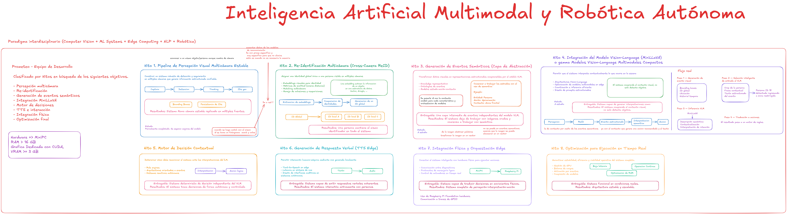

*Figura 2. Plan de arranque: ocho hitos, no nueve; el recuadro "Flujo real" desglosa el hito 3. Fuente: semillero Prometeo.*

Cada hito se lee hoy contra el código, no contra la intención original.

| Hito | Qué pedía el plan | Estado actual |
|---|---|---|
| 1. Pipeline de percepción visual multicámara estable | Captura, detección, seguimiento e ids locales en varias cámaras | Cumplido: YOLO y el seguidor corren en `pmai-mai-core` sobre una o varias cámaras USB; ver [4.4](#44-detección-seguimiento-y-reidentificación) |
| 2. Reidentificación multicámara | Un `id_global` que sobreviva al cambio de cámara | Cumplido: OSNet asigna la identidad global; el empate del turno se resuelve por confianza y, a igualdad, por `id_global` menor |
| 3. Generación de eventos semánticos | Una capa intermedia, independiente del modelo visión-lenguaje, que convirtiera recuadros en hechos (persona, acción, zona) | Cumplido a medias: no hay esa capa; BLIP describe el recorte de la persona elegida y el modelo de lenguaje interpreta la frase |
| 4. Integración de un modelo visión-lenguaje compacto (MiniLLaVA u otro) | Que el sistema interpretara la escena, no solo detectara objetos | Cumplido de otra manera: no se integró MiniLLaVA; el turno encadena BLIP con OpenAI o Gemma, como ya se adelantó en [1.2](#12-objetivos-del-proyecto) |
| 5. Motor de decisión contextual | Traducir la interpretación en acciones del cuerpo, desacopladas de la red | Cumplido: `responder()` elige hasta tres ids del catálogo vivo de robótica; si la lista llega vacía, se habla y no se mueve |
| 6. Generación de respuesta verbal en el borde | Hablar en el miniPC, sin depender de un servidor externo | Cumplido con matices: robótica sintetiza con OpenAI TTS, Piper o eSpeak; la voz en la nube sigue siendo la primera opción cuando hay clave |
| 7. Integración física y orquestación en el borde | Unir percepción, decisión, voz y servos en un solo computador | Cumplido: Compose levanta el stack en la Jetson; NATS orquesta los servicios y el Arduino ejecuta las secuencias |
| 8. Optimización para tiempo real | Cuantización, lotes y despliegue estable | Parcial: el detector corre en CPU, BLIP tiene cuantización disponible y no usada, y Gemma comparte el miniPC con el resto; la Jetson funciona, pero el recorte de latencia sigue abierto |

Dicho de otro modo, el plan original acertó el destino y se equivocó en varias piezas del camino. Las secciones que siguen cuentan esas piezas: el detector (sección 29), el modelo contextual (sección 30), el modelo de acción (sección 31) y, al cierre, la primera interfaz y lo que se dejó atrás (sección 32).

### 29. El detector de objetos

#### 29.1 Captura y extracción de imágenes

El detector de R-ONE no nació de un conjunto público de rostros. Nació de videos de los integrantes del semillero, grabados con el celular en distintos lugares y luces, y de la necesidad de convertir esos videos en fotos etiquetables. Por eso el primer oficio no fue entrenar una red: fue extraer fotogramas sin inundar el dataset de casi-duplicados.

La herramienta fue FFmpeg. La memoria dedicó varias páginas a instalarla en Windows; aquí basta el comando que de verdad construyó el conjunto. En la carpeta de cada video se ejecutó:

```bash
ffmpeg -i video.mp4 -vf fps=1 imagen_%04d.jpg
```

`-i` nombra el video de entrada, `-vf fps=1` pide un fotograma por segundo y `imagen_%04d.jpg` numera la salida con cuatro dígitos (`imagen_0001.jpg`, `imagen_0002.jpg`, …). Al principio se probó `fps=2`, unas 44 imágenes por video, y el resultado fue demasiado parecido: la gente apenas se movía. `fps=0,5` (una imagen cada dos segundos) se quedó corto. Un fotograma por segundo, unas 22 imágenes por video, fue el compromiso. La figura siguiente muestra el resultado para una integrante, ya recortado a la cara y listo para etiquetar.

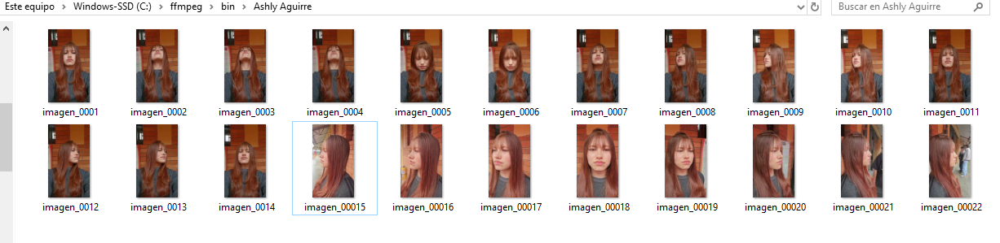

*Figura 3. Fotogramas extraídos a un cuadro por segundo; la carpeta corresponde a una integrante. Fuente: memoria académica 2026.*

Ese material no va directo al entrenamiento. El cuaderno de `pmai-model-vision` descomprime la exportación de Label Studio (`dataset/data.zip`) y, si existe, un conjunto auxiliar (`dataset/set.zip`); después `merge_datasets` los une, con una partición al azar (semilla 42) que en el cuaderno final fue 90 % entrenamiento y 10 % validación, no el 80/10/10 que escribió la memoria. El `test` solo se copia si el conjunto auxiliar lo trae. El pipeline completo, desde el video hasta el peso que carga mai-core, cabe en este diagrama:


La última flecha es a mano: nadie copia el peso al núcleo de forma automática. Eso se retoma en [29.7](#297-despliegue-en-mai-core).

#### 29.2 Etiquetado en Label Studio

Con las fotos en carpetas por persona, el semillero las etiquetó a mano en Label Studio, levantado en Docker con la imagen `heartexlabs/label-studio:latest` y el volumen `pmai-model-vision/mydata`. El contenedor se arrancaba con `sudo docker start label-studio` y se abría en `http://localhost:8080`. El proyecto se llamó *Federico Object Recognition Model*.

El oficio era el de siempre en detección: abrir una imagen, elegir el nombre de quien aparecía y dibujar un recuadro (*bounding box*) alrededor de la cara. Las etiquetas no eran "persona" ni "rostro": eran los nombres de los integrantes. De ahí que el detector de R-ONE no reconozca a un visitante desconocido como persona, sino que o bien no lo ve, o bien lo confunde con alguien del semillero. Esa decisión, que parece de dataset, es la que permite que el turno salude por el nombre: la clase detectada se convierte en `etiqueta` del objeto global.

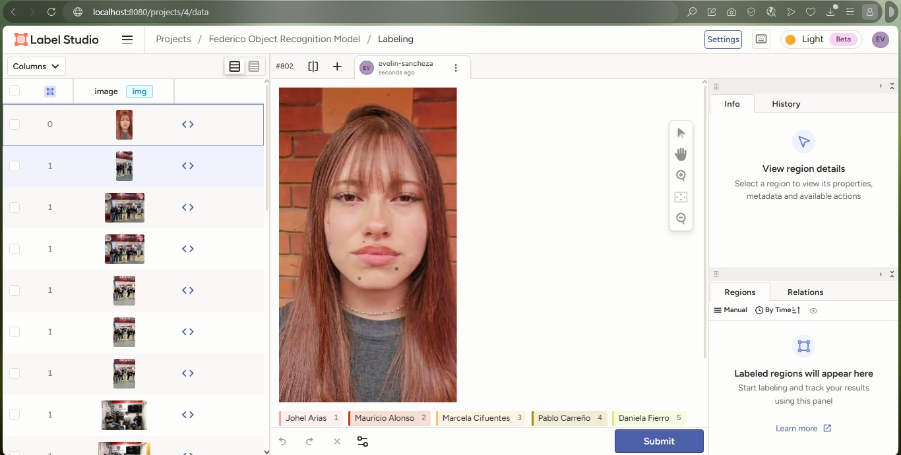

*Figura 4. Etiquetado en Label Studio: el recuadro se dibuja a mano y la clase es un nombre del semillero. Fuente: memoria académica 2026.*

El mismo criterio se aplicó a fotos de grupo y a planos más abiertos. Las dos figuras siguientes son ejemplos de esas otras imágenes, ya anotadas: no todas las muestras son un retrato centrado.


*Figura 5. Ejemplo de etiquetado sobre una escena con más de una persona. Fuente: memoria académica 2026.*

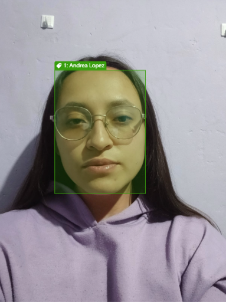

*Figura 6. Segundo ejemplo de etiquetado; el recuadro cubre la cara, no el cuerpo entero. Fuente: memoria académica 2026.*

Al terminar, el conjunto se exportó en formato YOLO (imágenes más un `.txt` por foto, con clase y coordenadas normalizadas). Las exportaciones que quedan en `pmai-model-vision/mydata/export` cuentan la historia en tres momentos: el proyecto 3, de septiembre de 2025, con 44 tareas y 8 clases; el proyecto 4, entre octubre y noviembre de 2025, con 52 a 174 tareas y 7 a 9 clases; y el mismo proyecto 4, el 1 de mayo de 2026, con 798 tareas y las 25 clases actuales. Esa última cifra no coincide del todo con las 802 imágenes de la memoria; la discrepancia se discute en la sección siguiente.

#### 29.3 Análisis del dataset

Las 25 clases de `pmai-model-vision/data.yaml` son, en este orden, los nombres de integrantes del semillero: Alison Segura, Alison Tinoco, Andrea Lopez, Anyi Becerra, Ashly Aguirre, Brayan Gomez, Breiner Bonilla, Carlos Ángulo, Cristhian Tapiero, Daniela Fierro, Diego Patiño, Evelin Sanchez, Jeferson Castellanos, Johel Arias, Juan Toro, Karol Zubieta, Laura Barón, Laura Perez, Marcela Cifuentes, Mauricio Alonso, Pablo Carreño, Rodrigo Castro, Sara Cárdenas, Valery Guerrero y Valery Guzman. No hay una clase genérica `person`. Dicho de otro modo, el detector sabe quiénes son esas veinticinco personas y no está entrenado para el resto del campus.

La memoria publicó un conteo por integrante (tabla 19) y un total de 802 imágenes. Ese conteo se reproduce aquí porque es la cifra que cita el documento de investigación; la suma de la columna, sin embargo, da 830, no 802, y encaja mejor con las 830 etiquetas de entrenamiento que registró el cuaderno después de limpiar. Pendiente de confirmar: si las 802 imágenes de la memoria cuentan fotos únicas y las 830 son recuadros (una foto de grupo aporta varias etiquetas), o si el total se tomó de un recuento anterior.

| Integrante | Imágenes según la memoria |
|---|---|
| Johel Arias | 114 |
| Laura Barón | 86 |
| Karol Zubieta | 55 |
| Andrea Lopez | 52 |
| Laura Perez | 49 |
| Alison Segura | 48 |
| Pablo Carreño | 42 |
| Alison Tinoco | 40 |
| Jeferson Castellanos | 39 |
| Daniela Fierro | 38 |
| Juan Toro | 36 |
| Diego Patiño | 36 |
| Valery Guzman | 23 |
| Sara Cárdenas | 22 |
| Ashly Aguirre | 21 |
| Brayan Gomez | 20 |
| Marcela Cifuentes | 18 |
| Evelin Sanchez | 17 |
| Anyi Becerra | 17 |
| Carlos Ángulo | 14 |
| Breiner Bonilla | 11 |
| Valery Guerrero | 11 |
| Mauricio Alonso | 10 |
| Cristhian Tapiero | 6 |
| Rodrigo Castro | 5 |

El desbalance es el dato que importa. Johel Arias tiene más de veinte veces las muestras de Rodrigo Castro. Tres clases (Rodrigo Castro, Cristhian Tapiero, Mauricio Alonso) quedan por debajo de diez ejemplos, y Breiner Bonilla no tiene ninguna etiqueta en validación. Por eso las métricas por clase de esas personas son poco fiables: el modelo las ha visto apenas, y en el caso de Breiner no tiene con qué validarlas.

La gráfica de etiquetas que produjo Ultralytics sobre el conjunto de entrenamiento cuenta otra vez la misma historia, con números algo menores (Johel Arias 108, Laura Barón 83) porque ya es el split de train, no el total de la memoria. El panel de la derecha muestra que los recuadros son, en su mayoría, caras centradas y de tamaño medio: el detector no está aprendiendo cuerpos enteros.

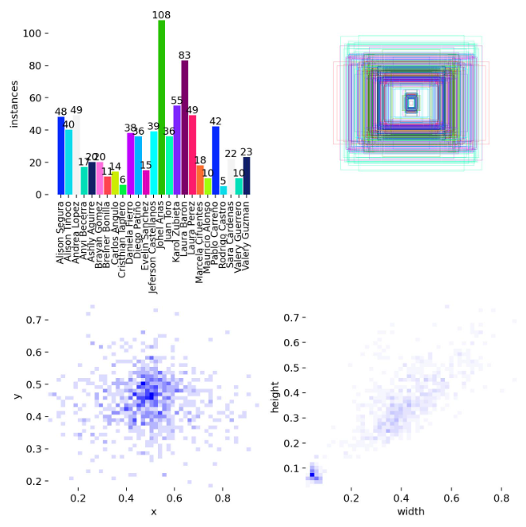

*Figura 7. Distribución de instancias por clase en entrenamiento y geometría de los recuadros. Fuente: memoria académica 2026.*

La memoria dijo, además, que el conjunto se partió 80 % / 10 % / 10 % en entrenamiento, validación y prueba. El cuaderno vigente no hace eso: parte el material propio 90/10 y solo conserva un `test` si `set.zip` lo trae. Pendiente de confirmar: el contenido de `set.zip`, que no está en el repositorio, y el número exacto de imágenes por partición del entrenamiento final, porque no se conserva la carpeta `data_preprocessed`. Pendiente de confirmar, también, las 802 imágenes frente a las 798 tareas de la última exportación.

#### 29.4 Limpieza y preprocesamiento

Antes de entrenar, el cuaderno llama a `data_cleaning` de `pmai-model-vision/utils/data_cleaning.py`. No transforma las fotos: solo borra lo que rompería el entrenamiento. Recorre las particiones de entrenamiento y validación del dataset y ejecuta, en este orden, cuatro rutinas.

`clean_missing_labels` borra cada imagen que no tiene su `.txt` pareja, para que no queden fotos sin anotación. `clean_corrupt_labels` lee cada etiqueta y exige el formato YOLO de cinco números (clase, centro x, centro y, ancho, alto, todos entre 0 y 1); si una línea no cumple, elimina la etiqueta y la imagen. `clean_corrupt_images` intenta abrir cada archivo con PIL y, si está dañado, borra también su `.txt`. `remove_duplicates` calcula el hash MD5 del contenido binario y elimina las copias exactas dentro de cada partición. En el cuaderno, esa última rutina quitó 16 imágenes duplicadas del entrenamiento.

A continuación entra el preprocesado, en `pmai-model-vision/utils/data_preprocess.py`. `process_dataset` recorre train, validation y test, replica la carpeta de etiquetas y, para cada foto, llama a `preprocess_image`. El resultado se escribe en `data_preprocessed`, que es a lo que apunta `pmai-model-vision/data.yaml`. Cada transformación corrige una molestia distinta de las fotos de celular:

- El **balance de blancos** (`apply_white_balance`) pasa la imagen a LAB y desplaza los canales A y B para que su media quede en 128. Corrige el tinte de una lámpara amarilla o de un fluorescentes frío, que si no haría que la misma cara pareciera de otro color según el salón.
- **CLAHE** (`apply_clahe`, `clipLimit=2.0`, cuadrícula 8×8) equaliza el histograma del canal L por teselas. Corrige el contraste local: una cara a contraluz deja de ser una mancha oscura.
- La **corrección gamma** (`apply_gamma`) ajusta la luminosidad global con una LUT. En el flujo actual se llama con `gamma=1.0`, así que no cambia la imagen: queda en el código como gancho, no como efecto.
- El **letterbox** (`letterbox`) redimensionaría a 512×512 conservando la proporción y rellenando el resto de negro. Está comentado. El tamaño de entrada lo fija el entrenamiento (`imgsz=640`), no esta función.

Hay una trampa que no está en la memoria y sí en el código de noviembre de 2026. El detector se entrena con fotos ya balanceadas y con CLAHE, pero mai-core le pasa el cuadro BGR crudo de la cámara, sin ese preprocesado (`pmai-mai-core/src/pmai_core/resources/vision/detector.py`). Entrenar y detectar en condiciones distintas es una fuente clásica de pérdida de precisión en el robot real. No se "arregla" reaplicando CLAHE a ciegas en inferencia: habría que medir el efecto, porque el umbral de confianza del núcleo (0,5) ya es más estricto que el 0,25 del cuaderno.

#### 29.5 Entrenamiento y aumento de datos

El modelo base es `yolo11s.pt` de Ultralytics, no YOLOv8, pese a la insignia del README. Se instancia con `YOLO("yolo11s.pt")` y se afina sobre el dataset propio: es aprendizaje por transferencia, no un entrenamiento desde cero. La corrida que está en producción es `train5`, de 60 épocas, lote 16, `imgsz` 640, 8 *workers*, precisión mixta (`amp=True`) y semilla 0, sobre una NVIDIA GeForce GTX 1050 Ti de 4 GB. Los hiperparámetros están en `pmai-model-vision/runs/detect/train5/args.yaml` y en la celda 20 de `pmai-model-vision/main.ipynb`.

El aumento de datos es la otra mitad del entrenamiento. Ultralytics aplica, en cada época, transformaciones fotométricas (`hsv_h=0.015`, `hsv_s=0.7`, `hsv_v=0.4`) y geométricas contenidas: rotación de 5°, traslación 0,10, escala 0,50, cizallamiento 1,5, perspectiva mínima, volteo horizontal al 50 % y nada de volteo vertical (`flipud=0.0`), porque una cara boca abajo no es un caso del robot. Encima van mosaic (siempre), mixup al 10 % y *erasing* al 40 %. Las corridas `train` a `train3`, de nueve clases, no usaban `degrees` ni `mixup`; `train5` sí. Esa es, junto con el salto de 9 a 25 clases y el preprocesado, la diferencia entre la fase 1 y la fase 2 del documento de visión.

Hubo cinco corridas. Las tres primeras, en Windows, produjeron `full_model.pt`, `persons_model.pt` y `base_model.pt` (nueve integrantes: Andrea Lopez, Anyi Becerra, Cristhian Tapiero, Daniela Fierro, Diego Patiño, Johel Arias, Marcela Cifuentes, Mauricio Alonso y Pablo Carreño). `train4` y `train5` se entrenaron en Linux, ya con 25 clases; solo `train5` se exportó a `pmai-model-vision/my_model/my_model.pt`, que es el peso de mai-core. Pendiente de confirmar: el número de clases de `train4`, cuyo peso no se exportó.

La fase 3 del documento de visión (BlazeFace, face_recognition, DeepFace y HandLandmarker sobre el prototipo CLAUD-IA) no está en este repositorio. El detector de R-ONE es YOLO11s afinado, y solo eso.

#### 29.6 Resultados

Las métricas que hay que citar son las de `train5`, porque ese es el modelo que carga el robot. En la última época, `pmai-model-vision/runs/detect/train5/results.csv` registra precisión 0,884, *recall* 0,932, mAP50 0,944 y mAP50-95 0,654. Ultralytics, sin embargo, no se queda con la última época: `best.pt` guarda la de mejor aptitud (0,1 · mAP50 + 0,9 · mAP50-95), que en esta corrida fue la 29 (precisión 0,922, *recall* 0,939, mAP50 0,978, mAP50-95 0,697).

Esas cifras no coinciden con las de la memoria ni con las de `docs/project-docs/model-vision-project.md`. La memoria y el documento de investigación publicaron precisión 0,8486, *recall* 0,9474, mAP50 0,9942 y mAP50-95 0,8677. Ninguna de las cinco corridas tiene esa fila, ni en la última época ni en la mejor. Las conclusiones del mismo documento (precisión ≈ 0,82, *recall* ≈ 0,96, mAP50 ≈ 0,90, mAP50-95 ≈ 0,78 "a lo largo de las 60 épocas") se parecen, en cambio, a `train`, que duró 40 épocas y tenía nueve clases. Pendiente de confirmar: de dónde salieron las 0,8486 / 0,9474 / 0,9942 / 0,8677. En este documento mandan las de `train5`.

mAP50 merece una frase de lectura, porque es el número que suele citarse solo. *mean Average Precision* a umbral de solapamiento 0,50 quiere decir: una predicción cuenta como acierto si el recuadro predicho cubre al verdadero en al menos un 50 % (IoU ≥ 0,50) y la clase es la correcta. Un ejemplo del propio R-ONE: si el modelo encierra la cara de Andrea Lopez y el recuadro verdadero es esa misma cara, con la mitad o más de la superficie en común, suma; si el recuadro se va a la chaqueta o etiqueta a Daniela Fierro, no suma. mAP50-95 endurece la regla: promedia el mismo cálculo desde IoU 0,50 hasta 0,95. Por eso 0,944 de mAP50 con 0,654 de mAP50-95 se lee así: el modelo casi siempre acierta quién es y dónde está la cara a groso modo, y se desordena cuando se le pide que el recuadro calce con milímetros.

Las curvas de la corrida, conservadas de la ilustración 76 de la memoria (la 77, "extracción del mejor modelo", se descartó), muestran esa convergencia. Las pérdidas de caja, clase y distribución bajan; precisión, *recall* y mAP suben y se estabilizan. Las pérdidas de validación no disparan al final, así que no hay un sobreajuste grosero, aunque el mAP50-95 se queda por debajo del mAP50, como es habitual.

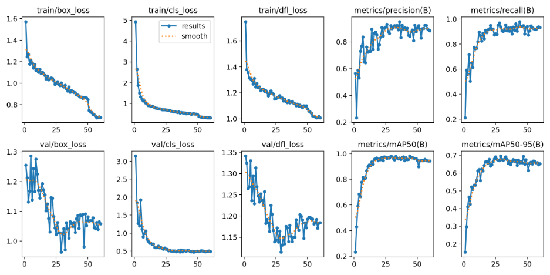

*Figura 8. Pérdidas de entrenamiento y validación, precisión, recall, mAP50 y mAP50-95 de la corrida train5. Fuente: memoria académica 2026.*

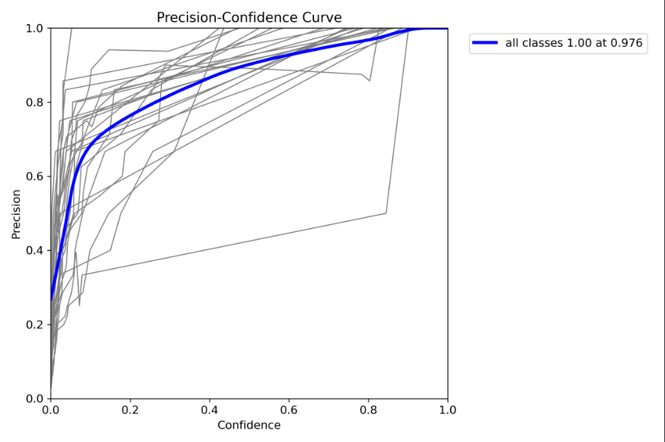

*Figura 9. Precisión por umbral de confianza. Fuente: memoria académica 2026.*

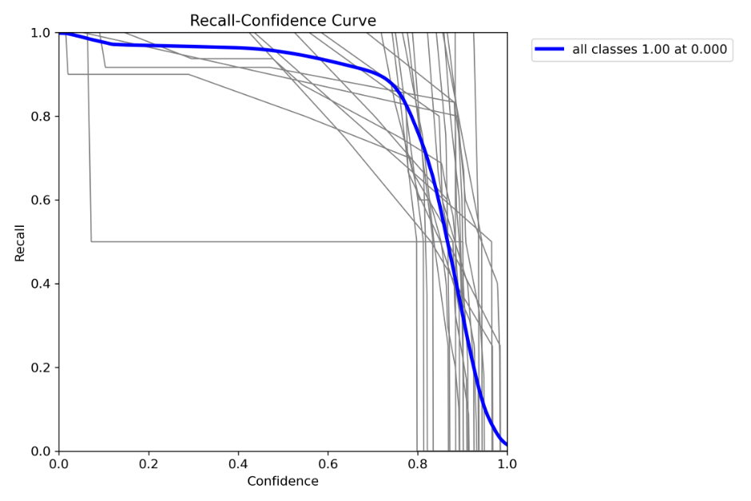

*Figura 10. Recall por umbral de confianza. Fuente: memoria académica 2026.*

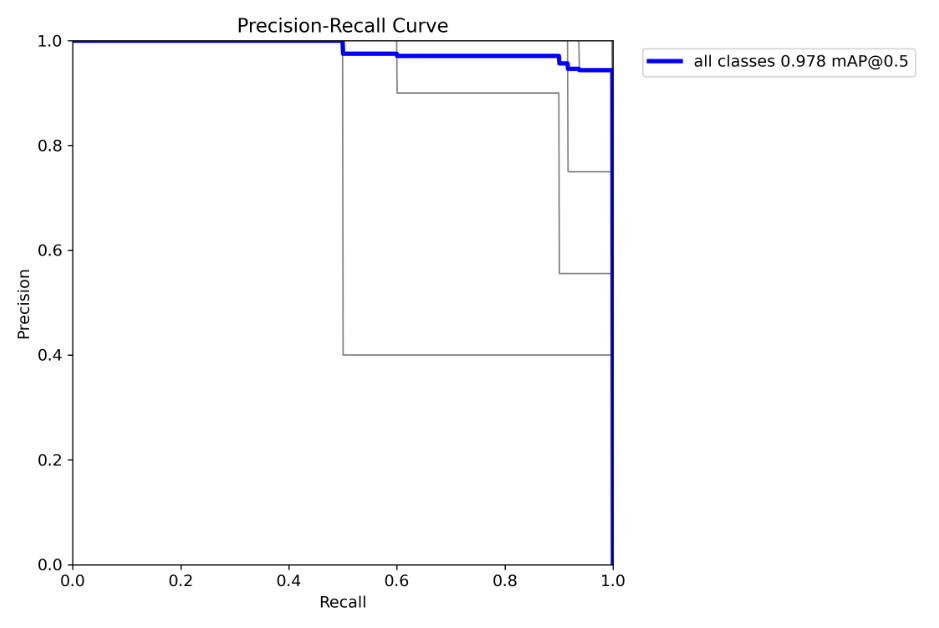

*Figura 11. Curva precisión-recall; el área bajo la curva es el mAP50. Fuente: memoria académica 2026.*

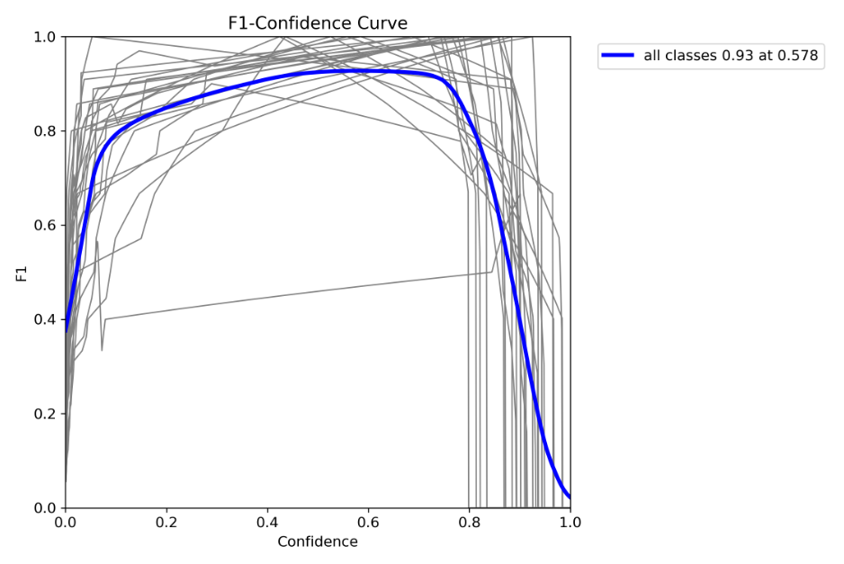

*Figura 12. F1 por umbral; el pico indica el compromiso entre precisión y recall. Fuente: memoria académica 2026.*

La matriz de confusión normalizada enseña dónde se equivoca. La diagonal está cerca de 1,0 en las clases con muchas muestras (Alison Segura, Andrea Lopez, Johel Arias). Las clases pobres se derraman: Cristhian Tapiero se confunde a menudo, Valery Guerrero se mezcla con el fondo y con otras, y Breiner Bonilla casi no aparece, coherente con su ausencia en validación. El fondo (*background*) también se come recuadros: el modelo a veces "ve" a alguien donde no hay integrante.

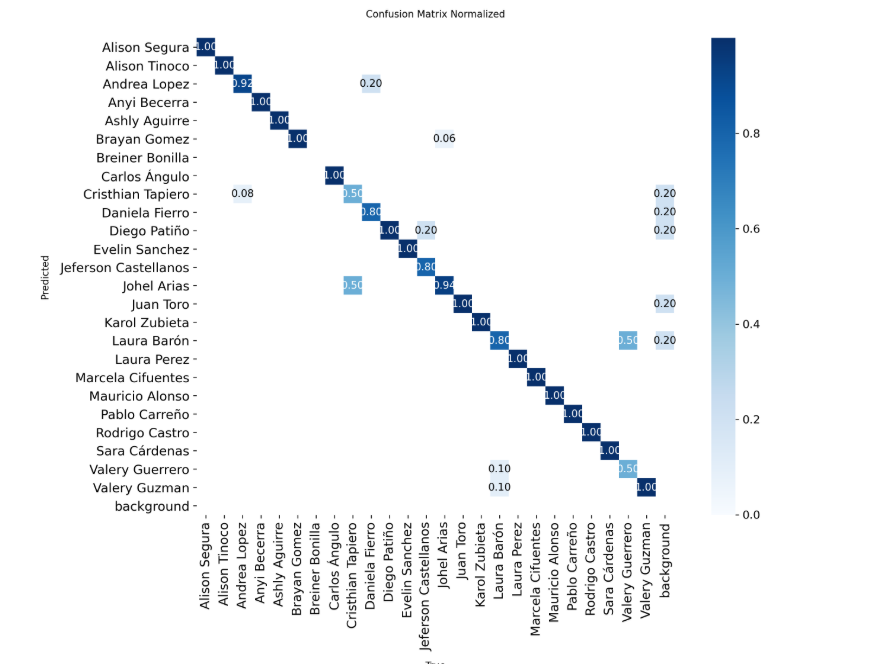

*Figura 13. Matriz de confusión normalizada: las clases con pocos ejemplos se confunden entre sí y con el fondo. Fuente: memoria académica 2026.*

Sobre imágenes de validación el resultado es cualitativo y más fácil de leer. El mosaico siguiente es el que produjo la celda 23 del cuaderno (`conf=0.25`) sobre `validation/images`: retratos de Andrea Lopez, un grupo en el stand de la Universidad Libre, Johel Arias junto al robot. Los recuadros caen en las caras y los nombres coinciden con las personas, con algún solape en las fotos de grupo.

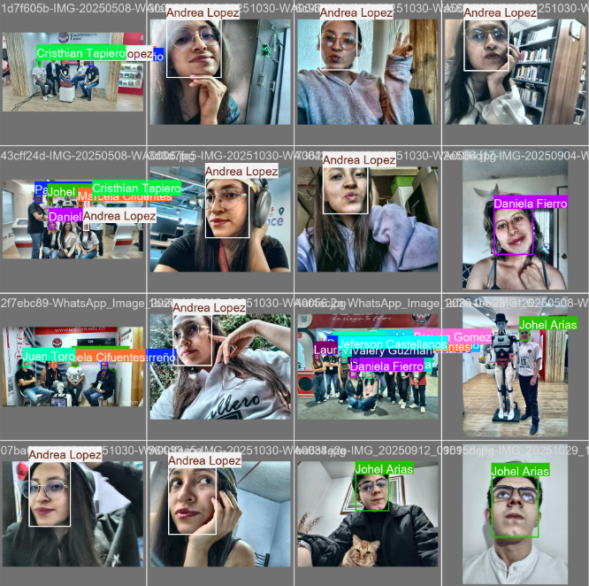

*Figura 14. Predicciones de validación: el recuadro es la cara y la etiqueta es el nombre. Fuente: memoria académica 2026.*

Las dos fotos de feria, conservadas del mismo bloque de la memoria, muestran el detector en el entorno para el que se pensó: un grupo del semillero frente al stand y el androide al lado de un integrante. En la de grupo los recuadros se amontonan y las confianzas varían (Anyi Becerra a 0,99, otros por debajo de 0,70). En la del robot, el modelo nombra a la persona y no al cuerpo de InMoov, que no es una clase.

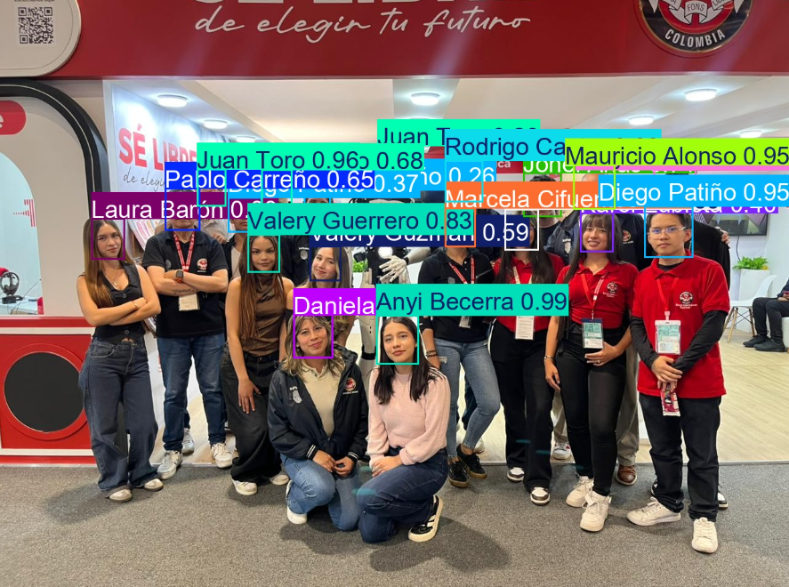

*Figura 15. Detección en una foto de grupo; cada recuadro es un integrante, no una persona genérica. Fuente: memoria académica 2026.*

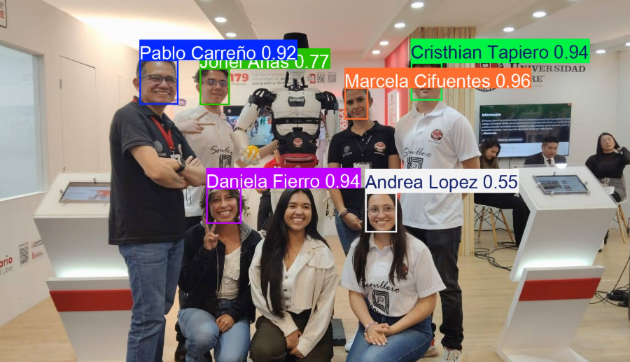

*Figura 16. Detección junto al robot: la clase es el integrante, no el androide. Fuente: memoria académica 2026.*

#### 29.7 Despliegue en mai-core

El artefacto que sale del entrenamiento es `best.pt` de `train5`, copiado a `pmai-model-vision/my_model/my_model.pt` y, a mano, a `pmai-mai-core/src/pmai_core/models/my_model.pt`. Los dos archivos compartían, al documentar, el mismo md5 (`f35b4d6bdf30ba9a6384f822b120ae9f`). Nada en el arranque comprueba que sigan iguales: si alguien reentrena y se olvida de copiar, el núcleo sigue con el peso viejo.

mai-core encapsula el peso en `YOLODetector`: valida que el archivo exista, lo carga con `YOLO(..., task="detect")`, lee los nombres de clase del propio peso y filtra por `confidence_threshold` 0,5. El dispositivo es CPU. Cada cuadro de cámara entra en `detect()`, que devuelve recuadros `xyxy`, clase y confianza; un NMS adicional refuerza el de Ultralytics. A partir de ahí el núcleo ya no es "el detector": el seguidor une recuadros en pistas, OSNet asigna el `id_global` y la interfaz dibuja recuadro, nombre y confianza. La ficha de ese servicio está en [15. pmai-mai-core](#15-pmai-mai-core); el flujo en vivo, en [6.6](#66-visión-en-tiempo-real).

La figura que la memoria tituló "visión artificial integrada dentro de R-One" resume esa orquestación: el peso entrenado deja de ser un cuaderno y pasa a ser un eslabón del pipeline de percepción.

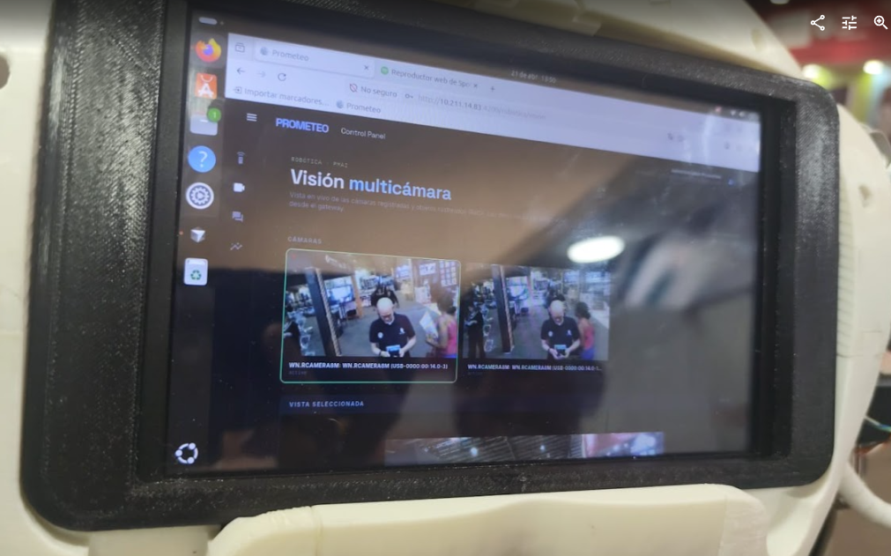

*Figura 17. El detector en el pipeline de mai-core: detección, seguimiento, reidentificación y visualización. Fuente: memoria académica 2026.*

Tres advertencias cierran el despliegue. La primera, ya dicha: el preprocesado de entrenamiento no se aplica en inferencia. La segunda: el umbral 0,5 del núcleo es más severo que el 0,25 con el que se miraron las figuras de validación, así que en el robot se ven menos recuadros, no más. La tercera: alguien que no esté entre las 25 clases no tiene etiqueta propia; el turno lo tratará como `Persona no identificada` si el detector no dispara, o lo saludará con el nombre de otro integrante si dispara mal.

### 30. El modelo contextual

#### 30.1 Elección del modelo

El detector dice quién está delante. No dice qué está haciendo, si sonríe, si lleva un grupo o si se plantó junto a un mapa. Esa frase corta, en inglés, es el "contexto visual" y la escribe un modelo de *image captioning*. La memoria lo llamó modelo contextual; hoy es el paquete `model_context` de `pmai-model-context`, importado por mai-core desde `/opt/model-context`. La ficha vigente está en [16. pmai-model-context](#16-pmai-model-context).

La arquitectura es la clásica *encoder-decoder* de BLIP: un codificador de visión convierte la imagen en vectores, un decodificador de texto los traduce en palabras. El semillero no la entrenó. Probó modelos preentrenados de Hugging Face, de la familia *image-to-text*, y se quedó con uno. El criterio no fue "el más poético", sino el que cupiera en CPU y contestara en pocos segundos, porque el turno no puede esperar a un modelo de miles de millones de parámetros cada vez que alguien dice "Fede".

De las tres variantes que se documentaron, la elegida —y la que sigue en el código— es `Salesforce/blip-image-captioning-base`. Se carga una vez al arrancar, con `import_Blip_model`, y se reutiliza desde una caché de proceso. La salida va en inglés a propósito: nadie la lee en pantalla; el modelo de lenguaje la interpreta y responde en español.

#### 30.2 Pruebas de BLIP-base y Geospace

La fase de pruebas no fue un *benchmark* académico con COCO. Fue un diccionario de casos, un cuaderno y un libro de Excel (Parametros.xlsx) donde se anotaron, para cada imagen, los parámetros de generación y la frase resultante. Se midieron tiempo, velocidad, memoria y CPU, y se graficaron con Matplotlib. La ilustración 93 de la memoria (primer bloque de métricas) se descartó; se conserva la 94.

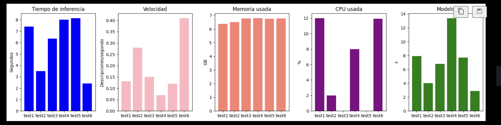

*Figura 18. Métricas de las pruebas de captioning: tiempo, velocidad, memoria y CPU por caso. Fuente: memoria académica 2026.*

Tres modelos se documentaron a mano.

El primero, `michelecafagna26/blip-base-captioning-ft-hl-scenes`, salió mal: frases repetitivas, ruido e incoherencias. La memoria lo calificó de rendimiento bajo.

El segundo, `gospacedev/blip-image-captioning-base-bf16` (en la memoria, "Geospace"), escribió descripciones más claras y estable. En precisión semántica tuvo una ligera ventaja. Su problema fue el reloj: más de ocho segundos de inferencia de media, inviable para un androide que acaba de oír su nombre.

El tercero, `Salesforce/blip-image-captioning-base`, quedó en el medio alto: frases coherentes, menos errores, unos cuatro segundos de media en aquellas pruebas. Se priorizó la fluidez sobre el último matiz semántico, "considerando las capacidades de hardware disponible". Esa es la razón por la que R-ONE no usa Geospace.

El resumen del caso `test1` sobre Salesforce, conservado de la ilustración 99, cifra una corrida concreta: 0,59 s, 1,71 descripciones por segundo, 0,58 GB de memoria, 99,6 % de CPU y un *score* de 44,51. La memoria redondeó el tiempo a 0,586 s. No es la latencia del turno en la Jetson; es la de aquella prueba de cuaderno.

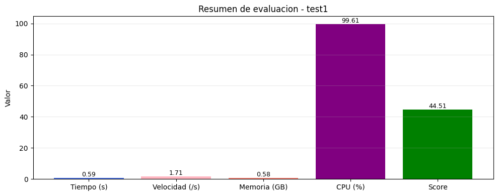

*Figura 19. Resumen del caso de prueba 1 sobre BLIP-base. Fuente: memoria académica 2026.*

Los parámetros con los que la memoria dijo haber cerrado Salesforce fueron `max_length=50`, `min_length=15`, `num_beams=1`, `repetition_penalty=1.3`, `early_stopping=False`, `length_penalty=2.0` y `no_repeat_ngram_size=2`. El código de noviembre de 2026 no usa esa terna. `generate_context` en `pmai-model-context/model_context/context.py` genera con `max_length=88`, `min_length=18`, `num_beams=10`, `repetition_penalty=1.4`, `early_stopping=True`, `length_penalty=1.05` y `no_repeat_ngram_size=3`, sin texto guía. Dicho de otro modo, hoy se exploran más haces y se piden frases un poco más largas. Geospace se descartó; Salesforce se quedó y se le cambiaron los mandos.

#### 30.3 Optimización e inferencia

La fase de desarrollo buscó el flujo real: imagen en base64, una sola carga del modelo, CPU, y una frase. La memoria habla de un reajuste a 120×120 y de cuantización con Torch, y cita inferencias de 0,8 a 1,5 s en esa etapa, luego 2,5 a 4,2 s cuando se endurecieron los parámetros para ganar calidad sobre un lote de unas 41 imágenes generales y 7 específicas. El código vigente no redimensiona a 120×120 en el turno: `base64_to_image` valida, convierte a RGB y pasa la imagen a BLIP; existe `base64_to_image_resized`, y mai-core no la llama.

La cuantización sí está escrita. `get_quantized_blip_model` aplica `torch.quantization.quantize_dynamic` sobre las capas `torch.nn.Linear`, con `dtype=torch.qint8` y motor `qnnpack`, y la deja en la misma caché. El cuaderno la prueba. El turno no la usa: mai-core lee `cache["model"]`, el modelo completo. Pendiente de confirmar: por qué se dejó de cuantizar en producción (el código la conserva). Pendiente de confirmar, también, la latencia real de BLIP-base con 10 haces en la Jetson Orin Nano.

El ejemplo que la memoria eligió para enseñar una inferencia es un gato. La entrada es la foto; la salida, una frase en inglés. No es una escena del campus, y por eso sirve: muestra el modelo haciendo lo suyo sin el ruido de un stand universitario.

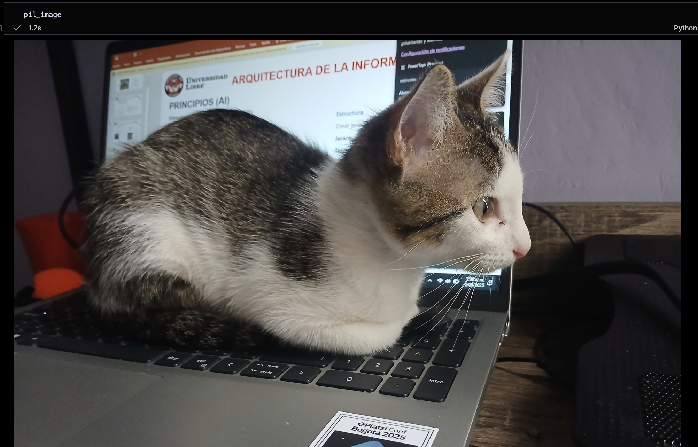

*Figura 20. Imagen de prueba para el caption: un gato. Fuente: memoria académica 2026.*

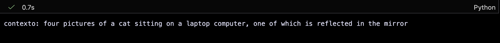

*Figura 21. Descripción generada a partir de la figura anterior. Fuente: memoria académica 2026.*

El lote completo se imprimió cuadro a cuadro y se volcó a JSON para comparar. La figura conservada de esa impresión muestra el ritmo de trabajo de la fase: una frase por imagen, con los parámetros ya fijados, todavía sin el filtro de alucinaciones de la sección siguiente.

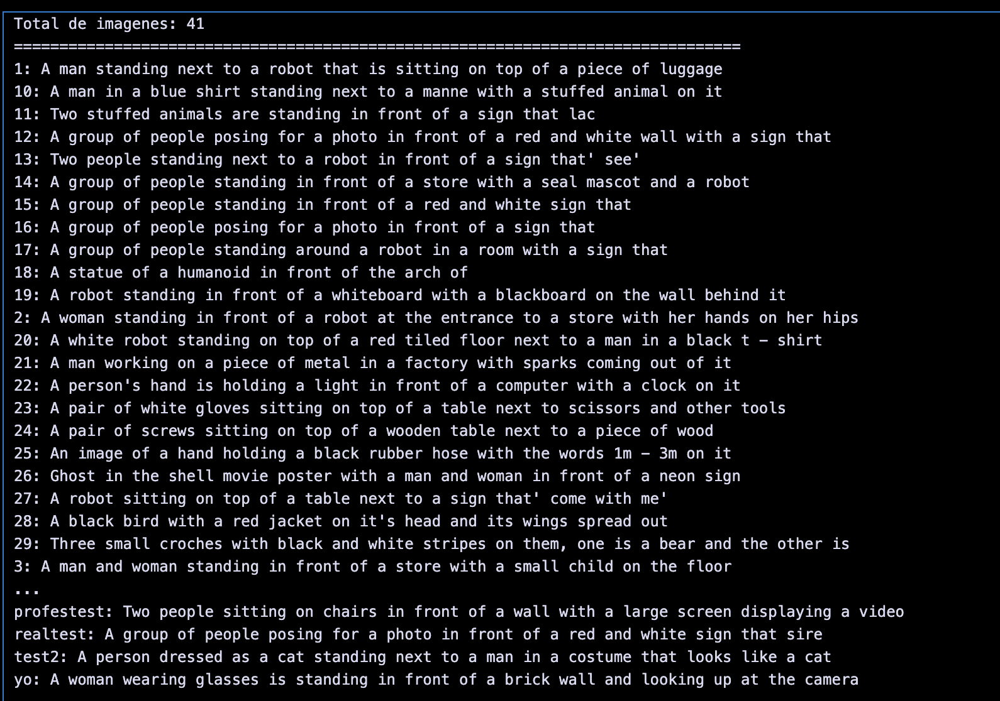

*Figura 22. Resultados descriptivos impresos por frame en la fase de desarrollo. Fuente: memoria académica 2026.*

#### 30.4 Alucinaciones y palabras protegidas

BLIP inventa. En las pruebas aparecían países, años, la NASA, "a man a man", palabras pegadas (`sebre`, `crochel`) y leyendas que el modelo juraba leer en una camiseta. El semillero no reentrenó el modelo: le puso un filtro a la frase, `clean_caption` en `pmai-model-context/model_context/context.py`. El filtro tiene tres listas, que la memoria ilustró como 110, 111 y 112 y que siguen en el código con otros nombres.

Las **palabras omitidas** son `SUSPICIOUS_WORDS`: adverbios de duda (`likely`, `probably`, `maybe`, `seems`…), `nasa`, `unknown`, países (Spain, Russia, Germany, France, Peru, Bolivia y posesivos) y restos vistos en pruebas (`sebre`, `keychain`, `triumph`, `says`, `reads`). Se borran palabra a palabra, salvo que la palabra esté protegida.

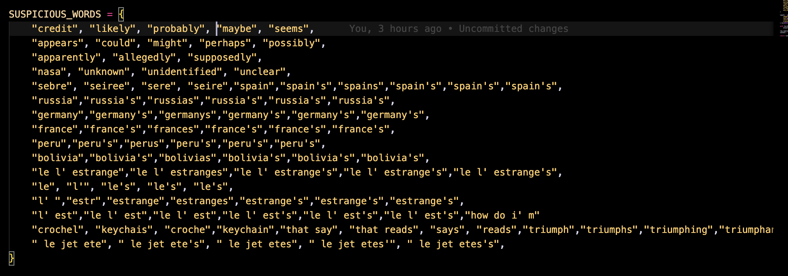

*Figura 23. Palabras omitidas en la inferencia (`SUSPICIOUS_WORDS`). Fuente: memoria académica 2026.*

Los **patrones de alucinación** (`HALLUCINATION_PATTERNS`) son expresiones regulares: palabra de cuatro letras o más repetida, "a man" o "a woman" duplicado, verbos copulativos dobles, fechas con mes y año, cualquier año 19xx o 20xx, texto citado después de `says`/`reads`, comillas tipográficas repetidas, ciudades tras `in`, `nasa…` y `mascot`/`robot`/`people` repetidos. Si el trozo coincidente contiene una palabra protegida, no se borra.

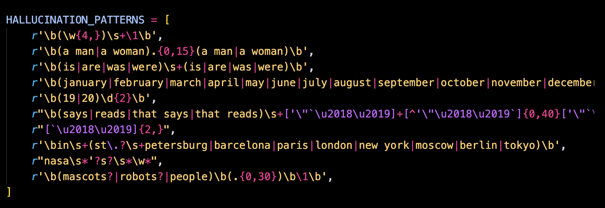

*Figura 24. Patrones de alucinación aplicados después del filtro de palabras. Fuente: memoria académica 2026.*

Las **palabras protegidas** (`PROTECTED_WORDS`) no se tocan: `robot`, personas (`man`, `woman`, `child`, `niño`, `niña`…), animales, objetos de escena (`table`, `chair`, `laptop`, `camera`), colores, tamaños y acciones (`standing`, `sitting`, `walking`, `holding`, `wearing`, `looking`, `working`). Sin esa lista, el filtro se comería exactamente lo que el turno necesita saber.

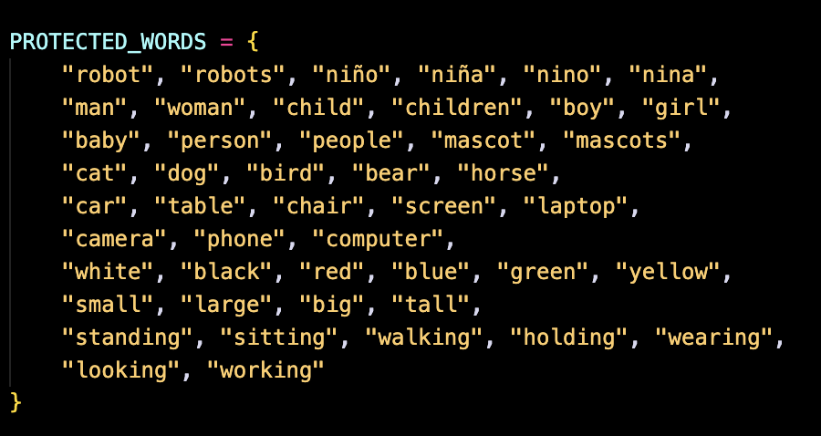

*Figura 25. Palabras protegidas del modelo contextual. Fuente: memoria académica 2026.*

El filtro no es perfecto. Las entradas de `SUSPICIOUS_WORDS` con espacios nunca coinciden, porque la comparación es palabra a palabra. Falta una coma entre `"how do i' m"` y `"crochel"`, así que Python concatena las cadenas y `crochel` no se filtra como palabra suelta. El patrón de años borra cualquier 19xx o 20xx, aunque esté de verdad en un cartel. Aun así, la frase que llega al modelo de lenguaje es más corta y menos fantasiosa que la cruda de BLIP.

La prueba con imágenes reales, conservada de la ilustración 113, cierra el arco: una foto en el stand de la Universidad Libre, con el toro de la mascota y el androide al fondo, y la frase "A man in a red shirt standing next to a statue of a bull wearing a t-shirt". El modelo vio al hombre de rojo y al toro; no nombró a R-ONE. Eso es exactamente el tipo de contexto que el turno usa: una pista, no un acta notarial.

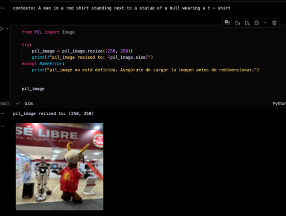

*Figura 26. Inferencia con una imagen real del stand; la frase describe al hombre y al toro, no al robot. Fuente: memoria académica 2026.*

Hoy, en resumen, `pmai-model-context` carga `Salesforce/blip-image-captioning-base` en CPU, genera con diez haces y limpia con `clean_caption`. La cuantización dinámica a `qint8` existe y el turno no la usa. El paquete se llama `model_context` y no `utils`; esa decisión se cuenta en la [sección 32](#32-la-primera-interfaz-y-las-decisiones-descartadas).

### 31. El modelo de acción

#### 31.1 Fase de análisis

El modelo de acción es el que, con la persona, la frase de BLIP, la pregunta y el catálogo de gestos, decide qué decir y qué mover. La memoria lo diseñó en papel antes de escribirlo: arquitectura de componentes, procesos internos frente a externos y un BPMN de punta a punta. Las ilustraciones 114 a 116 de ese análisis se descartaron; el diagrama equivalente que sigue vivo se incrusta a continuación.

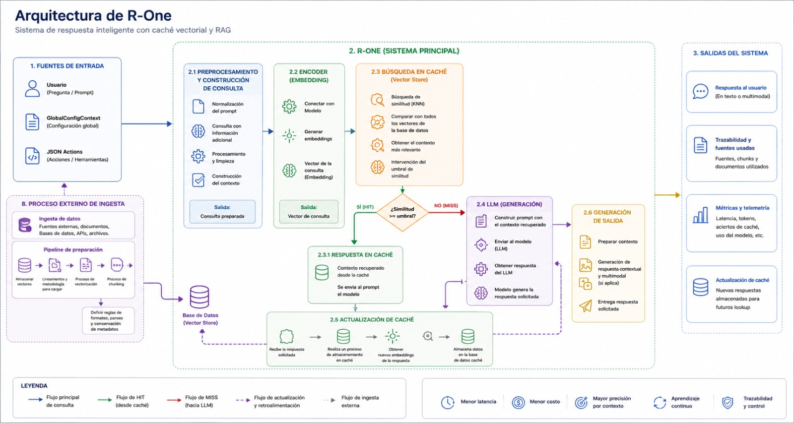

*Figura 27. Arquitectura del modelo de acción: pregunta y escena a la izquierda, caché vectorial en el centro, texto y movimientos a la derecha. Fuente: semillero Prometeo.*

La idea de aquel dibujo sigue siendo la del código. A la izquierda entran la pregunta, el objeto de escena y las acciones disponibles. En el centro, un encoder convierte la pregunta en un vector, se busca en la memoria y, si no hay acierto, se llama a un modelo de lenguaje. A la derecha salen el texto y los movimientos. Abajo, un proceso externo de ingesta alimenta la base. El "HIT" evita al LLM; el "MISS" lo enciende y, si la respuesta es almacenable, la escribe para la próxima vez. Eso es, con otros nombres, `responder()` de `pmai-model-vision-language/utils/main.py`. La ficha del paquete está en [17. pmai-model-vision-language](#17-pmai-model-vision-language); la de la base, en [7.2 Milvus Lite](#72-milvus-lite).

Lo que el análisis de 2026 todavía mezclaba, y el código ya no, es el postprocesado de BLIP con la salida del LLM. La ilustración 119 dibuja un filtro de palabras sospechosas y patrones anti-alucinación *después* de generar la respuesta de acción, y parte el resultado en un string para la voz y un movimiento por nombre. Ese filtro vive en `pmai-model-context`, no en el modelo de acción. El modelo de acción limpia groserías de la pregunta, antepone el nombre, filtra ids contra el catálogo y habla por `voiceService.speak`. La figura se conserva porque documenta esa intención primera, no porque describa el turno actual.

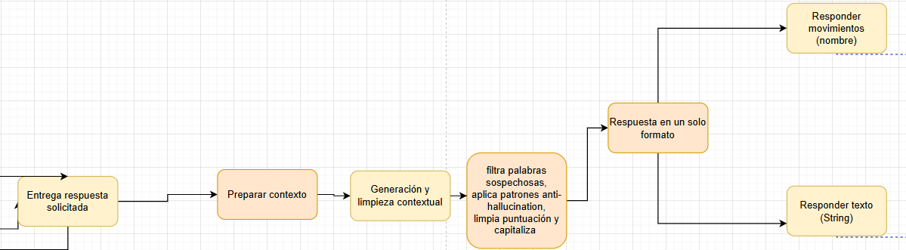

*Figura 28. Etapa de postprocesamiento según la memoria: el filtro de alucinaciones se dibujó aquí y hoy vive en el modelo contextual. Fuente: memoria académica 2026.*

#### 31.2 Ingesta por web scraping

La memoria dejó en blanco las secciones finales "Stack tecnologico", "Proceso de Ingesta" y "Base vectorial Milvus", y en su lugar hay capturas de un flujo de dos fases. El código sí las implementó, con un matiz: la ingesta no es un subproceso que se dispare cuando el caché falla, como sugería el diagrama. Es un trabajo de cuaderno, curado a mano, que se siembra al arrancar.

La **primera fase** está hecha. El cuaderno `pmai-model-vision-language/utils/webscraping/primera fase/scraping.ipynb` descarga con `requests` y BeautifulSoup páginas de unilibre.edu.co (la universidad, normativa, directorio, calidad, proyección social, facultades, pregrados, posgrados, investigación, financiación) y resúmenes de la API REST de Wikipedia en español. La información de gatos sale de animaldiversity.org y la de la gata Sky, de una ficha local. El resultado curado es `preguntas_respuestas.json`: 244 pares pregunta-respuesta; 73 traen `movimientos` y 171 no. Ese JSON es el que `scripts/seed-conocimiento.sh` carga en la colección `conocimiento`, sin repetir las preguntas que ya están.

La **segunda fase** está planeada y no hecha. `pmai-model-vision-language/utils/webscraping/segunda fase/info.txt` lista filosofía, economía, medio ambiente, astronomía, existenciales, películas, literatura, tecnología y robótica; el cuaderno de esa carpeta pesa 0 bytes. Un texto de tópicos añade una tercera fase de política y religión, marcada como delicada. El prompt vigente ya prevé esos temas (neutralidad estricta), pero no hay corpus ingerido para ellos.

El diagrama de ingesta externa de la memoria (ilustración 117) dibuja el pipeline que se tenía en mente: capturar, validar, tokenizar, partir en *chunks*, vectorizar y guardar en Milvus. Hoy no hay *chunking* de documentos largos. Cada fila del JSON es ya un par corto; el embedding se calcula sobre la pregunta, nunca sobre la respuesta, con `paraphrase-multilingual-MiniLM-L12-v2` (384 dimensiones).

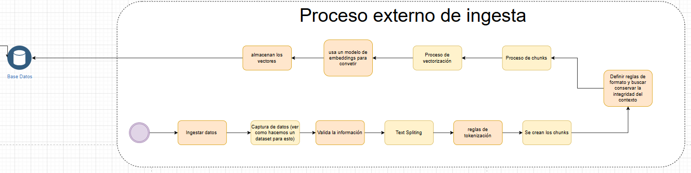

*Figura 29. Proceso externo de ingesta según la memoria; el código vigente siembra pares curados, no un pipeline de chunks en caliente. Fuente: memoria académica 2026.*

#### 31.3 Búsqueda semántica y caché

Una vez sembrada, la base se consulta en cada turno. `search()` de `pmai-model-vision-language/utils/milvus/busqueda.py` tiene dos etapas. La primera, si no se pidió coincidencia estricta, busca el vecino más cercano por distancia coseno (HNSW, `ef=64`) y acepta si la distancia es menor o igual que el umbral: 0,35 en `conocimiento`, 0,28 si la intención es un dato específico, 0,40 en `interacciones`. La segunda mira hasta 1 000 registros en memoria y acepta igualdad exacta, o una frase contenida con al menos tres palabras; en modo no estricto también una similitud de Jaccard ≥ 0,45.

Las dos colecciones no se usan igual, y esa diferencia es deliberada. `conocimiento` guarda respuestas verificadas por el semillero, así que basta con que la pregunta nueva se parezca. `interacciones` guarda lo que inventó un modelo, así que solo se reutiliza con coincidencia estricta. Si hay acierto, `fuente` vale `caché`, se antepone el nombre y, si el contexto de BLIP se parece a una situación de `aperturas.json`, una frase del tipo "veo que buscas orientación". No se llama a OpenAI ni a Gemma. Si no hay acierto, se construye el prompt y se genera; la respuesta nueva, sin el nombre de la persona, se indexa en `interacciones` cuando es almacenable.

La ilustración 123 de la memoria, de la que se conserva un recorte, es un diagrama de secuencia de ese recorrido. Hay que leerlo como historia, no como contrato. En el dibujo el respaldo del LLM se llama `Ollama (llama3.2:1b)` y el autoindexado escribe en `conocimiento`. Hoy el respaldo es OpenAI `gpt-4o-mini` y, si falla o no hay clave, Gemma 4 E2B en GGUF; lo nuevo se escribe en `interacciones`, no en `conocimiento`. Ollama quedó como cliente roto en `pmai-model-vision-language/utils/ollama`.

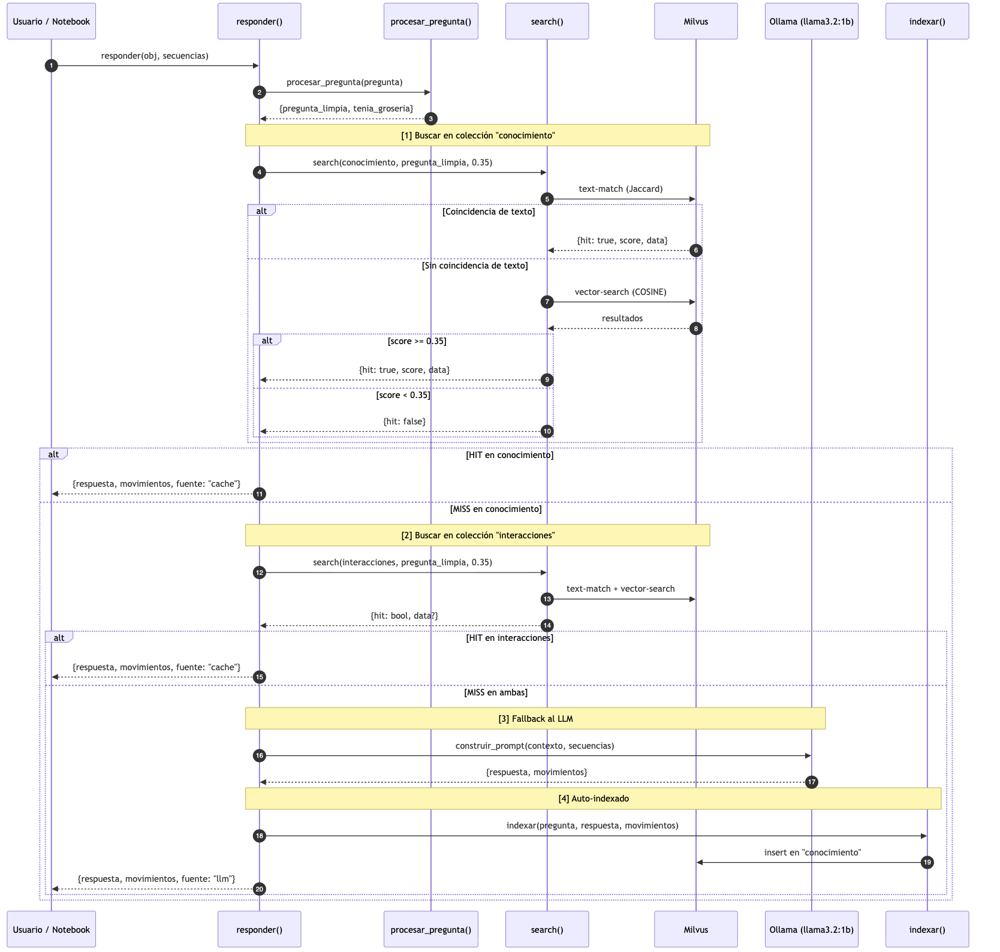

*Figura 30. Gestión de solicitudes a la base vectorial según un dibujo original; el LLM del recuadro es Ollama, ya descartado. Fuente: memoria académica 2026.*

#### 31.4 Ingeniería del prompt

El prompt es `PROMPT_PRINCIPAL` en `pmai-model-vision-language/prompt/principal.py`. Define a R-One (nombre invariable, robot físico, español siempre, tono cálido), cinco pasos de razonamiento (persona, intención, contexto visual, movimientos, veracidad), reglas de personalización, formato JSON `{"respuesta", "movimientos"}`, temas delicados y defensa ante inyección. Los datos de la llamada van al final: etiqueta, contexto, pregunta y una tabla Markdown del catálogo.

Dos evoluciones separan este prompt del de la memoria.

La primera es el **catálogo**. Durante meses el modelo creyó que los gestos eran los enteros del 1 al 34. Ese rango sigue escrito en el docstring de `indexar` ("IDs válidos (1-34)") y en el cliente Ollama, que además importa un `OLLAMA_MODEL` que ya no existe. El prompt vigente no enumera ids. Recibe la lista que robótica acaba de entregar en esa llamada (`formatear_catalogo`) y le ordena al modelo copiar de esa tabla, o devolver `[]`. Un id que no esté en la tabla se descarta al filtrar, con un máximo de tres. Si la tabla llega vacía, el prompt dice `(No hay movimientos disponibles)` y no se mueve nadie. El catálogo fijo era más simple de promptar y se rompía cada vez que el estudio creaba o renumeraba una secuencia.

La segunda es el **nombre del campo**. El JSON de salida pide `"movimientos"` (plural, lista). El sembrador `alimentar_basevec` acepta todavía `"movimiento"` (singular) como alias, y si el par no trae ninguno guarda `[1]`. De ahí un efecto colateral que la memoria no vio: 171 de los 244 pares de `conocimiento` quedan con el gesto 1 por defecto. Si el catálogo vivo tiene una secuencia con `id == 1`, esa respuesta de caché la ejecutará. Pendiente de confirmar: si el catálogo actual de robótica tiene una secuencia con `id == 1`.

El resto del prompt es posterior a la memoria y ya se describió en [4.7](#47-caché-semántico) y en la ficha 17: no mencionar `Persona no identificada`, interpretar el inglés de BLIP y responder en español, no inventar cifras de la universidad. Los ejemplos del propio prompt llevan `movimientos: []` a propósito, para que el modelo no copie ids de muestra.

#### 31.5 Métricas

Pendiente de confirmar: la memoria deja la sección vacía. El encabezado **Metricas** existe, y debajo hay una nota de trabajo ("Toca hacerlo"), sin tablas, sin latencias, sin precisión de caché ni de gestos. Tampoco hay, en el repositorio, un cuaderno de evaluación del modelo de acción comparable al de BLIP o al `results.csv` de YOLO.

Lo que sí se puede afirmar, porque está en el código y en las pruebas, no sustituye a esas métricas. Hay 34 pruebas de pytest que cubren el catálogo vacío, el máximo de tres ids, el enrutador OpenAI → Gemma y la personalización por nombre. No miden calidad de las respuestas ni acierto de los gestos. Pendiente de confirmar: cuántos registros tienen hoy `conocimiento` e `interacciones` en `pmai-model-vision-language/utils/milvus/androide_milvus.db` (no se abrió la base al documentar, para no escribir en ella). Pendiente de confirmar: la latencia de Gemma 4 E2B Q4_K_M con `n_ctx=8192` en la Jetson, y si cabe en memoria junto a BLIP y YOLO.

### 32. La primera interfaz y las decisiones descartadas

El capítulo 4 de la memoria describe una aplicación distinta de la mesa de control de las [Partes V](#parte-v-producto-e-identidad-visual) y de la [ficha 10](#10-pmas-web-main). No es que aquel texto mintiera: es que el producto se acotó. La primera interfaz quería ser, a la vez, sitio público del semillero, CMS, panel de telemetría, editor de coreografías y consola del androide. La de noviembre de 2026 quiere ser una mesa de control, con unas páginas públicas estáticas al lado.

El **CMS** de la memoria guardaba el contenido de inicio, equipo y proyectos en JSON servidos como estáticos, con las imágenes embebidas en base64. No queda un servicio CMS en el árbol. Las rutas `info`, `team` y `projects` existen y se cargan con `guestGuard`; su contenido está escrito en los componentes, no se edita desde un panel. La página `info` todavía muestra tres cifras fijas ("Accuracy 98.2 %", "Precision 96.7 %", "Recall 94.1 %") que `PRODUCT.md` prohibiría como telemetría inventada: son un resto de aquella vocación de vitrina.

Las **páginas públicas** (hero, enfoques, metodología, impactos, proyectos destacados) siguen ahí, y también un `register` en inglés de plantilla que no crea cuentas. Con `compactMode = true`, quien ya inició sesión no las ve: va al panel. El semillero no tiró el escaparate; lo dejó fuera del flujo de operar el robot.

El **editor de secuencias de línea de tiempo** vivía en Angular, en `sequences.ts`, con el tiempo en el eje horizontal, un servo por fila y bloques de color. Detectaba Arduinos y PCA, guardaba JSON y encadenaba secuencias. Ese editor ya no es la herramienta de trabajo. Lo sustituye `pmas-web-motion-studio`, un estudio propio incrustado en `/sequences` como iframe (`http://<hostname>:4210/?embed=1`), con cabecera navy, pistas de gesto y de neutro, y el token viajando por `postMessage`. La página Angular de secuencias quedó como cascarón: embebe el estudio e importa JSON legado. El diseño de la línea de tiempo no se perdió; cambió de casa.

La **telemetría** de la memoria sondeaba cada dos segundos el servicio de robótica y pintaba *uptime*, carga de CPU, memoria, temperatura y velocidad en m/s. `PRODUCT.md` prohíbe exactamente eso: "nunca CPU/dBm/uptime falsos". Lo que hay ahora es estado real del hardware (`RuntimeSnapshot`: ocupado o libre, origen `turno`/`panel`/`estudio`, paso actual y cola), un cajón "En hardware" y un registro de hasta 300 eventos del panel. La salud de los microservicios sigue en el menú, como verde o rojo; no se finge un procesador al 12 %.

El paso al **estudio integrado** y al **rediseño navy** es la otra mitad de esa historia. `PRODUCT.md` y `DESIGN.md`, en la raíz del lanzador, unifican web y estudio: marco `#0B2540`, campo `#eef2f6`, acción cian, neutro esmeralda. La voz es de operador (Gesto, Neutro, Detener, En el robot). El capítulo 4 no habla de ese marco; habla de un *admin chrome* que recordaba si el menú estaba colapsado. El navy no es un barniz: es la decisión de que la interfaz se lea como herramienta del semillero y no como consola de ciencia ficción. Los detalles de paleta y accesibilidad están en la [sección 27](#27-paleta-tipografía-y-accesibilidad).

Alrededor de esa interfaz —y de los tres modelos de este capítulo— se descartaron piezas que la memoria daba por sentadas. Conviene listarlas con el motivo, para que nadie las "recupere" sin saber por qué se fueron.

El **catálogo fijo de gestos 1–34** se sustituyó por el catálogo vivo de `getActions`. Un entero eterno no sobrevive a un estudio donde las secuencias se crean, se borren y se vuelven a guardar con otro `id`. El rango 1–34 queda como fósil en un docstring y en Ollama.

El paquete de contexto se llamaba **`utils`**. Se renombró a `model_context` el 9 de octubre de 2026 porque mai-core carga en el mismo proceso las dos bibliotecas, y `pmai-model-vision-language` ya exporta `utils`. Con las dos rutas en `PYTHONPATH`, un `utils` tapaba al otro. Volver al nombre viejo rompería el turno.

**Ollama** (y, en el dibujo de la figura 30, `llama3.2:1b`) fue el LLM local de la primera versión. El cliente está roto: importa `OLLAMA_MODEL`, que ya no existe, y valida ids 1–34. El local de hoy es Gemma 4 E2B en GGUF, con `llama-cpp-python`. LangChain aparece en el README de contexto y en las dependencias de acción; el turno no lo llama.

**Geospace** (`gospacedev/blip-image-captioning-base-bf16`) describía un poco mejor y tardaba el doble. Se eligió Salesforce por latencia. MiniLLaVA, el VLM del hito 4, no se integró: una frase de BLIP más un LLM resultó más barato de correr en el miniPC que un visión-lenguaje de verdad.

Otras decisiones del mismo linaje, ya sin figura. El archivo `movimientos.json` como fuente del catálogo no existe; el catálogo llega por NATS. La demo Gradio (`app.py`) importa paquetes que no están y habla con `say` de macOS. El micrófono de la primera interfaz usaba la Web Speech API del navegador para conversar; el del robot es Vosk en mai-core, y el botón del chat solo rellena la caja de texto. La fase 3 de visión (emociones y gestos de mano sobre CLAUD-IA) no está en `pmai-model-vision`. La aplicación móvil que iba a reentrenar el detector sola no existe; el objetivo correspondiente sigue pendiente en [1.2](#12-objetivos-del-proyecto). Las claves de Anthropic y Watson del `.env.example` de acción no se leen. `ACTION_DESCRIPTIONS_PATH` no alimenta las frases de las secuencias: esas frases las escribe el estudio al guardar.

Queda, como resto visible, la ruta `/r-one`: un panel de rutinas predefinidas que llama a `/robotics/execute` y `/robotics/health`, endpoints que el gateway no tiene. Es la interfaz del capítulo 4 sin el suelo que la sostenía. El suelo de noviembre de 2026 es otro: login, movimientos, visión, chat, estudio incrustado y usuarios, con el turno único detrás.

## Anexos

### Anexo A. Glosario

Estos cinco anexos recogen lo que el cuerpo del documento no cabe repetir: el vocabulario, las variables, los sujetos NATS, las rutas HTTP y el índice de figuras. El glosario reescribe los veinticuatro términos del capítulo 2 de la memoria académica y añade los que el código de noviembre de 2026 usa de verdad. Cada entrada cabe en unas pocas frases; cuando el término tiene un capítulo propio, el enlace lleva allí.

**Angular.** Marco de Google con el que está construida la mesa de control `pmas-web-main`. R-ONE usa Angular 21.2 con componentes independientes y señales, no módulos NgModule. La ficha está en [10](#10-pmas-web-main).

**API (Application Programming Interface).** Conjunto de reglas con las que dos programas se hablan. En R-ONE la API que ve el navegador es HTTP y WebSocket en el gateway; detrás, cada servicio expone sujetos NATS. Las listas completas están en el [Anexo C](#anexo-c-patrones-nats) y el [Anexo D](#anexo-d-endpoints-http-del-gateway).

**Base64.** Codificación que convierte bytes en texto ASCII y agranda el dato alrededor de un 33 %. El núcleo recorta a la persona en JPEG y la manda a BLIP en base64; las miniaturas de visión viajan igual dentro del snapshot. El recorte del turno está en [6.3](#63-chat-por-la-ruta-complejo-el-turno).

**BLIP.** Modelo de descripción de imágenes de Salesforce. Recibe el recorte JPEG de la persona elegida y devuelve una frase en inglés que el modelo de acción usa como contexto, no como texto para la pantalla. Si falla, el turno sigue con el contexto vacío. La pieza vive en `pmai-model-context` y se cuenta en [4.5](#45-descripción-de-escena) y en [16](#16-pmai-model-context).

**CMS (Content Management System).** Sistema para editar el contenido de un sitio sin tocar el código. La memoria lo listó porque la primera interfaz pensaba así las páginas del semillero. Hoy `info`, `team` y `projects` son componentes Angular estáticos; no hay CMS.

**Componente.** Unidad de Angular que junta lógica, plantilla y estilos. En R-ONE cada página del cascarón autenticado (chat, visión, panel, secuencias, usuarios) es un componente independiente, cableado en `pmas-web-main/src/app/app.routes.ts`.

**Compose.** Docker Compose es el orquestador del lanzador: un solo `docker-compose.yml` define los nueve servicios, los puertos y los montajes. No hay clave `version` en el archivo. El mapa está en [5.1](#51-servicios-y-puertos) y la ficha en [9](#9-pba-launcher).

**Computed Signal.** Señal de Angular cuyo valor se calcula a partir de otras y se recalcula cuando cambian. La web las usa, por ejemplo, para derivar el estado visible del cascarón a partir de la sesión y del rol activo.

**CRUD.** Crear, leer, actualizar y eliminar. En R-ONE aplica a usuarios, roles, personas, frases de «Decir oración» y secuencias; cada familia termina en un sujeto NATS distinto, no en un controlador único.

**DOM (Document Object Model).** Árbol en memoria del HTML de la página. Angular lo actualiza cuando cambian las señales; el operador no lo toca.

**Embedding.** Lista de números que representa el significado de un texto. R-ONE convierte cada pregunta en 384 números con `paraphrase-multilingual-MiniLM-L12-v2` y busca vecinos por distancia coseno en Milvus. La analogía del mapa de significados está en [4.6](#46-embeddings-y-búsqueda-vectorial).

**Gateway.** Única puerta HTTP y WebSocket de la interfaz. Valida el JWT, la sesión y el rol, y traduce cada petición a un mensaje NATS. El proceso es `pba-ms-gateway`, puerto 3000. Ver [4.1](#41-microservicios-y-gateway) y [11](#11-pba-ms-gateway).

**Gemma.** Modelo de lenguaje de Google que R-ONE corre en el miniPC, variante 4 E2B cuantizada a Q4_K_M. Es el respaldo cuando no hay clave OpenAI o la llamada a la nube falla; la pantalla entonces muestra `Gemma (local)`. El enrutador está en [4.8](#48-modelo-local-frente-a-modelo-en-la-nube) y en [17](#17-pmai-model-vision-language).

**GGUF.** Formato de archivo para modelos de lenguaje cuantizados que corre `llama.cpp`. El de R-ONE es `pmai-model-vision-language/models/gguf/gemma-4-E2B-it-Q4_K_M.gguf`, unos 2,9 GB; si falta, se descarga de Hugging Face (`unsloth/gemma-4-E2B-it-GGUF`).

**Guard.** Función que decide si se entra a una ruta. En Angular, `authGuard`, `guestGuard` y `roleGuard` cubren la navegación. En el gateway, `UserAccessGuard`, `JwtAuthGuard` y `RolesGuard` cubren el HTTP. El flujo de sesión está en [6.1](#61-inicio-de-sesión).

**Interceptor.** Pieza que mira todas las peticiones o respuestas HTTP. La web adjunta `Authorization` y `X-Active-Role` en `pmas-web-main/src/app/core/interceptors/auth.interceptor.ts`. El gateway, por su lado, copia el `statusCode` de un microservicio al HTTP.

**Jetson.** MiniPC NVIDIA Jetson Orin Nano Super, 8 GB, donde corre el stack en campo. Compose no pide `runtime: nvidia`: YOLO, BLIP y Gemma van por CPU. La ficha operativa está en [23](#23-la-jetson-orin-nano) y en `docs/project-docs/jetson-orin-nano-r-one.md`.

**JWT (JSON Web Token).** Texto firmado que prueba la identidad. Auth lo emite con `{ user: { id, roles } }`; el gateway lo verifica con el mismo `SECRET`. Hay una sola sesión activa por cuenta. Ver [4.3](#43-sesión-y-jwt).

**Label Studio.** Herramienta de etiquetado con la que el semillero dibujó recuadros sobre los fotogramas del detector. Cada clase es el nombre de un integrante, no «persona». El proceso está en [29.2](#292-etiquetado-en-label-studio).

**llama.cpp.** Motor C++ (aquí, el enlace Python `llama-cpp-python`) que carga el GGUF de Gemma en CPU. Sustituye a Ollama, que la memoria daba por sentado y el código vigente ya no llama. Ver [4.8](#48-modelo-local-frente-a-modelo-en-la-nube) y [32](#32-la-primera-interfaz-y-las-decisiones-descartadas).

**localStorage.** Almacén clave-valor del navegador que sobrevive al cierre de pestaña. La web guarda ahí el JWT (`prometeo_token`), el rol activo, los mensajes del chat y el registro del panel. El tope típico es de 5 a 10 MB por origen.

**mAP (mean Average Precision).** Métrica del detector: el área bajo la curva precisión-recall. El entrenamiento `train5` reporta mAP50 y mAP50-95; las curvas están en [29.6](#296-resultados).

**Microservicio.** Proceso independiente que hace una sola cosa y se habla con los demás por mensajes. R-ONE tiene cuatro de negocio detrás del gateway (auth, management, robótica, núcleo) más Postgres y NATS. Ver [4.1](#41-microservicios-y-gateway) y [5](#5-mapa-de-servicios).

**Milvus.** Base de datos vectorial. R-ONE usa Milvus Lite, sin servidor aparte: el archivo real es `pmai-model-vision-language/utils/milvus/androide_milvus.db`. Compose pasa `MILVUS_DB_PATH` y nadie la lee. Colecciones y umbrales están en [7.2](#72-milvus-lite).

**NATS.** Bus de mensajes de petición y respuesta. El servidor es el contenedor `nats-server`; el puerto 4222 no se publica al anfitrión. Los servicios Python imitan el sobre de NestJS. Ver [4.2](#42-nats-y-los-patrones-de-mensaje) y el [Anexo C](#anexo-c-patrones-nats).

**NestJS.** Marco Node para el gateway, auth y management. Los dos últimos no sirven HTTP: solo atienden `@MessagePattern`. El gateway sí, sobre Fastify. Fichas [11](#11-pba-ms-gateway), [12](#12-pba-ms-auth) y [13](#13-pba-ms-management).

**Neutro.** Pista de una secuencia (`blocks_neutro`) que devuelve cada servo a la postura de descanso. Robótica encola siempre normal, un segundo, neutro y otro segundo. Sin ese regreso, el gesto siguiente partiría de donde el anterior dejó el brazo. Ver [4.9](#49-secuencias-bloques-y-el-par-normal-y-neutro) y [6.5](#65-ciclo-de-un-gesto).

**Observable (RxJS).** Flujo de valores en el tiempo. NestJS usa uno por cada petición NATS; robótica y el núcleo cierran ese flujo con `{ response, isDisposed: true }`. En la web, RxJS cubre el cliente HTTP.

**PCA9685.** Circuito que, por I2C, mueve hasta dieciséis servos con dos pines. El firmware habla con hasta cuatro placas (`pca` 0–3). Robótica envía `PCA,<pca>,<servo>,<pos>,<vel>`. Ver [20](#20-pba-arduino-codes).

**Piper.** Sintetizador de voz local. El modelo es `pba-ms-robotics/src/core/models/voice/es_ES-davefx-medium.onnx`. Si OpenAI TTS falla o no hay clave, robótica llama a `piper` y, si ese también falla, a eSpeak. Ver [14](#14-pba-ms-robotics).

**Prisma.** Generador de cliente SQL. Auth define el esquema `auth` y las migraciones; el gateway copia el esquema y solo lee `session` en `/auth/me` y `/auth/verify`. Management trae un Prisma heredado sin modelos. Ver [7.1](#71-postgres-y-prisma).

**PulseAudio.** Servidor de sonido del anfitrión. Compose monta el socket del UID 1000 y la cookie dentro de robótica para que `paplay` llegue al parlante Bluetooth. Sin cookie, Pulse responde `Access denied`. Ver [9.7](#97-configuración) y [22](#22-arranque-local-y-en-red-local).

**PWM (Pulse Width Modulation).** Técnica que controla un servo variando el ancho del pulso. El PCA9685 genera esas señales; el firmware convierte la posición 0–1000 en el pulso que el motor entiende.

**ReID (reidentificación).** Dar el mismo `id_global` a una persona que pasa de una cámara a otra, comparando huellas de aspecto (OSNet, 512 valores, umbral 0,6). No es el nombre de la clase YOLO: ese nombre es el integrante. Ver [4.4](#44-detección-seguimiento-y-reidentificación).

**REST.** Estilo que usa los verbos HTTP sobre recursos. El gateway lo sigue en lo visible (`GET /users`, `POST /chat/question`); por detrás cada verbo es un sujeto NATS. El [Anexo D](#anexo-d-endpoints-http-del-gateway) lista las rutas.

**RxJS.** Biblioteca de flujos asíncronos sobre la que se apoyan Angular y el cliente NATS de NestJS. En R-ONE no se programa a mano casi nada de RxJS fuera de `subscribe` a las respuestas del gateway.

**Secuencia.** Partitura de movimiento: un JSON canónico con `id`, nombre, categoría, `blocks` y `blocks_neutro`. Solo el par completo con descripción de al menos diez caracteres entra al catálogo del turno. Viven en `pba-ms-robotics/data/sequences`. Ver [4.9](#49-secuencias-bloques-y-el-par-normal-y-neutro) y [7.3](#73-secuencias-en-json).

**Signal (Angular).** Contenedor reactivo que avisa a quien lo lee cuando cambia. Es el estado local de la web: sesión, mensajes, runtime del hardware.

**SPA (Single Page Application).** Aplicación que carga un HTML y cambia de vista sin recargar. `pmas-web-main` lo es: el cascarón autenticado y las páginas públicas conviven en el mismo bundle.

**Turno.** Una pregunta a la vez, con visión, memoria y hasta tres gestos. Lo corre `interaction_turn.py` cuando los turnos están encendidos y el modelo es `complejo`. El recuento de pasos está en [6.3](#63-chat-por-la-ruta-complejo-el-turno).

**TypeScript.** JavaScript con tipos. Lo usan la web, el gateway, auth y management. Se compila antes de ejecutarse; en Compose eso ocurre dentro de la imagen `node:22-slim`.

**Vosk.** Reconocedor de voz embebido. El núcleo carga `pmai-mai-core/src/pmai_core/models/vosk-model-small-es-0.42` y transcribe en español tras la palabra de activación. La web no captura el audio del robot. Ver [6.4](#64-el-micrófono).

**WebSocket.** Conexión persistente y bidireccional. El único de R-ONE es `ws://<host>:3000/vision/ws`: el gateway pide un snapshot NATS cada 500 ms y se lo empuja al navegador. Ver [6.6](#66-visión-en-tiempo-real).

**XSS (Cross-Site Scripting).** Ataque que inyecta un script en una página. Angular escapa el texto interpolado por defecto; el chat pinta `reply` como texto, no como HTML.

**YOLO.** Familia de detectores de objetos. El peso de R-ONE es YOLO11s entrenado sobre 25 rostros del semillero, copiado a `pmai-mai-core/src/pmai_core/models/my_model.pt`. No detecta «una persona»: detecta a un integrante. Ver [4.4](#44-detección-seguimiento-y-reidentificación) y [29](#29-el-detector-de-objetos).

### Anexo B. Variables de entorno

Este anexo lista las variables de `docker-compose.yml` y de `.env.template`, más las claves del TOML del núcleo y del `.env` del modelo de acción. La columna «Contenedor» es el nombre que ve el proceso; «Plantilla» es el valor de `.env.template` o el literal de Compose. Las claves van como `<secreto>` o `vacío`: no se copian valores reales. El catálogo por ficha está enlazado a la derecha; aquí no se repite el efecto largo de cada trampa.

Cuatro hechos que conviene leer antes de la primera tabla. `NATS_SERVER` de la plantilla no se usa: Compose fija `nats://nats-server:4222` en cada servicio. `MILVUS_DB_PATH` se inyecta en `pmai-core` y ningún módulo la lee; la base real es `pmai-model-vision-language/utils/milvus/androide_milvus.db`. `PMAI_CORE_PORT` se publica y nada escucha. `OPENAI_SYSTEM_PROMPT` es obligatoria para Joi en management y el servicio importa una constante. `ACTION_DESCRIPTIONS_PATH` existe como defecto en robótica y nadie en `src` la usa: las frases de las secuencias las escribe el estudio al guardar.

La plantilla no basta para arrancar gateway y auth: faltan `MS_GATEWAY_SECRET`, `MS_GATEWAY_RESTORE_PASSWORD_SECRET`, `MS_GATEWAY_PROJECT_ID` y `MS_AUTH_PROJECT_ID`. Esos nombres sí están en Compose. El comentario de robótica dice que la TTS reusa la clave de management si `MS_ROBOTICS_OPENAI_API_KEY` va vacía; Compose, en cambio, pasa esa variable tal cual, sin `:-`.

#### Postgres (`db`)

| Variable | Contenedor | Plantilla | Efecto | Ficha |
|---|---|---|---|---|
| `DB_USER` | `POSTGRES_USER` | vacío | Usuario de Postgres y de `pg_isready` | [9](#9-pba-launcher) |
| `DB_PASSWORD` | `POSTGRES_PASSWORD` | vacío | Contraseña de Postgres | [9](#9-pba-launcher) |
| `DB_NAME` | `POSTGRES_DB` | vacío | Base que se crea al arrancar | [9](#9-pba-launcher) |

El puerto 5432 está fijo en Compose. `scripts/lan-up.sh` espera a `pg_isready` con `${DB_USER:-postgres}`; `scripts/seed-auth.sh` usa `-U postgres` fijo.

#### NATS (`nats-server`)

No recibe variables de la plantilla. Compose publica 8222, monta `nats.conf` y arranca `-c /etc/nats/nats.conf`. El puerto de clientes, 4222, solo existe dentro de la red de Docker. Ver [5.1](#51-servicios-y-puertos).

#### pba-ms-gateway

| Variable | Contenedor | Plantilla | Efecto | Ficha |
|---|---|---|---|---|
| `MS_GATEWAY_PORT` | `PORT` | `3000` | Puerto HTTP; `main.ts` cae a 3000 si faltara | [11](#11-pba-ms-gateway) |
| `MS_GATEWAY_DATABASE_URL` | `DATABASE_URL` | vacío | Prisma; misma URL que auth con `?schema=auth` | [11](#11-pba-ms-gateway) |
| `MS_GATEWAY_SECRET` | `SECRET` | no está en la plantilla | Verifica el JWT que firmó auth; tiene que coincidir con `MS_AUTH_SECRET` | [11](#11-pba-ms-gateway) |
| `MS_GATEWAY_RESTORE_PASSWORD_SECRET` | `RESTORE_PASSWORD_SECRET` | no está en la plantilla | Verifica el token de restauración | [11](#11-pba-ms-gateway) |
| `MS_GATEWAY_PROJECT_ID` | `PROJECT_ID` | no está en la plantilla | Joi la exige; ningún código del gateway la usa | [11](#11-pba-ms-gateway) |
| (literal Compose) | `NATS_SERVER` | `nats://nats-server:4222` | Cliente NATS, espera 20 s | [11](#11-pba-ms-gateway) |
| (literal Compose) | `NODE_ENV` | `development` | `configEnvs.environment` | [11](#11-pba-ms-gateway) |

Compose publica además 9230 para el depurador Node. La web no lee `MS_GATEWAY_PORT`: arma `http://<hostname>:3000`.

#### pba-ms-auth

| Variable | Contenedor | Plantilla | Efecto | Ficha |
|---|---|---|---|---|
| `MS_AUTH_PORT` | `PORT` | `3001` | Joi la exige; no hay servidor HTTP | [12](#12-pba-ms-auth) |
| `MS_AUTH_DATABASE_URL` | `DATABASE_URL` | vacío | Prisma del esquema `auth` | [12](#12-pba-ms-auth) |
| `MS_AUTH_SECRET` | `SECRET` | vacío | Firma el JWT de acceso | [12](#12-pba-ms-auth) |
| `MS_AUTH_RESTORE_PASSWORD_SECRET` | `RESTORE_PASSWORD_SECRET` | vacío | Firma el token de restauración | [12](#12-pba-ms-auth) |
| `MS_AUTH_PROJECT_ID` | `PROJECT_ID` | no está en la plantilla | Audiencia de una estrategia Google que ningún controlador usa | [12](#12-pba-ms-auth) |
| (literal Compose) | `NATS_SERVER` | `nats://nats-server:4222` | Servidor del microservicio | [12](#12-pba-ms-auth) |
| (literal Compose) | `NODE_ENV` | `development` | Entorno Joi | [12](#12-pba-ms-auth) |

El puerto 3001 se publica y nadie escucha. La vigencia del JWT la pone el ajuste `SESSION_EXPIRATION` de la base (8 h en la siembra), no esta tabla.

#### pba-ms-management

| Variable | Contenedor | Plantilla | Efecto | Ficha |
|---|---|---|---|---|
| `MS_MANAGEMENT_PORT` | `PORT` | `3002` | Joi la exige; no hay servidor HTTP | [13](#13-pba-ms-management) |
| `MS_MANAGEMENT_DATABASE_URL` | `DATABASE_URL` | vacío | Prisma heredado, no montado | [13](#13-pba-ms-management) |
| `MS_MANAGEMENT_OPENAI_API_KEY` | `OPENAI_API_KEY` | vacío | `chatStructured` de la ruta Básico; también respaldo de `pmai-core` | [13](#13-pba-ms-management) |
| `MS_MANAGEMENT_OPENAI_SYSTEM_PROMPT` | `OPENAI_SYSTEM_PROMPT` | vacío | Joi la exige; el servicio no la lee | [13](#13-pba-ms-management) |
| `MS_MANAGEMENT_OPENAI_MODEL` | `OPENAI_MODEL` | vacío | Modelo de `chatStructured`; Joi no admite vacío, así que la plantilla sola no arranca management | [13](#13-pba-ms-management) |
| `MS_MANAGEMENT_CHAT_ROUTE_PATH` | (no se pasa) | vacío | Si viniera, sería el JSON de ruta; Compose no la inyecta y management cae a `pba-ms-management/data/chat-route.json` | [13](#13-pba-ms-management) |
| (literal Compose) | `NATS_SERVER` | `nats://nats-server:4222` | Cliente NATS; `ask` espera 120 s | [13](#13-pba-ms-management) |
| (literal Compose) | `NODE_ENV` | `development` | Entorno Joi | [13](#13-pba-ms-management) |

El prompt que sí se envía es la constante de `pba-ms-management/src/openai-integration/constants/system-prompt.constant.ts`. El puerto 3002 se publica y nadie escucha.

#### pba-ms-robotics

| Variable | Contenedor | Plantilla | Efecto | Ficha |
|---|---|---|---|---|
| `MS_ROBOTICS_PORT` | `PORT` | `3003` | Uvicorn; no hay rutas de negocio | [14](#14-pba-ms-robotics) |
| `MS_ROBOTICS_PIPER_MODEL_PATH` | `PIPER_MODEL_PATH` | `…/es_ES-davefx-medium.onnx` | Modelo Piper; Compose la deja vacía si la plantilla no llega (`:-`) | [14](#14-pba-ms-robotics) |
| `MS_ROBOTICS_ESPEAK_VOICE` | `ESPEAK_VOICE` | `es` | Voz de eSpeak si Piper falla | [14](#14-pba-ms-robotics) |
| `MS_ROBOTICS_VOICE_SKIP_PLAYBACK` | `VOICE_SKIP_PLAYBACK` | `0` | `1`/`true`/`yes` genera el WAV y no lo oye | [14](#14-pba-ms-robotics) |
| `MS_ROBOTICS_PULSE_SERVER` | `PULSE_SERVER` | `unix:/run/user/1000/pulse/native` | Socket Pulse del UID 1000 | [14](#14-pba-ms-robotics) |
| `MS_ROBOTICS_VOICE_TTS_MODE` | `VOICE_TTS_MODE` | no está en la plantilla | `local` nunca usa la nube; cualquier otro valor intenta OpenAI si hay clave (defecto de código `auto`) | [14](#14-pba-ms-robotics) |
| `MS_ROBOTICS_OPENAI_API_KEY` | `OPENAI_API_KEY` | no está en la plantilla | TTS OpenAI; Compose no aplica el respaldo de management | [14](#14-pba-ms-robotics) |
| `MS_ROBOTICS_OPENAI_TTS_MODEL` | `OPENAI_TTS_MODEL` | no está en la plantilla | Defecto de código `gpt-4o-mini-tts` | [14](#14-pba-ms-robotics) |
| `MS_ROBOTICS_OPENAI_TTS_VOICE` | `OPENAI_TTS_VOICE` | no está en la plantilla | Defecto de código `ash` | [14](#14-pba-ms-robotics) |
| `MS_ROBOTICS_OPENAI_TTS_SPEED` | `OPENAI_TTS_SPEED` | no está en la plantilla | Si falta, no se envía | [14](#14-pba-ms-robotics) |
| `MS_ROBOTICS_OPENAI_TTS_TIMEOUT` | `OPENAI_TTS_TIMEOUT` | no está en la plantilla | Defecto de código 60 s | [14](#14-pba-ms-robotics) |
| (literal Compose) | `NATS_SERVER` | `nats://nats-server:4222` | `env.py` la exige; el cliente igual conecta a `nats-server:4222` fijo | [14](#14-pba-ms-robotics) |
| (literal Compose) | `ENV` | `development` | Nadie la lee | [14](#14-pba-ms-robotics) |
| (literal Compose) | `PULSE_COOKIE` | `/root/.config/pulse/cookie` | Cookie montada desde el anfitrión | [14](#14-pba-ms-robotics) |
| `GCLOUD_CONFIG_PATH` | (volumen) | `~/.config/gcloud` | Montaje; no es variable del proceso | [14](#14-pba-ms-robotics) |
| `PULSE_COOKIE_PATH` | (volumen) | `${HOME}/.config/pulse/cookie` | Origen de la cookie | [14](#14-pba-ms-robotics) |

No pasan a Compose y el código sí las entiende: `SEQUENCES_DATA_DIR` (defecto `/usr/src/app/data/sequences`), `PHRASES_PATH` (defecto `/usr/src/app/data/phrases.json`), `PULSE_SINK` y `VOICE_AUDIO_SINK`. `ACTION_DESCRIPTIONS_PATH` (defecto `/usr/src/app/data/action-descriptions.json`) no alimenta las descripciones del catálogo.

#### pmas-web-main

| Variable | Contenedor | Plantilla | Efecto | Ficha |
|---|---|---|---|---|
| `WEB_MAIN_PORT` | `WEB_MAIN_PORT` | `4200` | Puerto de `ng serve` | [10](#10-pmas-web-main) |
| (literal Compose) | `NODE_OPTIONS` | `--max-old-space-size=4096` | Tope de memoria de Node | [10](#10-pmas-web-main) |

La URL del gateway y la del estudio están fijas en código (3000 y 4210). `environment.compactMode` vale `true` y no sale de Compose.

#### pmas-web-motion-studio

| Variable | Contenedor | Plantilla | Efecto | Ficha |
|---|---|---|---|---|
| `MOTION_STUDIO_PORT` | `PORT` (y el de uvicorn) | `4210` | Uvicorn; Angular no lee este valor | [19](#19-pmas-web-motion-studio) |
| `MOTION_STUDIO_DATA_DIR` | (no se pasa) | no está en la plantilla | Almacén local del estudio; defecto `pmas-web-motion-studio/data/sequences` | [19](#19-pmas-web-motion-studio) |

#### pmai-core (Compose)

| Variable | Contenedor | Plantilla | Efecto | Ficha |
|---|---|---|---|---|
| `PMAI_CORE_PORT` | (solo publicación) | `3004` | Se publica; no hay servidor HTTP | [15](#15-pmai-mai-core) |
| `PMAI_CORE_SETTINGS` | `PMAI_SETTINGS` | `/app/settings.toml` | Nadie la lee; la ruta llega como argumento del comando | [15](#15-pmai-mai-core) |
| `PMAI_CORE_PYTHONPATH` | `PYTHONPATH` | `/opt/model-context:/opt/action-model:/app/src` | Importa `model_context` y `utils`; no recortar | [15](#15-pmai-mai-core) |
| `PMAI_OPENAI_API_KEY` | `OPENAI_API_KEY` | vacío; si falta, `MS_MANAGEMENT_OPENAI_API_KEY` | Clave de `responder()`; Compose siempre define la variable, aunque sea vacía | [15](#15-pmai-mai-core) |
| `PMAI_CORE_OMP_NUM_THREADS` | `OMP_NUM_THREADS` | `1` | Hilos de PyTorch y BLAS | [15](#15-pmai-mai-core) |
| `PMAI_CORE_MKL_NUM_THREADS` | `MKL_NUM_THREADS` | `1` | Igual | [15](#15-pmai-mai-core) |
| `PMAI_CORE_OPENBLAS_NUM_THREADS` | `OPENBLAS_NUM_THREADS` | `1` | Igual; Gemma usa `n_threads=os.cpu_count()` igual | [15](#15-pmai-mai-core) |
| (literal Compose) | `NATS_SERVER` | `nats://nats-server:4222` | Sustituye `nats.url` del TOML | [15](#15-pmai-mai-core) |
| (literal Compose) | `MILVUS_DB_PATH` | `/data/milvus/androide_milvus.db` | Nadie la lee | [15](#15-pmai-mai-core) |

#### pmai-mai-core (`settings.toml`)

La configuración efectiva es el archivo montado en `/app/settings.toml`. Entre paréntesis, el defecto de `pmai-mai-core/src/pmai_core/settings.py` cuando difiere. El detalle de cada clave de audio está en [15.7](#157-configuración).

| Clave | Contenedor | Valor | Efecto | Ficha |
|---|---|---|---|---|
| `app.name` | ninguna | `pmai-core` | Solo el log de arranque | [15](#15-pmai-mai-core) |
| `app.log_level` | ninguna | `INFO` | Nadie la lee | [15](#15-pmai-mai-core) |
| `camera.source_mode` | ninguna | `v4l2` | `v4l2` o `video_folder` | [15](#15-pmai-mai-core) |
| `camera.auto_discover` | ninguna | `true` | Descubre USB en caliente | [15](#15-pmai-mai-core) |
| `camera.video_folder_path` | ninguna | `/data` | Videos de prueba si el modo es carpeta | [15](#15-pmai-mai-core) |
| `vision.model_path` | ninguna | `/app/src/pmai_core/models/my_model.pt` (defecto `models/yolo11n.onnx`) | Peso YOLO | [15](#15-pmai-mai-core) |
| `vision.confidence_threshold` | ninguna | `0.5` | Descarta detecciones por debajo | [15](#15-pmai-mai-core) |
| `vision.device` | ninguna | `cpu` | Dispositivo de inferencia | [15](#15-pmai-mai-core) |
| `reid.model_path` | ninguna | `…/osnet_x0_25_msmt17.onnx` | Huella ReID | [15](#15-pmai-mai-core) |
| `reid.similarity_threshold` | ninguna | `0.6` (defecto 0,7) | Similitud mínima para reusar `id_global` | [15](#15-pmai-mai-core) |
| `reid.embedding_update_interval` | ninguna | `5` | ReID en el cuadro 1 y cada 5 | [15](#15-pmai-mai-core) |
| `pipeline.result_interval_seconds` | ninguna | `0.75` (defecto 1,0) | Ritmo del motor y de los eventos | [15](#15-pmai-mai-core) |
| `audio.enabled` | ninguna | `true` | Si es falso, no arranca el hilo | [15](#15-pmai-mai-core) |
| `audio.min_useful_transcript_chars` | ninguna | `14` | Decide si se dice la frase de espera | [15](#15-pmai-mai-core) |
| `audio.vosk_model_path` | ninguna | `…/vosk-model-small-es-0.42` | Modelo Vosk | [15](#15-pmai-mai-core) |
| `audio.fallback_speak_message` | ninguna | frase de «no te escuché» | Nadie la lee; el turno tiene su constante | [15](#15-pmai-mai-core) |
| `nats.url` | `NATS_SERVER` gana | `nats://localhost:4222` | RPC | [15](#15-pmai-mai-core) |
| `nats.subject_prefix` | ninguna | `pmai` | Eventos `pmai.detection` y `pmai.reid` | [15](#15-pmai-mai-core) |
| `nats.ms_name` | ninguna | `MAI_CORE_MS` | Prefijo de los sujetos RPC | [15](#15-pmai-mai-core) |

#### pmai-model-vision-language

En el contenedor este código se importa desde `/opt/action-model` porque va segundo en `PYTHONPATH`. `pmai-model-vision-language/utils/config.py` hace `load_dotenv(PROJECT_ROOT / ".env", override=False)`: solo rellena variables que aún no existen. Compose siempre define `OPENAI_API_KEY` (aunque sea vacía), de modo que el `.env` del repositorio no sirve de respaldo dentro del contenedor. Además, ese archivo no está en el árbol actual; solo existe `.env.example`.

| Clave | Contenedor | Plantilla o constante | Efecto | Ficha |
|---|---|---|---|---|
| `OPENAI_API_KEY` | `OPENAI_API_KEY` | vacío (Compose); `.env.example` vacío | Única variable que lee `gptapi`; sin clave o si la llamada falla, Gemma | [17](#17-pmai-model-vision-language) |
| `MILVUS_DB_PATH` (constante) | no es variable | `PROJECT_ROOT/utils/milvus/androide_milvus.db` | Ruta real de Milvus Lite; ignora la del mismo nombre en Compose | [17](#17-pmai-model-vision-language) |
| `OPENAI_MODEL` (constante) | no es variable | `gpt-4o-mini` | Distinta de `OPENAI_MODEL` de management | [17](#17-pmai-model-vision-language) |

El `.env.example` del repositorio lista otras dos claves de plantilla (Anthropic y Watson) que ningún módulo importa. Ollama, LangChain y las rutas de macOS del README de ese repo tampoco entran aquí.

#### Scripts del anfitrión

No entran al contenedor. `LAN_IFACE` fuerza la interfaz que anuncia `scripts/lan-up.sh`. `RONE_BT_DEVICE` (defecto `Thinkplus-K3-pro`) es el parlante que busca `scripts/bt-up.sh`. `WSL_DISTRO_NAME` y `XDG_CONFIG_HOME` las lee el mismo script de Bluetooth. En la Jetson, `DOCKER_INSECURE_NO_IPTABLES_RAW=1` evita el módulo de kernel que JetPack 6.2 no trae. Ver [9](#9-pba-launcher) y [23](#23-la-jetson-orin-nano).

### Anexo C. Patrones NATS

NATS no tiene colas con nombre de producto: cada sujeto es un string `SERVICIO.servicio.metodo`. NestJS lo registra con `@MessagePattern`; robótica y el núcleo, con `NatsSubscriber`. La petición lleva `{ id, pattern, data }` y la respuesta Python cierra el Observable de Nest con `{ response, isDisposed: true }`. Hay **37** patrones NestJS (31 de auth y 6 de management), igual al conteo de `@MessagePattern` en `pba-ms-*/src`. Hay **20** sujetos de robótica y **14** del núcleo, igual a los `NatsSubscriber` de las notas. A eso se suman dos eventos publicados sin respuesta. El gateway no atiende NATS: solo envía.

Dos sujetos se piden y nadie los atiende. `DELETE /person/:id` manda `AUTH_MS.personService.remove`, y auth no tiene ese `@MessagePattern`: la petición espera hasta el tiempo límite. El cliente de auth de management llama a `AUTH_MS.countryService.findActive` y a `AUTH_MS.appSettingsService.findOne`, pero ese módulo no está importado en `AppModule`, así que en tiempo de ejecución no salen.

#### AUTH_MS (31)

Prefijo `AUTH_MS` en `pba-ms-auth/src/core/constants/ms-names.constant.ts`. Quien llama, salvo nota, es el gateway.

| Patrón | Responde | Quién lo llama | Entrada | Salida | Archivo |
|---|---|---|---|---|---|
| `AUTH_MS.healthService.health` | auth | gateway `GET /auth-ms/health` | `{}` | `{ status, timestamp, msName }` | `pba-ms-auth/src/app.controller.ts` |
| `AUTH_MS.authService.validateUser` | auth | `LocalAuthGuard` del login | `{ username, password }` | usuario con hash, o `null`; 401 si está de baja o bloqueado | `pba-ms-auth/src/auth/auth.controller.ts` |
| `AUTH_MS.authService.login` | auth | `POST /auth/login` | `{ username }` (`push_token` se ignora) | `{ accessToken }` | `pba-ms-auth/src/auth/auth.controller.ts` |
| `AUTH_MS.authService.requestNewPassword` | auth | `POST /auth/restore-password` | `{ email }` | mensaje; si el correo existe, también `resetToken` | `pba-ms-auth/src/auth/auth.controller.ts` |
| `AUTH_MS.authService.getProfile` | auth | `GET /auth/me` y `GET /auth/verify` | `{ id }` | `UserResponse` sin contraseña | `pba-ms-auth/src/auth/auth.controller.ts` |
| `AUTH_MS.authService.setNewPassword` | auth | `PUT /auth/set-password` | `{ newPassword, userId, token }` | `{ accessToken }` | `pba-ms-auth/src/auth/auth.controller.ts` |
| `AUTH_MS.authService.findOneSession` | auth | `JwtAuthGuard` y el WebSocket de visión | `{ user_id }` | `session` activa o `null` | `pba-ms-auth/src/auth/auth.controller.ts` |
| `AUTH_MS.authService.refreshToken` | auth | `POST /auth/refresh-token` | `{ userId }` | `{ accessToken }` nuevo; el login no emite refresh | `pba-ms-auth/src/auth/auth.controller.ts` |
| `AUTH_MS.usersService.findAll` | auth | `GET /users` | paginación y `search` | `{ total, data }` | `pba-ms-auth/src/users/users.controller.ts` |
| `AUTH_MS.usersService.findOne` | auth | `GET /users/:id`, guards e interceptor | `{ id }` UUID o username | `UserResponse` o `null` | `pba-ms-auth/src/users/users.controller.ts` |
| `AUTH_MS.usersService.create` | auth | `POST /users` | `{ createUserDto }` | 201 con `{ id, username }` | `pba-ms-auth/src/users/users.controller.ts` |
| `AUTH_MS.usersService.updateAuthUser` | auth | `PUT /users/:id` | `{ id, updateAuthUserDto, requestUser }` | usuario actualizado | `pba-ms-auth/src/users/users.controller.ts` |
| `AUTH_MS.usersService.inactive` | auth | `PATCH /users/inactive` | `{ inactiveUserDto, requestUser }` | usuario con `deleted_at` | `pba-ms-auth/src/users/users.controller.ts` |
| `AUTH_MS.usersService.active` | auth | `PATCH /users/active` | `{ user_id, reason? }` | usuario reactivado | `pba-ms-auth/src/users/users.controller.ts` |
| `AUTH_MS.usersService.findByIdsOrRole` | auth | nadie en el lanzador | `{ ids?, roleName? }` | `UserResponse[]` | `pba-ms-auth/src/users/users.controller.ts` |
| `AUTH_MS.personService.create` | auth | `POST /person` (público) | `CreatePersonDto` | `person` | `pba-ms-auth/src/person/person.controller.ts` |
| `AUTH_MS.personService.findAll` | auth | `GET /person` | paginación | página de `person` | `pba-ms-auth/src/person/person.controller.ts` |
| `AUTH_MS.personService.findOne` | auth | `GET /person/:id` | `{ id }` | `person` | `pba-ms-auth/src/person/person.controller.ts` |
| `AUTH_MS.personService.update` | auth | `PUT /person/:id` | `{ id, updatePersonDto }` | `person` | `pba-ms-auth/src/person/person.controller.ts` |
| `AUTH_MS.rolesService.findAll` | auth | `GET /roles` | paginación | `{ data, total }` | `pba-ms-auth/src/roles/roles.controller.ts` |
| `AUTH_MS.rolesService.findOne` | auth | `GET /roles/:id` | `{ id }` UUID o nombre | `role` | `pba-ms-auth/src/roles/roles.controller.ts` |
| `AUTH_MS.rolesService.setRoles` | auth | `POST /roles/set-roles` | `{ user_id, roles_id }` | transacción de roles | `pba-ms-auth/src/roles/roles.controller.ts` |
| `AUTH_MS.rolesService.createRole` | auth | `POST /roles/create-role` | `{ name: ADMIN o USER }` | `role` | `pba-ms-auth/src/roles/roles.controller.ts` |
| `AUTH_MS.rolesService.deleteRole` | auth | `DELETE /roles/delete-role/:id` | id como cadena | `role` con `deleted_at` | `pba-ms-auth/src/roles/roles.controller.ts` |
| `AUTH_MS.documentTypesService.findAll` | auth | `GET /document-types` | `{}` | `document_type[]` | `pba-ms-auth/src/document-types/document-types.controller.ts` |
| `AUTH_MS.documentTypesService.findOne` | auth | `GET /document-types/:id` | `{ id }` | tipo o `null` | `pba-ms-auth/src/document-types/document-types.controller.ts` |
| `AUTH_MS.appSettingsService.findAll` | auth | `GET /app-settings` | `{}` | ajustes vigentes | `pba-ms-auth/src/app-settings/app-settings.controller.ts` |
| `AUTH_MS.appSettingsService.findOne` | auth | nadie en tiempo de ejecución | `{ key }` | ajuste o `null` | `pba-ms-auth/src/app-settings/app-settings.controller.ts` |
| `AUTH_MS.appSettingsService.getSetting` | auth | `GET /app-settings/:id` | `{ id, startAt? }` | ajuste vigente o `null` | `pba-ms-auth/src/app-settings/app-settings.controller.ts` |
| `AUTH_MS.appSettingsService.update` | auth | `PATCH /app-settings/:id` | `{ id, appSettingsDto }` | `{ updatedSetting }` | `pba-ms-auth/src/app-settings/app-settings.controller.ts` |
| `AUTH_MS.appSettingsService.updateMany` | auth | `PATCH /app-settings/many` | lista más categoría `AUTH` | ajustes nuevos | `pba-ms-auth/src/app-settings/app-settings.controller.ts` |

#### MANAGEMENT_MS (6)

Prefijo `MANAGEMENT_MS` en `pba-ms-management/src/core/constants/ms-names.constant.ts`.

| Patrón | Responde | Quién lo llama | Entrada | Salida | Archivo |
|---|---|---|---|---|---|
| `MANAGEMENT_MS.healthService.health` | management | gateway `GET /management-ms/health` | `{}` | `{ status, timestamp, msName }` | `pba-ms-management/src/app.controller.ts` |
| `MANAGEMENT_MS.chatService.chat` | management | `POST /chat/question`; el micrófono del núcleo (30 s) | `{ message }` | `{ reply, fuente?, movimientos? }` | `pba-ms-management/src/chat/chat.controller.ts` |
| `MANAGEMENT_MS.chatService.declarePoema` | management | `POST /chat/poema` | ignorada | `{ reply }` | `pba-ms-management/src/chat/chat.controller.ts` |
| `MANAGEMENT_MS.chatService.getRoute` | management | `GET /chat/route` | ignorada | `{ automationEnabled, selectedModel }` | `pba-ms-management/src/chat/chat.controller.ts` |
| `MANAGEMENT_MS.chatService.setAutomation` | management | `PATCH /chat/route/automation` | `{ enabled }` | el estado de ruta | `pba-ms-management/src/chat/chat.controller.ts` |
| `MANAGEMENT_MS.chatService.setModel` | management | `PATCH /chat/route/model` | `{ model }` | el estado, o 409 si se pide `complejo` con turnos apagados | `pba-ms-management/src/chat/chat.controller.ts` |

`chat` reenvía a `MAI_CORE_MS.interactionService.ask` cuando `automationEnabled && selectedModel === 'complejo'`; si no, llama a OpenAI y a `ROBOTICS_MS.voiceService.speak`.

#### ROBOTICS_MS (20)

Constante `ROBOTICS_MS` en `pba-ms-robotics/src/core/settings/env.py`. Lista en `pba-ms-robotics/src/core/nats/nats_subscribers.py`.

| Patrón | Responde | Quién lo llama | Entrada | Salida | Archivo |
|---|---|---|---|---|---|
| `ROBOTICS_MS.healthService.health` | robótica | gateway `GET /robotics-ms/health` | ignorada | `{ status, timestamp, msName }` | `pba-ms-robotics/src/app_controller.py` |
| `ROBOTICS_MS.actionService.getActions` | robótica | gateway; el núcleo en cada turno (10 s) | ignorada | `{ total, data: [{ id, name, arduino_id, description }] }` | `pba-ms-robotics/src/action/action_controller.py` |
| `ROBOTICS_MS.actionService.executeAction` | robótica | gateway; el núcleo por cada id válido (10 s) | `{ action_id, arduino_id }` | `{ status, response }` (`Encolado`, `omitido` o texto serie) | `pba-ms-robotics/src/action/action_controller.py` |
| `ROBOTICS_MS.sequenceService.listArduinos` | robótica | panel, estudio, importación | ignorada | `[{ arduino_id, port, hardware_fingerprint }]` | `pba-ms-robotics/src/sequence/sequence_service.py` |
| `ROBOTICS_MS.sequenceService.scanPcas` | robótica | `GET /sequence/pcas` | `{ arduino_id }` | `{ arduino_id, pcas }` | `pba-ms-robotics/src/sequence/sequence_service.py` |
| `ROBOTICS_MS.sequenceService.listSequences` | robótica | panel y estudio | ignorada | `{ total, data }` | `pba-ms-robotics/src/sequence/sequence_service.py` |
| `ROBOTICS_MS.sequenceService.getSequence` | robótica | panel (por archivo) y estudio | `{ name }` | JSON canónico | `pba-ms-robotics/src/sequence/sequence_service.py` |
| `ROBOTICS_MS.sequenceService.saveSequence` | robótica | estudio e importación legado | `{ sequence, overwrite? }` | `{ status, message }` | `pba-ms-robotics/src/sequence/sequence_controller.py` |
| `ROBOTICS_MS.sequenceService.deleteSequence` | robótica | `DELETE /sequence/file` | `{ name }` | `{ status, message }` | `pba-ms-robotics/src/sequence/sequence_service.py` |
| `ROBOTICS_MS.sequenceService.startPlayback` | robótica | panel y estudio | `{ mode, source, name?, blocks? }` | `{ status, message }` | `pba-ms-robotics/src/sequence/sequence_service.py` |
| `ROBOTICS_MS.sequenceService.stopPlayback` | robótica | cajón Detener y estudio | `{}` | `{ status, message }` | `pba-ms-robotics/src/sequence/sequence_controller.py` |
| `ROBOTICS_MS.sequenceService.startChain` | robótica | `POST /sequence/chain/start` | `{ items: [{ name, repeat, delay_ms }] }` | `{ status, message }` | `pba-ms-robotics/src/sequence/sequence_controller.py` |
| `ROBOTICS_MS.sequenceService.stopChain` | robótica | `POST /sequence/chain/stop` | `{}` | `{ status, message }` | `pba-ms-robotics/src/sequence/sequence_service.py` |
| `ROBOTICS_MS.sequenceService.chainStatus` | robótica | `GET /sequence/chain/status` | ignorada | `{ status, running, current_sequence, … }` | `pba-ms-robotics/src/sequence/sequence_service.py` |
| `ROBOTICS_MS.sequenceService.getRuntime` | robótica | cajón de hardware cada 0,5–3 s | ignorada | `RuntimeSnapshot` | `pba-ms-robotics/src/sequence/sequence_service.py` |
| `ROBOTICS_MS.voiceService.speak` | robótica | núcleo (30 s), management (20 s), `POST /voice/speak` | `{ message }` | `{ message, spoken, sink }` cuando terminó de sonar | `pba-ms-robotics/src/voice/voice_service.py` |
| `ROBOTICS_MS.phraseService.list` | robótica | pestaña Decir oración | ignorada | `{ items }` | `pba-ms-robotics/src/voice/phrases/phrase_controller.py` |
| `ROBOTICS_MS.phraseService.create` | robótica | alta de frase | `{ title, text, icon? }` | frase creada | `pba-ms-robotics/src/voice/phrases/phrase_controller.py` |
| `ROBOTICS_MS.phraseService.update` | robótica | edición de frase | `{ id, title?, text?, icon? }` | frase | `pba-ms-robotics/src/voice/phrases/phrase_controller.py` |
| `ROBOTICS_MS.phraseService.setActive` | robótica | activar o ocultar frase | `{ id, active }` | frase | `pba-ms-robotics/src/voice/phrases/phrase_controller.py` |

#### MAI_CORE_MS (14)

`ms_name = "MAI_CORE_MS"` en `pmai-mai-core/settings.toml`. Lista en `pmai-mai-core/src/pmai_core/core/nats/nats_subscribers.py`.

| Patrón | Responde | Quién lo llama | Entrada | Salida | Archivo |
|---|---|---|---|---|---|
| `MAI_CORE_MS.healthService.health` | núcleo | gateway `GET /mai-core-ms/health` | ignorada | `{ status, timestamp, msName }` | `pmai-mai-core/src/pmai_core/api/health/health_controller.py` |
| `MAI_CORE_MS.cameraService.getCameras` | núcleo | `GET /camera` | ignorada | `{ version, count, cameras }` | `pmai-mai-core/src/pmai_core/api/camera/camera_controller.py` |
| `MAI_CORE_MS.cameraService.getCameraView` | núcleo | `GET /camera/:camera_id` | `{ camera_id }` | JPEG anotado en base64; 404 si no hay cuadro | `pmai-mai-core/src/pmai_core/api/camera/camera_controller.py` |
| `MAI_CORE_MS.monitoringService.getObjects` | núcleo | `GET /monitoring/objects` | ignorada | `{ identities, ids }` | `pmai-mai-core/src/pmai_core/api/monitoring/monitoring_controller.py` |
| `MAI_CORE_MS.monitoringService.getTrackers` | núcleo | `GET /monitoring/trackers` | ignorada | `{ active_cameras }` | `pmai-mai-core/src/pmai_core/api/monitoring/monitoring_controller.py` |
| `MAI_CORE_MS.monitoringService.getTrackedObjects` | núcleo | `GET /monitoring/tracked-objects` | ignorada | `{ count, objects }` | `pmai-mai-core/src/pmai_core/api/monitoring/monitoring_controller.py` |
| `MAI_CORE_MS.monitoringService.getReidStatus` | núcleo | `GET /monitoring/reid-status` | ignorada | `{ total_identities, identities }` | `pmai-mai-core/src/pmai_core/api/monitoring/monitoring_controller.py` |
| `MAI_CORE_MS.visionService.getSnapshot` | núcleo | `GET /vision/snapshot` y el WebSocket cada 500 ms | `{ selectedCameraId, thumbMaxWidth, previewMaxWidth }` | snapshot camelCase; `previewJpegBase64` siempre `null` | `pmai-mai-core/src/pmai_core/api/vision/vision_controller.py` |
| `MAI_CORE_MS.microphoneService.listMicrophones` | núcleo | `GET /audio/microphones` | ignorada | lista con el seleccionado | `pmai-mai-core/src/pmai_core/api/audio/audio_controller.py` |
| `MAI_CORE_MS.microphoneService.selectMicrophone` | núcleo | `POST /audio/select-microphone` | `{ microphone_id }` | `{ status, selected_microphone_id }` | `pmai-mai-core/src/pmai_core/api/audio/audio_controller.py` |
| `MAI_CORE_MS.microphoneService.startListening` | núcleo | `POST /audio/start-listening` | `{}` | `{ status, message }` | `pmai-mai-core/src/pmai_core/api/audio/audio_controller.py` |
| `MAI_CORE_MS.microphoneService.stopListening` | núcleo | `POST /audio/stop-listening` | `{}` | `{ status, message }` | `pmai-mai-core/src/pmai_core/api/audio/audio_controller.py` |
| `MAI_CORE_MS.microphoneService.getListeningStatus` | núcleo | chat cada 500 ms | `{}` | fase, nivel 0–100, última transcripción | `pmai-mai-core/src/pmai_core/api/audio/audio_controller.py` |
| `MAI_CORE_MS.interactionService.ask` | núcleo | management en la ruta Complejo (120 s) | `{ message }` | `{ reply, fuente, movimientos }` con fuente fijada a `chat` | `pmai-mai-core/src/pmai_core/api/interaction/interaction_controller.py` |

#### Eventos publicados (2)

El segundo cliente NATS del núcleo publica sin esperar respuesta, con prefijo `pmai` (`pmai-mai-core/src/pmai_core/messaging/client.py`). Ningún otro repositorio se suscribe.

| Patrón | Publica | Quién lo llama | Entrada | Salida | Archivo |
|---|---|---|---|---|---|
| `pmai.detection` | núcleo | pipeline de identificación, por objeto seguido | `ObjectDetectedEvent` | ninguna | `pmai-mai-core/src/pmai_core/resources/identification/service.py` |
| `pmai.reid` | núcleo | el mismo pipeline, si hay `id_global` | `ObjectReIdentifiedEvent` | ninguna | `pmai-mai-core/src/pmai_core/resources/identification/service.py` |

### Anexo D. Endpoints HTTP del gateway

El gateway no pone prefijo global: la URL es `http://<host>:3000/<controlador>/<ruta>`. Todas las rutas pasan primero por `UserAccessGuard`, salvo las marcadas `@Public()`. En la columna Guard, «Pública» es `@Public()`; «JWT+sesión+rol» es `JwtAuthGuard`; «ADMIN» añade `RolesGuard` con rol `ADMIN`; «Acceso» es solo el guard global (JWT válido, sin exigir sesión activa ni rol); «Perfil» es `JwtMeAuthGuard` (sesión sí, rol no). El detalle de filtros, CORS y el tiempo límite NATS de 20 s está en [11](#11-pba-ms-gateway).

Hay **69** rutas HTTP y **1** WebSocket, las mismas que registran los controladores de `pba-ms-gateway/src`. La página heredada `/r-one` llama a `/robotics/execute` y `/robotics/health`, que no existen aquí.

#### Salud

| Método | Ruta | Guard | Patrón NATS | Uso en la interfaz |
|---|---|---|---|---|
| GET | `/health` | Pública | ninguno; responde el propio gateway | menú de salud |
| GET | `/auth-ms/health` | Pública | `AUTH_MS.healthService.health` | menú de salud |
| GET | `/management-ms/health` | Pública | `MANAGEMENT_MS.healthService.health` | menú de salud |
| GET | `/robotics-ms/health` | Pública | `ROBOTICS_MS.healthService.health` | menú de salud |
| GET | `/mai-core-ms/health` | Pública | `MAI_CORE_MS.healthService.health` | menú de salud |

#### Autenticación

| Método | Ruta | Guard | Patrón NATS | Uso en la interfaz |
|---|---|---|---|---|
| POST | `/auth/login` | Pública + `LocalAuthGuard` | `AUTH_MS.authService.login` (antes, `validateUser`) | pantalla de login |
| POST | `/auth/restore-password` | Pública | `AUTH_MS.authService.requestNewPassword` | la web no lo llama |
| GET | `/auth/me` | Perfil | `AUTH_MS.authService.getProfile` | sesión, perfil, selector de rol |
| GET | `/auth/verify` | Perfil | `AUTH_MS.authService.getProfile` | la web no lo llama |
| PUT | `/auth/set-password` | Pública + `password-reset` | `AUTH_MS.authService.setNewPassword` | la web no lo llama |
| POST | `/auth/refresh-token` | Pública + `RefreshTokenGuard` | `AUTH_MS.authService.refreshToken` | la web no lo llama; auth no emite refresh en el login |

#### Usuarios, personas, roles y ajustes

| Método | Ruta | Guard | Patrón NATS | Uso en la interfaz |
|---|---|---|---|---|
| GET | `/users` | ADMIN | `AUTH_MS.usersService.findAll` | página Usuarios |
| GET | `/users/:id` | ADMIN | `AUTH_MS.usersService.findOne` | la web no lo llama (el listado basta) |
| POST | `/users` | ADMIN | `AUTH_MS.usersService.create` | alta de usuario |
| PUT | `/users/:id` | ADMIN | `AUTH_MS.usersService.updateAuthUser` | edición de usuario |
| PATCH | `/users/inactive` | ADMIN | `AUTH_MS.usersService.inactive` | baja desde Usuarios |
| PATCH | `/users/active` | ADMIN | `AUTH_MS.usersService.active` | la web no lo llama |
| POST | `/person` | Pública | `AUTH_MS.personService.create` | la web no lo llama |
| GET | `/person` | JWT+sesión+rol | `AUTH_MS.personService.findAll` | la web no lo llama |
| GET | `/person/:id` | JWT+sesión+rol | `AUTH_MS.personService.findOne` | la web no lo llama |
| PUT | `/person/:id` | JWT+sesión+rol | `AUTH_MS.personService.update` | la web no lo llama |
| DELETE | `/person/:id` | JWT+sesión+rol | `AUTH_MS.personService.remove` (auth no responde) | la web no lo llama |
| GET | `/roles` | ADMIN | `AUTH_MS.rolesService.findAll` | selector de roles en Usuarios |
| GET | `/roles/:id` | ADMIN | `AUTH_MS.rolesService.findOne` | la web no lo llama |
| POST | `/roles/set-roles` | ADMIN | `AUTH_MS.rolesService.setRoles` | la web no lo llama |
| POST | `/roles/create-role` | ADMIN | `AUTH_MS.rolesService.createRole` | la web no lo llama |
| DELETE | `/roles/delete-role/:id` | ADMIN | `AUTH_MS.rolesService.deleteRole` | la web no lo llama |
| GET | `/document-types` | Acceso | `AUTH_MS.documentTypesService.findAll` | tipos de documento en el alta |
| GET | `/document-types/:id` | Acceso | `AUTH_MS.documentTypesService.findOne` | la web no lo llama |
| GET | `/app-settings` | JWT+sesión+rol | `AUTH_MS.appSettingsService.findAll` | la web no lo llama |
| GET | `/app-settings/:id` | JWT+sesión+rol | `AUTH_MS.appSettingsService.getSetting` | la web no lo llama |
| PATCH | `/app-settings/many` | JWT+sesión+rol | `AUTH_MS.appSettingsService.updateMany` | la web no lo llama |
| PATCH | `/app-settings/:id` | JWT+sesión+rol | `AUTH_MS.appSettingsService.update` | la web no lo llama |

`PATCH /app-settings/:id` y `PATCH /app-settings/many` no piden ADMIN: cualquier sesión puede cambiar `SESSION_EXPIRATION` o el bloqueo de login.

#### Chat

| Método | Ruta | Guard | Patrón NATS | Uso en la interfaz |
|---|---|---|---|---|
| POST | `/chat/question` | JWT+sesión+rol | `MANAGEMENT_MS.chatService.chat` | caja del chat |
| POST | `/chat/poema` | JWT+sesión+rol | `MANAGEMENT_MS.chatService.declarePoema` | ningún botón lo llama |
| GET | `/chat/route` | JWT+sesión+rol | `MANAGEMENT_MS.chatService.getRoute` | selector Básico o Complejo |
| PATCH | `/chat/route/automation` | ADMIN | `MANAGEMENT_MS.chatService.setAutomation` | interruptor de turnos |
| PATCH | `/chat/route/model` | JWT+sesión+rol | `MANAGEMENT_MS.chatService.setModel` | selector de modelo (cualquier usuario cambia el global) |

#### Acciones, voz y secuencias

| Método | Ruta | Guard | Patrón NATS | Uso en la interfaz |
|---|---|---|---|---|
| GET | `/action/actions` | JWT+sesión+rol | `ROBOTICS_MS.actionService.getActions` | la web no lo llama |
| GET | `/action/execute` | JWT+sesión+rol | `ROBOTICS_MS.actionService.executeAction` | la web no lo llama |
| POST | `/voice/speak` | JWT+sesión+rol | `ROBOTICS_MS.voiceService.speak` | Decir oración |
| GET | `/voice/phrases` | JWT+sesión+rol | `ROBOTICS_MS.phraseService.list` | lista de frases |
| POST | `/voice/phrases` | JWT+sesión+rol | `ROBOTICS_MS.phraseService.create` | alta de frase |
| PATCH | `/voice/phrases/:id/active` | JWT+sesión+rol | `ROBOTICS_MS.phraseService.setActive` | mostrar u ocultar |
| PATCH | `/voice/phrases/:id` | JWT+sesión+rol | `ROBOTICS_MS.phraseService.update` | edición de frase |
| GET | `/sequence/arduinos` | JWT+sesión+rol | `ROBOTICS_MS.sequenceService.listArduinos` | panel, estudio e importación |
| GET | `/sequence/pcas` | JWT+sesión+rol | `ROBOTICS_MS.sequenceService.scanPcas` | la web no lo llama |
| GET | `/sequence/files` | JWT+sesión+rol | `ROBOTICS_MS.sequenceService.listSequences` | panel y biblioteca del estudio |
| GET | `/sequence/file` | JWT+sesión+rol | `ROBOTICS_MS.sequenceService.getSequence` | panel (bloques) y estudio |
| POST | `/sequence/file` | JWT+sesión+rol | `ROBOTICS_MS.sequenceService.saveSequence` | estudio e importación legado |
| DELETE | `/sequence/file` | JWT+sesión+rol | `ROBOTICS_MS.sequenceService.deleteSequence` | la web no lo llama |
| POST | `/sequence/play` | JWT+sesión+rol | `ROBOTICS_MS.sequenceService.startPlayback` | Gesto o Neutro del panel; Play del estudio |
| POST | `/sequence/stop` | JWT+sesión+rol | `ROBOTICS_MS.sequenceService.stopPlayback` | Detener del cajón y del estudio |
| POST | `/sequence/chain/start` | JWT+sesión+rol | `ROBOTICS_MS.sequenceService.startChain` | la web no lo llama |
| POST | `/sequence/chain/stop` | JWT+sesión+rol | `ROBOTICS_MS.sequenceService.stopChain` | la web no lo llama |
| GET | `/sequence/chain/status` | JWT+sesión+rol | `ROBOTICS_MS.sequenceService.chainStatus` | la web no lo llama |
| GET | `/sequence/runtime` | JWT+sesión+rol | `ROBOTICS_MS.sequenceService.getRuntime` | cajón de hardware |

#### Audio, cámaras, monitoreo y visión

| Método | Ruta | Guard | Patrón NATS | Uso en la interfaz |
|---|---|---|---|---|
| GET | `/audio/microphones` | JWT+sesión+rol | `MAI_CORE_MS.microphoneService.listMicrophones` | la web no lo llama |
| POST | `/audio/select-microphone` | JWT+sesión+rol | `MAI_CORE_MS.microphoneService.selectMicrophone` | la web no lo llama |
| POST | `/audio/start-listening` | JWT+sesión+rol | `MAI_CORE_MS.microphoneService.startListening` | la web no lo llama |
| POST | `/audio/stop-listening` | JWT+sesión+rol | `MAI_CORE_MS.microphoneService.stopListening` | la web no lo llama |
| GET | `/audio/listening-status` | JWT+sesión+rol | `MAI_CORE_MS.microphoneService.getListeningStatus` | indicador del micrófono, cada 500 ms |
| GET | `/camera` | JWT+sesión+rol | `MAI_CORE_MS.cameraService.getCameras` | la web no lo llama |
| GET | `/camera/:camera_id` | JWT+sesión+rol | `MAI_CORE_MS.cameraService.getCameraView` | la web no lo llama |
| GET | `/monitoring/objects` | JWT+sesión+rol | `MAI_CORE_MS.monitoringService.getObjects` | la web no lo llama |
| GET | `/monitoring/trackers` | JWT+sesión+rol | `MAI_CORE_MS.monitoringService.getTrackers` | la web no lo llama |
| GET | `/monitoring/tracked-objects` | JWT+sesión+rol | `MAI_CORE_MS.monitoringService.getTrackedObjects` | la web no lo llama |
| GET | `/monitoring/reid-status` | JWT+sesión+rol | `MAI_CORE_MS.monitoringService.getReidStatus` | la web no lo llama |
| GET | `/vision/snapshot` | JWT+sesión+rol | `MAI_CORE_MS.visionService.getSnapshot` | la web no lo llama; el WS usa el mismo sujeto |
| WS | `/vision/ws` | JWT en la consulta, sesión y rol | `MAI_CORE_MS.visionService.getSnapshot` cada 500 ms; `findOneSession` y `usersService.findOne` al conectar | página Visión |

El WebSocket acepta `setSelection` y `setQuality`. Si el token no vale, cierra con código 4001 y la web vuelve al login. El JWT viaja en la URL.

### Anexo E. Índice de figuras y diagramas

Hay **30** figuras, numeradas de corrido en todo el documento, y **19** bloques Mermaid.

#### Figuras

| Número | Pie | Sección |
|---|---|---|
| 1 | Arquitectura de alto nivel: la web habla con el gateway y este con cuatro microservicios por NATS | [2](#2-el-sistema-en-una-página) |
| 2 | Plan de arranque: ocho hitos, no nueve; el recuadro «Flujo real» desglosa el hito 3 | [28](#28-stakeholders-e-hitos) |
| 3 | Fotogramas extraídos a un cuadro por segundo | [29.1](#291-captura-y-extracción-de-imágenes) |
| 4 | Etiquetado en Label Studio: el recuadro se dibuja a mano y la clase es un nombre del semillero | [29.2](#292-etiquetado-en-label-studio) |
| 5 | Ejemplo de etiquetado sobre una escena con más de una persona | [29.2](#292-etiquetado-en-label-studio) |
| 6 | Segundo ejemplo; el recuadro cubre la cara, no el cuerpo entero | [29.2](#292-etiquetado-en-label-studio) |
| 7 | Distribución de instancias por clase y geometría de los recuadros | [29.3](#293-análisis-del-dataset) |
| 8 | Pérdidas, precisión, recall, mAP50 y mAP50-95 de la corrida train5 | [29.6](#296-resultados) |
| 9 | Precisión por umbral de confianza | [29.6](#296-resultados) |
| 10 | Recall por umbral de confianza | [29.6](#296-resultados) |
| 11 | Curva precisión-recall; el área es el mAP50 | [29.6](#296-resultados) |
| 12 | F1 por umbral | [29.6](#296-resultados) |
| 13 | Matriz de confusión normalizada | [29.6](#296-resultados) |
| 14 | Predicciones de validación: el recuadro es la cara y la etiqueta es el nombre | [29.6](#296-resultados) |
| 15 | Detección en una foto de grupo | [29.6](#296-resultados) |
| 16 | Detección junto al robot: la clase es el integrante, no el androide | [29.6](#296-resultados) |
| 17 | El detector en el pipeline de mai-core | [29.7](#297-despliegue-en-mai-core) |
| 18 | Métricas de las pruebas de captioning | [30.2](#302-pruebas-de-blip-base-y-geospace) |
| 19 | Resumen del caso de prueba 1 sobre BLIP-base | [30.2](#302-pruebas-de-blip-base-y-geospace) |
| 20 | Imagen de prueba para el caption: un gato | [30.3](#303-optimización-e-inferencia) |
| 21 | Descripción generada a partir de la figura anterior | [30.3](#303-optimización-e-inferencia) |
| 22 | Resultados descriptivos impresos por frame | [30.3](#303-optimización-e-inferencia) |
| 23 | Palabras omitidas en la inferencia | [30.4](#304-alucinaciones-y-palabras-protegidas) |
| 24 | Patrones de alucinación aplicados después del filtro | [30.4](#304-alucinaciones-y-palabras-protegidas) |
| 25 | Palabras protegidas del modelo contextual | [30.4](#304-alucinaciones-y-palabras-protegidas) |
| 26 | Inferencia con una imagen real del stand | [30.4](#304-alucinaciones-y-palabras-protegidas) |
| 27 | Arquitectura del modelo de acción: pregunta, caché y gestos | [31.1](#311-fase-de-análisis) |
| 28 | Postprocesamiento según la memoria; el filtro vive hoy en el modelo contextual | [31.1](#311-fase-de-análisis) |
| 29 | Ingesta según la memoria; el código vigente siembra pares curados | [31.2](#312-ingesta-por-web-scraping) |
| 30 | Gestión de solicitudes a la base vectorial; el LLM del recuadro es Ollama, ya descartado | [31.3](#313-búsqueda-semántica-y-caché) |

#### Diagramas Mermaid

| Tipo | Tema | Sección |
|---|---|---|
| flowchart | R-ONE en cuatro bloques: percepción, núcleo, servicios, cuerpo e interfaz | [2](#2-el-sistema-en-una-página) |
| flowchart | Recorrido de una pregunta desde el micrófono hasta la voz y el gesto | [3](#3-recorrido-de-una-pregunta) |
| flowchart | Canales reales entre servicios (HTTP, NATS, serie, Pulse) | [5.2](#52-canales-de-comunicación) |
| sequenceDiagram | Login: web, gateway, auth y Postgres | [6.1](#61-inicio-de-sesión) |
| sequenceDiagram | Chat por la ruta Básico: OpenAI y `speak`, sin visión ni gestos | [6.2](#62-chat-por-la-ruta-básico) |
| sequenceDiagram | Chat por la ruta Complejo: los seis pasos del turno | [6.3](#63-chat-por-la-ruta-complejo-el-turno) |
| stateDiagram-v2 | Estados del turno: voz corta, ocupado, caché, OpenAI, Gemma o disculpa | [6.3](#63-chat-por-la-ruta-complejo-el-turno) |
| sequenceDiagram | El micrófono transcribe y entra por `chatService.chat` | [6.4](#64-el-micrófono) |
| stateDiagram-v2 | Cola de un gesto: libre, normal, espera, neutro, Detener | [6.5](#65-ciclo-de-un-gesto) |
| sequenceDiagram | Un gesto desde el panel o el estudio hasta el Arduino | [6.5](#65-ciclo-de-un-gesto) |
| sequenceDiagram | Visión: WebSocket del gateway pidiendo snapshots NATS | [6.6](#66-visión-en-tiempo-real) |
| sequenceDiagram | Creación e ingesta de una secuencia desde el estudio | [6.7](#67-creación-e-ingesta-de-una-secuencia) |
| sequenceDiagram | Declarar un poema: OpenAI y `speak`, fuera del turno | [6.8](#68-declarar-un-poema) |
| erDiagram | Tablas Prisma del esquema `auth` | [7.1](#71-postgres-y-prisma) |
| flowchart | Búsqueda en Milvus: `conocimiento` y después `interacciones` | [7.2](#72-milvus-lite) |
| flowchart | `executeAction` encola normal, espera, neutro y espera | [14.6](#146-contratos) |
| flowchart | Pipeline interno de visión: YOLO, seguimiento, ReID y snapshot | [15.6](#156-contratos) |
| flowchart | Turno por módulos: candado, BLIP, catálogo y `responder` | [15.6](#156-contratos) |
| flowchart | Del video al peso YOLO: FFmpeg, Label Studio y train5 | [29.1](#291-captura-y-extracción-de-imágenes) |
