# R-ONE: documentación integral

Semillero de investigación Prometeo · Facultad de Ingeniería · Universidad Libre, seccional Bogotá

Este documento explica R-ONE de principio a fin: qué es, cómo está construido, cómo viaja una pregunta desde que alguien la dice hasta que el robot responde y gesticula, cómo se despliega y qué historia de investigación hay detrás. Está pensado como el único material que necesita una persona que llega al proyecto, ya sea para operarlo, para evaluarlo o para seguir desarrollándolo.

Reemplaza a la memoria académica *Documentación del Proyecto: Inteligencia Artificial Multimodal y Robótica Autónoma*, que ahora vive como referencia histórica en `docs/project-docs/archivo/`. Todo su contenido está aquí: lo que sigue vigente se integra en el cuerpo del texto y lo que ya cambió se cuenta en la [Parte VI](#parte-vi-evolución-e-investigación). Cuando la memoria y el código no coinciden, este documento sigue al código, y la tabla [Versión documentada](#versión-documentada) dice exactamente qué versión de cada repositorio se leyó para escribirlo.

## Cómo leer este documento

No hace falta leerlo de corrido. Está organizado por capas: cada parte supone un poco más de contexto técnico que la anterior, de modo que cada lector puede detenerse donde ya tenga lo que necesita.

| Si eres… | Lee | Puedes saltarte |
|---|---|---|
| Visitante, directivo o evaluador | Parte I y Parte V | Partes II, III y anexos |
| Operador del robot en un evento | Parte I y Parte IV | Parte III |
| Desarrollador que se suma al equipo | Partes I, II y III, y los anexos | Parte V, si no tocas la interfaz |
| Investigador que retoma un modelo | Parte I y Parte VI, y la ficha del repositorio en la Parte III | Parte IV |

Algunas convenciones se repiten en todo el texto:

- Las rutas de archivo se escriben siempre desde la raíz del lanzador, por ejemplo `pmai-mai-core/settings.toml`. Así se pueden abrir directamente desde la carpeta `pba-launcher`.
- Los nombres que vienen del código (funciones, mensajes, variables) aparecen en `letra de código` y tal como están escritos en el programa, aunque mezclen inglés y español.
- Cuando algo no se pudo comprobar en el código, el texto lo dice con la fórmula "pendiente de confirmar" seguida del motivo. Ningún dato de este documento es una suposición presentada como hecho.
- Los diagramas están dibujados en Mermaid dentro del propio archivo, por lo que GitHub, GitLab o el editor los muestran sin herramientas adicionales. Las figuras con imagen vienen de la memoria académica y están en `docs/project-docs/assets/`.

## Versión documentada

| Repositorio | Rama | Commit | Fecha |
|---|---|---|---|
| `pba-launcher` | main | `28900f3` | 2026-11-05 |
| `pmas-web-main` | dev | `8e3c3fb` | 2026-10-27 |
| `pba-ms-gateway` | dev | `3f38ec9` | 2026-10-19 |
| `pba-ms-auth` | dev | `4c4802a` | 2026-10-14 |
| `pba-ms-management` | dev | `d70503c` | 2026-10-27 |
| `pba-ms-robotics` | dev | `05a6e16` | 2026-10-27 |
| `pmai-mai-core` | dev | `e0452ed` | 2026-10-27 |
| `pmai-model-context` | dev | `400ec0d` | 2026-10-09 |
| `pmai-model-vision-language` | dev | `b9042c9` | 2026-10-31 |
| `pmai-model-vision` | dev | `5bbccd6` | 2026-08-27 |
| `pmas-web-motion-studio` | dev | `259451a` | 2026-10-17 |
| `pba-arduino-codes` | dev | `2e9454f` | 2026-04-14 |

## Tabla de contenido

<!-- toc:inicio -->
- [Cómo leer este documento](#cómo-leer-este-documento)
- [Versión documentada](#versión-documentada)
- [Parte I. Entender R-ONE](#parte-i-entender-r-one)
  - [1. Qué es R-ONE y por qué existe](#1-qué-es-r-one-y-por-qué-existe)
  - [2. El sistema en una página](#2-el-sistema-en-una-página)
  - [3. Recorrido de una pregunta](#3-recorrido-de-una-pregunta)
  - [4. Conceptos clave](#4-conceptos-clave)
- [Parte II. Arquitectura y flujos](#parte-ii-arquitectura-y-flujos)
  - [5. Mapa de servicios](#5-mapa-de-servicios)
  - [6. Flujos](#6-flujos)
  - [7. Datos y persistencia](#7-datos-y-persistencia)
- [Parte III. Repositorios](#parte-iii-repositorios)
  - [8. Cómo leer una ficha](#8-cómo-leer-una-ficha)
  - [9. pba-launcher](#9-pba-launcher)
  - [10. pmas-web-main](#10-pmas-web-main)
  - [11. pba-ms-gateway](#11-pba-ms-gateway)
  - [12. pba-ms-auth](#12-pba-ms-auth)
  - [13. pba-ms-management](#13-pba-ms-management)
  - [14. pba-ms-robotics](#14-pba-ms-robotics)
  - [15. pmai-mai-core](#15-pmai-mai-core)
  - [16. pmai-model-context](#16-pmai-model-context)
  - [17. pmai-model-vision-language](#17-pmai-model-vision-language)
  - [18. pmai-model-vision](#18-pmai-model-vision)
  - [19. pmas-web-motion-studio](#19-pmas-web-motion-studio)
  - [20. pba-arduino-codes](#20-pba-arduino-codes)
- [Parte IV. Despliegue y operación](#parte-iv-despliegue-y-operación)
  - [21. Requisitos y configuración](#21-requisitos-y-configuración)
  - [22. Arranque local y en red local](#22-arranque-local-y-en-red-local)
  - [23. La Jetson Orin Nano](#23-la-jetson-orin-nano)
  - [24. Solución de problemas](#24-solución-de-problemas)
- [Parte V. Producto e identidad visual](#parte-v-producto-e-identidad-visual)
  - [25. Para quién es la interfaz](#25-para-quién-es-la-interfaz)
  - [26. Principios y voz](#26-principios-y-voz)
  - [27. Paleta, tipografía y accesibilidad](#27-paleta-tipografía-y-accesibilidad)
- [Parte VI. Evolución e investigación](#parte-vi-evolución-e-investigación)
  - [28. Stakeholders e hitos](#28-stakeholders-e-hitos)
  - [29. El detector de objetos](#29-el-detector-de-objetos)
  - [30. El modelo contextual](#30-el-modelo-contextual)
  - [31. El modelo de acción](#31-el-modelo-de-acción)
  - [32. La primera interfaz y las decisiones descartadas](#32-la-primera-interfaz-y-las-decisiones-descartadas)
- [Anexos](#anexos)
  - [Anexo A. Glosario](#anexo-a-glosario)
  - [Anexo B. Variables de entorno](#anexo-b-variables-de-entorno)
  - [Anexo C. Patrones NATS](#anexo-c-patrones-nats)
  - [Anexo D. Endpoints HTTP del gateway](#anexo-d-endpoints-http-del-gateway)
  - [Anexo E. Índice de figuras y diagramas](#anexo-e-índice-de-figuras-y-diagramas)
<!-- toc:fin -->

## Parte I. Entender R-ONE

> Esta parte es para cualquier lector. No supone conocimientos de programación: explica qué es R-ONE, qué hace hoy y cómo recorre una pregunta, y cierra con los conceptos técnicos que el resto del documento usa, cada uno con un ejemplo cotidiano.

### 1. Qué es R-ONE y por qué existe

#### 1.1 El semillero Prometeo

R-ONE es un androide de tamaño humano construido por el semillero de investigación Prometeo, de la Facultad de Ingeniería de Sistemas de la Universidad Libre, sede El Bosque, en Bogotá. Su cuerpo parte del diseño abierto InMoov (de ahí el nombre del firmware, `Inmoov_control2.ino`): una cabeza con ojos, párpados y cejas móviles, un cuello, un torso y brazos con manos, todos movidos por servomotores. A ese cuerpo el semillero le añadió cámaras, un micrófono, un parlante y un miniPC que corre todo el software.

El proyecto nació con una idea sencilla: acercar a toda la comunidad de la universidad a los robots humanoides y, de paso, automatizar tareas repetitivas como orientar a un visitante o contestar preguntas generales sobre la institución. Con el tiempo se convirtió también en un ecosistema de software propio del semillero, con una aplicación web para administrarlo y un estudio para diseñar sus movimientos.

La memoria académica que este documento reemplaza la firmaron Johel Arias, Andrea López, Anyi Becerra, Daniela Fierro y Evelin Sánchez. Además de ellos, el semillero tiene más integrantes; de hecho, las 25 personas que el detector de rostros sabe reconocer son miembros del semillero (ver [29.3](#293-análisis-del-dataset)).

#### 1.2 Objetivos del proyecto

El objetivo general, tal como lo formuló la memoria, era diseñar e implementar un sistema de inteligencia artificial multimodal capaz de interactuar en tiempo real con personas reconocibles, construir la arquitectura de servidores que ejecuta los movimientos del androide e integrar las aplicaciones del semillero en un mismo ecosistema.

Ese objetivo se desglosó en objetivos específicos. La tabla los resume y, a la derecha, dice en qué punto están según el código de noviembre de 2026.

| Objetivo específico | Estado actual |
|---|---|
| Reidentificación multicámara: dar un identificador global único a cada persona aunque pase de una cámara a otra | Implementado en `pmai-mai-core` con OSNet; ver [4.4](#44-detección-seguimiento-y-reidentificación) |
| Usar un modelo preentrenado que convierta lo que se ve en lenguaje natural | Implementado con BLIP base en `pmai-model-context` |
| Integrar un modelo visión-lenguaje compacto que interprete ese contexto | Cumplido de otra manera: en lugar de un modelo visión-lenguaje, un modelo de lenguaje (OpenAI o Gemma local) recibe la descripción de BLIP |
| Motor de decisión que traduzca la interpretación en acciones | Implementado: el modelo elige hasta tres gestos del catálogo vivo de robótica |
| Interacción verbal por síntesis de voz | Implementado en `pba-ms-robotics` (OpenAI TTS, Piper o eSpeak) |
| Arquitectura de servidores para mover el hardware por Arduino | Implementado en `pba-ms-robotics` y el firmware `pba-arduino-codes` |
| Integrar el sistema inteligente con esa arquitectura | Implementado mediante NATS; ver [6.3](#63-chat-por-la-ruta-complejo-el-turno) |
| Sistema web de gestión y administración del semillero y del robot | Implementado en `pmas-web-main`, con el estudio `pmas-web-motion-studio` incrustado |
| Entrenamiento automático del detector a partir de la aplicación móvil | Pendiente: no existe aplicación móvil en el lanzador y el detector se entrena a mano en `pmai-model-vision` |

#### 1.3 Qué puede hacer R-ONE hoy

Dicho en una frase, R-ONE ve, reconoce, escucha, responde con voz y puede gesticular. A continuación se detalla cada capacidad con la precisión que el resto del documento sostiene.

R-ONE **ve** con una o varias cámaras USB conectadas al miniPC. En cada cuadro busca rostros con un detector entrenado por el semillero y, cuando reconoce a alguien, lo sigue dentro de esa cámara y le asigna una identidad global que se mantiene aunque la persona aparezca en otra cámara. Desde la interfaz web cualquier operador ve en vivo lo que ven las cámaras, con un recuadro y el nombre de cada persona.

R-ONE **escucha** de forma continua por un micrófono. No reacciona a cualquier ruido: espera a oír su nombre de activación, "Fede" (también acepta "hey fede" y "federico"), y entonces graba la frase completa hasta que la persona deja de hablar. Mientras piensa la respuesta dice una frase corta del tipo "Déjame pensarla un momentico", para que el silencio no parezca un fallo.

R-ONE **responde** combinando tres fuentes. Primero busca en su memoria (una base de datos de preguntas y respuestas sobre la universidad); si no encuentra nada parecido, le pregunta a un modelo de lenguaje en la nube (OpenAI) y, si no hay internet o clave, a un modelo que corre en el propio miniPC (Gemma). La respuesta se personaliza: si sabe quién pregunta, lo llama por su nombre, y si la cámara ve algo útil (por ejemplo, un grupo de personas), lo menciona.

R-ONE **habla** por un parlante, que puede ser Bluetooth, con una voz sintética. También puede **gesticular**: tiene un catálogo de secuencias de movimiento (un saludo, un guiño, un gesto de sorpresa) creadas por el equipo en un estudio web, y el modelo puede elegir hasta tres para acompañar la respuesta.

Por último, la **aplicación web** permite iniciar sesión, administrar usuarios, ver las cámaras, conversar con el robot por chat, lanzar gestos a mano, crear secuencias y decidir si el chat usa la ruta sencilla o la ruta completa con visión y gestos (ver [6.2](#62-chat-por-la-ruta-básico) y [6.3](#63-chat-por-la-ruta-complejo-el-turno)).

Hay, sin embargo, una salvedad importante sobre el estado de noviembre de 2026. Las 31 secuencias que hay hoy en robótica no tienen descripción, y robótica solo ofrece al modelo las secuencias con una descripción de al menos diez caracteres (`pba-ms-robotics/src/sequence/ingest.py:54`). En consecuencia, el catálogo que recibe el modelo está vacío y, aunque la arquitectura completa funciona, el robot responde sin mover el cuerpo en el turno. Los gestos sí se pueden lanzar a mano desde la interfaz. La [sección 24](#24-solución-de-problemas) explica cómo corregirlo guardando de nuevo cada secuencia con su descripción desde el estudio.

### 2. El sistema en una página

El diagrama siguiente resume R-ONE en cuatro bloques. A la izquierda está la **percepción**: las cámaras y el micrófono. En el centro, el **núcleo** (`pmai-core`), que es el proceso que interpreta lo que llega y arma cada respuesta. Arriba a la derecha, los **servicios** de apoyo: la puerta de entrada de la web, la autenticación, la gestión del chat, la robótica y las dos piezas de infraestructura que los conectan, una base de datos Postgres y un servidor de mensajes NATS. Abajo a la derecha, lo que la gente ve y oye: el **cuerpo** (Arduino y servos), el **parlante** y las **interfaces web**.

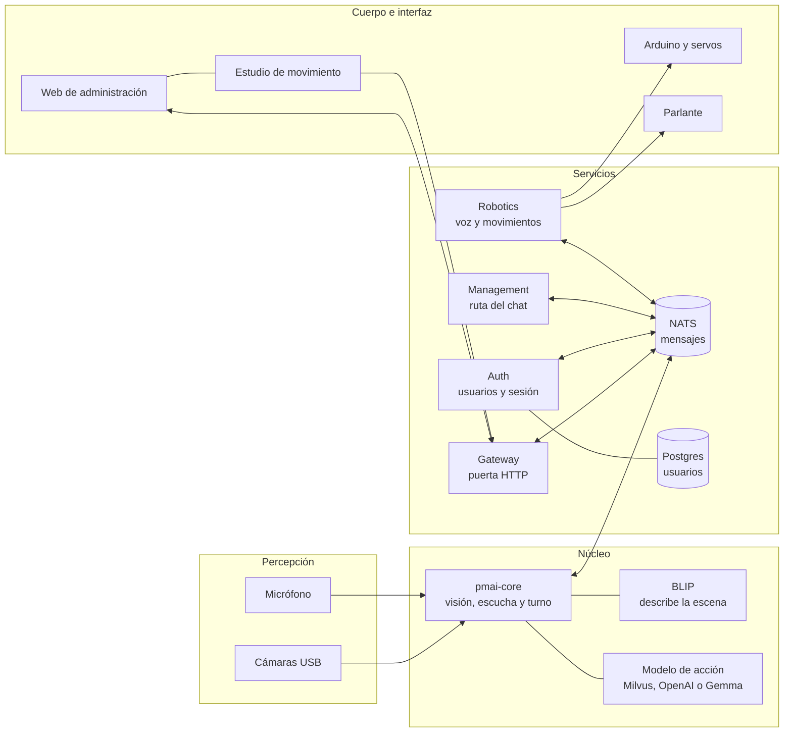

Leído de izquierda a derecha, el recorrido es el siguiente. Las cámaras alimentan continuamente al núcleo, que reconoce a las personas y guarda la última imagen de cada cámara. El micrófono también entrega audio al núcleo, que detecta el nombre de activación y transcribe la pregunta. A partir de ahí, la pregunta no va directa al modelo: pasa primero por el servicio de gestión (management), que decide si se responde por la ruta sencilla o por la ruta completa. En la ruta completa, el núcleo junta todo lo que sabe de la escena, le pide a BLIP una descripción de la persona, consulta el catálogo de gestos en robótica y le pasa todo al modelo de acción. La respuesta vuelve a robótica, que la dice por el parlante y ejecuta los gestos en el Arduino.

Ningún servicio llama directamente a otro. Todos se hablan a través de NATS, que funciona como una central de mensajes (ver [4.2](#42-nats-y-los-patrones-de-mensaje)). La única excepción es la web, que habla por HTTP con el gateway, y este traduce cada petición a un mensaje NATS. Por eso el gateway es la única puerta que el navegador conoce.

La memoria académica incluía un diagrama equivalente, que sigue siendo correcto en lo esencial:


*Figura 1. Arquitectura de alto nivel de R-ONE: la web habla con el gateway y este con cuatro microservicios por NATS, todo dentro del miniPC. Fuente: memoria académica 2026.*

Dos detalles de esa figura ya no se ajustan al código. NATS no usa gRPC, como dice su rótulo: es un protocolo propio en el que los servicios intercambian mensajes JSON. Además, `pmai-mai-core` no es una aplicación FastAPI: no abre ningún puerto HTTP y solo se comunica por NATS (ver la [ficha 15](#15-pmai-mai-core)). La figura tampoco muestra Postgres, el estudio de movimiento ni el Arduino, que sí aparecen en el diagrama de arriba.

### 3. Recorrido de una pregunta

La mejor manera de entender R-ONE es seguir una pregunta de principio a fin. El ejemplo que sigue usa nombres y valores reales del código. Lo único inventado es la situación.

Andrea López, integrante del semillero, se acerca al robot durante una feria y dice: "Fede, ¿qué es la Universidad Libre?".

**La cámara ya la había visto.** Mucho antes de que hablara, la cámara del robot la estaba enviando al núcleo a unos quince cuadros por segundo. Cada tres cuartos de segundo, el núcleo toma el cuadro más reciente de cada cámara y se lo pasa al detector de rostros, un modelo YOLO entrenado por el semillero con fotos de sus integrantes. El detector encierra la cara de Andrea en un recuadro y la etiqueta como `Andrea Lopez` con una confianza de 0,91. Un seguidor sencillo comprueba que ese recuadro se solapa con el del cuadro anterior y concluye que es la misma persona. Cada cinco cuadros, además, un segundo modelo (OSNet) calcula una "huella" numérica de su aspecto y la compara con las que ya conoce; como no la había visto antes, le asigna una identidad global nueva, del estilo `gid_3f9a1c2e`. Si Andrea se moviera frente a otra cámara, esa misma huella permitiría reconocerla como la misma persona.

**El micrófono la oye.** El micrófono también está siempre encendido, pero el núcleo no transcribe todo lo que oye. Primero filtra por volumen, para no gastar cálculo en el silencio, y luego pasa el audio a un reconocedor de voz (Vosk) que solo sabe distinguir las palabras de activación. Cuando oye "Fede", abre un segundo reconocedor, este sí de vocabulario libre, y empieza a grabar. Un detector de actividad de voz decide que Andrea terminó cuando lleva 1,6 segundos en silencio. El resultado es el texto "fede qué es la universidad libre".

**El robot avisa que está pensando.** Como la frase tiene más de catorce caracteres, el núcleo le pide a robótica que diga una frase de espera, por ejemplo "Déjame pensarla un momentico.", y envía la pregunta al servicio de gestión mediante el mensaje `MANAGEMENT_MS.chatService.chat`.

**Gestión elige la ruta.** El servicio de gestión lee un pequeño archivo de configuración (`pba-ms-management/data/chat-route.json`) donde el operador dejó guardada la elección del chat. Ese día están activados los turnos y el modelo elegido es "complejo", así que gestión no responde por su cuenta: reenvía la pregunta al núcleo con el mensaje `MAI_CORE_MS.interactionService.ask`.

**El núcleo arma el turno.** Lo primero que hace el núcleo es asegurarse de que no hay otro turno en curso: atiende una pregunta a la vez. Después elige a la persona de la escena con mayor confianza, que es Andrea. Toma el último cuadro de la cámara que la ve, recorta su recuadro, lo guarda como imagen JPEG y se lo pasa a BLIP, un modelo que describe imágenes. BLIP responde en inglés algo como "a woman with glasses standing in front of a robot". A continuación, el núcleo le pide a robótica el catálogo de gestos disponibles (`ROBOTICS_MS.actionService.getActions`).

**El modelo de acción busca primero en su memoria.** Con todo eso, el núcleo llama a la función `responder()` de `pmai-model-vision-language/utils/main.py`. Esta convierte la pregunta en un vector de 384 números que representa su significado y lo busca en Milvus, una base de datos de vectores. En la colección `conocimiento` hay 244 preguntas sobre la universidad cargadas por el semillero y una de ellas se parece mucho: la distancia entre ambas es menor que el umbral de 0,35, así que cuenta como acierto. Como la respuesta viene de la memoria, no se llama a ningún modelo de lenguaje y la respuesta tarda milisegundos.

**La respuesta se personaliza.** Antes de devolverla, `responder()` antepone el nombre de Andrea y, si la descripción de BLIP se parece a alguna situación conocida (por ejemplo, alguien que parece buscar orientación), añade una frase de apertura. El resultado se parece a "Andrea, la Universidad Libre es una institución de educación superior colombiana fundada en 1923…". Si la respuesta guardada trae gestos, solo se conservan los que estén en el catálogo que robótica entregó en esta misma llamada, con un máximo de tres.

**El robot habla y gesticula.** El núcleo le pide a robótica que diga la respuesta (`ROBOTICS_MS.voiceService.speak`) y, mientras habla, le pide ejecutar cada gesto (`ROBOTICS_MS.actionService.executeAction`). Robótica sintetiza la voz y la envía al parlante. Por cada gesto, encola cuatro pasos: el movimiento, un segundo de espera, el regreso a la postura de descanso (el "neutro") y otro segundo de espera. El núcleo no espera a que los gestos terminen.

**La pantalla registra la respuesta.** Si en lugar de hablar Andrea hubiera escrito la pregunta en el chat de la web, el navegador habría recibido `{ reply, fuente, movimientos }`. En este caso, `fuente` valdría `caché`, porque la respuesta salió de la memoria, y `movimientos` listaría los gestos ejecutados.

El recorrido completo cabe en este diagrama, que la [sección 6.3](#63-chat-por-la-ruta-complejo-el-turno) vuelve a dibujar con todos sus detalles técnicos.

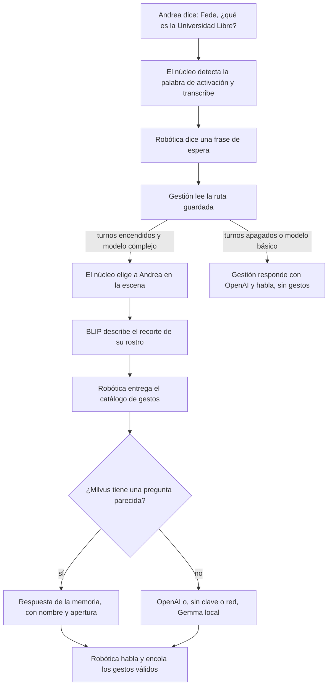

Dos variaciones ayudan a fijar la idea. Si Andrea hubiera preguntado algo que nadie había preguntado antes, como "¿qué opinas del clima de hoy?", Milvus no habría encontrado nada parecido. En ese caso, `responder()` construye un prompt con su nombre, la descripción de BLIP, la pregunta y la tabla de gestos, y se lo envía a OpenAI (`gpt-4o-mini`); si no hay clave o la llamada falla, lo resuelve Gemma en el miniPC. La respuesta nueva se guarda en la colección `interacciones`, sin el nombre de Andrea, para que la próxima vez que alguien pregunte exactamente lo mismo salga de la memoria. Si, en cambio, el operador hubiera dejado el chat en la ruta "básico", gestión le habría preguntado directamente a OpenAI, habría pedido a robótica que dijera la respuesta y el robot no habría usado ni la cámara ni los gestos.

### 4. Conceptos clave

#### 4.1 Microservicios y gateway

Un **microservicio** es un programa pequeño que se encarga de una sola responsabilidad y se comunica con los demás a través de la red, en lugar de vivir todo dentro de una sola aplicación. Se parece a un restaurante con estaciones: la cocina, la barra y la caja son equipos distintos que se pasan comandas; si la barra se satura, la cocina sigue funcionando, y se puede cambiar al cajero sin cerrar el restaurante.

R-ONE tiene siete servicios propios, además de la base de datos y el servidor de mensajes. Cada uno vive en su propio repositorio y en su propio contenedor Docker: `pba-ms-auth` se ocupa de usuarios y sesiones; `pba-ms-management`, del chat; `pba-ms-robotics`, de la voz y el cuerpo; `pmai-mai-core`, de la percepción y el turno; `pmas-web-main`, de la interfaz; `pmas-web-motion-studio`, del estudio de movimientos; y `pba-ms-gateway`, de la puerta de entrada que se describe a continuación. La ventaja práctica es que cada equipo del semillero puede trabajar en su pieza sin romper las demás, y que un fallo en el reconocimiento de voz no tumba el inicio de sesión.

El **gateway** (`pba-ms-gateway`) es la recepción del edificio. El navegador no conoce las direcciones internas de los servicios y tampoco debería: toda petición HTTP entra por el gateway, que comprueba la sesión y los permisos, la traduce a un mensaje y la envía al servicio que corresponde. De ese modo, la seguridad se revisa en un solo lugar.

En R-ONE: el gateway escucha en el puerto 3000 y su punto de entrada es `pba-ms-gateway/src/main.ts`. La lista completa de rutas está en el [Anexo D](#anexo-d-endpoints-http-del-gateway). Para profundizar en el patrón, la documentación de NestJS sobre [microservicios](https://docs.nestjs.com/microservices/basics) explica exactamente el modelo que usan el gateway, auth y management.

#### 4.2 NATS y los patrones de mensaje

**NATS** es un servidor de mensajería: un programa por el que pasan todos los mensajes entre servicios. Funciona como un conmutador telefónico de oficina. Cada servicio se registra con unas "extensiones", que en NATS se llaman *sujetos*, y quien quiere algo marca la extensión sin saber en qué computador vive el otro servicio. Si nadie contesta, el que llama recibe un error al agotarse el tiempo de espera.

Los sujetos de R-ONE siguen la convención de NestJS, `SERVICIO.servicioInterno.método`. Por ejemplo, `ROBOTICS_MS.voiceService.speak` es "la función `speak` del servicio de voz de robótica". Casi todas las llamadas son de tipo **petición-respuesta**: quien llama envía `{ pattern, data, id }` y espera una respuesta `{ response, isDisposed }`, o `{ err }` si algo salió mal. El núcleo también publica **eventos** sin esperar respuesta (`pmai.detection` y `pmai.reid`), aunque hoy ningún servicio se suscribe a ellos.

La ventaja frente a que cada servicio llame a los demás por HTTP es que NATS desacopla a quien llama de quien responde. Por eso un servicio en Python (robótica o el núcleo) puede atender a uno en TypeScript (el gateway) sin que ninguno sepa en qué lenguaje está escrito el otro. Basta con que ambos respeten la forma del mensaje.

En R-ONE: el servidor es el contenedor `nats-server` (imagen `nats:2.12.5-alpine3.22`), escucha en el puerto 4222 dentro de la red de Docker y publica su monitor en el 8222. Los servicios Python imitan el formato de NestJS en `pba-ms-robotics/src/core/nats/nest_request.py` y `pmai-mai-core/src/pmai_core/core/nats/nats_client.py`. El catálogo completo de sujetos está en el [Anexo C](#anexo-c-patrones-nats). Referencia externa: [documentación de NATS](https://docs.nats.io/nats-concepts/core-nats/reqreply).

#### 4.3 Sesión y JWT

Para usar la web hay que iniciar sesión. Cuando el usuario y la contraseña son correctos, el servidor entrega un **JWT** (JSON Web Token): un texto firmado que dice quién es el usuario y qué roles tiene. Es como la manilla de un evento: en la entrada verifican la identidad una vez y, a partir de ahí, basta con mostrar la manilla en cada puerta, sin volver a enseñar la cédula. La firma impide falsificarla, porque solo el servidor conoce la clave con la que se firmó.

En R-ONE el token tiene dos particularidades que conviene conocer. La primera es que cada usuario tiene una sola sesión activa: iniciar sesión en un teléfono cierra la que estuviera abierta en el portátil, que entonces muestra "Tu sesión venció. Entra de nuevo.". La segunda es que, además del token, cada petición lleva la cabecera `X-Active-Role` con el identificador del rol con el que se está trabajando (ADMIN o USER), porque un usuario puede tener varios.

En R-ONE: el token lo emite `pba-ms-auth` y lo valida el gateway con su estrategia JWT en `pba-ms-gateway/src/auth/strategies`; la web lo guarda y lo adjunta en su interceptor de `pmas-web-main/src/app/core/interceptors`. El flujo completo está en [6.1](#61-inicio-de-sesión). Referencia externa: [introducción a JWT](https://jwt.io/introduction).

#### 4.4 Detección, seguimiento y reidentificación

Reconocer a alguien en video implica tres problemas distintos, que R-ONE resuelve con tres piezas.

La **detección** responde a la pregunta "¿qué hay en esta imagen y dónde?". Un detector mira un cuadro y devuelve recuadros con una etiqueta y una confianza. El de R-ONE es un modelo YOLO entrenado por el semillero cuyas 25 etiquetas son los nombres de sus integrantes, así que no detecta "una persona" en general, sino "Andrea López" o "Johel Arias". Si nadie supera una confianza de 0,5, no hay detección.

El **seguimiento** responde a "¿esta persona es la misma que estaba aquí hace un instante?". El seguidor compara cada recuadro nuevo con los del cuadro anterior en la misma cámara y, si se solapan lo suficiente, los une en una misma pista. Es lo que hacemos al seguir con la vista a alguien que camina: no necesitamos reconocerle la cara en cada paso.

La **reidentificación** (ReID) responde a "¿esta persona que aparece en la cámara 2 es la misma que vi en la cámara 1?". Para eso, un segundo modelo convierte la imagen de la persona en una huella numérica (512 valores, según la documentación del modelo) que resume su aspecto (ropa, colores, silueta). Dos huellas parecidas indican que se trata de la misma persona, aunque haya cambiado de cámara o de ángulo. Es lo que hace un portero que reconoce por la chaqueta a alguien que entró por otra puerta. Cada persona recibe así un `id_global`, como `gid_3f9a1c2e`, que se conserva mientras el núcleo esté encendido.

En R-ONE: el detector es `pmai-mai-core/src/pmai_core/models/my_model.pt` (YOLO11s), el seguidor está en `pmai-mai-core/src/pmai_core/resources/vision/tracker.py` y la reidentificación usa `pmai-mai-core/src/pmai_core/models/osnet_x0_25_msmt17.onnx`, con una similitud mínima de 0,6. Todo lo orquesta `pmai-mai-core/src/pmai_core/resources/identification/service.py`. Referencias externas: [Ultralytics YOLO](https://docs.ultralytics.com/) y [OSNet en torchreid](https://kaiyangzhou.github.io/deep-person-reid/).

#### 4.5 Descripción de escena

Saber que la persona es Andrea no dice nada de lo que está haciendo. Para eso R-ONE usa un modelo de **descripción de imágenes** (image captioning): recibe una foto y devuelve una frase que la describe. Funciona como un narrador para personas ciegas que, al ver la imagen, dice "una mujer con gafas de pie frente a un robot".

El modelo es BLIP en su versión base, publicado por Salesforce. Escribe en inglés, y eso no es un problema: la frase no se le muestra a nadie, sino que se entrega como contexto al modelo de lenguaje, que la interpreta y responde en español. Como BLIP a veces inventa detalles (por ejemplo, menciona un lugar o una fecha que no aparecen en la imagen), el semillero añadió filtros que eliminan esas alucinaciones típicas; su historia se cuenta en [30.4](#304-alucinaciones-y-palabras-protegidas).

En R-ONE: el núcleo recorta el recuadro de la persona elegida como JPEG de calidad 85 y llama a `generate_context_from_base64` de `pmai-model-context/model_context/context.py`. Si BLIP falla, el turno sigue sin contexto visual. Referencia externa: [BLIP en Hugging Face](https://huggingface.co/Salesforce/blip-image-captioning-base).

#### 4.6 Embeddings y búsqueda vectorial

Un **embedding** es una lista de números que representa el significado de un texto. El truco está en que textos con significados parecidos producen listas parecidas, aunque no compartan palabras. Se puede imaginar como unas coordenadas en un mapa de significados: "¿dónde queda la universidad?" y "¿en qué parte está la U?" caen muy cerca, mientras que "¿qué es un gato?" cae lejos.

R-ONE usa el modelo `paraphrase-multilingual-MiniLM-L12-v2`, que entiende español y convierte cada pregunta en 384 números. Comparar dos preguntas se reduce entonces a medir el ángulo entre sus vectores (distancia coseno): cuanto más pequeño, más se parecen. Una **base de datos vectorial** es una base de datos optimizada para responder rápido "¿cuál es el vector guardado más cercano a este?", incluso con millones de registros. R-ONE usa Milvus Lite, la versión de Milvus que corre dentro del propio proceso y guarda todo en un archivo, sin servidor aparte.

En R-ONE: el codificador está en `pmai-model-vision-language/utils/encoder/encoder.py`, la búsqueda en `pmai-model-vision-language/utils/milvus/busqueda.py` y la base en `pmai-model-vision-language/utils/milvus/androide_milvus.db`. Las colecciones y sus umbrales se detallan en [7.2](#72-milvus-lite). Referencias externas: [Sentence Transformers](https://www.sbert.net/) y [Milvus Lite](https://milvus.io/docs/milvus_lite.md).

#### 4.7 Caché semántico

Un caché guarda respuestas ya calculadas para no repetir el trabajo. Uno normal solo acierta si la pregunta es idéntica; uno **semántico** acierta si la pregunta *significa* lo mismo. Milvus funciona como un archivo que no busca por palabras exactas, sino por parecido de significado: si alguien ya preguntó "¿dónde queda la universidad?", la pregunta "¿en qué parte está la U?" encuentra esa respuesta sin llamar a ningún modelo.

R-ONE tiene dos memorias con reglas distintas, y la diferencia es deliberada. La colección `conocimiento` contiene preguntas y respuestas verificadas por el semillero, así que basta con que la pregunta nueva se parezca lo suficiente (distancia menor que 0,35, o 0,28 si la pregunta pide un dato concreto). La colección `interacciones`, en cambio, guarda respuestas que generó un modelo de lenguaje y que nadie revisó. Por eso solo se reutilizan si la pregunta coincide de forma estricta: igual al texto guardado, o contenida en él con al menos tres palabras. Así se evita que una respuesta improvisada se reparta a preguntas que solo se parecen.

El caché tiene dos beneficios visibles. Las respuestas de la memoria salen casi al instante, mientras que Gemma en el miniPC puede tardar varios segundos. Además, no gastan créditos de la API de OpenAI.

En R-ONE: `responder()` consulta primero `conocimiento` y luego `interacciones` (`pmai-model-vision-language/utils/main.py`); cuando acierta, la pantalla muestra `fuente: caché`. El paso a paso está en la [ficha 17](#17-pmai-model-vision-language).

#### 4.8 Modelo local frente a modelo en la nube

Cuando la memoria no tiene la respuesta, R-ONE necesita un **modelo de lenguaje** (LLM) que la redacte. Puede usar dos, y la elección es un equilibrio entre calidad y autonomía. Es como elegir entre llamar a un experto por teléfono o resolverlo con la calculadora de bolsillo: el experto sabe más, pero hace falta línea y cuesta; la calculadora siempre está ahí, aunque haga menos.

El modelo en la nube es `gpt-4o-mini` de OpenAI: responde bien y rápido, pero necesita una clave de API, conexión a internet y presupuesto. El modelo local es Gemma 4 E2B, de Google, en un archivo GGUF de unos 3 GB que corre en el procesador del miniPC con `llama-cpp-python`. No depende de nada externo, pero es más lento y menos preciso. R-ONE intenta primero OpenAI si tiene clave y, si la llamada falla por cualquier motivo (sin red, clave inválida o cuota agotada), cae a Gemma sin que el usuario lo note, más allá de la `fuente` que muestra la pantalla: `OpenAI` o `Gemma (local)`.

En R-ONE: el enrutador está en `pmai-model-vision-language/utils/gpt/gptapi.py` y Gemma en `pmai-model-vision-language/utils/gguf/ggufapi.py`. El archivo del modelo vive en `pmai-model-vision-language/models/gguf/` y se descarga solo, desde `unsloth/gemma-4-E2B-it-GGUF`, la primera vez que hace falta. Referencias externas: [llama.cpp](https://github.com/ggml-org/llama.cpp) y [Gemma](https://ai.google.dev/gemma).

#### 4.9 Secuencias, bloques y el par normal y neutro

Un gesto de R-ONE es una **secuencia**: una partitura de movimientos para varios servos a lo largo del tiempo. Cada nota de esa partitura es un **bloque**, que dice "en el segundo 0,4, lleva el servo 3 de la placa 2 a tal posición, a tal velocidad". Las secuencias se diseñan en el estudio de movimiento grabando posiciones del robot real y quedan guardadas como archivos JSON en robótica, con un número de identificación (`id`), un nombre, una categoría y una descripción.

Cada secuencia viene en **par**: la versión normal (los `blocks`) y su versión neutra (los `blocks_neutro`), que devuelve cada servo a la postura de descanso. Es como hacer un saludo y luego bajar el brazo: si el robot encadenara gestos sin volver al neutro, cada uno empezaría desde la posición en que dejó el anterior y el resultado sería impredecible. Por eso robótica ejecuta siempre normal, espera un segundo, ejecuta el neutro y espera otro segundo.

Para que el modelo de lenguaje pueda elegir un gesto, este tiene que estar en el **catálogo** que robótica entrega en cada turno. Solo entran los pares completos (categoría, normal y neutro) que además tienen una descripción de al menos diez caracteres, porque la descripción es lo que el modelo lee para decidir si el gesto encaja con la respuesta. Un id que no esté en el catálogo de esa llamada se descarta, aunque el modelo lo pida.

En R-ONE: las secuencias viven en `pba-ms-robotics/data/sequences`, la cola de ejecución en `pba-ms-robotics/src/sequence/playback_queue.py` y el filtro del catálogo en `pba-ms-robotics/src/sequence/ingest.py`. El ciclo completo de un gesto está en [6.5](#65-ciclo-de-un-gesto).

## Parte II. Arquitectura y flujos

> Esta parte es para desarrolladores y para operadores que quieran entender qué pasa por dentro. Supone que se leyeron los conceptos de la [sección 4](#4-conceptos-clave). Primero muestra el mapa de servicios, luego recorre cada flujo con un diagrama de secuencia que usa los nombres reales de los mensajes y, por último, describe dónde se guarda cada dato. Las fichas de la [Parte III](#parte-iii-repositorios) bajan al detalle de cada repositorio.

### 5. Mapa de servicios

#### 5.1 Servicios y puertos

Todo R-ONE se levanta con un único archivo de Docker Compose, `docker-compose.yml`, en la raíz del lanzador. Define nueve servicios: siete son repositorios del semillero y dos son piezas de infraestructura tomadas tal cual (Postgres y NATS). Los puertos salen de `.env.template`, y conviene no cambiarlos porque la web tiene fijos el 3000 y el 4210 (ver la [ficha 10](#10-pmas-web-main)).

| Servicio de Compose | Repositorio | Tecnología | Puerto publicado | Depuración | Depende de |
|---|---|---|---|---|---|
| `db` | imagen `postgres:17.1-alpine` | PostgreSQL 17 | 5432 | — | — |
| `nats-server` | imagen `nats:2.12.5-alpine3.22` | NATS | 8222 (monitor) | — | — |
| `pba-ms-gateway` | `pba-ms-gateway` | NestJS | 3000 (`MS_GATEWAY_PORT`) | 9230 | `db` sano, `nats-server` |
| `pba-ms-auth` | `pba-ms-auth` | NestJS | 3001 (`MS_AUTH_PORT`), sin servidor HTTP | 9231 | `db` sano, `nats-server` |
| `pba-ms-management` | `pba-ms-management` | NestJS | 3002 (`MS_MANAGEMENT_PORT`), sin servidor HTTP | 9232 | — |
| `pba-ms-robotics` | `pba-ms-robotics` | Python, FastAPI y Uvicorn | 3003 (`MS_ROBOTICS_PORT`), sin rutas de negocio | 9233 | — |
| `pmas-web-main` | `pmas-web-main` | Angular | 4200 (`WEB_MAIN_PORT`) | — | — |
| `pmas-web-motion-studio` | `pmas-web-motion-studio` | Python, FastAPI | 4210 (`MOTION_STUDIO_PORT`) | — | — |
| `pmai-core` | `pmai-mai-core` (con `pmai-model-context` y `pmai-model-vision-language` montados) | Python 3.12 | 3004 (`PMAI_CORE_PORT`), sin servidor | — | `nats-server` |

La tabla tiene varias rarezas que conviene explicar, porque desconciertan a quien llega. Tres servicios publican un puerto en el que nadie escucha: auth y management son microservicios NestJS que solo atienden NATS, y el núcleo no abre ningún servidor. Esos puertos quedaron de una versión anterior y no hacen daño, pero tampoco sirven para nada. Robótica, en cambio, sí arranca un servidor web con Uvicorn, aunque no monta ninguna ruta de negocio; todo su trabajo entra por NATS. En la práctica, los únicos puertos que un navegador usa son el 4200 (la web), el 3000 (el gateway) y el 4210 (el estudio).

El puerto de clientes de NATS, el 4222, no se publica en el anfitrión: solo existe dentro de la red privada de Docker, donde cada servicio lo encuentra como `nats://nats-server:4222`. Esto tiene una consecuencia de seguridad positiva, porque desde la red local nadie puede enviar mensajes directamente a robótica o al núcleo saltándose el gateway.

Por último, solo el gateway y auth declaran dependencias en Compose. El orden en que arranca el resto lo impone el script `scripts/lan-up.sh`, que se describe en la [sección 22](#22-arranque-local-y-en-red-local).

#### 5.2 Canales de comunicación

El diagrama muestra cada canal real entre servicios, con el protocolo en la flecha.

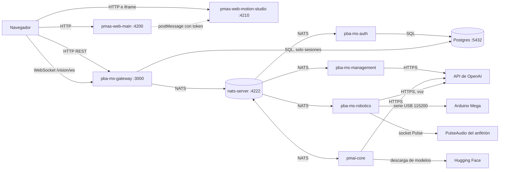

El navegador habla con tres servidores. Carga la aplicación Angular desde el 4200, carga el estudio desde el 4210 dentro de un `iframe` y hace todas las peticiones de datos al gateway en el 3000, por HTTP para lo normal y por WebSocket para el video. El estudio no inicia sesión por su cuenta: la web le pasa el token con `postMessage` (mensajes `prometeo-auth` y `prometeo-auth-request`) y, desde ahí, el estudio llama al mismo gateway.

Detrás del gateway todo es NATS. Gateway, auth y management son NestJS y usan el transporte NATS de NestJS tal cual. Robótica y el núcleo son Python y no tienen NestJS, así que reproducen a mano el formato de sobre que NestJS espera. Cuando el gateway envía `ROBOTICS_MS.voiceService.speak`, publica en ese sujeto un JSON `{ "pattern": "ROBOTICS_MS.voiceService.speak", "data": { "message": "Hola" }, "id": "…" }`. Robótica lo recibe en su suscriptor, llama al controlador con `data` y responde `{ "response": …, "isDisposed": true }`. La función que arma esas peticiones en Python es `nest_request` en `pba-ms-robotics/src/core/nats/nest_request.py`, y el núcleo tiene su equivalente en `pmai-mai-core/src/pmai_core/core/nats/nats_client.py`.

Hay tres salidas a internet. Management y el núcleo llaman a OpenAI para generar texto, robótica la llama para sintetizar voz y el núcleo descarga de Hugging Face los modelos que no encuentra en disco. Las tres son opcionales: sin internet, el sistema responde con Gemma, habla con Piper o eSpeak y usa los modelos ya descargados.

Hacia el mundo físico, robótica escribe en el puerto serie del Arduino (115200 baudios) y reproduce el audio a través del servidor PulseAudio del anfitrión, cuyo socket Compose monta dentro del contenedor. Por eso el parlante Bluetooth se empareja en el sistema operativo y no en Docker.

### 6. Flujos

#### 6.1 Inicio de sesión

Iniciar sesión involucra a la web, al gateway, a auth y a Postgres. El gateway nunca guarda contraseñas: delega la validación en auth y, desde ese momento, en cada petición comprueba que la sesión siga viva.

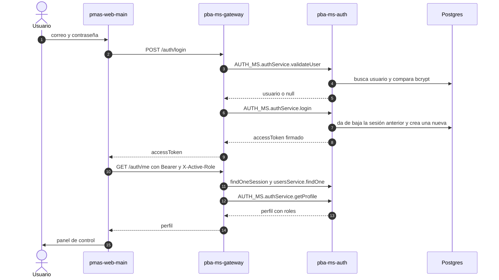

El orden importa por dos razones. Primero, el gateway usa dos estrategias de Passport: `LocalStrategy` comprueba usuario y contraseña con `AUTH_MS.authService.validateUser`, y solo si pasa se pide el token a `AUTH_MS.authService.login`. Segundo, auth firma el JWT con una duración tomada del ajuste `SESSION_EXPIRATION` (8 horas en la siembra) y, al crear la sesión, da de baja la anterior del mismo usuario. Esa es la razón de que haya una sola sesión por cuenta: si dos personas comparten usuario, la que entró primero queda fuera.

Después del login, cada petición protegida pasa por `JwtAuthGuard`, que valida la firma y además pregunta a auth si la sesión existe y sigue activa. Luego `RolesGuard` comprueba que el rol de la cabecera `X-Active-Role` esté asignado al usuario. Si un usuario tiene varios roles, la web le muestra un selector después del login.

Los errores se ven así en la pantalla. Una contraseña errada da 401 y "Credenciales incorrectas."; demasiados intentos bloquean la cuenta durante `LOCK_LOGIN_UNTIL` horas (0,25 en la siembra, es decir, quince minutos) después de `LOCK_LOGIN_ATTEMPTS` fallos (5). Una sesión vencida o dada de baja da 401 y la web vuelve al login con "Tu sesión venció. Entra de nuevo.". Hay un matiz: la web cierra la sesión ante cualquier 401 o 403, incluido un 403 por falta de permisos, de modo que un USER que intenta una acción de ADMIN también termina en el login.

#### 6.2 Chat por la ruta Básico

La ruta Básico es la más sencilla y no usa ni cámaras, ni memoria, ni gestos. Se activa cuando el operador apaga los turnos automáticos o elige el modelo "básico" en el selector del chat.

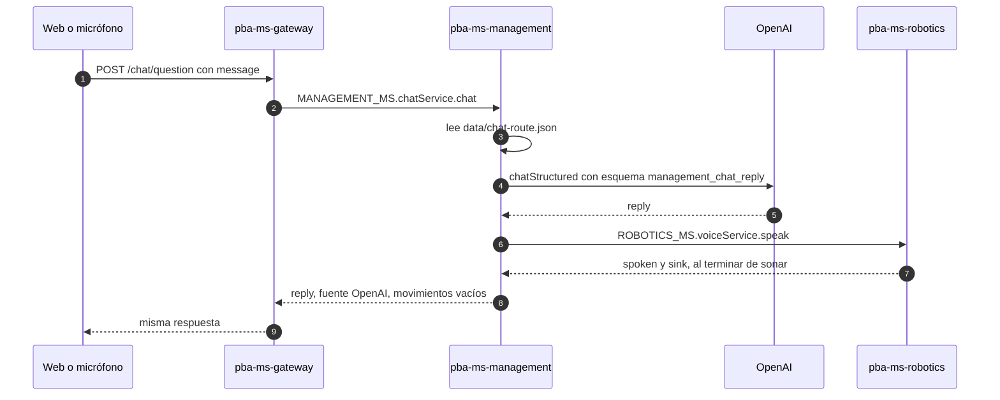

La decisión de ruta es una sola línea de `pba-ms-management/src/chat/chat.service.ts`: `const useTurn = route.automationEnabled && route.selectedModel === 'complejo';`. Si es falsa, management llama a OpenAI pidiendo una respuesta estructurada (`chatStructured`), le pide a robótica que la diga y devuelve `{ reply, fuente: "OpenAI", movimientos: [] }`.

Hay tres detalles que no se ven desde fuera. El primero es que management espera a que robótica termine de reproducir el audio antes de contestar, y esa espera tiene un límite de 20 segundos; una respuesta muy larga puede vencerlo aunque el robot siga hablando. El segundo es que esta ruta no tiene respaldo: si OpenAI falla, el chat muestra un error. El tercero es que el prompt de sistema que se envía es una constante del código; la variable `OPENAI_SYSTEM_PROMPT` es obligatoria al arrancar, pero nadie la lee (ver la [ficha 13](#13-pba-ms-management)).

#### 6.3 Chat por la ruta Complejo: el turno

La ruta Complejo es el corazón del sistema y se llama **turno**. Se activa cuando los turnos automáticos están encendidos y el modelo elegido es "complejo", que es el valor por defecto.

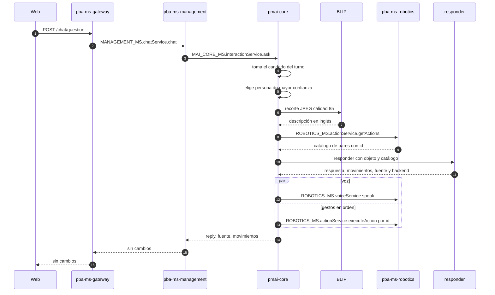

El turno lo implementa `InteractionTurn.ask` en `pmai-mai-core/src/pmai_core/pipeline/interaction_turn.py`, y conviene leerlo paso a paso.

1. **Un turno a la vez.** Un candado no bloqueante impide que dos preguntas se mezclen. Si llega una segunda mientras la primera sigue en curso, la respuesta inmediata es "Sigo respondiendo, un momento." con `fuente: ocupado`.
2. **Elegir a la persona.** De los objetos globales de la escena, gana el de mayor confianza; si hay empate, el de `id_global` menor en orden alfabético. Si no hay nadie, se usa la etiqueta `Persona no identificada`, sin recuadro ni imagen.
3. **Describir la escena.** Si hay recuadro, se toma el último cuadro de la cámara que mejor ve a la persona, se recorta como JPEG de calidad 85 y se envía a BLIP. Si BLIP falla, el contexto queda vacío y el turno sigue.
4. **Pedir el catálogo.** `ROBOTICS_MS.actionService.getActions` devuelve los pares completos y con descripción, cada uno con su `id`. Si la lista está vacía, el turno no falla: el robot hablará y no moverá nada.
5. **Responder.** `responder()` busca en la memoria y, si no acierta, genera con OpenAI o Gemma (ver [4.7](#47-caché-semántico) y [4.8](#48-modelo-local-frente-a-modelo-en-la-nube)). Devuelve como máximo tres ids, y solo de ese catálogo.
6. **Hablar y gesticular.** La voz se lanza en un hilo aparte y, mientras suena, el núcleo envía `executeAction` por cada id en el orden que eligió el modelo, sin esperas ni neutro: el neutro lo inserta robótica. Al final, el turno espera a que termine la voz y devuelve `{ reply, fuente, movimientos }`.

La `fuente` le dice al operador de dónde salió la respuesta. El núcleo la traduce a partir de lo que devuelve `responder()`:

| `fuente` | Cuándo aparece |
|---|---|
| `caché` | Milvus encontró la respuesta en `conocimiento` o `interacciones` |
| `OpenAI` | No hubo acierto y respondió `gpt-4o-mini` |
| `Gemma (local)` | No hubo acierto y respondió Gemma, porque no había clave o la llamada a OpenAI falló |
| `ocupado` | Había otro turno en curso |
| `voz corta` | La pregunta vino por voz y tenía menos de 14 caracteres |
| `disculpa` | `responder()` lanzó una excepción o devolvió vacío; la respuesta es "Lo siento, no puedo responder en este momento." |

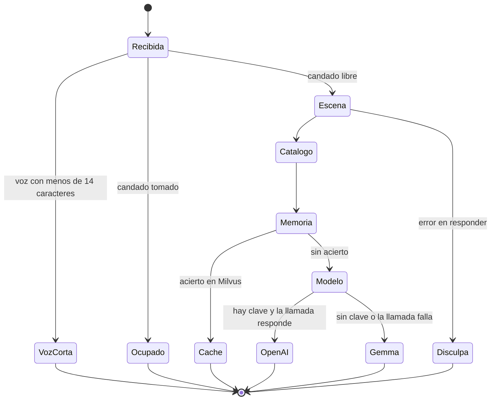

El código y la documentación anterior se separan en cuatro puntos que un desarrollador tiene que conocer:

- **"Voz corta" y el "ocupado" hablado no ocurren hoy.** Esas dos ramas solo se activan cuando el origen del turno es `voice`, pero el controlador de NATS siempre llama `turn.ask(message, "chat")`, también cuando la pregunta vino del micrófono a través de management.
- **Una disculpa de Gemma se ve como `Gemma (local)`.** Si Gemma no puede cargar, devuelve la frase de disculpa marcada como `gguf`. Además, esa frase no está en la lista de respuestas que no se guardan, así que puede quedar indexada en `interacciones` y repetirse desde la caché.
- **El tiempo límite del gateway es de 20 segundos.** El gateway espera ese tiempo como máximo cualquier respuesta NATS. Como el turno espera a que termine la voz, una respuesta larga generada por Gemma puede superarlo: el robot habla, pero la web muestra "Error al conectar con el robot.".
- **La persona puede desaparecer de la escena.** La identidad global solo se calcula en el primer cuadro y luego cada cinco, y el resto de cuadros no la trae. Por eso una pregunta puede caer en `Persona no identificada` aunque haya alguien delante (pendiente de confirmar: falta medir con cámaras reales con qué frecuencia ocurre).

#### 6.4 El micrófono

El micrófono no tiene un camino propio hasta el modelo: transcribe y entra por la misma puerta que el chat. Por eso la voz obedece siempre la ruta que el operador eligió en la pantalla.

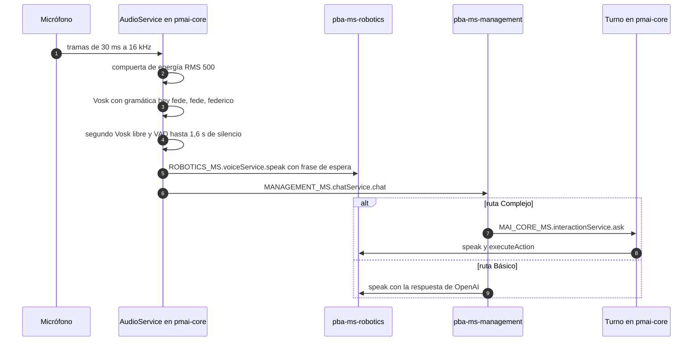

La escucha corre en un hilo propio del núcleo (`pmai-mai-core/src/pmai_core/resources/audio/service.py`). En reposo, una compuerta de volumen descarta el silencio y el resto del audio pasa a un reconocedor Vosk restringido a las palabras de activación. Usar una gramática tan pequeña lo hace rápido y evita falsas activaciones. Cuando oye la palabra, el núcleo abre un reconocedor de vocabulario libre, le reinyecta los 0,4 segundos anteriores para no perder el arranque de la frase y empieza a grabar. La grabación termina cuando el detector de voz de WebRTC cuenta 1,6 segundos de silencio, siempre después de un margen de gracia de 2,2 segundos tras la activación y con un mínimo de un segundo grabado; en ningún caso supera los 20 segundos.

Si la transcripción tiene al menos 14 caracteres, el núcleo dice una de cinco frases de espera ("Uy, buena esa. Dame un segundo.", "Déjame pensarla un momentico.", etc.) y envía el texto a `MANAGEMENT_MS.chatService.chat` con un límite de 30 segundos. La frase de espera se dice también cuando la ruta será Básico. En la ruta Complejo, la pregunta hace así un viaje de ida y vuelta: del núcleo a management y de management de nuevo al núcleo.

La web no captura audio para el robot. La página del chat consulta cada medio segundo `GET /audio/listening-status` y muestra el estado del micrófono ("Conectado, en silencio", "Oyendo", "Frase reconocida"…), el nivel de entrada de 0 a 100 y la última frase reconocida.

#### 6.5 Ciclo de un gesto

Un gesto puede venir de tres orígenes: el turno ("Voz o chat"), el panel de control de la web y el estudio. Los tres terminan en la misma clase, `SequenceService` de `pba-ms-robotics/src/sequence/sequence_service.py`, que encola pasos en una `PlaybackQueue` y los ejecuta en un hilo llamado `sequence-queue`.

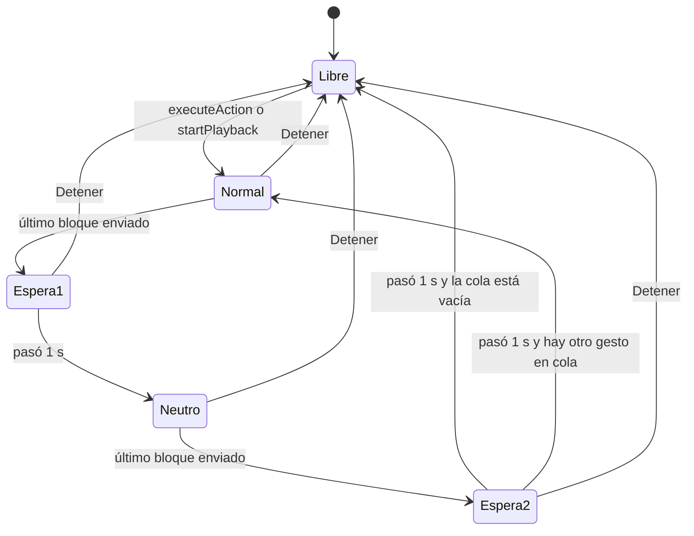

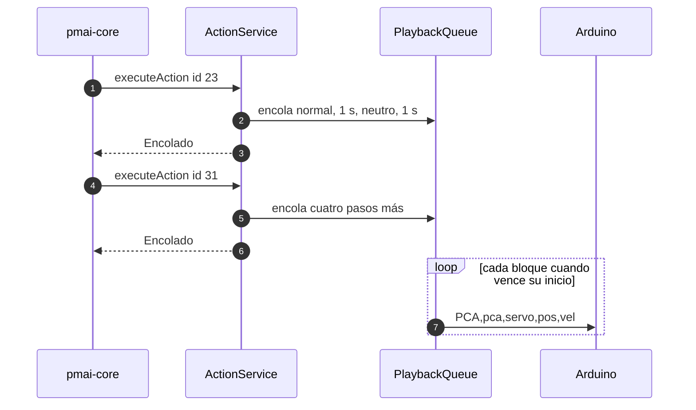

Por cada id, robótica encola cuatro pasos: la versión normal, una espera de un segundo, la versión neutra y otra espera de un segundo. La llamada `executeAction` responde "Encolado" en cuanto encola, así que el núcleo no se queda esperando a que el robot termine de moverse. Dentro de cada paso, el hilo envía cada bloque al Arduino cuando llega su tiempo de `inicio`, con el comando `PCA,<pca>,<servo>,<pos>,<vel>`. El paso termina cuando se envía el último bloque. El campo `dur` de cada bloque nunca llega al Arduino: la duración real depende de la velocidad `vel` y de la distancia que recorre el servo.

Desde el panel o el estudio, `startPlayback` rechaza una nueva reproducción si la cola está ocupada. Por eso la interfaz deshabilita los botones de gesto mientras el hardware trabaja y solo deja activo Detener. Detener vacía la cola, pero no envía nada al Arduino: los servos terminan de llegar a la última posición que recibieron.

Aquí hay una trampa importante del código actual. `ActionController` (que atiende al turno) y `SequenceController` (que atiende al panel y al estudio) crean cada uno su propio `SequenceService`, y cada servicio tiene su propia cola. En consecuencia, el cajón de runtime de la web y el botón Detener solo ven los gestos lanzados desde el panel o el estudio, no los del turno. Las pruebas no lo detectan porque usan una sola instancia (pendiente de confirmar en el hardware, aunque se deduce directamente del código).

Si no hay ningún Arduino conectado, robótica descarta los pasos de movimiento y solo consume las esperas. En ese caso, el gesto "ocurre" en la cola, pero no mueve nada.

#### 6.6 Visión en tiempo real

El video que se ve en la página de visión no viaja como un flujo de video, sino como una sucesión de fotos JPEG pedidas dos veces por segundo.

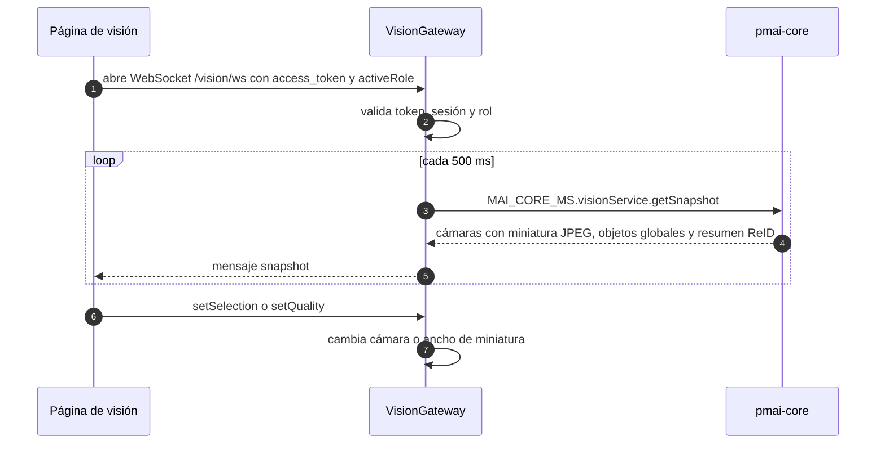

El núcleo mantiene en memoria el último cuadro anotado de cada cámara, con el recuadro, el nombre, el porcentaje de confianza, un identificador corto y la marca `SEEN` si varias cámaras ven a la misma persona. Cuando el gateway pide `getSnapshot`, el núcleo devuelve cada cámara como una miniatura JPEG de calidad 82, con un ancho de 480 píxeles por defecto y de 960 como máximo, junto con la lista de objetos globales y un resumen de la reidentificación.

El gateway valida el token en la cadena de consulta, porque un WebSocket del navegador no puede enviar cabeceras. Si el token no vale, cierra con el código 4001 y la web vuelve al login. La espera máxima de cada petición NATS es de 20 segundos; si el núcleo está ocupado cargando modelos al arrancar, la página puede tardar en mostrar la primera imagen.

La memoria académica describía este mismo flujo con un componente `ngOnInit → connect() → snapshot` validado por `parseVisionSnapshot`; esa estructura sigue presente en `pmas-web-main/src/app/pages/robotics-vision/vision-websocket.service.ts`.

#### 6.7 Creación e ingesta de una secuencia

Las secuencias nuevas nacen en el estudio de movimiento, que la web muestra incrustado en la página `/sequences`.

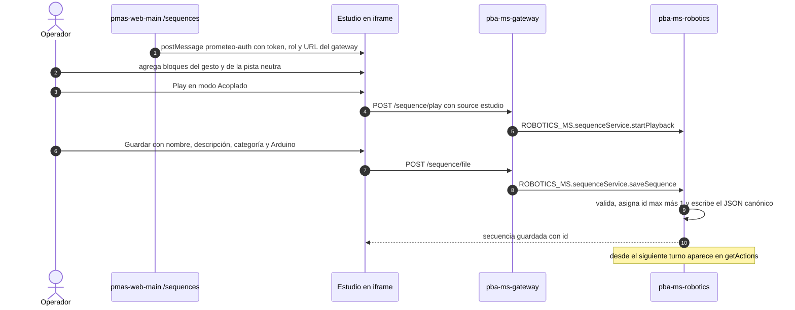

El estudio exige lo mismo que el catálogo: un nombre, una descripción de al menos diez caracteres, una de las seis categorías, el Arduino de destino y las dos pistas, la del gesto y la neutra. Puede generar la pista neutra "rebobinando" el gesto, aunque la propia interfaz advierte que ese neutro automático no es fiable, porque lleva cada servo a la posición 0 en su primer movimiento.

Robótica valida otra vez, convierte el archivo al formato canónico y le asigna un `id` nuevo (el mayor existente más uno) o conserva el que tenía si se sobrescribe. Desde ese momento la secuencia está en `pba-ms-robotics/data/sequences` y aparece en el catálogo del siguiente turno.

La web también puede importar archivos JSON del formato anterior: empareja cada gesto con su neutro por el nombre del archivo y los guarda con `overwrite: true`. Esa importación no exige descripción, lo que probablemente explica que las 31 secuencias actuales no la tengan (pendiente de confirmar: el historial no registra con qué herramienta se crearon).

#### 6.8 Declarar un poema

`MANAGEMENT_MS.chatService.declarePoema` es un camino aparte y más antiguo que el turno. Lo expone el gateway en `POST /chat/poema` y hace siempre lo mismo: le pide a OpenAI un poema con una instrucción fija escrita en el código, le pide a robótica que lo diga y devuelve el texto.

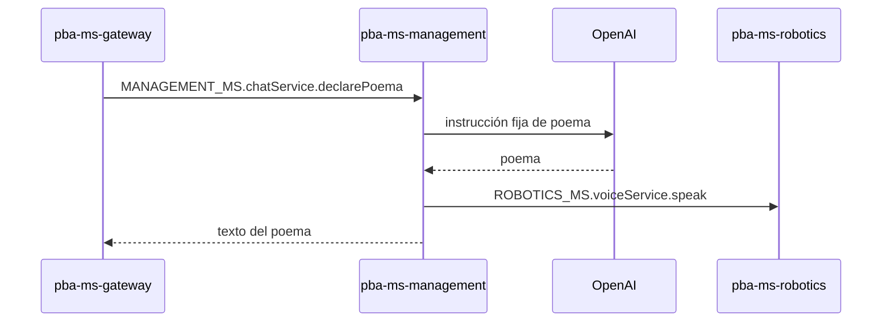

No pasa por el turno porque no necesita ni visión, ni memoria, ni gestos: es una demostración de voz. Tampoco tiene respaldo local si OpenAI falla. Hoy ningún botón de la web llama a esta ruta; queda disponible para usarla con una herramienta HTTP o desde otra interfaz.

### 7. Datos y persistencia

#### 7.1 Postgres y Prisma

La única base de datos relacional de R-ONE es un Postgres compartido. El dueño de sus tablas es `pba-ms-auth`, que las define con Prisma en el esquema `auth`; el gateway se conecta a la misma base, pero solo para leer la tabla `session` al responder `GET /auth/me`. Management tiene un archivo de Prisma heredado sin modelos y no usa la base.

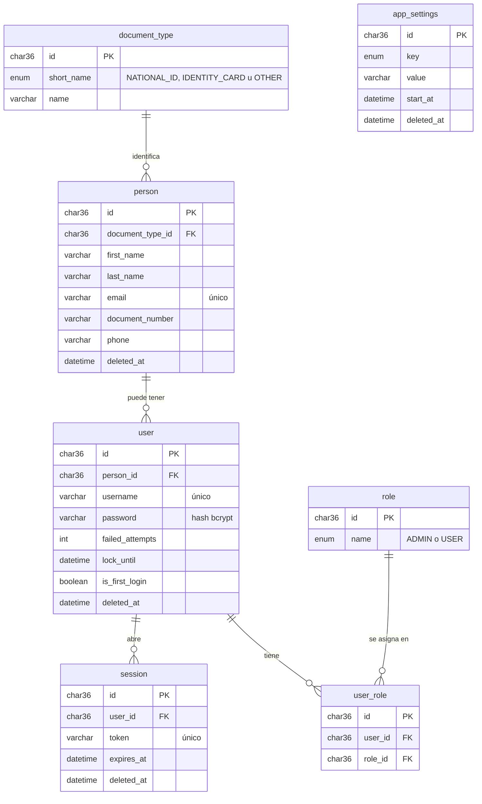

El modelo separa a la **persona** del **usuario** a propósito. Una persona es alguien del semillero, con su documento y su correo; un usuario es una cuenta para entrar, con su contraseña y sus roles. Así se puede registrar a alguien sin darle acceso, o darle de baja la cuenta sin borrar sus datos. Casi todas las tablas tienen `deleted_at`: las bajas son lógicas y los listados solo muestran lo que no se ha dado de baja.

La tabla `app_settings` guarda ajustes con historia. Cambiar un ajuste no sobrescribe la fila, sino que marca la vigente como dada de baja y crea una nueva con su fecha de inicio. Los cuatro ajustes que existen son `SESSION_EXPIRATION`, `LOCK_LOGIN_ATTEMPTS`, `LOCK_LOGIN_UNTIL` y `FRONT_END_URL`.

La siembra crea los tres tipos de documento colombianos (cédula de ciudadanía, tarjeta de identidad y otro), los roles ADMIN y USER, tres administradores (`admin-prometeo@unilibre.edu.co`, `admin-prometeo2@unilibre.edu.co` y `admin-prometeo3@unilibre.edu.co`) y los ajustes por defecto. La contraseña de esos administradores está en `pba-ms-auth/prisma/seed.ts` y este documento no la reproduce.

#### 7.2 Milvus Lite

La memoria del modelo de acción vive en Milvus Lite, dentro del proceso del núcleo, en la carpeta `pmai-model-vision-language/utils/milvus/androide_milvus.db`. Tiene dos colecciones con el mismo tipo de índice (HNSW con distancia coseno, `M=16`, `efConstruction=200`, búsqueda con `ef=64`) y vectores de 384 dimensiones.

| Colección | Qué guarda | Campos | Cuándo acierta |
|---|---|---|---|
| `conocimiento` | Preguntas y respuestas verificadas, sembradas desde `preguntas_respuestas.json` (244 pares) | `id`, `pregunta`, `respuesta`, `movimientos` (lista JSON en texto), `vector` | Distancia ≤ 0,35 (≤ 0,28 si la pregunta pide un dato específico) o coincidencia textual |
| `interacciones` | Respuestas generadas por OpenAI o Gemma, sin el nombre de la persona | `id`, `texto_clave`, `pregunta`, `scene_summary`, `respuesta`, `movimientos`, `vector` | Solo coincidencia estricta: texto igual o contenido, con tres palabras o más |

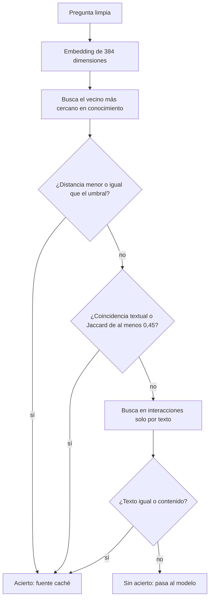

Además de la búsqueda vectorial, cada búsqueda tiene un respaldo textual: carga hasta mil registros y acepta la igualdad exacta (tras normalizar mayúsculas y tildes), una frase contenida o, solo en `conocimiento`, una similitud de Jaccard de al menos 0,45. Ese respaldo existe para cuando el embedding falla, pero con colecciones grandes se vuelve lento y deja registros fuera.

Dos detalles de rutas confunden a menudo. Primero, Compose define `MILVUS_DB_PATH=/data/milvus/androide_milvus.db`, pero ningún archivo lee esa variable: la ruta está fija en `pmai-model-vision-language/utils/config.py`, y por eso `data/milvus` del lanzador está vacío. Segundo, en la raíz de `pmai-model-vision-language` hay otra carpeta `androide_milvus.db` más antigua, creada por el cuaderno de ingesta, que tampoco se usa.

Hay también un efecto de la siembra que conviene saber. A 171 de los 244 pares sin gesto propio se les asigna `movimientos = [1]`, así que, si alguna vez existe en robótica una secuencia con `id` 1, el robot la ejecutará en todas esas respuestas.

#### 7.3 Secuencias en JSON

Cada secuencia es un archivo JSON dentro de `pba-ms-robotics/data/sequences`. El nombre lógico es la ruta relativa sin la extensión, y al guardar se sustituyen los caracteres raros por guiones; así, la secuencia `Secuencias/NEGAR 9.0` vive en `pba-ms-robotics/data/sequences/Secuencias/NEGAR-9-0.json`. Este es un extracto real de ese archivo, recortado a dos bloques del gesto y uno del neutro:

```json
{
  "version": 1,
  "id": 23,
  "name": "Secuencias/NEGAR 9.0",
  "description": "",
  "category": "cuello",
  "blocks": [
    { "arduino_id": 0, "pca": 0, "servo": 1, "inicio": 0.0, "dur": 0.5, "pos": 420, "vel": 6, "nombre": "rot_cuello" },
    { "arduino_id": 0, "pca": 3, "servo": 8, "inicio": 0.0, "dur": 1.0, "pos": 650, "vel": 5, "nombre": "ceja_izq" }
  ],
  "blocks_neutro": [
    { "arduino_id": 0, "pca": 0, "servo": 1, "inicio": 0.0, "dur": 1.0, "pos": 560, "vel": 5, "nombre": "rot_cuello" }
  ]
}
```

Cada campo tiene un sentido preciso. `version` es la versión del formato. `id` es el número que usa el catálogo y que el modelo elige; se asigna al guardar y no cambia al sobrescribir. `name` es el nombre visible y `description` es la frase que lee el modelo para decidir si el gesto encaja, por lo que debe tener al menos diez caracteres para entrar al catálogo; en este ejemplo está vacía y por eso la secuencia no se ofrece al turno. `category` es una de seis zonas del cuerpo (en los datos actuales aparecen `cara`, `cuello`, `torso` y `brazo_derecho`).

Cada bloque dice qué Arduino (`arduino_id`), qué placa controladora PCA9685 (`pca`, de 0 a 3) y qué canal (`servo`, de 0 a 15) mover; a qué segundo empezar (`inicio`); hasta qué posición, en ticks de PWM (`pos`); y con qué velocidad (`vel`). `nombre` es una etiqueta legible del servo y `dur` una duración orientativa que el firmware no recibe. El formato antiguo, una lista de siete valores `[pca, servo, inicio, dur, pos, vel, nombre]`, se sigue aceptando al leer.

#### 7.4 Ruta del chat

La elección entre Básico y Complejo no está en la base de datos, sino en un archivo pequeño: `pba-ms-management/data/chat-route.json`. Hoy contiene `{ "automationEnabled": true, "selectedModel": "complejo" }`.

Management lo vuelve a leer en cada mensaje, de modo que un cambio desde la web aplica a la siguiente pregunta, sin reiniciar nada. Compose monta la carpeta `data` de management, así que el archivo sobrevive a recrear el contenedor; git, en cambio, lo ignora. Si el archivo falta o está corrupto, management asume turnos encendidos y modelo complejo.

Las reglas de cambio las aplica `pba-ms-management/src/chat/chat.service.ts`. Apagar los turnos fuerza el modelo `basico`, y pedir `complejo` con los turnos apagados devuelve un error 409. Desde la web, cualquier usuario puede cambiar el modelo con `PATCH /chat/route/model`, pero solo un ADMIN puede encender o apagar los turnos con `PATCH /chat/route/automation`. La plantilla `.env.template` declara `MS_MANAGEMENT_CHAT_ROUTE_PATH` para mover el archivo, pero Compose no pasa esa variable al contenedor.

#### 7.5 Modelos de IA en disco

R-ONE usa siete modelos de inteligencia artificial. Algunos vienen dentro del repositorio y otros se descargan la primera vez que se necesitan, lo que explica que el primer arranque sea lento.

| Modelo | Para qué | Archivo o identificador | Tamaño aproximado | Origen |
|---|---|---|---|---|
| YOLO11s del semillero | Detectar los 25 rostros | `pmai-mai-core/src/pmai_core/models/my_model.pt` | 19 MB | En el repositorio |
| OSNet x0.25 | Huella para reidentificar | `pmai-mai-core/src/pmai_core/models/osnet_x0_25_msmt17.onnx` | 0,9 MB | En el repositorio |
| Vosk small es 0.42 | Voz a texto en español | `pmai-mai-core/src/pmai_core/models/vosk-model-small-es-0.42` | 58 MB | En el repositorio |
| BLIP base | Describir la escena | `Salesforce/blip-image-captioning-base` | ~1 GB (pendiente de confirmar: medido en Hugging Face, no en el contenedor) | Hugging Face, al arrancar |
| MiniLM multilingüe | Embeddings de preguntas | `paraphrase-multilingual-MiniLM-L12-v2` | ~470 MB (pendiente de confirmar: medido en Hugging Face, no en el contenedor) | Hugging Face, al arrancar |
| Gemma 4 E2B Q4_K_M | Respuestas sin internet | `pmai-model-vision-language/models/gguf/gemma-4-E2B-it-Q4_K_M.gguf` | 2,9 GB | Hugging Face, `unsloth/gemma-4-E2B-it-GGUF`, si falta |
| Piper es_ES davefx | Voz local | `pba-ms-robotics/src/core/models/voice/es_ES-davefx-medium.onnx` | 61 MB | En el repositorio |

El núcleo precarga Milvus, BLIP, el modelo de embeddings y Gemma al arrancar, en `pmai-mai-core/src/pmai_core/pipeline/runtime.py`, para que el primer turno no pague esa espera. El precio es que el contenedor tarda varios minutos en estar listo la primera vez. Compose no monta un volumen para la caché de Hugging Face, así que BLIP y los embeddings probablemente se vuelven a descargar cada vez que se recrea el contenedor (pendiente de confirmar dónde queda esa caché dentro de la imagen). El GGUF, en cambio, se guarda en la carpeta montada del repositorio y sobrevive.

## Parte III. Repositorios

<!-- pendiente: tarea 10 -->

### 8. Cómo leer una ficha

<!-- pendiente: tarea 10 -->

### 9. pba-launcher

<!-- pendiente: tarea 10 -->

### 10. pmas-web-main

<!-- pendiente: tarea 10 -->

### 11. pba-ms-gateway

<!-- pendiente: tarea 10 -->

### 12. pba-ms-auth

<!-- pendiente: tarea 10 -->

### 13. pba-ms-management

<!-- pendiente: tarea 10 -->

### 14. pba-ms-robotics

<!-- pendiente: tarea 10 -->

### 15. pmai-mai-core

#### 15.1 Propósito

`pmai-mai-core` es el núcleo de percepción e interacción de R-ONE. Descubre y lee las cámaras, detecta con YOLO los rostros de los integrantes del semillero, los sigue dentro de cada cámara, les asigna una identidad global con ReID, escucha el micrófono con Vosk y arma el turno: persona, recorte, descripción de escena, catálogo de gestos, respuesta, voz y movimientos. Dicho de otro modo, es el proceso que ve, oye y decide qué decir; no es quien habla ni quien mueve los servos.

Lo que no le toca queda en otros repositorios a propósito. No abre HTTP ni WebSocket propios: la pantalla recibe el video a través del gateway. No sintetiza voz ni encola gestos: eso lo hace `pba-ms-robotics`. No elige la ruta Básico o Complejo: eso lo hace `pba-ms-management`. Tampoco contiene la lógica de describir una imagen ni la de redactar la respuesta: las importa, en el mismo proceso, de `pmai-model-context` (paquete `model_context`) y de `pmai-model-vision-language` (paquete `utils`). El recorrido de una pregunta está en [6.3](#63-chat-por-la-ruta-complejo-el-turno) y [6.4](#64-el-micrófono); esta ficha baja al código que lo ejecuta.

#### 15.2 Versión

La versión leída es la de la tabla [Versión documentada](#versión-documentada): rama `dev`, commit `e0452ed`, fecha 2026-10-27. El paquete declara versión `0.1.0` en `pmai-mai-core/pyproject.toml`. El script de consola es `pmai-core = "pmai_core.__main__:main"`.

#### 15.3 Tecnología

El servicio corre en Python 3.12 o superior, empaquetado con Hatchling. La imagen de desarrollo parte de `python:3.12-slim` (`pmai-mai-core/Dockerfile.dev`). Las dependencias propias cubren visión (`opencv-python-headless`, `onnxruntime`, `ultralytics`, `numpy`), audio (`sounddevice`, `vosk`, `webrtcvad-wheels`), configuración (`pydantic`, `pydantic-settings`), mensajería (`nats-py`) y trazas (`structlog`). El extra `dev` añade `pytest`, `pytest-asyncio`, `ruff`, `mypy` y `watchfiles`.

En la misma imagen se instalan además los dos modelos hermanos, porque el núcleo los importa en el mismo proceso: `pmai-model-context` (torch y transformers) y `pmai-model-vision-language` (Milvus Lite, sentence-transformers, llama-cpp-python, openai). Por eso el Dockerfile instala ffmpeg, v4l-utils, portaudio, libasound2, libgl1, build-essential y cmake: los dos últimos hacen falta para compilar `llama-cpp-python`. Compose construye esa imagen con el contexto en la raíz del lanzador, no dentro de `pmai-mai-core`, para poder copiar a los tres repositorios a la vez.

#### 15.4 Árbol

```text
pmai-mai-core/
  src/pmai_core/                 # paquete instalable
    __main__.py                  # CLI: python -m pmai_core
    app.py                       # arranque y cableado
    settings.py                  # modelos Pydantic de settings.toml
    api/                         # controladores NATS y clientes salientes
      health/                    # healthService.health
      camera/                    # listado y vista JPEG
      monitoring/                # identidades, pistas y ReID
      vision/                    # snapshot para la pantalla
      audio/                     # micrófono
      interaction/               # interactionService.ask
      management_ms/             # cliente a chatService.chat
      robotics_ms/               # cliente a voz y gestos
    core/                        # NATS de petición-respuesta al estilo NestJS
    messaging/                   # segundo cliente: eventos pmai.detection y pmai.reid
    domain/                      # BBox, Detection, TrackedObject, eventos
    pipeline/                    # motor, objetos globales, recorte, turno
    resources/
      camera/                    # V4L2, captura por hilo, gestor
      vision/                    # YOLO, seguidor IoU, recuadros
      reid/                      # OSNet ONNX, comparador, galería
      identification/            # orquesta detección, seguimiento, ReID
      audio/                     # palabra de activación, VAD, Vosk
    models/                      # my_model.pt, OSNet, Vosk
  tests/                         # turno, cableado, audio y contrato de visión
  settings.toml                  # configuración efectiva en el contenedor
  Dockerfile.dev                 # imagen; contexto en la raíz del lanzador
```

La organización separa tres capas que no deben mezclarse. `resources/` habla con el hardware y con los pesos: cámaras, detector, ReID, micrófono. `pipeline/` convierte ese estado en algo usable: un bucle cada 0,75 s, una escena de objetos globales y el turno. `api/` es la fachada NATS, una carpeta por servicio, más dos clientes salientes hacia management y robótica. Hay dos conexiones NATS a propósito: `core/` imita el sobre de NestJS para petición-respuesta, y `messaging/` publica eventos sin esperar respuesta. Los pesos viven versionados en `pmai-mai-core/src/pmai_core/models/` para que el contenedor no dependa de una descarga al arrancar.

#### 15.5 Archivos clave

- `pmai-mai-core/src/pmai_core/__main__.py`: punto de entrada. Lee `settings.toml` o la ruta de `sys.argv[1]`, construye `Settings.from_toml` y lanza `run_app` con `asyncio.run`.
- `pmai-mai-core/src/pmai_core/app.py`: cablea el arranque en este orden: cámaras, cliente de eventos, identificación y audio, NATS de RPC, precarga de Milvus, BLIP, embeddings y Gemma, `InteractionTurn`, enlace del micrófono al chat de management, registro de suscriptores y las tareas `pipeline`, `audio_poll` y, si aplica, `cam_poll`.
- `pmai-mai-core/src/pmai_core/pipeline/interaction_turn.py`: el turno completo. El controlador NATS solo le pasa el mensaje y la fuente `chat`.
- `pmai-mai-core/src/pmai_core/pipeline/runtime.py`: precarga. Importa `model_context.model.import_Blip_model`, `utils.milvus.conexion.get_client`, `utils.encoder.encoder` y `utils.gguf.ggufapi.precargar`.
- `pmai-mai-core/src/pmai_core/core/nats/nats_subscribers.py`: los 14 sujetos RPC, todos con prefijo `MAI_CORE_MS`.
- `pmai-mai-core/src/pmai_core/core/nats/nats_client.py`: `NatsHandler`. Espera el sobre `{pattern, data, id}`, responde `{response, isDisposed}` y ofrece `sync_request` para las llamadas salientes desde hilos.
- `pmai-mai-core/src/pmai_core/resources/identification/service.py`: `run_phase`. Detecta, sigue, corre ReID y publica eventos. Inicializa ONNX antes que PyTorch.
- `pmai-mai-core/src/pmai_core/resources/audio/service.py`: hilo de escucha, palabra de activación, VAD y despacho de la transcripción a `MANAGEMENT_MS.chatService.chat`.
- `pmai-mai-core/settings.toml`: configuración efectiva. Compose la monta en `/app/settings.toml`.
- `pmai-mai-core/Dockerfile.dev`: copia `pmai-mai-core`, `pmai-model-context` y `pmai-model-vision-language` y los instala. Un contexto limitado a este repositorio no vería a sus hermanos.

#### 15.6 Contratos

mai-core no sirve HTTP. El gateway traduce las rutas de cámara, monitoreo, visión, audio y salud a los sujetos de abajo; el catálogo global está en el [Anexo C](#anexo-c-patrones-nats). El manejador espera el sobre de NestJS, pasa `data["data"]` al controlador y responde `{response, isDisposed: true}`. JSON inválido produce `{err: "Invalid JSON"}`; cualquier otra excepción, `{err: …}`, que el gateway convierte en 400.

Contratos expuestos (RPC, `ms_name = "MAI_CORE_MS"`):

| Sujeto | Entrada | Salida | Archivo |
|---|---|---|---|
| `MAI_CORE_MS.healthService.health` | ignorada | `{status: "UP", timestamp, msName}` | `pmai-mai-core/src/pmai_core/api/health/health_controller.py` |
| `MAI_CORE_MS.cameraService.getCameras` | ignorada | `{version, count, cameras}` | `pmai-mai-core/src/pmai_core/api/camera/camera_controller.py` |
| `MAI_CORE_MS.cameraService.getCameraView` | `{camera_id}` | JPEG calidad 90 con recuadros, o 404 | `pmai-mai-core/src/pmai_core/api/camera/camera_controller.py` |
| `MAI_CORE_MS.monitoringService.getObjects` | ignorada | `{identities, ids}` | `pmai-mai-core/src/pmai_core/api/monitoring/monitoring_controller.py` |
| `MAI_CORE_MS.monitoringService.getTrackers` | ignorada | `{active_cameras}` | `pmai-mai-core/src/pmai_core/api/monitoring/monitoring_controller.py` |
| `MAI_CORE_MS.monitoringService.getTrackedObjects` | ignorada | `{count, objects}` de tipo `GlobalObjectForContext` | `pmai-mai-core/src/pmai_core/api/monitoring/monitoring_controller.py` |
| `MAI_CORE_MS.monitoringService.getReidStatus` | ignorada | identidades, cámaras vistas y cruce | `pmai-mai-core/src/pmai_core/api/monitoring/monitoring_controller.py` |
| `MAI_CORE_MS.visionService.getSnapshot` | `{selectedCameraId, thumbMaxWidth, previewMaxWidth}` | camelCase con miniaturas JPEG 82; `previewJpegBase64` siempre `null` | `pmai-mai-core/src/pmai_core/api/vision/vision_controller.py` |
| `MAI_CORE_MS.microphoneService.listMicrophones` | ignorada | lista, seleccionado y huella | `pmai-mai-core/src/pmai_core/api/audio/audio_controller.py` |
| `MAI_CORE_MS.microphoneService.selectMicrophone` | `{microphone_id}` | `{status: "ok", selected_microphone_id}` | `pmai-mai-core/src/pmai_core/api/audio/audio_controller.py` |
| `MAI_CORE_MS.microphoneService.startListening` | ignorada | `{status: "ok", message}` | `pmai-mai-core/src/pmai_core/api/audio/audio_controller.py` |
| `MAI_CORE_MS.microphoneService.stopListening` | ignorada | `{status: "ok", message}` | `pmai-mai-core/src/pmai_core/api/audio/audio_controller.py` |
| `MAI_CORE_MS.microphoneService.getListeningStatus` | ignorada | `running`, `phase`, `input_level` 0–100, última transcripción | `pmai-mai-core/src/pmai_core/api/audio/audio_controller.py` |
| `MAI_CORE_MS.interactionService.ask` | `{message}` | `{reply, fuente, movimientos: [{id, name}]}` | `pmai-mai-core/src/pmai_core/api/interaction/interaction_controller.py` |

El controlador de `ask` llama siempre `turn.ask(message, "chat")`, también cuando la pregunta nació en el micrófono. Por eso las ramas `voice` del turno no se alcanzan en el despliegue (ver [15.9](#159-trampas)).

Eventos publicados, sin respuesta, con prefijo `subject_prefix = "pmai"`: `pmai.detection` (`ObjectDetectedEvent`) y `pmai.reid` (`ObjectReIdentifiedEvent`). Ningún otro repositorio del lanzador se suscribe a ellos.

Contratos consumidos. Todas las peticiones salientes usan `NatsHandler.sync_request`, que envía `{id: "audio-voice-dispatch", data}` —el mismo `id` para todo, también en el turno—, espera `timeout + 2` s y lanza `RuntimeError` si la respuesta trae `err`. Solo puede llamarse desde un hilo de trabajo, nunca desde el bucle principal; de ahí que `ask` corra en `asyncio.to_thread`.

| Destino | Entrada | Salida esperada | Archivo |
|---|---|---|---|
| `ROBOTICS_MS.voiceService.speak` | `{message}`, 30 s | respuesta de robótica | `pmai-mai-core/src/pmai_core/api/robotics_ms/robotics_ms_service.py` |
| `ROBOTICS_MS.actionService.getActions` | `{}`, 10 s | `response["data"]` como lista de `{id, name, arduino_id, description}` | `pmai-mai-core/src/pmai_core/api/robotics_ms/robotics_ms_service.py` |
| `ROBOTICS_MS.actionService.executeAction` | `{action_id, arduino_id}`, 10 s | acuse de encolado | `pmai-mai-core/src/pmai_core/api/robotics_ms/robotics_ms_service.py` |
| `MANAGEMENT_MS.chatService.chat` | `{message}`, 30 s | la respuesta del chat (el micrófono la ignora) | `pmai-mai-core/src/pmai_core/api/management_ms/management_ms_service.py` |
| `model_context.model.import_Blip_model` | sin argumentos | `(processor, model)` en la caché | `pmai-mai-core/src/pmai_core/pipeline/runtime.py` |
| `model_context.context.generate_context_from_base64` | JPEG en base64, processor, model | `(contexto, "")`; se descarta el segundo valor | `pmai-mai-core/src/pmai_core/app.py` |
| `utils.main.responder` | objeto de escena y catálogo | ver [17.6](#176-contratos) | `pmai-mai-core/src/pmai_core/app.py` |

Si el `import` de `utils.main` falla al arrancar, el turno responde siempre la disculpa con `movimientos: []` y sin clave `fuente`, de modo que la fuente visible queda vacía y no `disculpa`.

El pipeline de visión, por dentro del código, es este. El flujo que ve el operador está en [6.6](#66-visión-en-tiempo-real); aquí importa el orden de las funciones.

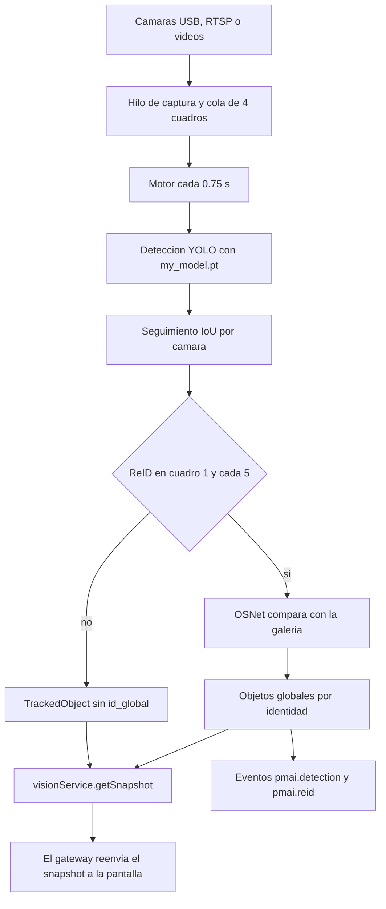

El turno, también por dentro del código. El recuento de pasos para cualquier lector está en [6.3](#63-chat-por-la-ruta-complejo-el-turno); este diagrama nombra los módulos.

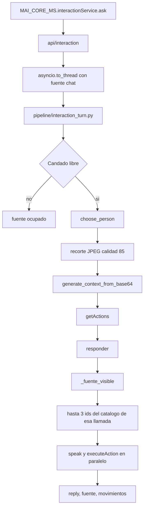

`_fuente_visible` traduce lo que devuelve `responder()`: `fuente == "cache"` pasa a `caché`; `backend == "openai"` a `OpenAI`; `fuente == "llm"` o `backend == "gguf"` a `Gemma (local)`; cualquier otro valor se deja tal cual. Los valores que mai-core puede producir son `caché`, `OpenAI`, `Gemma (local)`, `ocupado`, `voz corta`, `disculpa` y, si falló el import, la cadena vacía.

#### 15.7 Configuración

La configuración efectiva vive en `pmai-mai-core/settings.toml`. Entre paréntesis, el valor por defecto de `pmai-mai-core/src/pmai_core/settings.py` cuando difiere. La lista de variables de Compose está en el [Anexo B](#anexo-b-variables-de-entorno).

| Clave | Valor en el TOML | Efecto |
|---|---|---|
| `app.name` | `pmai-core` | Solo se registra en el log de arranque |
| `app.log_level` | `INFO` | Ningún módulo la lee; structlog usa su configuración por defecto |
| `camera.source_mode` | `v4l2` | `v4l2` descubre USB; `video_folder` trata cada video como `usb_0..N` |
| `camera.auto_discover` | `true` | Activa el descubrimiento V4L2 y el sondeo en caliente |
| `camera.poll_interval_seconds` | `10` | Periodo del sondeo de cámaras |
| `camera.default_resolution` | `[640, 480]` | Se pide a cada cámara V4L2 |
| `camera.default_fps` | `15` | Se pide a cada cámara V4L2 |
| `camera.video_folder_path` | `/data` | Carpeta de videos de desarrollo; Compose monta `./data:/data:ro` |
| `camera.video_extensions` | `.mp4`, `.avi`, `.mov`, `.mkv`, `.webm` | Extensiones aceptadas en modo carpeta |
| `camera.video_loop` | `true` | El video se repite |
| `camera.video_fps` | `15` | Lectura de archivo |
| `vision.model_path` | `/app/src/pmai_core/models/my_model.pt` | Detector; el defecto de Pydantic es `models/yolo11n.onnx` |
| `vision.confidence_threshold` | `0.5` | Descarta detecciones por debajo |
| `vision.device` | `cpu` | Dispositivo de YOLO |
| `reid.model_path` | `/app/src/pmai_core/models/osnet_x0_25_msmt17.onnx` | Extractor; el defecto de Pydantic es `models/osnet_ain_x0_25.onnx` |
| `reid.similarity_threshold` | `0.6` | Similitud coseno mínima (defecto 0.7) |
| `reid.embedding_update_interval` | `5` | ReID en el cuadro 1 y luego cada 5 cuadros por cámara |
| `reid.gallery_max_size` | `1000` | Tope del registro; al llenarse expulsa la identidad con menos actualizaciones |
| `pipeline.result_interval_seconds` | `0.75` | Espera entre iteraciones y entre eventos (defecto 1.0) |
| `audio.enabled` | `true` | Si es falso, el hilo de audio no arranca |
| `audio.auto_start_listening` | `true` | Estado inicial de `listening_enabled` |
| `audio.auto_select_microphone` | `true` | Elige el primero de la lista (USB primero) si no hay preferido |
| `audio.preferred_microphone_id` | `""` | Huella preferida; vacía = automático |
| `audio.sample_rate` | `16000` | Tasa deseada; si no, la primera compatible y remuestreo a 16 kHz |
| `audio.channels` | `1` | Mono |
| `audio.chunk_ms` | `30` | Trama de 480 muestras a 16 kHz |
| `audio.long_silence_ms` | `1600` | Silencio que cierra la frase |
| `audio.post_wake_grace_ms` | `2200` | Tras la palabra de activación el silencio no cuenta (defecto 1800) |
| `audio.max_recording_seconds` | `20.0` | Tope de captura (defecto 12.0) |
| `audio.min_recording_seconds` | `1.0` | Mínimo grabado (defecto 0.8) |
| `audio.preroll_seconds` | `0.4` | Audio previo reinyectado al reconocedor de la orden |
| `audio.min_useful_transcript_chars` | `14` | Por debajo no se dice la frase de "pensando" |
| `audio.fallback_speak_message` | frase de "no te escuché" | Ningún módulo la lee; el turno usa su propia constante |
| `audio.wake_phrases` | `hey fede`, `fede`, `federico` | Gramática de activación (defecto `hey fede`, `hola fede`) |
| `audio.thinking_phrases` | cinco frases | Rotación antes de despachar una transcripción larga |
| `audio.wake_partial_match` | `true` | Acepta la frase al final de lo oído |
| `audio.wake_energy_rms` | `500` | Compuerta de energía hacia el reconocedor de activación |
| `audio.wake_energy_hangover_ms` | `300` | Cola de esa compuerta |
| `audio.wake_confirm_chunks` | `2` | Parciales iguales seguidos para abrir |
| `audio.level_rms_full_scale` | `4000` | Escala del medidor `input_level` |
| `audio.level_hold_ms` | `500` | Retención del medidor |
| `audio.vosk_model_path` | `/app/src/pmai_core/models/vosk-model-small-es-0.42` | Modelo de español |
| `audio.poll_interval_seconds` | `5.0` | Resincroniza la selección con el hardware |
| `nats.url` | `nats://localhost:4222` | Lo pisa `NATS_SERVER` si existe |
| `nats.subject_prefix` | `pmai` | Prefijo de eventos |
| `nats.ms_name` | `MAI_CORE_MS` | Prefijo de los sujetos RPC |

`camera.sources` no está en el TOML: Pydantic la deja en `[]`. Sirve para fuentes manuales `stream` o `file` (RTSP, MJPEG o archivo) y es la vía que Compose recomienda en WSL2, donde los dispositivos V4L2 van comentados.

Variables del servicio `pmai-core` en Compose:

| Variable | Valor de plantilla | Efecto |
|---|---|---|
| `NATS_SERVER` | `nats://nats-server:4222` | Pisa `nats.url` |
| `PMAI_SETTINGS` | `/app/settings.toml` | Ningún módulo la lee; la ruta llega como argumento del comando |
| `PYTHONPATH` ← `PMAI_CORE_PYTHONPATH` | `/opt/model-context:/opt/action-model:/app/src` | Resolución de `model_context`, `utils` y `pmai_core` |
| `OPENAI_API_KEY` | clave de acción o, si va vacía, la de management | La lee `utils.gpt.gptapi` |
| `OMP_NUM_THREADS`, `MKL_NUM_THREADS`, `OPENBLAS_NUM_THREADS` | `1` | Acotan PyTorch y BLAS; Gemma usa `n_threads=os.cpu_count()` y no los respeta |
| `MILVUS_DB_PATH` | `/data/milvus/androide_milvus.db` | Ningún módulo la lee |
| `PMAI_CORE_PORT` | `3004` | Se publica; nada escucha en él |

`PMAI_CORE_PYTHONPATH` no se recorta a `/app/src`. La imagen instala con pip una copia de los dos modelos en site-packages, y Compose monta el código vivo en `/opt/model-context` y `/opt/action-model`. El orden del `PYTHONPATH` hace que esas rutas montadas ganen sobre la copia congelada de la imagen, y que `/app/src` resuelva `pmai_core`. Si se dejara solo `/app/src`, el núcleo importaría la versión instalada al construir la imagen y los cambios en BLIP, Milvus o el prompt no tendrían efecto hasta reconstruir. Por eso el lanzador fija las tres rutas y `AGENTS.md` prohíbe recortarlas.

El comando del contenedor es `watchfiles "python -m pmai_core /app/settings.toml" /app/src`. Reinicia el proceso al cambiar archivos bajo `/app/src`; no vigila `settings.toml` ni el código de los modelos en `/opt`.

#### 15.8 Pruebas

El comando es `pytest` desde `pmai-mai-core` (`testpaths = ["tests"]`, `asyncio_mode = "auto"`, `pythonpath = ["src"]`).

`pmai-mai-core/tests/test_interaction_turn.py` cubre el desempate por `id_global`, el recorte JPEG en base64, la voz corta sin modelo, el segundo turno ocupado sin hablar en chat, el turno sin persona sin BLIP y el fallo de BLIP que igual responde. `pmai-mai-core/tests/test_interaction_wiring.py` cubre `getActions` y `executeAction`, que el controlador `ask` usa la fuente `chat` y el despacho de voz. `pmai-mai-core/tests/test_audio_dispatch.py` comprueba que la transcripción va al chat enlazado y no al turno. `pmai-mai-core/tests/test_vision_pipeline_contract.py` exige un solo JPEG por miniatura, `previewJpegBase64` nulo, límites 480/960 y `result_interval_seconds = 1.0` en el TOML. `pmai-mai-core/tests/audio/` cubre descubrimiento de micrófonos, energía, nivel, reglas de escucha, remuestreo, selección y coincidencia de la palabra de activación.

Resultado registrado en las notas, ejecutado con `pmai-mai-core/.venv` y sin escribir cachés: las dos pruebas de turno y cableado no se recolectan porque ese entorno no tiene `nats-py`; del resto, 48 pasan y 1 falla, `test_pipeline_interval_is_one_second`, porque el TOML dice `0.75` y la prueba sigue exigiendo `1.0`. Pendiente de confirmar: si el valor 0,75 es intencional (lo cambió el commit `52eba23`) y la prueba quedó desactualizada.

#### 15.9 Trampas

El invariante del turno es uno solo a la vez: un `threading.Lock` no bloqueante. Si está tomado, la respuesta es "Sigo respondiendo, un momento." con fuente `ocupado`, y solo se pronuncia si la fuente es `voice`. Esa rama `voice` —voz corta y ocupado hablado— no se alcanza en el despliegue. El micrófono despacha a `MANAGEMENT_MS.chatService.chat` y management llama a `interactionService.ask`, cuyo controlador fija la fuente `chat`. `bind_turn` guarda el turno en el audio, pero nadie lo usa. De ahí que `voz corta` y el ocupado hablado solo aparecerían si alguien llamara a `ask(..., "voice")` directamente.

`id_global` solo existe en los cuadros donde corre ReID: el primero y luego cada cinco. El seguidor crea cada `TrackedObject` con `global_id=""`, y `compute_global_objects_for_context` descarta los objetos sin identidad. Como el último cuadro anotado se sobrescribe en cada iteración, en cuatro de cada cinco vueltas la escena puede no tener personas y el turno caer en `Persona no identificada` aunque alguien esté frente a la cámara. Pendiente de confirmar: con qué frecuencia ocurre eso con cámaras reales. Además, la etiqueta de la persona es el nombre de la clase YOLO (un integrante del semillero), no el identificador ReID.

El aviso de catálogo vacío escribe `reason="sin_arduino"` y habla de que no hay puerto serie `ttyACM`/`ttyUSB` (`pmai-mai-core/src/pmai_core/api/robotics_ms/robotics_ms_service.py`). Eso contradice el contrato de robótica y `AGENTS.md`: un almacén sin pares completos o un JSON legado produce lista vacía aunque el Arduino esté conectado, y esa lista vacía no es un fallo del turno. El texto del log engaña; manda lo que responde `getActions`.

Otras invariantes que no se deben romper. ONNX Runtime (ReID) se inicializa y calienta antes que PyTorch (YOLO) para evitar un bloqueo de OpenMP; no se reordena, y la inferencia corre en `asyncio.to_thread` por la misma razón. El detector recibe el cuadro BGR crudo: no aplica el balance de blancos ni el CLAHE del entrenamiento (ver [18.9](#189-trampas)). `watchfiles` solo vigila `/app/src`, así que cambiar `pmai-mai-core/settings.toml` o el código montado en `/opt` no reinicia el proceso. `PMAI_CORE_PORT` se publica y no hay servidor. `PMAI_SETTINGS` y `MILVUS_DB_PATH` se definen y nadie las lee. Compose siempre define `OPENAI_API_KEY`, aunque sea vacía, y `load_dotenv(..., override=False)` no pisa una variable que ya existe: el `.env` de `pmai-model-vision-language` no sirve de respaldo dentro del contenedor. Si BLIP no se precargó, cada turno falla al leer `cache["processor"]` nulo y sigue con contexto vacío, sin recarga perezosa. Una cámara V4L2 se abandona tras 50 lecturas fallidas seguidas. El registro de identidades vive solo en memoria: al reiniciar se pierden todos los `id_global`. Pendiente de confirmar: si `voiceService.speak` bloquea hasta terminar de reproducir, una respuesta larga superaría los 30 s de `sync_request` y el turno registraría `turn_speak_failed`. Pendiente de confirmar: dónde guardan BLIP y sentence-transformers su caché de Hugging Face dentro del contenedor; Compose no monta un volumen para ella.

### 16. pmai-model-context

#### 16.1 Propósito

`pmai-model-context` describe en una frase corta, en inglés, lo que se ve en el recorte de la persona elegida para el turno. Esa frase es el "contexto visual": no se muestra en la pantalla, sino que viaja dentro del objeto de escena hasta el modelo de acción, que la interpreta y responde en español. Para producirla carga BLIP desde Hugging Face, decodifica un JPEG en base64, genera el texto con búsqueda por haces y lo limpia de alucinaciones frecuentes.

No elige a la persona, no recorta la imagen y no responde la pregunta: eso lo hacen `pmai-mai-core` y `pmai-model-vision-language`. Tampoco entrena. Pese a que el cuaderno habla de entrenar modelos, el repositorio solo usa un modelo preentrenado. La historia de por qué se eligió BLIP-base está en [30](#30-el-modelo-contextual); esta ficha documenta lo que corre hoy. El paso del turno que lo llama está en [6.3](#63-chat-por-la-ruta-complejo-el-turno) y el concepto en [4.5](#45-descripción-de-escena).

#### 16.2 Versión

La versión leída es la de la tabla [Versión documentada](#versión-documentada): rama `dev`, commit `400ec0d`, fecha 2026-10-09. El paquete declara versión `0.1.0` en `pmai-model-context/pyproject.toml`. El commit `ac2703f` del mismo día renombró el paquete de `utils` a `model_context`.

#### 16.3 Tecnología

Python 3.12 o superior, empaquetado con setuptools y el paquete explícito `model_context`. En ejecución bastan torch, transformers menor que 5, Pillow y Pydantic. El resto de dependencias declaradas (`datasets`, Jupyter, `spiceypy`, `pycocoevalcap`, matplotlib) es del cuaderno de experimentación. La gestión local es con uv (`pmai-model-context/uv.lock`). No lee variables de entorno.

#### 16.4 Árbol

```text
pmai-model-context/
  model_context/          # paquete importable (antes se llamaba utils)
    model.py              # carga de BLIP y cuantización
    context.py            # generación y limpieza
    cache.py              # caché de módulo
    decoder.py            # base64 a imagen RGB
    local_object.py       # copia de GlobalObjectForContext; mai-core no la usa
  objetos/                # 41 imágenes de prueba en base64, ~27,7 MB
  tests/                  # una prueba de importación
  main.ipynb              # experimentación: carga, cuantización y recorrido de objetos
```

El repositorio es una biblioteca, no un servicio. Por eso no hay `api/`, ni NATS, ni Dockerfile propio: vive montado en `/opt/model-context` dentro del contenedor de mai-core. La carpeta `objetos/` y el cuaderno son material de laboratorio; el turno no los toca.

#### 16.5 Archivos clave

- `pmai-model-context/model_context/model.py`: `MODEL_ID` e `import_Blip_model` (carga única cacheada) y `get_quantized_blip_model` (cuantización dinámica, no usada en el turno).
- `pmai-model-context/model_context/context.py`: `PROTECTED_WORDS`, `SUSPICIOUS_WORDS`, `HALLUCINATION_PATTERNS`, `clean_caption`, `generate_context` y `generate_context_from_base64`.
- `pmai-model-context/model_context/cache.py`: diccionario de módulo `_MODEL_CACHE` con `processor`, `model`, `model_quantized` y metadatos; `get_cache`, `update_cache`, `clear_cache`.
- `pmai-model-context/model_context/decoder.py`: `base64_to_image` acepta prefijo `data:`, valida y convierte a RGB. Si la imagen no es válida lanza `ValueError("La imagen Base64 no es válida.")`.
- `pmai-model-context/model_context/local_object.py`: copia de `GlobalObjectForContext`. mai-core usa la suya en `pmai-mai-core/src/pmai_core/domain/`.
- `pmai-model-context/model_context/__init__.py`: vacío. El import es siempre `from model_context.…`.

#### 16.6 Contratos

No expone NATS ni HTTP. Es una biblioteca que mai-core importa desde `/opt/model-context`, primer elemento de `PMAI_CORE_PYTHONPATH` (ver [15.7](#157-configuración) y el [Anexo B](#anexo-b-variables-de-entorno)). El [Anexo C](#anexo-c-patrones-nats) no aplica.

API pública que usa mai-core:

| Función | Entrada | Salida | Archivo |
|---|---|---|---|
| `model_context.model.import_Blip_model` | ninguna | `(processor, model)` y los deja en la caché | `pmai-model-context/model_context/model.py` |
| `model_context.cache.get_cache` | ninguna | el diccionario de módulo | `pmai-model-context/model_context/cache.py` |
| `model_context.context.generate_context_from_base64` | JPEG en base64, processor, model | `(contexto, prompt)` con `prompt` siempre `""`; mai-core descarta el segundo valor | `pmai-model-context/model_context/context.py` |

mai-core no usa `get_quantized_blip_model`, `base64_to_image_resized`, `GlobalObjectForContext`, `context_info` ni `clear_cache`.

Contratos consumidos: Hugging Face Hub, `AutoProcessor.from_pretrained("Salesforce/blip-image-captioning-base", use_fast=True)` —con reintento sin `use_fast` si da `TypeError` o `ImportError`— y `BlipForConditionalGeneration.from_pretrained`. La primera vez necesita red. No habla con ningún microservicio.

#### 16.7 Configuración

Todo está en constantes. No hay `.env`. El [Anexo B](#anexo-b-variables-de-entorno) no lista claves de este repositorio.

| Clave | Valor | Efecto |
|---|---|---|
| `MODEL_ID` | `Salesforce/blip-image-captioning-base` | Variante base de BLIP, elegida por ser ligera en CPU |
| `DEVICE` | `cpu` | Las tensores se mueven a CPU |
| `prompt` de generación | `""` | Sin texto guía |
| `max_length` | `88` | Tope de tokens |
| `min_length` | `18` | Piso de tokens |
| `num_beams` | `10` | Búsqueda por haces |
| `repetition_penalty` | `1.4` | Penaliza repeticiones |
| `early_stopping` | `True` | Corta cuando los haces convergen |
| `length_penalty` | `1.05` | Ligera preferencia por frases un poco más largas |
| `no_repeat_ngram_size` | `3` | No repite trigramas |
| `use_cache` | `True` | Caché KV de transformers |
| cuantización | `torch.qint8` sobre `torch.nn.Linear`, motor `qnnpack` | Disponible y cacheada; el turno usa `cache["model"]`, el modelo sin cuantizar |

La generación corre bajo `torch.inference_mode()`. Después, `processor.batch_decode(..., skip_special_tokens=True)` y `clean_caption`. Pendiente de confirmar: por qué se dejó de usar la versión cuantizada en el turno; el código la conserva y el cuaderno la prueba, pero mai-core carga el modelo completo.

#### 16.8 Pruebas

El comando es `PYTHONPATH=. pytest` desde `pmai-model-context`. Hay una sola prueba, `pmai-model-context/tests/test_package_import.py`, que comprueba que `model_context.local_object.GlobalObjectForContext` acepta el campo `question`. Resultado registrado: 1 prueba pasa (`PYTHONPATH=. python3 -m pytest -q -p no:cacheprovider`). No hay pruebas de `clean_caption`, `generate_context` ni de la caché.

#### 16.9 Trampas

El paquete se llama `model_context` y no `utils` porque las dos bibliotecas se cargan en el mismo proceso de mai-core. `pmai-model-vision-language` también exporta `utils` y, con las dos rutas en `PYTHONPATH`, un segundo `utils` taparía al primero. El commit `ac2703f` (2026-10-09) renombró `utils/*` a `model_context/*`. Nunca se debe volver a importar como `utils`.

`clean_caption` trabaja en dos pasadas. Primero borra, palabra a palabra, las de `SUSPICIOUS_WORDS`, salvo que estén en `PROTECTED_WORDS`. Después aplica cada patrón de `HALLUCINATION_PATTERNS` solo si el texto coincidente no contiene una palabra protegida. Al final arregla puntuación y pone mayúscula inicial. Las palabras protegidas —nunca se borran— cubren personas y animales (`robot`, `man`, `woman`, `child`, `cat`, `dog`…), objetos (`chair`, `laptop`, `camera`…), colores, tamaños y acciones (`standing`, `sitting`, `holding`…). Las sospechosas cubren adverbios de duda (`likely`, `probably`, `seems`…), `nasa`, países, restos de alucinaciones vistas en pruebas (`sebre`, `seiree`, `crochel`, `keychain`, `triumph`…) y verbos de texto leído (`says`, `reads`). Los patrones recortan palabras repetidas de cuatro letras o más, "a man"/"a woman" duplicado, verbos copulativos dobles, fechas con mes y año, cualquier año 19xx o 20xx, textos citados y nombres de ciudades tras "in".

Hay tres agujeros conocidos en ese filtro. Las entradas de `SUSPICIOUS_WORDS` con espacios (por ejemplo `"le l'estrange"`) nunca coinciden, porque la comparación es palabra a palabra. Falta una coma entre `"how do i' m"` y `"crochel"`: Python concatena las dos cadenas y `crochel` no se filtra como palabra suelta. El patrón de años borra cualquier número 19xx/20xx aunque sea real.

Si la precarga del arranque falla —sin red la primera vez—, la caché queda en `None` y cada turno falla en BLIP sin reintentar la carga; mai-core sigue sin contexto. La salida está en inglés a propósito: el prompt de `pmai-model-vision-language` le pide al modelo interpretarla y responder en español, y las aperturas de caché se eligen comparando ese inglés con ejemplos (ver [17.6](#176-contratos)). El `README.md` del repositorio habla de Ollama y LangChain; ninguno se usa en el paquete. Pendiente de confirmar: la latencia real de BLIP-base con 10 haces en la Jetson o el N100, y dónde queda la caché de Hugging Face dentro del contenedor.

### 17. pmai-model-vision-language

#### 17.1 Propósito

`pmai-model-vision-language` es el modelo de acción. Recibe el objeto de la escena —quién pregunta, qué se ve y qué preguntó— más el catálogo de gestos de esa misma llamada, y devuelve la frase y hasta tres ids de gesto. Primero busca una respuesta ya guardada en Milvus Lite (`conocimiento` y, si no hay acierto, `interacciones` con coincidencia estricta). Si no encuentra nada parecido, construye el prompt de R-One y genera con OpenAI `gpt-4o-mini` cuando hay clave, o con Gemma 4 E2B en GGUF local cuando no la hay o la llamada falla.

No elige a la persona, no describe la imagen, no habla y no mueve servos. Eso queda en mai-core, en el paquete de contexto y en robótica. El concepto de caché semántico está en [4.7](#47-caché-semántico), el de modelo local frente a nube en [4.8](#48-modelo-local-frente-a-modelo-en-la-nube), las colecciones en [7.2](#72-milvus-lite) y el lugar del turno en [6.3](#63-chat-por-la-ruta-complejo-el-turno). Esta ficha recorre `responder()` y el prompt.

#### 17.2 Versión

La versión leída es la de la tabla [Versión documentada](#versión-documentada): rama `dev`, commit `b9042c9`, fecha 2026-10-31. El paquete declara versión `0.1.0` en `pmai-model-vision-language/pyproject.toml`.

#### 17.3 Tecnología

Python 3.12 o superior, setuptools con los paquetes `utils*`, `models*` y `prompt*`. Las dependencias de ejecución relevantes son `pymilvus[milvus-lite]`, `sentence-transformers`, `llama-cpp-python`, `openai`, `huggingface-hub`, `python-dotenv` y `spanlp`. El extra `dev` es `pytest>=8`. Quedan además dependencias heredadas de experimentación que el turno no usa: FastAPI, Uvicorn, LangChain, Ollama, Jupyter, pandas, wikipedia-api e ibm-watsonx-ai. El bloqueo de versiones es con uv.

#### 17.4 Árbol

```text
pmai-model-vision-language/
  utils/                         # paquete importable utils
    main.py                      # responder() y ayudas de nombre
    config.py                    # rutas, umbrales, modelos
    personalizacion.py           # aperturas según el contexto visual
    encoder/                     # embeddings 384 dimensiones
    milvus/                      # conexión, búsqueda, indexación, androide_milvus.db
    gpt/                         # enrutador OpenAI hacia Gemma
    gguf/                        # Gemma 4 E2B con llama-cpp-python
    context_builder/             # siembra de conocimiento
    webscraping/                 # primera fase hecha; segunda vacía
    ollama/                      # cliente histórico, roto
    stt-tts_to_test/             # pruebas sueltas históricas
  prompt/                        # PROMPT_PRINCIPAL y detector de groserías
  models/                        # esquema GlobalObjectForContext y carpeta gguf
  data/                          # aperturas.json (lo único versionado de data)
  tests/                         # pytest actual
  test/                          # comparativa histórica de GGUF
  docs/                          # texto académico de las secciones 2.10 a 2.12
  app.py                         # demo Gradio, histórica
  main.ipynb                     # cuaderno histórico
  androide_milvus.db             # base vieja en la raíz; ningún módulo la abre
```

La organización sigue el camino de una pregunta: `utils/main.py` orquesta, `utils/milvus/` es la memoria, `prompt/` es lo que se le dice al modelo cuando la memoria no alcanza y `utils/gpt/` elige entre nube y local. `models/gguf/` guarda el archivo de Gemma, que git ignora y se descarga solo. Lo histórico queda en el árbol —Ollama, Gradio, el cuaderno, STT/TTS, la base de la raíz— para no romper clones antiguos, pero el turno no lo importa.

#### 17.5 Archivos clave

- `pmai-model-vision-language/utils/main.py`: `responder(obj, secuencias)`, única entrada del turno.
- `pmai-model-vision-language/utils/config.py`: constantes y `load_dotenv(PROJECT_ROOT / ".env", override=False)`.
- `pmai-model-vision-language/utils/milvus/busqueda.py`: `search()` en dos etapas, vectorial y textual.
- `pmai-model-vision-language/utils/milvus/conexion.py`: cliente perezoso y creación de `conocimiento` e `interacciones`.
- `pmai-model-vision-language/utils/milvus/indexar.py`: inserción. El docstring aún habla de ids 1–34; el código acepta cualquier entero.
- `pmai-model-vision-language/utils/gpt/gptapi.py`: `generar_respuesta`. Si hay `OPENAI_API_KEY` intenta OpenAI; si no hay clave o la llamada lanza, Gemma.
- `pmai-model-vision-language/utils/gguf/ggufapi.py`: descarga del GGUF, singleton, plantilla Gemma y análisis del JSON.
- `pmai-model-vision-language/prompt/principal.py`: `PROMPT_PRINCIPAL`, `formatear_catalogo`, `construir_prompt`.
- `pmai-model-vision-language/prompt/detector_grocerias.py`: `procesar_pregunta` con spanlp. `filtrar_pregunta`, con respuesta fija y gesto `[1]`, existe y no se llama.
- `pmai-model-vision-language/utils/personalizacion.py`: `elegir_apertura`.
- `pmai-model-vision-language/utils/context_builder/cargar_preguntas.py`: siembra idempotente. `pmai-model-vision-language/utils/context_builder/alimentar_basevec.py` inserta con `movimientos = [1]` por defecto.

#### 17.6 Contratos

No expone NATS ni HTTP en el despliegue. Es una biblioteca que mai-core importa desde `/opt/action-model` (ver [15.7](#157-configuración)). El [Anexo C](#anexo-c-patrones-nats) no aplica.

| Función | Entrada | Salida | Archivo |
|---|---|---|---|
| `utils.main.responder` | objeto con `question`, `etiqueta`, `contexto`; lista de `getActions` | dict con `respuesta`, `movimientos`, `fuente`, `etiqueta` y, en ruta modelo, `backend` | `pmai-model-vision-language/utils/main.py` |
| `utils.milvus.conexion.get_client` | ninguna | cliente Milvus Lite; crea las colecciones si faltan | `pmai-model-vision-language/utils/milvus/conexion.py` |
| `utils.encoder.encoder` | import de módulo | carga `paraphrase-multilingual-MiniLM-L12-v2` | `pmai-model-vision-language/utils/encoder/encoder.py` |
| `utils.gguf.ggufapi.precargar` | ninguna | deja Gemma en memoria | `pmai-model-vision-language/utils/gguf/ggufapi.py` |
| `python -m utils.context_builder.cargar_preguntas` | JSON de pares | imprime `Conocimiento nuevo: <n>` | `pmai-model-vision-language/utils/context_builder/cargar_preguntas.py` |

Contratos consumidos: OpenAI Chat Completions (`gpt-4o-mini`, `temperature=0.7`, `response_format=json_object`); Hugging Face Hub para el GGUF `unsloth/gemma-4-E2B-it-GGUF` / `gemma-4-E2B-it-Q4_K_M.gguf` y para el modelo de embeddings; Milvus Lite embebido; spanlp `Palabrota`. El catálogo lo produce `ROBOTICS_MS.actionService.getActions` y llega a través de mai-core.

`responder()` paso a paso. El objeto de entrada, escrito como JSON para leerlo —en el código es un `GlobalObjectForContext`—, se parece a este, tomado de la situación de la [sección 3](#3-recorrido-de-una-pregunta):

```json
{
  "id_global": "gid_3f9a1c2e",
  "etiqueta": "Andrea Lopez",
  "confianza": 0.91,
  "contexto": "a woman with glasses standing in front of a robot",
  "question": "qué es la Universidad Libre"
}
```

El segundo argumento es la lista que devolvió `getActions` en esa llamada (`id`, `name`, `arduino_id`, `description`). Hoy esa lista suele ir vacía porque las secuencias de robótica no tienen descripción (ver [1.3](#13-qué-puede-hacer-r-one-hoy)); el ejemplo sigue con catálogo vacío, que es el caso real.

1. Toma `obj.question` y la pasa por `procesar_pregunta`: spanlp censura groserías y reduce signos repetidos. Si había grosería, más adelante no se indexa.
2. `detectar_intencion` clasifica en `saludo_social`, `identidad_universidad`, `beneficio_opinion`, `dato_especifico` o `general`. Solo cambia el umbral: 0,35 en `conocimiento`, o 0,28 si la intención es `dato_especifico`. `INTENCIONES_SOCIALES` no se usa.
3. Arma `permitidos` con los `id` enteros del catálogo de esta llamada y pone `milvus_caido = False`. Esa bandera es interna: no viaja en el JSON de salida.
4. Busca en `conocimiento`. Si `search` lanza, marca Milvus caído y no hay acierto. `search` tiene dos etapas: vecino más cercano por HNSW (se acepta si la distancia coseno es ≤ umbral) y un respaldo textual de hasta 1000 registros (igualdad exacta, frase contenida con al menos tres palabras, o Jaccard ≥ 0,45).
5. Solo si no hubo acierto, busca en `interacciones` con umbral 0,40 y `solo_exacto=True`. "Coincidencia estricta" incluye que una pregunta contenga a la otra, no solo la igualdad carácter a carácter.
6. `etiqueta` pasa por `_etiqueta_real`: si era `Persona no identificada`, `(sin nombre)` o vacío, queda `""`.
7. Ruta caché: limpia restos de "Persona no identificada" en la respuesta guardada, elige una apertura con `elegir_apertura(obj.contexto)` y antepone nombre y apertura (`"Andrea, veo que buscas orientación. …"`). Los movimientos guardados, que en disco son texto JSON, se filtran por `permitidos` y se cortan a 3. No pasa por ningún modelo ni indexa. Sale así:

```json
{
  "respuesta": "Andrea, la Universidad Libre es una institución de educación superior colombiana fundada en 1923.",
  "movimientos": [],
  "fuente": "cache",
  "etiqueta": "Andrea Lopez"
}
```

8. `elegir_apertura` codifica el contexto visual y lo compara por producto punto con los ejemplos de `pmai-model-vision-language/data/aperturas.json` (41 situaciones). Si la mejor similitud es ≥ 0,60 (`UMBRAL_APERTURA`) devuelve una frase al azar de esa situación, en minúscula, del estilo "veo que buscas orientación" o "veo que vienen acompañados". Cualquier error devuelve nada.
9. Ruta modelo: `construir_prompt` rellena `PROMPT_PRINCIPAL` con la etiqueta cruda (puede ser `Persona no identificada`), el contexto o `Sin contexto visual disponible`, la pregunta y `{catalogo_movimientos}`. Ese hueco es una tabla Markdown `| id | nombre | arduino_id | descripcion |` con una fila por secuencia; sin secuencias, el texto `(No hay movimientos disponibles)`. Las llaves del formato de salida van dobles (`{{` `}}`) porque el prompt pasa por `str.format`.
10. El prompt fija identidad (nombre R-One invariable, robot físico, español siempre, tono cálido), cinco pasos de razonamiento (persona, intención, contexto visual, movimientos, veracidad), personalización obligatoria por nombre y por escena, formato JSON `{"respuesta", "movimientos"}`, veracidad, temas delicados, defensa ante inyección y nueve ejemplos con `movimientos: []`. Los datos de esta llamada van al final.
11. `generar_respuesta(prompt)`: si `OPENAI_API_KEY` no está vacía intenta OpenAI y marca `_backend = "openai"`; si no hay clave o la llamada lanza (sin red, 401, cuota), usa Gemma y marca `_backend = "gguf"`. El código no sondea la red: `hay_internet` existe solo para logs y no se llama. Gemma es un singleton con `n_ctx=8192`, `n_threads=os.cpu_count()`, `max_tokens=1024`, `temperature=0.3`; si la salida queda vacía, descarta la instancia y reintenta una vez.
12. Limpia marcas sin nombre. Indexa en `interacciones` solo si Milvus no cayó, la pregunta no tenía groserías y la respuesta es almacenable (no vacía, no genérica, sin "no dispongo de ese dato"). Antes quita el nombre de la persona; si el nombre o "Persona no identificada" siguen apareciendo, no indexa. Un error al indexar se registra y no corta la respuesta.
13. Devuelve la ruta modelo:

```json
{
  "respuesta": "Andrea, no tengo una opinión meteorológica; si sales, un abrigo no sobra.",
  "movimientos": [],
  "fuente": "llm",
  "backend": "openai",
  "etiqueta": "Andrea Lopez"
}
```

mai-core traduce esas claves a lo que ve la pantalla. `respuesta` pasa a `reply`. `fuente == "cache"` pasa a `caché`; `backend == "openai"` a `OpenAI`; `fuente == "llm"` o `backend == "gguf"` a `Gemma (local)`. `movimientos` deja de ser una lista de enteros y se convierte en `[{id, name}]`, conservando como máximo los tres primeros ids que existan en el catálogo de esa llamada, en el orden del modelo. El objeto que sale por NATS se parece a:

```json
{
  "reply": "Andrea, la Universidad Libre es una institución de educación superior colombiana fundada en 1923.",
  "fuente": "caché",
  "movimientos": []
}
```

Siembra de `conocimiento`. `scripts/seed-conocimiento.sh` usa `docker` o `sudo docker`: si `pmai-core` está corriendo ejecuta `python -m utils.context_builder.cargar_preguntas` con `compose exec`; si no, lanza un `compose run --rm --no-deps` de un solo uso. `cargar_preguntas.py` lee `pmai-model-vision-language/utils/webscraping/primera fase/preguntas_respuestas.json` (244 pares; 73 traen `movimientos` y 171 no), consulta hasta 16384 preguntas ya guardadas y solo inserta las que no estén con el mismo texto, de modo que es idempotente. `alimentar_basevec` valida pregunta y respuesta no vacías, toma `movimientos` o `movimiento` o, si faltan, `[1]` (`MOVIMIENTO_POR_DEFECTO = 1`), codifica en lote e inserta. De ahí que 171 pares de conocimiento ejecuten el gesto con `id == 1` el día que el catálogo vivo tenga una secuencia con ese número. `scripts/lan-up.sh` hace esta siembra en cada arranque en red local.

Lo histórico, que no forma parte del turno: `pmai-model-vision-language/utils/ollama` importa `OLLAMA_MODEL` de `utils.config`, que ya no existe, y valida ids fijos 1–34. `pmai-model-vision-language/app.py` es una demo Gradio que no arranca tal cual: importa `gradio` (no está en las dependencias), lee un `movimientos.json` que no existe y usa `say`/`afconvert` de macOS. `pmai-model-vision-language/main.ipynb` importa un nombre de módulo inválido y busca una ruta de macOS. `pmai-model-vision-language/utils/stt-tts_to_test` prueba NeMo y un TTS de transformers que no están en dependencias. `pmai-model-vision-language/androide_milvus.db`, en la raíz, la creó el cuaderno de ingesta abriendo `./androide_milvus.db`; el código usa `pmai-model-vision-language/utils/milvus/androide_milvus.db`.

#### 17.7 Configuración

Las constantes viven en `pmai-model-vision-language/utils/config.py`. La variable que sí lee el proceso es `OPENAI_API_KEY`; el resto de nombres del [Anexo B](#anexo-b-variables-de-entorno) que parecen de Milvus no tienen efecto aquí.

| Clave | Valor | Efecto |
|---|---|---|
| `PROJECT_ROOT` | carpeta del repositorio, `/opt/action-model` en el contenedor | Base de todas las rutas |
| `load_dotenv(..., override=False)` | `.env` del repositorio | No pisa variables ya definidas, aunque estén vacías |
| `MILVUS_DB_PATH` | `PROJECT_ROOT/utils/milvus/androide_milvus.db` | Constante; no lee la variable de Compose del mismo nombre |
| `APERTURAS_PATH` | `pmai-model-vision-language/data/aperturas.json` | Situaciones de apertura |
| `EMBED_MODEL_NAME` | `paraphrase-multilingual-MiniLM-L12-v2` | Embeddings |
| `EMBED_DIM` | `384` | Dimensión del vector |
| `COL_CONOCIMIENTO` / `COL_INTERACCIONES` | `conocimiento` / `interacciones` | Colecciones |
| `UMBRAL_CONOCIMIENTO` | `0.35` | Distancia coseno máxima (menor es mejor) |
| `UMBRAL_INTERACCIONES` | `0.40` | Distancia de la segunda colección |
| `UMBRAL_APERTURA` | `0.60` | Similitud mínima para elegir apertura |
| `SEARCH_PARAMS` | COSINE, `ef: 64` | Búsqueda HNSW |
| `OPENAI_MODEL` | `gpt-4o-mini` | Modelo de nube |
| `GGUF_HF_REPO` / `GGUF_HF_FILENAME` | `unsloth/gemma-4-E2B-it-GGUF`, `gemma-4-E2B-it-Q4_K_M.gguf` | Descarga si falta el archivo |
| `UMBRAL_JACCARD` | `0.45` | Respaldo textual no estricto |
| `QUERY_LIMIT_FALLBACK` | `1000` | Tope de registros cargados en memoria |
| Gemma `n_ctx` | `8192` | Contexto |
| Gemma `temperature` / `top_p` | `0.3` / `0.9` | Muestreo |

`MOVIMIENTOS_PATH` apunta a un JSON de gestos fijos bajo `pmai-model-vision-language/data/` que no está en el árbol; solo lo usan `cargar_movimientos` y `app.py`. El ejemplo de entorno del repositorio lista además claves de Anthropic y Watson; el turno no las lee.

#### 17.8 Pruebas

El comando es `pytest` desde `pmai-model-vision-language` con el extra `dev`. `pmai-model-vision-language/tests/conftest.py` sustituye por simulacros `sentence_transformers`, `openai`, `pymilvus`, `spanlp` y el codificador, para no descargar modelos.

`pmai-model-vision-language/tests/test_catalogo_prompt.py` cubre catálogo vacío explícito, tabla Markdown con descripción vacía, ausencia de ids fijos en el prompt y que los datos van al final. `pmai-model-vision-language/tests/test_gguf_singleton.py` cubre la descarga solo si falta y la reconstrucción única tras generación vacía. `pmai-model-vision-language/tests/test_milvus_startup.py` cubre la creación de las dos colecciones con pymilvus simulado. `pmai-model-vision-language/tests/test_openai_router.py` cubre que con clave se usa OpenAI aunque la sonda de red falle, que si OpenAI falla cae a Gemma, que sin clave va a Gemma y que `load_dotenv` usa `override=False`. `pmai-model-vision-language/tests/test_personalizacion.py` cubre aperturas, `_etiqueta_real`, `_anteponer_nombre` y las respuestas de caché. `pmai-model-vision-language/tests/test_responder_movimientos.py` cubre el máximo de 3 ids del catálogo, el fallo de Milvus que llega al modelo y no indexa, y que un fallo al indexar no bloquea la respuesta.

Resultado registrado: 34 pruebas pasan (`python3 -m pytest -q -p no:cacheprovider`).

#### 17.9 Trampas

Importar `utils.main` carga en cascada spanlp, el codificador (descarga del modelo de embeddings la primera vez) y llama-cpp-python, porque los `import` son de nivel de módulo. `MILVUS_DB_PATH` de Compose se ignora: la base vive en el montaje del repositorio, y `data/milvus` del lanzador queda vacío. `load_dotenv(..., override=False)` no sobrescribe una variable que ya existe aunque esté vacía, y Compose siempre define `OPENAI_API_KEY`; el archivo `.env` de este repositorio, además, no está en el árbol actual.

Si Gemma no puede cargar o genera vacío dos veces, devuelve "Lo siento, no puedo responder en este momento." con `_backend = "gguf"`; mai-core la muestra como `Gemma (local)`, no como `disculpa`. Esa frase no está en las listas de respuestas no almacenables, así que se indexa en `interacciones` y la misma pregunta exacta la devolvería desde la caché. Lo mismo vale para un texto no JSON que venga de OpenAI.

Los ids guardados en Milvus son de catálogos anteriores. En cada llamada se filtran por el catálogo vivo, de modo que un id viejo puede desaparecer o, peor, coincidir con otra secuencia que hoy tiene ese número. El gesto por defecto `[1]` de la siembra se ejecuta el día que exista una secuencia con `id == 1`. Pendiente de confirmar: si el catálogo vivo de robótica tiene esa secuencia. Pendiente de confirmar: cuántos registros tienen hoy `conocimiento` e `interacciones` (no se abrió la base para no escribir en ella). Pendiente de confirmar: la latencia de Gemma 4 E2B Q4_K_M con `n_ctx=8192` en la Jetson y si cabe junto a BLIP y YOLO en memoria.

Con catálogo vacío el prompt pide "de 1 a 3 ids" y a la vez dice que no hay movimientos; cualquier id inventado se descarta al filtrar. El README del repositorio enlaza números de línea viejos, lista un `movimientos.json` que no existe y dice que sin coincidencia "genera con OpenAI"; el código cae a Gemma. El cuaderno de ingesta usaba `UMBRAL_CONOCIMIENTO = 0.70`; el código usa 0,35.

### 18. pmai-model-vision

#### 18.1 Propósito

`pmai-model-vision` es el repositorio de entrenamiento del detector de R-ONE: un YOLO11s afinado con Ultralytics para reconocer los rostros de 25 integrantes del semillero Prometeo, etiquetados en Label Studio. No corre en el turno ni se despliega como servicio. El producto que llega a producción es un archivo de pesos; mai-core carga una copia en `pmai-mai-core/src/pmai_core/models/my_model.pt`.

Las fases 1 y 2 del documento de investigación corresponden a este repositorio. La fase 3 (BlazeFace, face_recognition, DeepFace, HandLandmarker sobre el prototipo CLAUD-IA) no está en el código. La historia completa —captura, Label Studio, limpieza, preprocesado, aumento de datos y lectura de las curvas— está en [29](#29-el-detector-de-objetos). Esta ficha deja el estado del árbol, las métricas de `train5` y qué peso usa el núcleo.

#### 18.2 Versión

La versión leída es la de la tabla [Versión documentada](#versión-documentada): rama `dev`, commit `5bbccd6`, fecha 2026-08-27. En el disco local la carpeta pertenece a `root`.

#### 18.3 Tecnología

Python 3.13 en un entorno Conda llamado `fede-model-env1`. No hay `pyproject.toml`; las dependencias están congeladas en `pmai-model-vision/requirements.txt`, exportado de Conda: Ultralytics 8.3.221, torch 2.7.1+cu118, torchvision 0.22.1+cu118, opencv-python 4.12.0.88. Las corridas 4 y 5 se entrenaron en una NVIDIA GeForce GTX 1050 Ti de 4 GB. El etiquetado se hizo con Label Studio en Docker (`heartexlabs/label-studio:latest`) montando `pmai-model-vision/mydata`. El README muestra una insignia "YOLOv8"; los pesos base reales son `pmai-model-vision/yolo11s.pt`, como declara `pmai-model-vision/runs/detect/train5/args.yaml`.

#### 18.4 Árbol

```text
pmai-model-vision/
  main.ipynb                 # punta a punta: unir, limpiar, preprocesar, entrenar, exportar
  data.yaml                  # 25 clases y rutas del dataset preprocesado
  utils/                     # merge, split, limpieza, preprocesado, análisis, inferencia
  mydata/                    # SQLite y medios de Label Studio, exportaciones JSON
  dataset/                   # solo no_borrar.txt; aquí se descomprimen data.zip y set.zip
  runs/detect/               # cinco corridas, train a train5, con args, results.csv y pesos
  my_model/                  # pesos exportados: my_model.pt, full_model.pt, persons_model.pt, base_model.pt
  yolo11n.pt                 # peso COCO genérico; no es el detector de R-ONE
  yolo11s.pt                 # peso base de las corridas finales
```

Es un repositorio de laboratorio, no de servicio: el cuaderno es el punto de entrada, `utils/` son scripts que el cuaderno invoca y `runs/` es el archivo de las corridas. `my_model/` es el estante de pesos "listos para copiar" hacia mai-core. La carpeta `data_preprocessed` que cita `data.yaml` no se conserva en el árbol.

#### 18.5 Archivos clave

- `pmai-model-vision/main.ipynb`: celda 6 descomprime `dataset/data.zip` y, si existe, `dataset/set.zip`; celda 8 une con `merge_datasets` (`--train_pct 0.9 --include_test`); celda 11 crea `data.yaml`; celda 16 limpia; celda 18 analiza; celda 19 preprocesa; celda 20 entrena; celda 23 predice sobre validación con `train5/weights/best.pt`; celda 27 copia ese `best.pt` a `pmai-model-vision/my_model/my_model.pt`.
- `pmai-model-vision/data.yaml`: `path: data_preprocessed`, `nc: 25` y los 25 nombres, con acentos en escapes YAML.
- `pmai-model-vision/utils/data_cleaning.py`: borra imágenes sin etiqueta, etiquetas corruptas, imágenes corruptas y duplicados por hash.
- `pmai-model-vision/utils/data_preprocess.py`: balance de blancos en LAB, CLAHE (`clipLimit=2.0`, cuadrícula 8×8) y gamma 1.0. El letterbox a 512 está comentado.
- `pmai-model-vision/utils/merge_datasets.py`: une `set` y `custom_data` sin choques de nombre, remapeando ids de clase.
- `pmai-model-vision/utils/yolo_detect.py`: inferencia de prueba con `--model`, `--source` (imagen, carpeta, video, `usbN`), `--thresh` y `--record`.
- `pmai-model-vision/runs/detect/train5/results.csv`: métricas por época de la corrida en producción.
- `pmai-model-vision/my_model/my_model.pt`: peso que se copia a mai-core.

#### 18.6 Contratos

Ninguno en tiempo de ejecución: no hay servicio, NATS ni HTTP. El [Anexo C](#anexo-c-patrones-nats) no aplica. El único producto que consume otro repositorio es `pmai-model-vision/my_model/my_model.pt`, copiado a mano como `pmai-mai-core/src/pmai_core/models/my_model.pt` (mismo md5 `f35b4d6bdf30ba9a6384f822b120ae9f`). mai-core lo carga con `YOLO(model_path, task="detect")` y toma los nombres de clase del propio peso (`pmai-mai-core/settings.toml`, clave `vision.model_path`).

Contratos consumidos: Ultralytics usa los pesos base `pmai-model-vision/yolo11s.pt`. Label Studio dejó las exportaciones JSON de los proyectos 3 y 4 en `pmai-model-vision/mydata/export`.

#### 18.7 Configuración

No hay variables de entorno de servicio. El [Anexo B](#anexo-b-variables-de-entorno) no lista claves de este repositorio. La configuración del dataset y del entrenamiento final está en archivos.

Las 25 clases, índices 0 a 24, son nombres de integrantes del semillero:

| Índice | Clase | Índice | Clase |
|---|---|---|---|
| 0 | Alison Segura | 13 | Johel Arias |
| 1 | Alison Tinoco | 14 | Juan Toro |
| 2 | Andrea Lopez | 15 | Karol Zubieta |
| 3 | Anyi Becerra | 16 | Laura Barón |
| 4 | Ashly Aguirre | 17 | Laura Perez |
| 5 | Brayan Gomez | 18 | Marcela Cifuentes |
| 6 | Breiner Bonilla | 19 | Mauricio Alonso |
| 7 | Carlos Ángulo | 20 | Pablo Carreño |
| 8 | Cristhian Tapiero | 21 | Rodrigo Castro |
| 9 | Daniela Fierro | 22 | Sara Cárdenas |
| 10 | Diego Patiño | 23 | Valery Guerrero |
| 11 | Evelin Sanchez | 24 | Valery Guzman |
| 12 | Jeferson Castellanos |  |  |

Hiperparámetros de `train5` (los mismos en `train4`), tomados de `pmai-model-vision/runs/detect/train5/args.yaml` y de la celda 20: `model: yolo11s.pt`, `pretrained: true`, `epochs: 60`, `patience: 100`, `batch: 16`, `imgsz: 640`, `optimizer: auto`, `seed: 0`, `amp: true`, `close_mosaic: 10`, `lr0: 0.01`, `lrf: 0.01`. Aumento: `hsv_h=0.015`, `hsv_s=0.7`, `hsv_v=0.4`, `degrees=5.0`, `translate=0.10`, `scale=0.50`, `shear=1.5`, `mixup=0.10`, `erasing=0.4`, `fliplr=0.5`, `mosaic=1.0`. Las corridas `train` a `train3` usaron `degrees: 0.0` y `mixup: 0.0`, y `train` tuvo 40 épocas. `train` a `train3` se entrenaron en Windows; `train4` y `train5` en Linux bajo la ruta antigua `pmai-launcher`.

#### 18.8 Pruebas

No hay pruebas automáticas ni comando de pytest. La validación es la de Ultralytics al final de cada época y la predicción visual de la celda 23 sobre `validation/images` con `conf=0.25`. En la investigación no se ejecutó nada: no hay entorno Conda ni GPU en la sesión.

Las métricas de la última fila de cada `results.csv` (precisión, recall, mAP50, mAP50-95):

| Corrida | Épocas | Precisión | Recall | mAP50 | mAP50-95 | Peso exportado |
|---|---|---|---|---|---|---|
| `train` | 40 | 0.823 | 0.967 | 0.907 | 0.782 | `full_model.pt` (9 clases, 2025-10-30) |
| `train2` | 60 | 0.783 | 0.958 | 0.995 | 0.816 | `persons_model.pt` (9 clases, 2025-10-30) |
| `train3` | 60 | 0.813 | 0.958 | 0.984 | 0.824 | `base_model.pt` (9 clases, 2025-11-01) |
| `train4` | 60 | 0.875 | 0.796 | 0.867 | 0.520 | ninguno |
| `train5` | 60 | 0.884 | 0.932 | 0.944 | 0.654 | `my_model.pt` (25 clases, 2026-05-01) |

La última fila de `pmai-model-vision/runs/detect/train5/results.csv` (época 60) es precisión 0.88436, recall 0.93229, mAP50 0.94407, mAP50-95 0.65381. Con la fórmula de aptitud de Ultralytics (0,1 · mAP50 + 0,9 · mAP50-95), la mejor época de `train5` sería la 29 (0.922, 0.939, 0.978, 0.697). `pmai-model-vision/runs/detect/train5/weights/best.pt` guarda esa época, no la última, y es el archivo que la celda 27 copia a `my_model.pt`. mai-core usa esa copia.

Esas cifras no coinciden con las de la memoria académica ni con `docs/project-docs/model-vision-project.md`, que reportan precisión 0.8486, recall 0.9474, mAP50 0.9942 y mAP50-95 0.8677. Tampoco coinciden con la última fila ni con la mejor época de ninguna de las cinco corridas. Las conclusiones narrativas de ese documento (precisión ≈ 0,82, recall ≈ 0,96, mAP50 ≈ 0,90, mAP50-95 ≈ 0,78 "a lo largo de las 60 épocas") se parecen a la corrida `train` de 40 épocas y 9 clases, no al modelo de 25 clases en producción. Pendiente de confirmar: de dónde salen las métricas de la memoria. Este documento sigue al `results.csv` de `train5`.

#### 18.9 Trampas

El detector reconoce personas concretas por su cara, no "personas" genéricas. La etiqueta que llega al turno es un nombre propio y `pmai-model-vision-language` la usa para saludar. Alguien que no esté entre las 25 clases no se detecta, o se detecta como otro integrante. El entrenamiento usa imágenes con balance de blancos y CLAHE (`data.yaml` apunta a `data_preprocessed`), pero mai-core detecta sobre el cuadro crudo de la cámara, sin ese preprocesado (`pmai-mai-core/src/pmai_core/resources/vision/detector.py`). Además, mai-core usa umbral 0,5 y la prueba del cuaderno usa 0,25.

El peso se copia a mano entre repositorios; nada comprueba que las dos copias sigan siendo iguales. Hay datos personales versionados: fotos y videos de integrantes en `pmai-model-vision/mydata/media` y la base `pmai-model-vision/mydata/label_studio.sqlite3`. Las clases con muy pocos ejemplos (Rodrigo Castro con 5 etiquetas, Cristhian Tapiero con 6, Mauricio Alonso con 10) y Breiner Bonilla sin validación hacen que sus métricas por clase sean poco fiables. `pmai-model-vision/yolo11n.pt` y `pmai-model-vision/yolo11s.pt` son pesos COCO genéricos (80 clases, `person` incluida); no son el detector de R-ONE.

Pendiente de confirmar: el total de 802 imágenes y la partición 80/10/10 del documento de investigación; la última exportación tiene 798 tareas y el cuaderno partió 90/10 más un test opcional. Pendiente de confirmar: el número exacto de imágenes por partición del entrenamiento final (el cuaderno registra 830 y 115 etiquetas, no imágenes) y el contenido de `set.zip`, que no está en el repositorio.

### 19. pmas-web-motion-studio

#### 19.1 Propósito

`pmas-web-motion-studio` es el editor web de secuencias de movimiento de R-ONE: una línea de tiempo con bloques por servo, dos pistas (gesto y neutro) y un diálogo que guarda nombre, descripción, categoría y Arduino. Funciona en dos modos. En **Suelto**, sin sesión, guarda JSON de origen en su propio disco y no mueve nada: sirve para que un estudiante diseñe en un portátil. En **Acoplado**, incrustado en `pmas-web-main`, recibe el JWT por `postMessage` y guarda, lista, reproduce y detiene a través del gateway hacia `pba-ms-robotics`.

No asigna `id` ni escribe el JSON canónico: eso lo hace robótica al ingerir. No habla con el Arduino directamente. El flujo de creación e ingesta está en [6.7](#67-creación-e-ingesta-de-una-secuencia); el par normal y neutro, en [4.9](#49-secuencias-bloques-y-el-par-normal-y-neutro).

#### 19.2 Versión

La versión leída es la de la tabla [Versión documentada](#versión-documentada): rama `dev`, commit `259451a`, fecha 2026-10-17.

#### 19.3 Tecnología

Python 3.11 o superior; la imagen es `python:3.13-slim`. FastAPI, Uvicorn y `python-multipart`. La interfaz es estática, sin framework ni empaquetador: `index.html`, `editor.js` (887 líneas), `library-view.js` (módulo UMD también usable desde Node) y `editor.css`. Las fuentes Space Grotesk, Inter y Material Symbols se cargan desde Google. El desarrollo usa `pytest` y `httpx`. Existe además `pmas-web-motion-studio/interfaz_record9_5_1.py`, una herramienta de escritorio en PyQt5 con `pyserial` y `openai`, que no figura en las dependencias del paquete.

#### 19.4 Árbol

```text
pmas-web-motion-studio/
  src/
    app.py                 # FastAPI: editor y almacén local
    local_sequences.py     # JSON de origen en disco (modo Suelto)
    neutro.py              # generador de neutro en Python; solo lo usan las pruebas
    static/                # index.html, editor.js, library-view.js, editor.css
  data/sequences/          # almacén Suelto, ignorado por git salvo .gitkeep
  tests/                   # pytest y una prueba Node de library-view.js
  interfaz_record9_5_1.py  # grabador de escritorio histórico
  start-studio.bat         # arranque Suelto en Windows
  Dockerfile.dev           # imagen para Compose
```

El servidor es deliberadamente pequeño: cuatro rutas y una carpeta estática. Toda la lógica de edición, acoplamiento y neutro vive en el navegador (`editor.js`). La versión Python del neutro existe para poder probar el algoritmo sin abrir el navegador; `app.py` no la importa.

#### 19.5 Archivos clave

- `pmas-web-motion-studio/src/app.py`: monta `/static` y define `GET /`, listado, lectura y guardado local.
- `pmas-web-motion-studio/src/static/editor.js`: estado de la línea de tiempo, `postMessage`, generación del neutro, guardado, reproducción y biblioteca.
- `pmas-web-motion-studio/src/static/index.html`: barra de acciones, pistas, biblioteca, inspector y diálogo de guardado. El comentario de diseño fija cromo azul marino `#0B2540`, papel frío `#eef2f6` y neutro en esmeralda.
- `pmas-web-motion-studio/src/static/library-view.js`: agrupación por categoría, tarjetas, chip del Arduino y la advertencia del neutro.
- `pmas-web-motion-studio/src/local_sequences.py`: normalización y validación del JSON de origen.
- `pmas-web-motion-studio/src/neutro.py`: `generate_neutro`, equivalente a `generateNeutroFrom` en JS.
- `pmas-web-motion-studio/interfaz_record9_5_1.py`: grabador histórico que habla con el Arduino a 115200 baudios.

#### 19.6 Contratos

Endpoints FastAPI del propio estudio. No hay CORS ni autenticación: las llama el editor con rutas relativas. El [Anexo C](#anexo-c-patrones-nats) cubre los sujetos de robótica a los que llega el modo Acoplado, no estas rutas.

| Método y ruta | Entrada | Salida | Archivo |
|---|---|---|---|
| `GET /` | sin cuerpo | `index.html` | `pmas-web-motion-studio/src/app.py` |
| `GET /static/...` | sin cuerpo | archivos de `pmas-web-motion-studio/src/static` | `pmas-web-motion-studio/src/app.py` |
| `GET /local/sequences` | sin cuerpo | `{total, data: [{name, description, file_name}]}` | `pmas-web-motion-studio/src/app.py` |
| `GET /local/sequences/{name}` | nombre con subcarpetas | JSON de origen normalizado; 404/400 | `pmas-web-motion-studio/src/app.py` |
| `POST /local/sequences` | `{sequence, overwrite?}` | el JSON guardado; 400 o 409 | `pmas-web-motion-studio/src/app.py` |

No hay rutas para reproducir ni para Arduino en el estudio: en Suelto, Play solo anima el cabezal.

Protocolo `postMessage` con Angular. El estudio se considera incrustado si `window.self !== window.top` o si la URL trae `?embed`. Angular lo carga en un `iframe` con `${MOTION_STUDIO_URL}/?embed=1`, donde `MOTION_STUDIO_URL` es `http://<hostname>:4210` (`pmas-web-main/src/app/core/constants/motion-studio.ts`). Al cargar, o cuando el estudio publica `{type: "prometeo-auth-request"}`, Angular responde `{type: "prometeo-auth", token, gatewayUrl, activeRole}` con `targetOrigin = MOTION_STUDIO_URL`. El estudio acepta el mensaje solo si el `hostname` del origen coincide con el suyo y si trae `token` y `gatewayUrl`. Sin `activeRole` queda en Suelto con el mensaje "Falta el rol activo; se usa el disco local". Con los tres datos pasa a Acoplado. Ante un 401 borra el token, muestra "Suelto: no hay sesión" y vuelve a pedir autenticación como mucho cada 2 s.

Contratos consumidos en Acoplado. Todas las llamadas van a `gatewayUrl` con `Authorization: Bearer <token>`, `Content-Type: application/json` y, si hay rol, `X-Active-Role`.

| Llamada del estudio | Ruta del gateway | Sujeto NATS | Archivo |
|---|---|---|---|
| Listar biblioteca | `GET /sequence/files` | `ROBOTICS_MS.sequenceService.listSequences` | `pmas-web-motion-studio/src/static/editor.js` |
| Abrir secuencia | `GET /sequence/file?name=…` | `ROBOTICS_MS.sequenceService.getSequence` | `pmas-web-motion-studio/src/static/editor.js` |
| Guardar | `POST /sequence/file` `{sequence, overwrite}` | `ROBOTICS_MS.sequenceService.saveSequence` | `pmas-web-motion-studio/src/static/editor.js` |
| Play | `POST /sequence/play` `{mode, source: "estudio", blocks}` | `ROBOTICS_MS.sequenceService.startPlayback` | `pmas-web-motion-studio/src/static/editor.js` |
| Stop | `POST /sequence/stop` | `ROBOTICS_MS.sequenceService.stopPlayback` | `pmas-web-motion-studio/src/static/editor.js` |
| Chip del Arduino, cada 5 s | `GET /sequence/arduinos` | `ROBOTICS_MS.sequenceService.listArduinos` | `pmas-web-motion-studio/src/static/editor.js` |

Grabación del par normal y neutro. El operador crea bloques en la pista Gesto (Agregar propone la siguiente pareja libre de PCA 0–2 y servo 0–15, `inicio 0`, `dur 2`, `pos 500`, `vel 5`). Cambia a la pista Neutro y la llena a mano o pulsa "Generar neutro". Guardar abre un diálogo con nombre, descripción (`minlength="10"`, `maxlength="280"`, "Para el prompt del turno"), categoría (`cara`, `cuello`, `brazo_derecho`, `brazo_izquierdo`, `torso`, `cadera`) y Arduino. `confirmSave` exige las dos pistas con bloques. En Suelto hace `POST /local/sequences`; en Acoplado, `POST /sequence/file`. Robótica asigna `id = max+1` y escribe el JSON canónico; desde ese momento la secuencia entra en `getActions` si la descripción tiene diez o más caracteres.

El neutro "rebobinado" recorre el gesto hacia atrás en el tiempo: lo último que se movió es lo primero que vuelve. Se ordenan los bloques del gesto por `inicio`; para cada uno se crea un deshacer con la posición anterior de ese mismo servo, o `0` si es su primer movimiento; el `inicio` se refleja como `t_end - (inicio + dur)`. La prueba fija el ejemplo: `[0,0,0.0,1,200]` y `[0,0,1.0,0.5,400]` generan `[0,0,0.0,0.5,200]` y `[0,0,0.5,1,0]`. La interfaz muestra fija la advertencia "El neutro generado debe revisarlo una persona. En el androide no es fiable.", porque esa posición `0` es un extremo del rango PWM, no la postura de reposo física.

#### 19.7 Configuración

| Variable | Valor | Efecto |
|---|---|---|
| `MOTION_STUDIO_PORT` | `4210` | Puerto de Uvicorn en Compose y en `start-studio.bat` |
| `PORT` | el de Compose | Nadie en el código del estudio la lee |
| `MOTION_STUDIO_DATA_DIR` | `pmas-web-motion-studio/data/sequences` | Almacén del modo Suelto |
| `MOTION_STUDIO_URL` | `http://<hostname>:4210` | Fija en Angular; si cambia el puerto del `.env`, Angular no se entera |

Compose monta el repositorio en `/usr/src/app` y arranca `uvicorn src.app:app --host 0.0.0.0 --port ${MOTION_STUDIO_PORT} --reload`. Las versiones de CSS y JS se fuerzan con `?v=2026-10-17-ard` para romper la caché. El resto de variables relacionadas está en el [Anexo B](#anexo-b-variables-de-entorno).

#### 19.8 Pruebas

Python: `python -m pytest -q` desde `pmas-web-motion-studio` (`testpaths = ["tests"]`, `pythonpath = ["."]`). Resultado registrado, con el intérprete de `pba-ms-robotics/.venv` y `-p no:cacheprovider`: 20 aprobadas en 0,94 s. Cubren el diálogo (nombre, descripción con `minlength="10"`, categoría, Arduino y el orden de la barra), el almacén local (lista vacía, duplicado, overwrite, escape de ruta, descripción corta rechazada y de 10 aceptada), el rebobinado del neutro y los colores del lienzo.

Node: `node --test tests/library-view.test.cjs` → 6 pruebas aprobadas (agrupación, tarjetas, chip del Arduino y texto de la advertencia).

#### 19.9 Trampas

El README del repositorio está desactualizado. Dice que la descripción admite 0–280 caracteres y su ejemplo de JSON de origen no trae `category` ni `blocks_neutro`. El código exige descripción de al menos diez caracteres, categoría y neutro (`pmas-web-motion-studio/src/local_sequences.py`). Manda el código.

El neutro generado lleva a `pos 0` cada servo en su primer movimiento; hay que revisarlo a mano antes de guardar. El campo Arduino del diálogo se aplica a todos los bloques: no se puede mezclar Arduinos en una misma secuencia desde el estudio. El inspector permite `pca` hasta 10, Agregar solo propone 0–2 y el firmware vigente solo acepta 0–3 (ver [20.6](#206-contratos)). Al mover un bloque a la fila de otro servo se intercambian `pca`/`servo` y se renombran ambos a `P<pca>_S<servo>`, perdiendo nombres como `rot_cuello`. El chip del Arduino consulta `GET /sequence/arduinos` cada 5 s, lo que en robótica ejecuta `sync_connections` mientras `/sequences` esté abierta. En Acoplado, un error al listar deja la biblioteca vacía en lugar de caer al disco. Stop llama a `POST /sequence/stop` si hay token, aunque el estudio esté en Suelto por falta de rol. Las fuentes vienen de Google: sin internet la interfaz se ve con tipografías de sistema.

`pmas-web-motion-studio/interfaz_record9_5_1.py` se considera histórica: el README no la menciona, sus dependencias no están en `pyproject.toml` y guarda listas de 7-tuplas sin nombre, descripción, categoría ni neutro, el formato de `pba-arduino-codes/sequences`. Pendiente de confirmar: si todavía se usa en el laboratorio. Pendiente de confirmar: si las 31 secuencias sin descripción de robótica entraron por la importación legada de Angular, que no exige descripción; en ese caso hay que abrirlas en el estudio y volver a guardarlas con descripción para que el turno las use.

### 20. pba-arduino-codes

#### 20.1 Propósito

`pba-arduino-codes` es el firmware de los Arduino que mueven los servos de R-ONE a través de placas PCA9685 por I2C, más un juego de secuencias de prueba en el formato antiguo del grabador de escritorio. Recibe comandos de texto por USB serie desde `pba-ms-robotics`. En la versión vigente no conoce secuencias, tiempos ni gestos con nombre: solo "lleva el servo X de la PCA Y a la posición Z con velocidad V".

No forma parte del turno de conversación —`AGENTS.md` lo excluye— y no tiene pruebas automáticas. El ciclo de un gesto, del lado de robótica, está en [6.5](#65-ciclo-de-un-gesto); esta ficha documenta lo que entiende la placa. El repositorio no es un submódulo del lanzador: vive clonado en `docs/project-docs/.work/pba-arduino-codes` y en este documento se cita como `pba-arduino-codes/<ruta>`.

#### 20.2 Versión

La versión leída es la de la tabla [Versión documentada](#versión-documentada): rama `dev`, commit `2e9454f`, fecha 2026-04-14, mensaje "Enhance gesture command functions and optimize PWM settings". El historial tiene 15 commits entre el 2026-03-29 y el 2026-04-14; el último toca solo `pba-arduino-codes/Inmoov_control2.ino`.

#### 20.3 Tecnología

Sketches Arduino en C++ (`.ino`), sin PlatformIO, Makefile ni archivo de placa en el repositorio. Bibliotecas: `Wire.h` (I2C) y `Adafruit_PWMServoDriver.h`. El encabezado de la versión vigente declara "Control 4x PCA9685 + Arduino Mega", con DS5160 a 7 V en las PCA 0–2 y SG90 a 5 V en la PCA 3. Los otros sketches no nombran la placa. No hay README. Pendiente de confirmar: la placa exacta (Mega 2560 u otra); solo el comentario de `pba-arduino-codes/Inmoov_control2.ino` la nombra. Pendiente de confirmar: qué sketch está cargado hoy en cada Arduino del androide.

#### 20.4 Árbol

```text
pba-arduino-codes/
  Inmoov_control2.ino     # firmware vigente: cuatro PCA, PCA,/SCAN/CENTER, 115200
  Inmoov_control.ino      # versión anterior del mismo protocolo, un solo rango PWM
  head/
    main.ino              # histórico de solo la cabeza: gestos por número a 9600
    test.ino              # escáner I2C a 9600
  sequences/
    head/                 # 22 secuencias de cara en 7-tuplas del grabador
    torso/                # 3 secuencias de brazos y manos, mismo formato
```

Hay un sketch vigente y dos capas de historia. `Inmoov_control2.ino` es el último commit y el único con `CENTER`, rangos por tipo de servo y temporizador no bloqueante; su protocolo es el que envía robótica. `Inmoov_control.ino` habla el mismo `PCA,…`/`SCAN` pero con un único rango y `delay(10)` bloqueante. `head/main.ino` es la etapa en que solo existía la cabeza y el catálogo de gestos salía del firmware; robótica ya no lo usa para el catálogo. Las secuencias de `sequences/` son material del grabador de escritorio, sin `id`, categoría, descripción ni neutro.

#### 20.5 Archivos clave

- `pba-arduino-codes/Inmoov_control2.ino`: punto de entrada vigente. `setup()` abre serie a 115200, inicia I2C a 100 kHz, escanea las cuatro direcciones, inicializa a 50 Hz solo las PCA presentes, centra todos los servos y reporta `PCAS:`. `loop()` alterna `leerSerial()` y `actualizarServos()`.
- `pba-arduino-codes/Inmoov_control.ino`: la misma idea sin `CENTER`, sin rangos por tipo y con `delay(10)` al final de `actualizarServos()`.
- `pba-arduino-codes/head/main.ino`: tabla de comandos numerados sobre una sola PCA en `0x43`, menú por número a 9600 baudios.
- `pba-arduino-codes/head/test.ino`: escaneo de direcciones I2C 1–126 cada 3 s, a 9600 baudios. Herramienta manual para comprobar que las cuatro PCA responden en `0x40`–`0x43`.

#### 20.6 Contratos

El contrato del firmware es su protocolo de texto por USB serie. Cada comando es una línea terminada en `\n`; el Arduino la lee con `Serial.readStringUntil('\n')` y le aplica `trim()`. El [Anexo C](#anexo-c-patrones-nats) no aplica: no hay NATS. Quién envía cada línea está en [6.5](#65-ciclo-de-un-gesto) y en la ficha de robótica.

Firmware vigente, `pba-arduino-codes/Inmoov_control2.ino`, a 115200 baudios:

| Comando | Efecto | Respuesta |
|---|---|---|
| `PCA,<pca>,<servo>,<pos>,<vel>` | Si `pca` 0–3, `servo` 0–15, `pos` 0–1000 y `vel` 1–10, fija objetivo y velocidad | ninguna |
| `SCAN` | Vuelve a sondear `0x40`–`0x43` | una línea `PCAS:<índices separados por coma>` |
| `CENTER` | Lleva todos los canales de las PCA presentes al centro de su rango, de golpe | ninguna |
| al arrancar | Centra todo | `PCAS:<índices>` |

Un comando de movimiento concreto: `PCA,0,1,420,6` seguido de salto de línea. Significa PCA 0, canal 1, posición 420 de 1000, velocidad 6. Se parsea con `sscanf(cmd.c_str(), "PCA,%d,%d,%d,%d", …) == 4`; cualquier línea que no encaje o quede fuera de rango se ignora en silencio. Un escaneo con las cuatro placas presentes responde `PCAS:0,1,2,3`; si no hay ninguna, `PCAS:` sin números.

La interpolación es local al firmware. Cada servo guarda `actual`, `target` y `speed`, inicializados en 307 ticks (≈1,5 ms) y velocidad 5. Cada 10 ms (`SERVO_INTERVAL_MS`, temporizador con `millis()`, no bloqueante) cada servo de una PCA presente avanza `max(1, vel)` ticks hacia su objetivo si la diferencia supera 2 ticks, y se escribe `setPWM(canal, 0, actual)`. Dicho de otro modo, `vel` es "ticks por cada 10 ms": a `vel = 5` un recorrido completo de un DS5160 (205→450, 245 ticks) tarda unos 0,5 s, y de un SG90 (150→600, 450 ticks) unos 0,9 s. El campo `dur` de las secuencias no llega al Arduino: el tiempo lo marca robótica, que espera un segundo entre el paso normal y el neutro.

Rangos PWM a 50 Hz, con la fórmula documentada `ticks = (ms / 20 ms) × 4096`. DS5160 (PCA 0, 1 y 2): `SERVOMIN_DS 205` (≈1,0 ms) a `SERVOMAX_DS 450` (≈2,2 ms), con la nota de subir de 10 en 10 si el brazo no llega, máximo ≈500. SG90 (PCA 3): `SERVOMIN_SG 150` (≈0,73 ms) a `SERVOMAX_SG 600` (≈2,93 ms). La conversión es `map(pos, 0, 1000, MIN, MAX)` según la PCA. No hay límites de ángulo por articulación: el único tope es ese rango PWM y la validación `pos` 0–1000.

Mapa de canales. Direcciones I2C: PCA 0 = `0x40`, PCA 1 = `0x41`, PCA 2 = `0x42`, PCA 3 = `0x43`. El encabezado del firmware y el uso real en las secuencias de robótica no coinciden en las placas 0 y 2:

| PCA | Dirección | Encabezado de `Inmoov_control2.ino` | Uso en `pba-ms-robotics/data/sequences` |
|---|---|---|---|
| 0 | `0x40` | Brazo derecho, 10 × DS5160 | Torso y cuello: 0 `rot_torso`, 1 `rot_cuello`, 2 `cuello_arr_abj`, 3 `incl_cuello`, 4 `mandibula` |
| 1 | `0x41` | Brazo izquierdo, 10 × DS5160 | Brazo izquierdo: 0 `menique`, 1 `anular`, 2 `corazon`, 4 `indice`, 5 `pulgar`, 6 `muneca`, 12 `antebrazo`, 13 `rotacion_brazo`, 14 `extension`, 15 `abduccion` |
| 2 | `0x42` | Torso y cuello, 6 × DS5160 | Brazo derecho: 0 `menique_der`, 1 `anular_der`, 2 `corazon_der`, 3 `indice_der`, 4 `pulgar_der`, 5 `muneca_der`, 6 `antebrazo_der`, 13 `rotacion_der`, 14 `extension_der`, 15 `abduccion_der` |
| 3 | `0x43` | Cabeza, 14 × SG90 | Cara: 4 `mejilla_izq`, 6 `labio_sup`, 8 `ceja_izq`, 11 `ceja_der`, 12 `parp_inf_izq`, 13 `parp_sup_izq`, 14 `parp_inf_der`, 15 `parp_sup_der` |

Pendiente de confirmar: el cableado real de las PCA 0 y 2. Si el comentario está desactualizado, también lo está la asignación de rangos (la mandíbula en la PCA 0 usaría el rango DS5160, coherente con un servo grande; si el comentario tuviera razón, esa mandíbula estaría en la PCA 2).

Correspondencia con robótica. Al abrir `/dev/ttyACM*` o `/dev/ttyUSB*` a 115200 el Arduino se reinicia, centra y emite `PCAS:`; robótica espera 1,8 s y descarta esa línea. Por cada bloque escribe `PCA,<pca>,<servo>,<pos>,<vel>\n` cuando vence su `inicio`. Para el panel de PCA escribe `SCAN\n` y lee `PCAS:`. `CENTER` no se envía nunca desde robótica. Un `executeAction` con un id que no está en el almacén manda `<id>\n`, que el firmware vigente ignora.

`pba-arduino-codes/head/main.ino` es otro contrato, histórico. 9600 baudios. `loop()` lee un entero; la tabla va de `-1` "Listar comandos" a 13 "Ojo Izquierdo", con gestos como Sorprendido, Furioso, Feliz, Parpadeo, guiños, Dormir, Sospechoso, Risa (no mueve nada), Triste y Despertar. `-1` responde un bloque JSON entre `JSON_BEGIN` y `JSON_END`. El modo manual acepta pares `<canal> <pasos>` (0–15, 0–1023) hasta recibir `-1`. Si se carga en una placa conectada a robótica, `PCA,…` y `SCAN` no funcionan.

Contratos consumidos: ninguno. El firmware solo lee la línea serie y escribe al bus I2C.

#### 20.7 Configuración

Todo está en constantes de compilación. No hay EEPROM ni parámetros por serie. El [Anexo B](#anexo-b-variables-de-entorno) no lista claves de este repositorio.

| Constante | Valor | Efecto |
|---|---|---|
| Baudios | 115200 | Debe coincidir con robótica |
| Reloj I2C | 100000 Hz | El comentario dice "modo fast"; 100 kHz es el modo estándar, el rápido es 400 kHz |
| Frecuencia PWM | 50 Hz | Periodo de 20 ms |
| `SERVOMIN_DS` / `SERVOMAX_DS` | 205 / 450 | Rango DS5160; 450 es menor que el ≈500 que el propio comentario sugiere |
| `SERVOMIN_SG` / `SERVOMAX_SG` | 150 / 600 | Rango SG90 |
| `SERVO_INTERVAL_MS` | 10 | Paso de interpolación |
| Direcciones PCA | `0x40`, `0x41`, `0x42`, `0x43` | PCA 0 a 3 |

#### 20.8 Pruebas

No hay pruebas automáticas ni script de compilación. `pba-arduino-codes/head/test.ino` es una herramienta manual de diagnóstico I2C. En la investigación no se compiló ni se cargó ningún sketch.

#### 20.9 Trampas

Robótica y el gateway aceptan `pca` 0–10, pero el firmware solo procesa 0–3 y descarta el resto sin responder. Un bloque con `pca` 4 o más se "envía" con éxito y no mueve nada. No hay acuse de recibo de `PCA,…`: robótica no puede saber si un comando fue rechazado por rango o por PCA ausente. Un `PCA,…` dirigido a una PCA no presente cambia su `target`, pero `actualizarServos()` salta esa placa hasta que un `SCAN` la detecte.

`CENTER` no interpola: escribe el centro de golpe en los 16 canales de cada PCA presente, incluidos los que no tienen servo. Al arrancar, la versión vigente lleva todos los servos al centro de su rango. Como abrir el puerto USB reinicia el Arduino, cada vez que robótica abre una conexión nueva el cuerpo salta al centro.

`head/main.ino` usa 9600 baudios y un protocolo distinto; `-1\n` y `<id>\n` (ruta heredada de robótica) solo los entiende ese sketch. El menú impreso solo enumera hasta el 11; los ids 12 y 13 existen en la tabla pero no en el menú. Las secuencias de `pba-arduino-codes/sequences` no tienen `id`, categoría, descripción ni `blocks_neutro`: si se copiaran a la carpeta de robótica se listarían como legado y nunca entrarían al catálogo del turno. Algunas usan otro cableado (cara en la PCA 0, nombres de canal distintos).

Pendiente de confirmar: el número de Arduinos en el cuerpo. Las 31 secuencias de robótica usan solo `arduino_id` 0, y el diseño admite varios. Pendiente de confirmar: si los SG90 de la cabeza tienen topes mecánicos más estrechos que 150–600 ticks; el firmware no limita por articulación.

## Parte IV. Despliegue y operación

> Esta parte es para quien tiene que poner a funcionar el robot: en un portátil de desarrollo, en la red del laboratorio o en la Jetson del androide durante un evento. No hace falta haber leído la Parte III, aunque los enlaces llevan allí cuando conviene saber qué pasa por dentro. La sección 24 sirve de guía rápida cuando algo falla.

### 21. Requisitos y configuración

**Hardware.** R-ONE corre en un solo computador, el miniPC del androide, que hoy es una NVIDIA Jetson Orin Nano de 8 GB (ver [23](#23-la-jetson-orin-nano)). Para desarrollar sirve cualquier portátil Linux o Windows con WSL2, con al menos 16 GB de RAM si se quiere levantar todo, incluido Gemma, y unos 30 GB libres en disco para las imágenes de Docker y los modelos. A ese computador se conectan las cámaras USB, un micrófono USB, el parlante (por cable o Bluetooth) y el Arduino Mega del cuerpo por un cable USB.

**Software.** Basta con Docker y Docker Compose, Git y una terminal Bash, porque todo lo demás va dentro de los contenedores. En la Jetson hace falta además un ajuste de Docker que se explica en la sección 23.

**Red.** El robot no necesita internet para funcionar, aunque sí la necesita la primera vez, para descargar BLIP, el modelo de embeddings y, si falta, el archivo de Gemma. Con internet y una clave de OpenAI, las respuestas nuevas y la voz salen de OpenAI; sin ellas, el robot responde con Gemma y habla con Piper o eSpeak.

**El archivo `.env`.** Toda la configuración del despliegue vive en un único archivo `.env` en la raíz del lanzador, que se crea copiando la plantilla con `cp .env.template .env`. La plantilla está organizada por bloques, uno por servicio, y vale la pena recorrerla entendiendo cada uno:

- **Base de datos:** `DB_USER`, `DB_PASSWORD`, `DB_NAME` y las URL de conexión de gateway y auth, que apuntan al esquema `auth`.
- **Gateway y auth:** el puerto y los secretos con que se firman los tokens. La plantilla no trae `MS_GATEWAY_SECRET`, `MS_GATEWAY_RESTORE_PASSWORD_SECRET`, `MS_GATEWAY_PROJECT_ID` ni `MS_AUTH_PROJECT_ID`, que ambos servicios exigen al arrancar; hay que añadirlos, y los secretos de gateway y auth deben ser idénticos, porque uno firma lo que el otro verifica.
- **Management:** la clave y el modelo de OpenAI (`MS_MANAGEMENT_OPENAI_API_KEY`, `MS_MANAGEMENT_OPENAI_MODEL`, que no puede quedar vacío; lo habitual es `gpt-4o-mini`) y el prompt de sistema, que se exige pero no se usa.
- **Robótica:** el modo de voz (`MS_ROBOTICS_VOICE_TTS_MODE`), la clave de OpenAI para la voz, el modelo de Piper y el socket de PulseAudio del anfitrión (`MS_ROBOTICS_PULSE_SERVER`).
- **Web y estudio:** los puertos 4200 y 4210.
- **Núcleo:** `PMAI_OPENAI_API_KEY` (si va vacía se reutiliza la de management), la ruta de ajustes, `PMAI_CORE_PYTHONPATH`, que debe quedar exactamente como `/opt/model-context:/opt/action-model:/app/src`, y los hilos de cálculo (`OMP_NUM_THREADS` y similares, en 1).

El [Anexo B](#anexo-b-variables-de-entorno) lista todas las variables con su efecto. Un consejo práctico: nunca se suben claves al repositorio, porque `.env` está ignorado por git; quien hereda el proyecto debe pedir las claves al equipo.

**El primer arranque tarda.** La primera vez se construyen las imágenes (Node, Python, la compilación de `llama-cpp-python`) y el núcleo descarga y carga los modelos. En un portátil puede tomar más de media hora; en la Jetson, bastante más. Los arranques siguientes son rápidos, porque las imágenes y el archivo de Gemma ya están en disco.

### 22. Arranque local y en red local

**Primera vez en una máquina nueva.** Los pasos son siempre los mismos:

```bash
git clone https://github.com/Semillero-Prometeo/pba-launcher.git
cd pba-launcher
git submodule update --init --recursive
cp .env.template .env        # y completar claves y secretos
mkdir -p data/milvus
docker compose build pmai-core
./scripts/lan-up.sh
```

El tercer comando descarga los diez repositorios hijos en sus carpetas. `docker compose build pmai-core` construye por adelantado la imagen más pesada, la del núcleo, que se construye desde la raíz del lanzador porque necesita copiar también `pmai-model-context` y `pmai-model-vision-language` (ver [9](#9-pba-launcher)). Para traer después las últimas versiones de los repositorios hijos se usa `git submodule update --remote`.

**Qué hace `scripts/lan-up.sh`.** Es el comando principal y conviene entender su orden, porque resuelve dependencias que Compose no declara:

1. Detecta la IPv4 de la red local; prefiere la dirección que el sistema usa para salir a internet y descarta interfaces virtuales. Con `LAN_IFACE=wlp2s0 ./scripts/lan-up.sh` se fuerza una interfaz concreta.
2. Si existe el cortafuegos UFW, abre los puertos 3000, 4200 y 4210.
3. Levanta primero `db` y `nats-server`, espera a que Postgres responda y levanta `pba-ms-auth`.
4. Aplica las migraciones (`prisma migrate deploy`) y la siembra de usuarios (`prisma db seed`).
5. Siembra la colección `conocimiento` de Milvus con `scripts/seed-conocimiento.sh`, que no repite las preguntas que ya están.
6. Levanta el resto con `docker compose up -d`, espera a que respondan la web y el estudio, imprime las URL de la red local y abre el navegador.

La salida termina con algo como:

```text
Frontend (LAN):      http://192.168.40.9:4200
Gateway (LAN):       http://192.168.40.9:3000
Motion Studio (LAN): http://192.168.40.9:4210
```

**Entrar desde un teléfono.** Cualquier dispositivo de la misma red abre la URL del frontend. Después de iniciar sesión, la web ofrece un código QR con su propia dirección (el modal "Código QR de red", que aparece solo en la primera visita de un administrador y luego se reabre desde el menú de perfil). No hace falta editar ningún archivo de configuración al cambiar de red: la web arma la dirección del gateway a partir de la dirección con la que se abrió la página.

**Comandos del día a día.** En la Jetson existen alias cortos, definidos en `~/.bashrc`; en otra máquina se llaman los scripts directamente.

| Alias | Script | Qué hace |
|---|---|---|
| `rone-up` | `./scripts/lan-up.sh` | Arranque completo, descrito arriba |
| `rone-down` | `./scripts/lan-down.sh` | Detiene el stack con `docker compose stop`; los contenedores siguen creados |
| `rone-restart` | `./scripts/lan-restart.sh` | `compose stop` y luego `compose start` con los mismos contenedores |
| `rone-status` | `./scripts/wifi-up.sh status` | Muestra interfaces, ruta por defecto y las URL para teléfonos |
| `rone-wifi` | `./scripts/wifi-up.sh` | `scan`, `join "SSID" "clave"` o `hotspot`, y luego arranca en esa red |
| `rone-bt` | `./scripts/bt-up.sh` | `scan`, `connect`, `disconnect` y `status` del parlante Bluetooth |
| `rone-seed` | `./scripts/seed-auth.sh` | Reaplica migraciones y usuarios administradores |
| — | `./scripts/seed-conocimiento.sh` | Vuelve a cargar `preguntas_respuestas.json` en Milvus |

Una advertencia sobre `rone-restart`: como no recrea los contenedores, los cambios en `.env` o en `docker-compose.yml` no se aplican con él. Para eso hay que usar `docker compose up -d`, que recrea los servicios cuya configuración cambió.

**Cambios en el código.** En desarrollo, casi todos los servicios recargan solos: los NestJS corren en modo `start:debug` con la carpeta `src` montada, robótica y el estudio usan `uvicorn --reload` y el núcleo usa `watchfiles` sobre `/app/src`. Hay dos excepciones. Cambiar `pmai-mai-core/settings.toml` o el código de los modelos montados en `/opt` no reinicia el núcleo, así que hay que hacer `docker compose restart pmai-core`. Y si cambian las dependencias de la web, hay que reconstruirla con `docker compose up -d --build pmas-web-main` para refrescar su `node_modules`.

**WSL2.** En Windows con WSL2 las cámaras USB no llegan al contenedor como dispositivos V4L2. Para desarrollar sin cámara, el núcleo puede leer videos en lugar de cámaras: basta con cambiar `source_mode = "video_folder"` en `pmai-mai-core/settings.toml`, y entonces trata cada video de la carpeta `data/` del lanzador (`data/video_test.mp4`, `data/video_test2.mp4`) como una cámara. El comentario de `docker-compose.yml` que remite a una clave `camera.sources` está desactualizado: esa clave existe en el código, pero no en el archivo de ajustes.

### 23. La Jetson Orin Nano

El miniPC del androide es una NVIDIA Jetson Orin Nano de 8 GB con la imagen del kit Yahboom. Su ficha completa y la bitácora de cómo se configuró están en `docs/project-docs/jetson-orin-nano-r-one.md`, que se mantiene como documento vivo; aquí se resume lo que un operador necesita.

| Pieza | Valor |
|---|---|
| Placa | Jetson Orin Nano Engineering Reference Developer Kit Super, módulo de 8 GB |
| CPU | 6 núcleos ARM Cortex-A78AE (`aarch64`) |
| Memoria | 7,4 GiB visibles y 8 GiB de swap |
| Disco | NVMe de 238 GB; unos 30 GB libres tras instalar R-ONE |
| Sistema | JetPack 6.2 (L4T R36.4.3), Ubuntu 22.04, CUDA 12.6 |
| Nombre en la red | `jetson-w4`, accesible como `jetson-w4.local` por mDNS |
| Usuario | `jetson`; el lanzador vive en `/home/jetson/pba-launcher` |

**Conectarse.** Por SSH con `ssh jetson@jetson-w4.local`. Si el nombre no resuelve, la IP se ve en el router del lugar o en la propia placa con `hostname -I`. La IP cambia con cada red.

**Arrancar.** Tras `source ~/.bashrc`, basta con `rone-up`. Para parar se usa `rone-down` y para ver los registros, `docker compose logs -f` desde `~/pba-launcher`.

**Redes en campo.** El androide se mueve entre recintos y cada uno tiene su red. Hay dos modos de trabajo:

- **Modo A, unirse al Wi-Fi del lugar (recomendado).** `rone-wifi scan` lista las redes y `rone-wifi join "SSID" "clave"` se une, espera la IP y vuelve a arrancar el stack con esa interfaz. Los teléfonos deben estar en esa misma red, no en una red de invitados que aísle a los clientes.
- **Modo B, crear la red (hotspot).** `rone-wifi hotspot` enciende la red `Jetson_Orin_Hot` con IP compartida (normalmente `10.42.0.1`) y arranca el stack. Los teléfonos se unen a esa red y abren la URL impresa. La clave del hotspot no se guarda en documentos: se consulta en la placa con `sudo nmcli -s -g 802-11-wireless-security.psk connection show Hotspot`.

Al cambiar de red no se reconstruye nada, no se edita `environment.ts` de la web y no se usa la dirección `192.168.1.15`, que es una IP estática heredada del kit Yahboom y no sale a internet. `rone-status` muestra en todo momento la red actual y las URL correctas.

**Parlante Bluetooth.** Robótica reproduce la voz en el PulseAudio del anfitrión y elige primero un dispositivo Bluetooth. El parlante de campo es un Thinkplus-K3-pro, ya emparejado. Con el parlante encendido, `rone-bt connect` lo conecta y suena un tono de prueba; `rone-bt status` muestra su estado. Si robótica ya estaba arriba, conviene reiniciarla con `docker compose restart pba-ms-robotics` para que tome el nuevo dispositivo de salida. Para que el audio Bluetooth funcione sin escritorio se hicieron dos ajustes en la placa: se reactivó el perfil A2DP, que JetPack desactiva por defecto, y Compose monta la cookie de PulseAudio, sin la cual el contenedor recibe "Access denied".

**Ajustes de Docker en JetPack.** El núcleo `5.15.148-tegra` no trae el módulo `iptable_raw`, que Docker 28 o superior necesita. La solución, ya aplicada, es arrancar Docker con `DOCKER_INSECURE_NO_IPTABLES_RAW=1` mediante un archivo en `/etc/systemd/system/docker.service.d/`.

**Límites.** Con 8 GB de RAM para todo (Postgres, NATS, varios procesos Node, Angular, robótica, BLIP, YOLO y Gemma), la placa trabaja al límite; si aparecen cierres por falta de memoria, conviene bajar la memoria de Angular (`NODE_OPTIONS` en Compose) o no levantar el estudio durante una demostración. Además, Compose no pide el runtime de NVIDIA, de modo que la GPU no se usa: los modelos corren en la CPU dentro de los contenedores. Aprovechar la GPU es una de las mejoras pendientes más claras (ver [32](#32-la-primera-interfaz-y-las-decisiones-descartadas)).

### 24. Solución de problemas

Cada problema se describe por lo que se ve, seguido de la causa más probable, qué revisar y cómo saber que quedó resuelto. Casi todos los diagnósticos empiezan con los registros del servicio implicado: `docker compose logs -f <servicio>`.

**El robot no habla.** La voz sale de `pba-ms-robotics` a través del PulseAudio del anfitrión, y lo más habitual es que el parlante no esté conectado o que robótica arrancara antes que él. Revisa `rone-bt status` y, si no está conectado, `rone-bt connect`; después reinicia robótica con `docker compose restart pba-ms-robotics`. En los registros de robótica, cada frase dicha deja el nombre del dispositivo usado (`sink`). Si aparece "Access denied", falta la cookie de PulseAudio (`PULSE_COOKIE_PATH`). Si la voz suena robótica y plana, OpenAI TTS falló o no hay clave y se está usando eSpeak: revisa `MS_ROBOTICS_OPENAI_API_KEY` y `MS_ROBOTICS_VOICE_TTS_MODE`. Queda resuelto cuando `POST /voice/speak` desde la página de voz se oye en el parlante.

**El robot habla, pero no se mueve en el turno.** Casi siempre es el catálogo vacío. En los registros del núcleo aparece un aviso de catálogo vacío con `reason="sin_arduino"`, pero ese texto engaña: la causa real suele ser que ninguna secuencia tiene una descripción de al menos diez caracteres (`pba-ms-robotics/src/sequence/ingest.py`). Comprueba el catálogo con `GET /action/actions` en el gateway; si devuelve una lista vacía, abre cada secuencia en el estudio, escribe su descripción y guárdala. Las secuencias guardadas desde el estudio ya exigen descripción, de modo que el problema no se repite. Queda resuelto cuando `GET /action/actions` lista las secuencias.

**No se mueve nada, ni siquiera desde el panel.** Entonces el problema es el Arduino. Comprueba que esté conectado y que el sistema lo vea como `/dev/ttyACM*` o `/dev/ttyUSB*` (`ls /dev/ttyACM* /dev/ttyUSB*`), y que la página de secuencias o `GET /sequence/arduinos` lo liste. Si no aparece, reconecta el cable y reinicia robótica. Recuerda que, si el panel muestra el hardware ocupado, los botones de gesto quedan deshabilitados hasta que termine la cola o se pulse Detener.

**La web no muestra las cámaras.** La página de visión depende de que el núcleo esté arriba y tenga cámaras. Revisa los registros de `pmai-core`: al arrancar enumera las cámaras encontradas. Durante los primeros minutos, el núcleo carga modelos y puede no responder a tiempo. En WSL2 las cámaras no llegan al contenedor; usa el modo `video_folder` (ver [22](#22-arranque-local-y-en-red-local)). Si la página vuelve al login al abrir la visión, el token venció: el WebSocket cierra con el código 4001.

**Las cámaras se ven, pero el robot no reconoce a nadie.** El detector solo conoce a 25 integrantes del semillero; cualquier otra persona aparece como `Persona no identificada`. Además, la confianza mínima es 0,5 y la iluminación influye mucho. Si alguien del semillero no aparece, acércate a la cámara con buena luz frontal.

**No escucha.** La página del chat muestra el estado del micrófono. "Micrófono apagado" o "Escucha en pausa" indican que la escucha está desactivada; "Desconectado", que no hay micrófono. Si el nivel sube al hablar pero nunca llega a "Frase reconocida", el robot no está oyendo la palabra de activación: hay que decir "Fede" con claridad antes de la pregunta. Los registros de `pmai-core` muestran cada activación y cada transcripción.

**Escucha, pero responde con un error o no responde.** Si la pregunta se escribió en el chat y aparece "Error al conectar con el robot.", lo más probable es que el turno haya tardado más de los 20 segundos que el gateway espera (pasa con Gemma y respuestas largas), aunque el robot igual termine hablando. Revisa los registros de `pmai-core` y de `pba-ms-management`. Para respuestas más rápidas, configura una clave de OpenAI.

**Gemma no carga.** El archivo `pmai-model-vision-language/models/gguf/gemma-4-E2B-it-Q4_K_M.gguf` pesa unos 2,9 GB. Si no existe, el núcleo lo descarga al arrancar y necesita internet. Si la descarga quedó a medias, borra el archivo y reinicia `pmai-core`. Si el problema es de memoria (el proceso se cierra al cargar), libera RAM deteniendo el estudio o usa OpenAI. Mientras Gemma no carga, las respuestas nuevas salen como disculpa ("Lo siento, no puedo responder en este momento.").

**La memoria está vacía o caída.** Si ninguna pregunta conocida sale con `fuente: caché`, la colección `conocimiento` puede estar vacía. Ejecuta `./scripts/seed-conocimiento.sh`, que imprime `Conocimiento nuevo: <n>` y no duplica preguntas. La base está en `pmai-model-vision-language/utils/milvus/androide_milvus.db`, no en `data/milvus`. Si los registros de `pmai-core` muestran errores de Milvus, el turno sigue funcionando con el modelo, pero no guarda nada nuevo.

**No hay clave de OpenAI.** Es un modo válido de operación. El turno responde con Gemma (`fuente: Gemma (local)`) y robótica habla con Piper o eSpeak. La ruta Básico y el poema, en cambio, dependen de OpenAI y fallan sin clave: deja el chat en "complejo" con los turnos encendidos.

**"Tu sesión venció. Entra de nuevo."** El token caducó (dura `SESSION_EXPIRATION` horas) o alguien inició sesión con la misma cuenta en otro dispositivo, porque cada usuario tiene una sola sesión activa. También aparece si se intenta una acción sin permiso, ya que la web cierra la sesión ante cualquier 401 o 403. Basta con volver a entrar; para demostraciones con varios dispositivos, usa cuentas distintas.

**No hay usuarios o el login dice que las credenciales son incorrectas en una instalación nueva.** La siembra no corrió, a menudo porque Postgres no pudo arrancar (por ejemplo, con el disco lleno). Revisa el espacio con `df -h` y ejecuta `rone-seed` o `./scripts/seed-auth.sh`.

**El teléfono no abre la interfaz.** El teléfono tiene que estar en la misma red que el robot y abrir la IP que imprimió `lan-up.sh` o `rone-status`, nunca `localhost` ni `192.168.1.15`. Si la red es de invitados y aísla los dispositivos, cambia al modo hotspot con `rone-wifi hotspot`. Si existe UFW, comprueba que estén abiertos los puertos 3000, 4200 y 4210.

**El disco se llena.** Las imágenes de Docker ocupan mucho, sobre todo la del núcleo (unos 13 GB en la Jetson). `docker builder prune` libera la caché de construcción y `docker system prune` elimina imágenes y contenedores que ya no se usan. Antes de borrar nada en la Jetson, consulta la tabla de limpieza de `docs/project-docs/jetson-orin-nano-r-one.md`.

## Parte V. Producto e identidad visual

> Esta parte es para quien diseña o modifica la interfaz, y también para evaluadores que quieran entender las decisiones de producto. No contiene detalles de implementación; las fuentes son `PRODUCT.md` y `DESIGN.md`, en la raíz del lanzador, y los tokens de `pmas-web-main/src/styles.css`.

### 25. Para quién es la interfaz

La aplicación web es una **mesa de control** para los integrantes del semillero que operan R-ONE. No es un panel genérico de administración ni una consola de ciencia ficción: es una herramienta de trabajo de un semillero de investigación, escrita en español de operador.

En la práctica, su éxito se mide en cinco tareas: ver el estado real del robot, lanzar un gesto en su versión normal o neutra, hablar con el robot por el chat o por el micrófono (que usan el mismo turno), crear secuencias en el estudio y administrar a los usuarios del semillero. Todo lo demás es secundario. El estudio de movimiento comparte identidad con la web, porque se ve incrustado en ella.

### 26. Principios y voz

`PRODUCT.md` fija siete principios que explican muchas decisiones de la interfaz:

1. **Operar, no decorar.** El panel sirve para mover el robot y ver qué va al hardware.
2. **Datos reales.** Los indicadores muestran estado, origen del gesto, número de secuencias y último evento; nunca métricas inventadas de CPU, señal o tiempo encendido.
3. **Una sola identidad.** `PRODUCT.md` y `DESIGN.md` viven en la raíz del lanzador y valen para la web y el estudio.
4. **El turno no se maquilla.** El chat y el micrófono siguen exactamente el mismo contrato; la interfaz muestra la `fuente` real de cada respuesta.
5. **Sesión, usuarios y visión claros.** Si el token no vale, el login lo dice ("Tu sesión venció. Entra de nuevo."). Los roles son ADMIN y USER; la gestión de usuarios es de ADMIN y pide nombre y documento. En visión, los objetos observados van arriba y las cámaras debajo.
6. **Marco navy.** La cabecera y el menú son navy; el verde no ocupa el riel.
7. **Reserva verde.** El esmeralda se reserva para Libre, Neutro y ok.

La **voz** de la interfaz es la de un operador: palabras cortas y concretas como Gesto, Neutro, Detener, En el robot o Registro, en lugar de jerga de consola. Por eso no aparecen textos como "System Override" ni valores hexadecimales decorativos. Los mensajes de error dicen qué pasó y qué hacer, como "Cuenta bloqueada. Intenta más tarde." o "No se puede conectar al servidor.".

### 27. Paleta, tipografía y accesibilidad

La identidad parte del logo de Prometeo: un circuito navy. A partir de él, `DESIGN.md` define pocos colores con un papel muy claro cada uno.

| Rol | Color | Dónde se usa |
|---|---|---|
| Marco | `#0B2540` con tinta `#eef2f6` | Cabecera, menú lateral, navegación inferior y mitad izquierda del login |
| Campo | `#eef2f6` | Fondo de trabajo |
| Tarjeta | `#f7fafc` con borde `#c5d4e0` | Superficies elevadas |
| Acción | `#38bdf8` con tinta `#0c4a6e` | Normal, Enviar, Play, Guardar, pestaña activa y foco |
| Reposo y ok | `#059669` | Neutro, Libre y estados correctos |
| Tinta | `#0B2540` | Títulos y cuerpo |
| Tinta suave | `#3d5a73` | Ayudas y metadatos |
| Detener | `#dc2626` | Botón Detener |
| Ocupado | `#b45309` | Hardware ocupado |

Las reglas con nombre de `DESIGN.md` resumen cómo aplicarlos. Ninguna superficie de trabajo es blanco puro (#ffffff): el campo es `#eef2f6` y la tarjeta más clara es `#f7fafc`, para reducir el deslumbramiento. El cian nunca se usa en títulos largos, solo en acciones. Las tarjetas no llevan sombras fuertes ni brillos. Además, cada control de ejecución, cada indicador y cada pestaña del chat llevan un icono de Material Symbols junto a la palabra.

La **tipografía** usa Space Grotesk para los títulos de página (24 px, negrita) y de sección (18 px) e Inter para el resto: cuerpo y botones a 14 px, etiquetas y metadatos a 12 px. Están prohibidos los tamaños de 8, 9 y 10 px, y las mayúsculas sostenidas solo se permiten en chips de una palabra.

La **accesibilidad** se trata como requisito y no como adorno. El texto de cuerpo no baja de 14 px ni las etiquetas de 12 px. El contraste cumple el nivel AA (4,5:1 en el cuerpo y 3:1 en los controles). El cian y el verde nunca son el único medio de comunicar un estado: siempre van acompañados de una palabra y un icono. El foco del teclado es visible y una pestaña inactiva se lee igual de bien que una etiqueta navy sobre tarjeta.

Algunos componentes tienen una forma fija que conviene respetar al modificarlos. El estudio, dentro de su `iframe`, tiene una cabecera navy y una barra con Play, Stop, Agregar, Gesto o Neutro, Generar neutro, Guardar y Actualizar; las barras del gesto son cian y las del neutro, esmeralda. El aviso de sesión vencida aparece sobre el formulario de login, con icono y borde de error, nunca como notificación flotante. Por último, la gestión de usuarios (`/admin/users`) es una tabla de nombre, correo, documento y roles, con un modal que edita persona, contraseña y roles ADMIN o USER.

## Parte VI. Evolución e investigación

<!-- pendiente: tarea 13 -->

### 28. Stakeholders e hitos

<!-- pendiente: tarea 13 -->

### 29. El detector de objetos

#### 29.1 Captura y extracción de imágenes

<!-- pendiente: tarea 13 -->

#### 29.2 Etiquetado en Label Studio

<!-- pendiente: tarea 13 -->

#### 29.3 Análisis del dataset

<!-- pendiente: tarea 13 -->

#### 29.4 Limpieza y preprocesamiento

<!-- pendiente: tarea 13 -->

#### 29.5 Entrenamiento y aumento de datos

<!-- pendiente: tarea 13 -->

#### 29.6 Resultados

<!-- pendiente: tarea 13 -->

#### 29.7 Despliegue en mai-core

<!-- pendiente: tarea 13 -->

### 30. El modelo contextual

#### 30.1 Elección del modelo

<!-- pendiente: tarea 13 -->

#### 30.2 Pruebas de BLIP-base y Geospace

<!-- pendiente: tarea 13 -->

#### 30.3 Optimización e inferencia

<!-- pendiente: tarea 13 -->

#### 30.4 Alucinaciones y palabras protegidas

<!-- pendiente: tarea 13 -->

### 31. El modelo de acción

#### 31.1 Fase de análisis

<!-- pendiente: tarea 13 -->

#### 31.2 Ingesta por web scraping

<!-- pendiente: tarea 13 -->

#### 31.3 Búsqueda semántica y caché

<!-- pendiente: tarea 13 -->

#### 31.4 Ingeniería del prompt

<!-- pendiente: tarea 13 -->

#### 31.5 Métricas

<!-- pendiente: tarea 13 -->

### 32. La primera interfaz y las decisiones descartadas

<!-- pendiente: tarea 13 -->

## Anexos

### Anexo A. Glosario

<!-- pendiente: tarea 14 -->

### Anexo B. Variables de entorno

<!-- pendiente: tarea 14 -->

### Anexo C. Patrones NATS

<!-- pendiente: tarea 14 -->

### Anexo D. Endpoints HTTP del gateway

<!-- pendiente: tarea 14 -->

### Anexo E. Índice de figuras y diagramas

<!-- pendiente: tarea 14 -->
