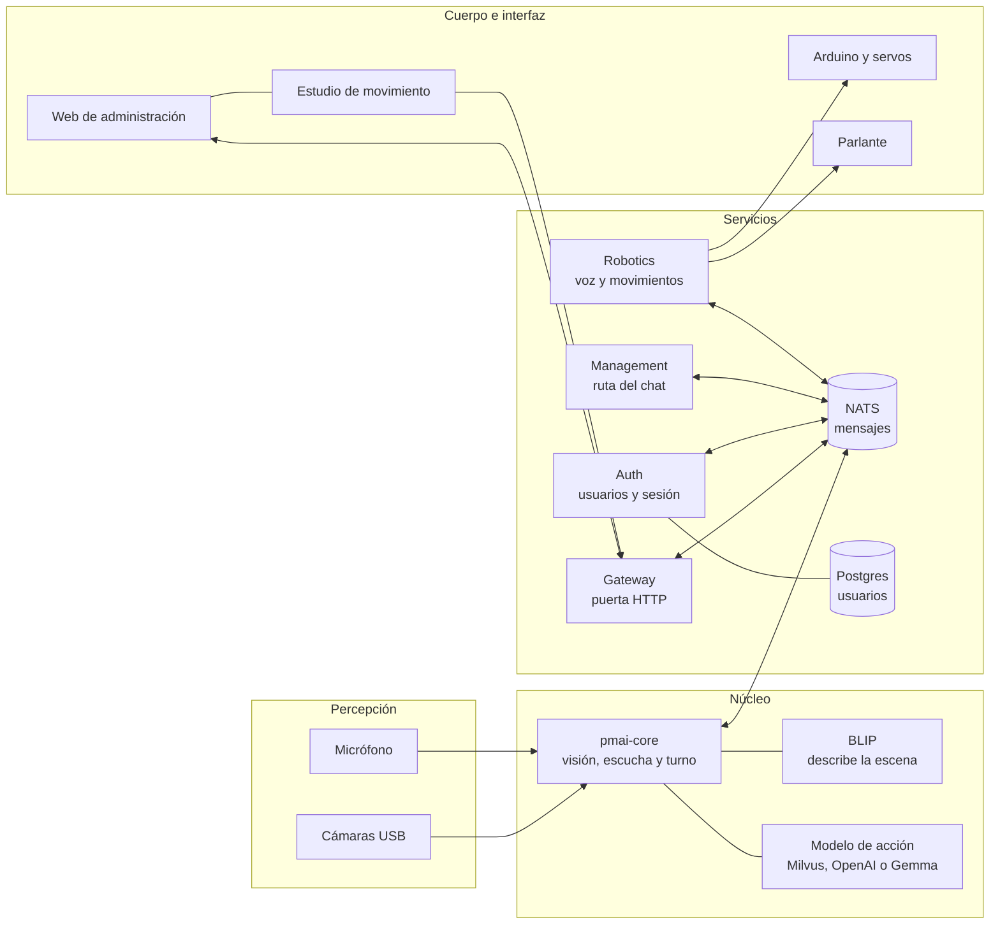
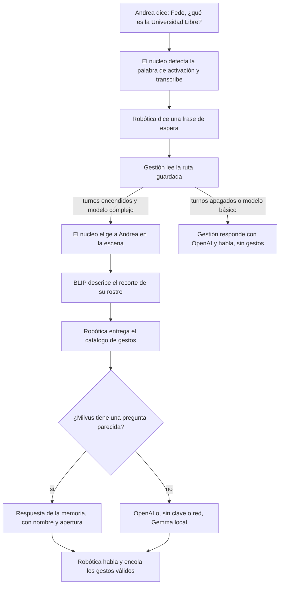

# R-ONE: documentación integral

Semillero de investigación Prometeo · Facultad de Ingeniería · Universidad Libre, seccional Bogotá

Este documento explica R-ONE de principio a fin: qué es, cómo está construido, cómo viaja una pregunta desde que alguien la dice hasta que el robot responde y gesticula, cómo se despliega y qué historia de investigación hay detrás. Está pensado como el único material que necesita una persona que llega al proyecto, ya sea para operarlo, para evaluarlo o para seguir desarrollándolo.

Reemplaza a la memoria académica *Documentación del Proyecto: Inteligencia Artificial Multimodal y Robótica Autónoma*, que ahora vive como referencia histórica en `docs/project-docs/archivo/`. Todo su contenido está aquí: lo que sigue vigente se integra en el cuerpo del texto y lo que ya cambió se cuenta en la [Parte VI](#parte-vi-evolución-e-investigación). Cuando la memoria y el código no coinciden, este documento sigue al código, y la tabla [Versión documentada](#versión-documentada) dice exactamente qué versión de cada repositorio se leyó para escribirlo.

## Cómo leer este documento

No hace falta leerlo de corrido. Está organizado por capas: cada parte supone un poco más de contexto técnico que la anterior, de modo que cada lector puede detenerse donde ya tenga lo que necesita.

| Si eres… | Lee | Puedes saltarte |
|---|---|---|
| Visitante, directivo o evaluador | Parte I y Parte V | Partes II, III y anexos |
| Operador del robot en un evento | Parte I y Parte IV | Parte III |
| Desarrollador que se suma al equipo | Partes I, II y III, y los anexos | Parte V, si no tocas la interfaz |
| Investigador que retoma un modelo | Parte I y Parte VI, y la ficha del repositorio en la Parte III | Parte IV |

Algunas convenciones se repiten en todo el texto:

- Las rutas de archivo se escriben siempre desde la raíz del lanzador, por ejemplo `pmai-mai-core/settings.toml`. Así se pueden abrir directamente desde la carpeta `pba-launcher`.
- Los nombres que vienen del código (funciones, mensajes, variables) aparecen en `letra de código` y tal como están escritos en el programa, aunque mezclen inglés y español.
- Cuando algo no se pudo comprobar en el código, el texto lo dice con la fórmula "pendiente de confirmar" seguida del motivo. Ningún dato de este documento es una suposición presentada como hecho.
- Los diagramas están dibujados en Mermaid dentro del propio archivo, por lo que GitHub, GitLab o el editor los muestran sin herramientas adicionales. Las figuras con imagen vienen de la memoria académica y están en `docs/project-docs/assets/`.

## Versión documentada

| Repositorio | Rama | Commit | Fecha |
|---|---|---|---|
| `pba-launcher` | main | `28900f3` | 2026-11-05 |
| `pmas-web-main` | dev | `8e3c3fb` | 2026-10-27 |
| `pba-ms-gateway` | dev | `3f38ec9` | 2026-10-19 |
| `pba-ms-auth` | dev | `4c4802a` | 2026-10-14 |
| `pba-ms-management` | dev | `d70503c` | 2026-10-27 |
| `pba-ms-robotics` | dev | `05a6e16` | 2026-10-27 |
| `pmai-mai-core` | dev | `e0452ed` | 2026-10-27 |
| `pmai-model-context` | dev | `400ec0d` | 2026-10-09 |
| `pmai-model-vision-language` | dev | `b9042c9` | 2026-10-31 |
| `pmai-model-vision` | dev | `5bbccd6` | 2026-08-27 |
| `pmas-web-motion-studio` | dev | `259451a` | 2026-10-17 |
| `pba-arduino-codes` | dev | `2e9454f` | 2026-04-14 |

## Tabla de contenido

<!-- toc:inicio -->
- [Cómo leer este documento](#cómo-leer-este-documento)
- [Versión documentada](#versión-documentada)
- [Parte I. Entender R-ONE](#parte-i-entender-r-one)
  - [1. Qué es R-ONE y por qué existe](#1-qué-es-r-one-y-por-qué-existe)
  - [2. El sistema en una página](#2-el-sistema-en-una-página)
  - [3. Recorrido de una pregunta](#3-recorrido-de-una-pregunta)
  - [4. Conceptos clave](#4-conceptos-clave)
- [Parte II. Arquitectura y flujos](#parte-ii-arquitectura-y-flujos)
  - [5. Mapa de servicios](#5-mapa-de-servicios)
  - [6. Flujos](#6-flujos)
  - [7. Datos y persistencia](#7-datos-y-persistencia)
- [Parte III. Repositorios](#parte-iii-repositorios)
  - [8. Cómo leer una ficha](#8-cómo-leer-una-ficha)
  - [9. pba-launcher](#9-pba-launcher)
  - [10. pmas-web-main](#10-pmas-web-main)
  - [11. pba-ms-gateway](#11-pba-ms-gateway)
  - [12. pba-ms-auth](#12-pba-ms-auth)
  - [13. pba-ms-management](#13-pba-ms-management)
  - [14. pba-ms-robotics](#14-pba-ms-robotics)
  - [15. pmai-mai-core](#15-pmai-mai-core)
  - [16. pmai-model-context](#16-pmai-model-context)
  - [17. pmai-model-vision-language](#17-pmai-model-vision-language)
  - [18. pmai-model-vision](#18-pmai-model-vision)
  - [19. pmas-web-motion-studio](#19-pmas-web-motion-studio)
  - [20. pba-arduino-codes](#20-pba-arduino-codes)
- [Parte IV. Despliegue y operación](#parte-iv-despliegue-y-operación)
  - [21. Requisitos y configuración](#21-requisitos-y-configuración)
  - [22. Arranque local y en red local](#22-arranque-local-y-en-red-local)
  - [23. La Jetson Orin Nano](#23-la-jetson-orin-nano)
  - [24. Solución de problemas](#24-solución-de-problemas)
- [Parte V. Producto e identidad visual](#parte-v-producto-e-identidad-visual)
  - [25. Para quién es la interfaz](#25-para-quién-es-la-interfaz)
  - [26. Principios y voz](#26-principios-y-voz)
  - [27. Paleta, tipografía y accesibilidad](#27-paleta-tipografía-y-accesibilidad)
- [Parte VI. Evolución e investigación](#parte-vi-evolución-e-investigación)
  - [28. Stakeholders e hitos](#28-stakeholders-e-hitos)
  - [29. El detector de objetos](#29-el-detector-de-objetos)
  - [30. El modelo contextual](#30-el-modelo-contextual)
  - [31. El modelo de acción](#31-el-modelo-de-acción)
  - [32. La primera interfaz y las decisiones descartadas](#32-la-primera-interfaz-y-las-decisiones-descartadas)
- [Anexos](#anexos)
  - [Anexo A. Glosario](#anexo-a-glosario)
  - [Anexo B. Variables de entorno](#anexo-b-variables-de-entorno)
  - [Anexo C. Patrones NATS](#anexo-c-patrones-nats)
  - [Anexo D. Endpoints HTTP del gateway](#anexo-d-endpoints-http-del-gateway)
  - [Anexo E. Índice de figuras y diagramas](#anexo-e-índice-de-figuras-y-diagramas)
<!-- toc:fin -->

## Parte I. Entender R-ONE

> Esta parte es para cualquier lector. No supone conocimientos de programación: explica qué es R-ONE, qué hace hoy y cómo recorre una pregunta, y cierra con los conceptos técnicos que el resto del documento usa, cada uno con un ejemplo cotidiano.

### 1. Qué es R-ONE y por qué existe

#### 1.1 El semillero Prometeo

R-ONE es un androide de tamaño humano construido por el semillero de investigación Prometeo, de la Facultad de Ingeniería de Sistemas de la Universidad Libre, sede El Bosque, en Bogotá. Su cuerpo parte del diseño abierto InMoov (de ahí el nombre del firmware, `Inmoov_control2.ino`): una cabeza con ojos, párpados y cejas móviles, un cuello, un torso y brazos con manos, todos movidos por servomotores. A ese cuerpo el semillero le añadió cámaras, un micrófono, un parlante y un miniPC que corre todo el software.

El proyecto nació con una idea sencilla: acercar a toda la comunidad de la universidad a los robots humanoides y, de paso, automatizar tareas repetitivas como orientar a un visitante o contestar preguntas generales sobre la institución. Con el tiempo se convirtió también en un ecosistema de software propio del semillero, con una aplicación web para administrarlo y un estudio para diseñar sus movimientos.

La memoria académica que este documento reemplaza la firmaron Johel Arias, Andrea López, Anyi Becerra, Daniela Fierro y Evelin Sánchez. Además de ellos, el semillero tiene más integrantes; de hecho, las 25 personas que el detector de rostros sabe reconocer son miembros del semillero (ver [29.3](#293-análisis-del-dataset)).

#### 1.2 Objetivos del proyecto

El objetivo general, tal como lo formuló la memoria, era diseñar e implementar un sistema de inteligencia artificial multimodal capaz de interactuar en tiempo real con personas reconocibles, construir la arquitectura de servidores que ejecuta los movimientos del androide e integrar las aplicaciones del semillero en un mismo ecosistema.

Ese objetivo se desglosó en objetivos específicos. La tabla los resume y, a la derecha, dice en qué punto están según el código de noviembre de 2026.

| Objetivo específico | Estado actual |
|---|---|
| Reidentificación multicámara: dar un identificador global único a cada persona aunque pase de una cámara a otra | Implementado en `pmai-mai-core` con OSNet; ver [4.4](#44-detección-seguimiento-y-reidentificación) |
| Usar un modelo preentrenado que convierta lo que se ve en lenguaje natural | Implementado con BLIP base en `pmai-model-context` |
| Integrar un modelo visión-lenguaje compacto que interprete ese contexto | Cumplido de otra manera: en lugar de un modelo visión-lenguaje, un modelo de lenguaje (OpenAI o Gemma local) recibe la descripción de BLIP |
| Motor de decisión que traduzca la interpretación en acciones | Implementado: el modelo elige hasta tres gestos del catálogo vivo de robótica |
| Interacción verbal por síntesis de voz | Implementado en `pba-ms-robotics` (OpenAI TTS, Piper o eSpeak) |
| Arquitectura de servidores para mover el hardware por Arduino | Implementado en `pba-ms-robotics` y el firmware `pba-arduino-codes` |
| Integrar el sistema inteligente con esa arquitectura | Implementado mediante NATS; ver [6.3](#63-chat-por-la-ruta-complejo-el-turno) |
| Sistema web de gestión y administración del semillero y del robot | Implementado en `pmas-web-main`, con el estudio `pmas-web-motion-studio` incrustado |
| Entrenamiento automático del detector a partir de la aplicación móvil | Pendiente: no existe aplicación móvil en el lanzador y el detector se entrena a mano en `pmai-model-vision` |

#### 1.3 Qué puede hacer R-ONE hoy

Dicho en una frase, R-ONE ve, reconoce, escucha, responde con voz y puede gesticular. A continuación se detalla cada capacidad con la precisión que el resto del documento sostiene.

R-ONE **ve** con una o varias cámaras USB conectadas al miniPC. En cada cuadro busca rostros con un detector entrenado por el semillero y, cuando reconoce a alguien, lo sigue dentro de esa cámara y le asigna una identidad global que se mantiene aunque la persona aparezca en otra cámara. Desde la interfaz web cualquier operador ve en vivo lo que ven las cámaras, con un recuadro y el nombre de cada persona.

R-ONE **escucha** de forma continua por un micrófono. No reacciona a cualquier ruido: espera a oír su nombre de activación, "Fede" (también acepta "hey fede" y "federico"), y entonces graba la frase completa hasta que la persona deja de hablar. Mientras piensa la respuesta dice una frase corta del tipo "Déjame pensarla un momentico", para que el silencio no parezca un fallo.

R-ONE **responde** combinando tres fuentes. Primero busca en su memoria (una base de datos de preguntas y respuestas sobre la universidad); si no encuentra nada parecido, le pregunta a un modelo de lenguaje en la nube (OpenAI) y, si no hay internet o clave, a un modelo que corre en el propio miniPC (Gemma). La respuesta se personaliza: si sabe quién pregunta, lo llama por su nombre, y si la cámara ve algo útil (por ejemplo, un grupo de personas), lo menciona.

R-ONE **habla** por un parlante, que puede ser Bluetooth, con una voz sintética. También puede **gesticular**: tiene un catálogo de secuencias de movimiento (un saludo, un guiño, un gesto de sorpresa) creadas por el equipo en un estudio web, y el modelo puede elegir hasta tres para acompañar la respuesta.

Por último, la **aplicación web** permite iniciar sesión, administrar usuarios, ver las cámaras, conversar con el robot por chat, lanzar gestos a mano, crear secuencias y decidir si el chat usa la ruta sencilla o la ruta completa con visión y gestos (ver [6.2](#62-chat-por-la-ruta-básico) y [6.3](#63-chat-por-la-ruta-complejo-el-turno)).

Hay, sin embargo, una salvedad importante sobre el estado de noviembre de 2026. Las 31 secuencias que hay hoy en robótica no tienen descripción, y robótica solo ofrece al modelo las secuencias con una descripción de al menos diez caracteres (`pba-ms-robotics/src/sequence/ingest.py:54`). En consecuencia, el catálogo que recibe el modelo está vacío y, aunque la arquitectura completa funciona, el robot responde sin mover el cuerpo en el turno. Los gestos sí se pueden lanzar a mano desde la interfaz. La [sección 24](#24-solución-de-problemas) explica cómo corregirlo guardando de nuevo cada secuencia con su descripción desde el estudio.

### 2. El sistema en una página

El diagrama siguiente resume R-ONE en cuatro bloques. A la izquierda está la **percepción**: las cámaras y el micrófono. En el centro, el **núcleo** (`pmai-core`), que es el proceso que interpreta lo que llega y arma cada respuesta. Arriba a la derecha, los **servicios** de apoyo: la puerta de entrada de la web, la autenticación, la gestión del chat, la robótica y las dos piezas de infraestructura que los conectan, una base de datos Postgres y un servidor de mensajes NATS. Abajo a la derecha, lo que la gente ve y oye: el **cuerpo** (Arduino y servos), el **parlante** y las **interfaces web**.

Leído de izquierda a derecha, el recorrido es el siguiente. Las cámaras alimentan continuamente al núcleo, que reconoce a las personas y guarda la última imagen de cada cámara. El micrófono también entrega audio al núcleo, que detecta el nombre de activación y transcribe la pregunta. A partir de ahí, la pregunta no va directa al modelo: pasa primero por el servicio de gestión (management), que decide si se responde por la ruta sencilla o por la ruta completa. En la ruta completa, el núcleo junta todo lo que sabe de la escena, le pide a BLIP una descripción de la persona, consulta el catálogo de gestos en robótica y le pasa todo al modelo de acción. La respuesta vuelve a robótica, que la dice por el parlante y ejecuta los gestos en el Arduino.

Ningún servicio llama directamente a otro. Todos se hablan a través de NATS, que funciona como una central de mensajes (ver [4.2](#42-nats-y-los-patrones-de-mensaje)). La única excepción es la web, que habla por HTTP con el gateway, y este traduce cada petición a un mensaje NATS. Por eso el gateway es la única puerta que el navegador conoce.

La memoria académica incluía un diagrama equivalente, que sigue siendo correcto en lo esencial:

*Figura 1. Arquitectura de alto nivel de R-ONE: la web habla con el gateway y este con cuatro microservicios por NATS, todo dentro del miniPC. Fuente: memoria académica 2026.*

Dos detalles de esa figura ya no se ajustan al código. NATS no usa gRPC, como dice su rótulo: es un protocolo propio en el que los servicios intercambian mensajes JSON. Además, `pmai-mai-core` no es una aplicación FastAPI: no abre ningún puerto HTTP y solo se comunica por NATS (ver la [ficha 15](#15-pmai-mai-core)). La figura tampoco muestra Postgres, el estudio de movimiento ni el Arduino, que sí aparecen en el diagrama de arriba.

### 3. Recorrido de una pregunta

La mejor manera de entender R-ONE es seguir una pregunta de principio a fin. El ejemplo que sigue usa nombres y valores reales del código. Lo único inventado es la situación.

Andrea López, integrante del semillero, se acerca al robot durante una feria y dice: "Fede, ¿qué es la Universidad Libre?".

**La cámara ya la había visto.** Mucho antes de que hablara, la cámara del robot la estaba enviando al núcleo a unos quince cuadros por segundo. Cada tres cuartos de segundo, el núcleo toma el cuadro más reciente de cada cámara y se lo pasa al detector de rostros, un modelo YOLO entrenado por el semillero con fotos de sus integrantes. El detector encierra la cara de Andrea en un recuadro y la etiqueta como `Andrea Lopez` con una confianza de 0,91. Un seguidor sencillo comprueba que ese recuadro se solapa con el del cuadro anterior y concluye que es la misma persona. Cada cinco cuadros, además, un segundo modelo (OSNet) calcula una "huella" numérica de su aspecto y la compara con las que ya conoce; como no la había visto antes, le asigna una identidad global nueva, del estilo `gid_3f9a1c2e`. Si Andrea se moviera frente a otra cámara, esa misma huella permitiría reconocerla como la misma persona.

**El micrófono la oye.** El micrófono también está siempre encendido, pero el núcleo no transcribe todo lo que oye. Primero filtra por volumen, para no gastar cálculo en el silencio, y luego pasa el audio a un reconocedor de voz (Vosk) que solo sabe distinguir las palabras de activación. Cuando oye "Fede", abre un segundo reconocedor, este sí de vocabulario libre, y empieza a grabar. Un detector de actividad de voz decide que Andrea terminó cuando lleva 1,6 segundos en silencio. El resultado es el texto "fede qué es la universidad libre".

**El robot avisa que está pensando.** Como la frase tiene más de catorce caracteres, el núcleo le pide a robótica que diga una frase de espera, por ejemplo "Déjame pensarla un momentico.", y envía la pregunta al servicio de gestión mediante el mensaje `MANAGEMENT_MS.chatService.chat`.

**Gestión elige la ruta.** El servicio de gestión lee un pequeño archivo de configuración (`pba-ms-management/data/chat-route.json`) donde el operador dejó guardada la elección del chat. Ese día están activados los turnos y el modelo elegido es "complejo", así que gestión no responde por su cuenta: reenvía la pregunta al núcleo con el mensaje `MAI_CORE_MS.interactionService.ask`.

**El núcleo arma el turno.** Lo primero que hace el núcleo es asegurarse de que no hay otro turno en curso: atiende una pregunta a la vez. Después elige a la persona de la escena con mayor confianza, que es Andrea. Toma el último cuadro de la cámara que la ve, recorta su recuadro, lo guarda como imagen JPEG y se lo pasa a BLIP, un modelo que describe imágenes. BLIP responde en inglés algo como "a woman with glasses standing in front of a robot". A continuación, el núcleo le pide a robótica el catálogo de gestos disponibles (`ROBOTICS_MS.actionService.getActions`).

**El modelo de acción busca primero en su memoria.** Con todo eso, el núcleo llama a la función `responder()` de `pmai-model-vision-language/utils/main.py`. Esta convierte la pregunta en un vector de 384 números que representa su significado y lo busca en Milvus, una base de datos de vectores. En la colección `conocimiento` hay 244 preguntas sobre la universidad cargadas por el semillero y una de ellas se parece mucho: la distancia entre ambas es menor que el umbral de 0,35, así que cuenta como acierto. Como la respuesta viene de la memoria, no se llama a ningún modelo de lenguaje y la respuesta tarda milisegundos.

**La respuesta se personaliza.** Antes de devolverla, `responder()` antepone el nombre de Andrea y, si la descripción de BLIP se parece a alguna situación conocida (por ejemplo, alguien que parece buscar orientación), añade una frase de apertura. El resultado se parece a "Andrea, la Universidad Libre es una institución de educación superior colombiana fundada en 1923…". Si la respuesta guardada trae gestos, solo se conservan los que estén en el catálogo que robótica entregó en esta misma llamada, con un máximo de tres.

**El robot habla y gesticula.** El núcleo le pide a robótica que diga la respuesta (`ROBOTICS_MS.voiceService.speak`) y, mientras habla, le pide ejecutar cada gesto (`ROBOTICS_MS.actionService.executeAction`). Robótica sintetiza la voz y la envía al parlante. Por cada gesto, encola cuatro pasos: el movimiento, un segundo de espera, el regreso a la postura de descanso (el "neutro") y otro segundo de espera. El núcleo no espera a que los gestos terminen.

**La pantalla registra la respuesta.** Si en lugar de hablar Andrea hubiera escrito la pregunta en el chat de la web, el navegador habría recibido `{ reply, fuente, movimientos }`. En este caso, `fuente` valdría `caché`, porque la respuesta salió de la memoria, y `movimientos` listaría los gestos ejecutados.

El recorrido completo cabe en este diagrama, que la [sección 6.3](#63-chat-por-la-ruta-complejo-el-turno) vuelve a dibujar con todos sus detalles técnicos.

Dos variaciones ayudan a fijar la idea. Si Andrea hubiera preguntado algo que nadie había preguntado antes, como "¿qué opinas del clima de hoy?", Milvus no habría encontrado nada parecido. En ese caso, `responder()` construye un prompt con su nombre, la descripción de BLIP, la pregunta y la tabla de gestos, y se lo envía a OpenAI (`gpt-4o-mini`); si no hay clave o la llamada falla, lo resuelve Gemma en el miniPC. La respuesta nueva se guarda en la colección `interacciones`, sin el nombre de Andrea, para que la próxima vez que alguien pregunte exactamente lo mismo salga de la memoria. Si, en cambio, el operador hubiera dejado el chat en la ruta "básico", gestión le habría preguntado directamente a OpenAI, habría pedido a robótica que dijera la respuesta y el robot no habría usado ni la cámara ni los gestos.

### 4. Conceptos clave

#### 4.1 Microservicios y gateway

Un **microservicio** es un programa pequeño que se encarga de una sola responsabilidad y se comunica con los demás a través de la red, en lugar de vivir todo dentro de una sola aplicación. Se parece a un restaurante con estaciones: la cocina, la barra y la caja son equipos distintos que se pasan comandas; si la barra se satura, la cocina sigue funcionando, y se puede cambiar al cajero sin cerrar el restaurante.

R-ONE tiene siete servicios propios, además de la base de datos y el servidor de mensajes. Cada uno vive en su propio repositorio y en su propio contenedor Docker: `pba-ms-auth` se ocupa de usuarios y sesiones; `pba-ms-management`, del chat; `pba-ms-robotics`, de la voz y el cuerpo; `pmai-mai-core`, de la percepción y el turno; `pmas-web-main`, de la interfaz; `pmas-web-motion-studio`, del estudio de movimientos; y `pba-ms-gateway`, de la puerta de entrada que se describe a continuación. La ventaja práctica es que cada equipo del semillero puede trabajar en su pieza sin romper las demás, y que un fallo en el reconocimiento de voz no tumba el inicio de sesión.

El **gateway** (`pba-ms-gateway`) es la recepción del edificio. El navegador no conoce las direcciones internas de los servicios y tampoco debería: toda petición HTTP entra por el gateway, que comprueba la sesión y los permisos, la traduce a un mensaje y la envía al servicio que corresponde. De ese modo, la seguridad se revisa en un solo lugar.

En R-ONE: el gateway escucha en el puerto 3000 y su punto de entrada es `pba-ms-gateway/src/main.ts`. La lista completa de rutas está en el [Anexo D](#anexo-d-endpoints-http-del-gateway). Para profundizar en el patrón, la documentación de NestJS sobre [microservicios](https://docs.nestjs.com/microservices/basics) explica exactamente el modelo que usan el gateway, auth y management.

#### 4.2 NATS y los patrones de mensaje

**NATS** es un servidor de mensajería: un programa por el que pasan todos los mensajes entre servicios. Funciona como un conmutador telefónico de oficina. Cada servicio se registra con unas "extensiones", que en NATS se llaman *sujetos*, y quien quiere algo marca la extensión sin saber en qué computador vive el otro servicio. Si nadie contesta, el que llama recibe un error al agotarse el tiempo de espera.

Los sujetos de R-ONE siguen la convención de NestJS, `SERVICIO.servicioInterno.método`. Por ejemplo, `ROBOTICS_MS.voiceService.speak` es "la función `speak` del servicio de voz de robótica". Casi todas las llamadas son de tipo **petición-respuesta**: quien llama envía `{ pattern, data, id }` y espera una respuesta `{ response, isDisposed }`, o `{ err }` si algo salió mal. El núcleo también publica **eventos** sin esperar respuesta (`pmai.detection` y `pmai.reid`), aunque hoy ningún servicio se suscribe a ellos.

La ventaja frente a que cada servicio llame a los demás por HTTP es que NATS desacopla a quien llama de quien responde. Por eso un servicio en Python (robótica o el núcleo) puede atender a uno en TypeScript (el gateway) sin que ninguno sepa en qué lenguaje está escrito el otro. Basta con que ambos respeten la forma del mensaje.

En R-ONE: el servidor es el contenedor `nats-server` (imagen `nats:2.12.5-alpine3.22`), escucha en el puerto 4222 dentro de la red de Docker y publica su monitor en el 8222. Los servicios Python imitan el formato de NestJS en `pba-ms-robotics/src/core/nats/nest_request.py` y `pmai-mai-core/src/pmai_core/core/nats/nats_client.py`. El catálogo completo de sujetos está en el [Anexo C](#anexo-c-patrones-nats). Referencia externa: [documentación de NATS](https://docs.nats.io/nats-concepts/core-nats/reqreply).

#### 4.3 Sesión y JWT

Para usar la web hay que iniciar sesión. Cuando el usuario y la contraseña son correctos, el servidor entrega un **JWT** (JSON Web Token): un texto firmado que dice quién es el usuario y qué roles tiene. Es como la manilla de un evento: en la entrada verifican la identidad una vez y, a partir de ahí, basta con mostrar la manilla en cada puerta, sin volver a enseñar la cédula. La firma impide falsificarla, porque solo el servidor conoce la clave con la que se firmó.

En R-ONE el token tiene dos particularidades que conviene conocer. La primera es que cada usuario tiene una sola sesión activa: iniciar sesión en un teléfono cierra la que estuviera abierta en el portátil, que entonces muestra "Tu sesión venció. Entra de nuevo.". La segunda es que, además del token, cada petición lleva la cabecera `X-Active-Role` con el identificador del rol con el que se está trabajando (ADMIN o USER), porque un usuario puede tener varios.

En R-ONE: el token lo emite `pba-ms-auth` y lo valida el gateway con su estrategia JWT en `pba-ms-gateway/src/auth/strategies`; la web lo guarda y lo adjunta en su interceptor de `pmas-web-main/src/app/core/interceptors`. El flujo completo está en [6.1](#61-inicio-de-sesión). Referencia externa: [introducción a JWT](https://jwt.io/introduction).

#### 4.4 Detección, seguimiento y reidentificación

Reconocer a alguien en video implica tres problemas distintos, que R-ONE resuelve con tres piezas.

La **detección** responde a la pregunta "¿qué hay en esta imagen y dónde?". Un detector mira un cuadro y devuelve recuadros con una etiqueta y una confianza. El de R-ONE es un modelo YOLO entrenado por el semillero cuyas 25 etiquetas son los nombres de sus integrantes, así que no detecta "una persona" en general, sino "Andrea López" o "Johel Arias". Si nadie supera una confianza de 0,5, no hay detección.

El **seguimiento** responde a "¿esta persona es la misma que estaba aquí hace un instante?". El seguidor compara cada recuadro nuevo con los del cuadro anterior en la misma cámara y, si se solapan lo suficiente, los une en una misma pista. Es lo que hacemos al seguir con la vista a alguien que camina: no necesitamos reconocerle la cara en cada paso.

La **reidentificación** (ReID) responde a "¿esta persona que aparece en la cámara 2 es la misma que vi en la cámara 1?". Para eso, un segundo modelo convierte la imagen de la persona en una huella numérica (512 valores, según la documentación del modelo) que resume su aspecto (ropa, colores, silueta). Dos huellas parecidas indican que se trata de la misma persona, aunque haya cambiado de cámara o de ángulo. Es lo que hace un portero que reconoce por la chaqueta a alguien que entró por otra puerta. Cada persona recibe así un `id_global`, como `gid_3f9a1c2e`, que se conserva mientras el núcleo esté encendido.

En R-ONE: el detector es `pmai-mai-core/src/pmai_core/models/my_model.pt` (YOLO11s), el seguidor está en `pmai-mai-core/src/pmai_core/resources/vision/tracker.py` y la reidentificación usa `pmai-mai-core/src/pmai_core/models/osnet_x0_25_msmt17.onnx`, con una similitud mínima de 0,6. Todo lo orquesta `pmai-mai-core/src/pmai_core/resources/identification/service.py`. Referencias externas: [Ultralytics YOLO](https://docs.ultralytics.com/) y [OSNet en torchreid](https://kaiyangzhou.github.io/deep-person-reid/).

#### 4.5 Descripción de escena

Saber que la persona es Andrea no dice nada de lo que está haciendo. Para eso R-ONE usa un modelo de **descripción de imágenes** (image captioning): recibe una foto y devuelve una frase que la describe. Funciona como un narrador para personas ciegas que, al ver la imagen, dice "una mujer con gafas de pie frente a un robot".

El modelo es BLIP en su versión base, publicado por Salesforce. Escribe en inglés, y eso no es un problema: la frase no se le muestra a nadie, sino que se entrega como contexto al modelo de lenguaje, que la interpreta y responde en español. Como BLIP a veces inventa detalles (por ejemplo, menciona un lugar o una fecha que no aparecen en la imagen), el semillero añadió filtros que eliminan esas alucinaciones típicas; su historia se cuenta en [30.4](#304-alucinaciones-y-palabras-protegidas).

En R-ONE: el núcleo recorta el recuadro de la persona elegida como JPEG de calidad 85 y llama a `generate_context_from_base64` de `pmai-model-context/model_context/context.py`. Si BLIP falla, el turno sigue sin contexto visual. Referencia externa: [BLIP en Hugging Face](https://huggingface.co/Salesforce/blip-image-captioning-base).

#### 4.6 Embeddings y búsqueda vectorial

Un **embedding** es una lista de números que representa el significado de un texto. El truco está en que textos con significados parecidos producen listas parecidas, aunque no compartan palabras. Se puede imaginar como unas coordenadas en un mapa de significados: "¿dónde queda la universidad?" y "¿en qué parte está la U?" caen muy cerca, mientras que "¿qué es un gato?" cae lejos.

R-ONE usa el modelo `paraphrase-multilingual-MiniLM-L12-v2`, que entiende español y convierte cada pregunta en 384 números. Comparar dos preguntas se reduce entonces a medir el ángulo entre sus vectores (distancia coseno): cuanto más pequeño, más se parecen. Una **base de datos vectorial** es una base de datos optimizada para responder rápido "¿cuál es el vector guardado más cercano a este?", incluso con millones de registros. R-ONE usa Milvus Lite, la versión de Milvus que corre dentro del propio proceso y guarda todo en un archivo, sin servidor aparte.

En R-ONE: el codificador está en `pmai-model-vision-language/utils/encoder/encoder.py`, la búsqueda en `pmai-model-vision-language/utils/milvus/busqueda.py` y la base en `pmai-model-vision-language/utils/milvus/androide_milvus.db`. Las colecciones y sus umbrales se detallan en [7.2](#72-milvus-lite). Referencias externas: [Sentence Transformers](https://www.sbert.net/) y [Milvus Lite](https://milvus.io/docs/milvus_lite.md).

#### 4.7 Caché semántico

Un caché guarda respuestas ya calculadas para no repetir el trabajo. Uno normal solo acierta si la pregunta es idéntica; uno **semántico** acierta si la pregunta *significa* lo mismo. Milvus funciona como un archivo que no busca por palabras exactas, sino por parecido de significado: si alguien ya preguntó "¿dónde queda la universidad?", la pregunta "¿en qué parte está la U?" encuentra esa respuesta sin llamar a ningún modelo.

R-ONE tiene dos memorias con reglas distintas, y la diferencia es deliberada. La colección `conocimiento` contiene preguntas y respuestas verificadas por el semillero, así que basta con que la pregunta nueva se parezca lo suficiente (distancia menor que 0,35, o 0,28 si la pregunta pide un dato concreto). La colección `interacciones`, en cambio, guarda respuestas que generó un modelo de lenguaje y que nadie revisó. Por eso solo se reutilizan si la pregunta coincide de forma estricta: igual al texto guardado, o contenida en él con al menos tres palabras. Así se evita que una respuesta improvisada se reparta a preguntas que solo se parecen.

El caché tiene dos beneficios visibles. Las respuestas de la memoria salen casi al instante, mientras que Gemma en el miniPC puede tardar varios segundos. Además, no gastan créditos de la API de OpenAI.

En R-ONE: `responder()` consulta primero `conocimiento` y luego `interacciones` (`pmai-model-vision-language/utils/main.py`); cuando acierta, la pantalla muestra `fuente: caché`. El paso a paso está en la [ficha 17](#17-pmai-model-vision-language).

#### 4.8 Modelo local frente a modelo en la nube

Cuando la memoria no tiene la respuesta, R-ONE necesita un **modelo de lenguaje** (LLM) que la redacte. Puede usar dos, y la elección es un equilibrio entre calidad y autonomía. Es como elegir entre llamar a un experto por teléfono o resolverlo con la calculadora de bolsillo: el experto sabe más, pero hace falta línea y cuesta; la calculadora siempre está ahí, aunque haga menos.

El modelo en la nube es `gpt-4o-mini` de OpenAI: responde bien y rápido, pero necesita una clave de API, conexión a internet y presupuesto. El modelo local es Gemma 4 E2B, de Google, en un archivo GGUF de unos 3 GB que corre en el procesador del miniPC con `llama-cpp-python`. No depende de nada externo, pero es más lento y menos preciso. R-ONE intenta primero OpenAI si tiene clave y, si la llamada falla por cualquier motivo (sin red, clave inválida o cuota agotada), cae a Gemma sin que el usuario lo note, más allá de la `fuente` que muestra la pantalla: `OpenAI` o `Gemma (local)`.

En R-ONE: el enrutador está en `pmai-model-vision-language/utils/gpt/gptapi.py` y Gemma en `pmai-model-vision-language/utils/gguf/ggufapi.py`. El archivo del modelo vive en `pmai-model-vision-language/models/gguf/` y se descarga solo, desde `unsloth/gemma-4-E2B-it-GGUF`, la primera vez que hace falta. Referencias externas: [llama.cpp](https://github.com/ggml-org/llama.cpp) y [Gemma](https://ai.google.dev/gemma).

#### 4.9 Secuencias, bloques y el par normal y neutro

Un gesto de R-ONE es una **secuencia**: una partitura de movimientos para varios servos a lo largo del tiempo. Cada nota de esa partitura es un **bloque**, que dice "en el segundo 0,4, lleva el servo 3 de la placa 2 a tal posición, a tal velocidad". Las secuencias se diseñan en el estudio de movimiento grabando posiciones del robot real y quedan guardadas como archivos JSON en robótica, con un número de identificación (`id`), un nombre, una categoría y una descripción.

Cada secuencia viene en **par**: la versión normal (los `blocks`) y su versión neutra (los `blocks_neutro`), que devuelve cada servo a la postura de descanso. Es como hacer un saludo y luego bajar el brazo: si el robot encadenara gestos sin volver al neutro, cada uno empezaría desde la posición en que dejó el anterior y el resultado sería impredecible. Por eso robótica ejecuta siempre normal, espera un segundo, ejecuta el neutro y espera otro segundo.

Para que el modelo de lenguaje pueda elegir un gesto, este tiene que estar en el **catálogo** que robótica entrega en cada turno. Solo entran los pares completos (categoría, normal y neutro) que además tienen una descripción de al menos diez caracteres, porque la descripción es lo que el modelo lee para decidir si el gesto encaja con la respuesta. Un id que no esté en el catálogo de esa llamada se descarta, aunque el modelo lo pida.

En R-ONE: las secuencias viven en `pba-ms-robotics/data/sequences`, la cola de ejecución en `pba-ms-robotics/src/sequence/playback_queue.py` y el filtro del catálogo en `pba-ms-robotics/src/sequence/ingest.py`. El ciclo completo de un gesto está en [6.5](#65-ciclo-de-un-gesto).

## Parte II. Arquitectura y flujos

<!-- pendiente: tarea 9 -->

### 5. Mapa de servicios

#### 5.1 Servicios y puertos

<!-- pendiente: tarea 9 -->

#### 5.2 Canales de comunicación

<!-- pendiente: tarea 9 -->

### 6. Flujos

#### 6.1 Inicio de sesión

<!-- pendiente: tarea 9 -->

#### 6.2 Chat por la ruta Básico

<!-- pendiente: tarea 9 -->

#### 6.3 Chat por la ruta Complejo: el turno

<!-- pendiente: tarea 9 -->

#### 6.4 El micrófono

<!-- pendiente: tarea 9 -->

#### 6.5 Ciclo de un gesto

<!-- pendiente: tarea 9 -->

#### 6.6 Visión en tiempo real

<!-- pendiente: tarea 9 -->

#### 6.7 Creación e ingesta de una secuencia

<!-- pendiente: tarea 9 -->

#### 6.8 Declarar un poema

<!-- pendiente: tarea 9 -->

### 7. Datos y persistencia

#### 7.1 Postgres y Prisma

<!-- pendiente: tarea 9 -->

#### 7.2 Milvus Lite

<!-- pendiente: tarea 9 -->

#### 7.3 Secuencias en JSON

<!-- pendiente: tarea 9 -->

#### 7.4 Ruta del chat

<!-- pendiente: tarea 9 -->

#### 7.5 Modelos de IA en disco

<!-- pendiente: tarea 9 -->

## Parte III. Repositorios

<!-- pendiente: tarea 10 -->

### 8. Cómo leer una ficha

<!-- pendiente: tarea 10 -->

### 9. pba-launcher

<!-- pendiente: tarea 10 -->

### 10. pmas-web-main

<!-- pendiente: tarea 10 -->

### 11. pba-ms-gateway

<!-- pendiente: tarea 10 -->

### 12. pba-ms-auth

<!-- pendiente: tarea 10 -->

### 13. pba-ms-management

<!-- pendiente: tarea 10 -->

### 14. pba-ms-robotics

<!-- pendiente: tarea 10 -->

### 15. pmai-mai-core

<!-- pendiente: tarea 11 -->

### 16. pmai-model-context

<!-- pendiente: tarea 11 -->

### 17. pmai-model-vision-language

<!-- pendiente: tarea 11 -->

### 18. pmai-model-vision

<!-- pendiente: tarea 11 -->

### 19. pmas-web-motion-studio

<!-- pendiente: tarea 11 -->

### 20. pba-arduino-codes

<!-- pendiente: tarea 11 -->

## Parte IV. Despliegue y operación

<!-- pendiente: tarea 12 -->

### 21. Requisitos y configuración

<!-- pendiente: tarea 12 -->

### 22. Arranque local y en red local

<!-- pendiente: tarea 12 -->

### 23. La Jetson Orin Nano

<!-- pendiente: tarea 12 -->

### 24. Solución de problemas

<!-- pendiente: tarea 12 -->

## Parte V. Producto e identidad visual

<!-- pendiente: tarea 13 -->

### 25. Para quién es la interfaz

<!-- pendiente: tarea 13 -->

### 26. Principios y voz

<!-- pendiente: tarea 13 -->

### 27. Paleta, tipografía y accesibilidad

<!-- pendiente: tarea 13 -->

## Parte VI. Evolución e investigación

<!-- pendiente: tarea 13 -->

### 28. Stakeholders e hitos

<!-- pendiente: tarea 13 -->

### 29. El detector de objetos

#### 29.1 Captura y extracción de imágenes

<!-- pendiente: tarea 13 -->

#### 29.2 Etiquetado en Label Studio

<!-- pendiente: tarea 13 -->

#### 29.3 Análisis del dataset

<!-- pendiente: tarea 13 -->

#### 29.4 Limpieza y preprocesamiento

<!-- pendiente: tarea 13 -->

#### 29.5 Entrenamiento y aumento de datos

<!-- pendiente: tarea 13 -->

#### 29.6 Resultados

<!-- pendiente: tarea 13 -->

#### 29.7 Despliegue en mai-core

<!-- pendiente: tarea 13 -->

### 30. El modelo contextual

#### 30.1 Elección del modelo

<!-- pendiente: tarea 13 -->

#### 30.2 Pruebas de BLIP-base y Geospace

<!-- pendiente: tarea 13 -->

#### 30.3 Optimización e inferencia

<!-- pendiente: tarea 13 -->

#### 30.4 Alucinaciones y palabras protegidas

<!-- pendiente: tarea 13 -->

### 31. El modelo de acción

#### 31.1 Fase de análisis

<!-- pendiente: tarea 13 -->

#### 31.2 Ingesta por web scraping

<!-- pendiente: tarea 13 -->

#### 31.3 Búsqueda semántica y caché

<!-- pendiente: tarea 13 -->

#### 31.4 Ingeniería del prompt

<!-- pendiente: tarea 13 -->

#### 31.5 Métricas

<!-- pendiente: tarea 13 -->

### 32. La primera interfaz y las decisiones descartadas

<!-- pendiente: tarea 13 -->

## Anexos

### Anexo A. Glosario

<!-- pendiente: tarea 14 -->

### Anexo B. Variables de entorno

<!-- pendiente: tarea 14 -->

### Anexo C. Patrones NATS

<!-- pendiente: tarea 14 -->

### Anexo D. Endpoints HTTP del gateway

<!-- pendiente: tarea 14 -->

### Anexo E. Índice de figuras y diagramas

<!-- pendiente: tarea 14 -->
